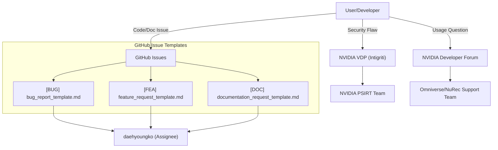
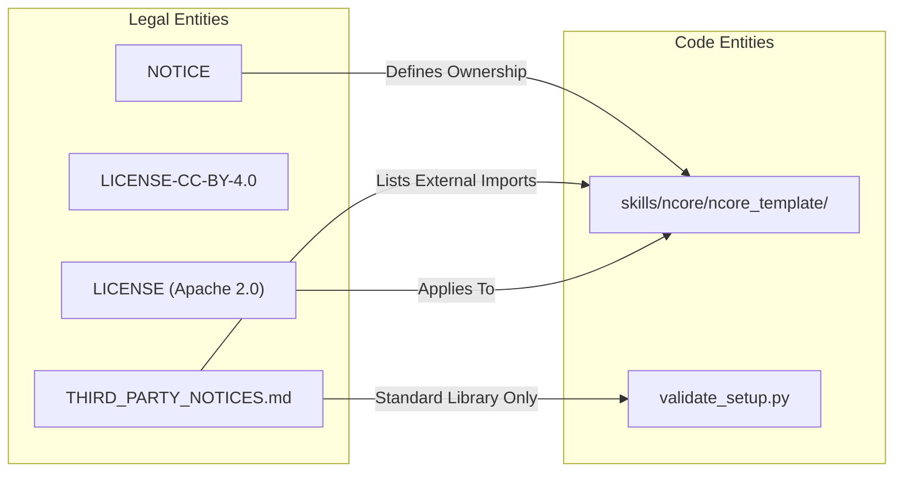

<!-- source: DeepWiki mcp.deepwiki.com · repo NVIDIA/nurec-skills · page 7.2 Security Policy and Issue Reporting · fetched 2026-10-26 -->

# Security Policy and Issue Reporting

Relevant source files

The following files were used as context for generating this wiki page:

- [.github/ISSUE_TEMPLATE/bug_report_template.md](.github/ISSUE_TEMPLATE/bug_report_template.md)
- [.github/ISSUE_TEMPLATE/config.yml](.github/ISSUE_TEMPLATE/config.yml)
- [.github/ISSUE_TEMPLATE/documentation_request_template.md](.github/ISSUE_TEMPLATE/documentation_request_template.md)
- [.github/ISSUE_TEMPLATE/feature_request_template.md](.github/ISSUE_TEMPLATE/feature_request_template.md)
- [LICENSE](LICENSE)
- [LICENSE-CC-BY-4.0](LICENSE-CC-BY-4.0)
- [NOTICE](NOTICE)
- [SECURITY.md](SECURITY.md)
- [THIRD_PARTY_NOTICES.md](THIRD_PARTY_NOTICES.md)

This page outlines the protocols for reporting security vulnerabilities and general issues within the `nurec-skills` repository. NVIDIA maintains a strict separation between security disclosures and functional issue tracking to ensure the safety of its users and infrastructure.

## Security Vulnerability Disclosure

NVIDIA is dedicated to the security and trust of its software products [SECURITY.md:1-3](). All security-related concerns for the NuRec Skills repository must be handled through official NVIDIA security channels.

### Prohibition on GitHub Security Reports
**Do not report security vulnerabilities through GitHub Issues.** [SECURITY.md:5-6](). Publicly disclosing vulnerabilities before a fix is available puts all users at risk.

### Reporting Channels
Potential security vulnerabilities should be submitted via **NVIDIA's Vulnerability Disclosure Program (VDP)** hosted on the Intigriti platform [SECURITY.md:8-11]().

| Channel | Purpose | Link |
| :--- | :--- | :--- |
| **Intigriti VDP** | Reporting specific vulnerabilities in `nurec-skills` code or dependencies. | [NVIDIA VDP](https://app.intigriti.com/programs/nvidia/nvidiavdp/detail) |
| **Product Security Portal** | General security concerns and global NVIDIA security information. | [NVIDIA Product Security](https://www.nvidia.com/en-us/security) |
| **PSIRT Policies** | Detailed information on coordinated disclosure and incident response. | [PSIRT Policies](https://www.nvidia.com/en-us/security/psirt-policies/) |

### Required Information for Security Reports
When submitting to the VDP, include the following details [SECURITY.md:12-14]():
1.  **Affected Component:** Specify the skill path (e.g., `skills/nre`) and the specific commit or version.
2.  **Vulnerability Type:** Categorize the flaw (e.g., Remote Code Execution, Path Traversal).
3.  **Reproduction Instructions:** Clear, step-by-step guide to trigger the issue.
4.  **Proof-of-Concept (PoC):** Material or scripts demonstrating the exploit.
5.  **Potential Impact:** Assessment of how this affects the NuRec pipeline or user data.

**Sources:** [SECURITY.md:1-23]()

---

## Issue Reporting and Feedback

For non-security related items, such as bugs, feature requests, or documentation gaps, users should utilize the GitHub Issue templates. Blank issues are disabled to ensure all reports contain necessary technical context [/.github/ISSUE_TEMPLATE/config.yml:1]().

### Communication Data Flow
The following diagram illustrates how different types of feedback are routed to the appropriate entities.

**Feedback Routing and Data Flow**

**Sources:** [/.github/ISSUE_TEMPLATE/config.yml:1-10](), [/.github/ISSUE_TEMPLATE/bug_report_template.md:1-7](), [/.github/ISSUE_TEMPLATE/feature_request_template.md:1-7](), [/.github/ISSUE_TEMPLATE/documentation_request_template.md:1-7]()

### Issue Templates Reference

The repository provides three structured templates to streamline triage. All templates are automatically assigned to the lead maintainer `daehyoungko` [/.github/ISSUE_TEMPLATE/bug_report_template.md:6]().

#### 1. Bug Reports (`[BUG]`)
Used for reporting reproducible problems with a NuRec skill [/.github/ISSUE_TEMPLATE/bug_report_template.md:2-4]().
*   **Key Fields:** Affected skill path, commit version, agent/runtime (e.g., Codex, Claude Code), and environment details (GPU/CUDA versions) [/.github/ISSUE_TEMPLATE/bug_report_template.md:9-45]().
*   **Constraint:** Users must remove credentials and private data before posting [/.github/ISSUE_TEMPLATE/bug_report_template.md:25-26]().

#### 2. Feature Requests (`[FEA]`)
Used for suggesting improvements to skills or workflows [/.github/ISSUE_TEMPLATE/feature_request_template.md:2-4]().
*   **Key Fields:** Identification of where the new capability fits in the `nurec-index` routing model, upstream dependencies, and acceptance criteria [/.github/ISSUE_TEMPLATE/feature_request_template.md:9-36]().

#### 3. Documentation Requests (`[DOC]`)
Used for reporting incorrect or missing documentation [/.github/ISSUE_TEMPLATE/documentation_request_template.md:2-4]().
*   **Key Fields:** Permalink to the affected file/section and suggested corrections [/.github/ISSUE_TEMPLATE/documentation_request_template.md:9-28]().

### Usage Questions
General "how-to" questions and usage discussions should not be opened as GitHub Issues. These are redirected to the **NVIDIA Developer Forum** under the Omniverse/NuRec category [/.github/ISSUE_TEMPLATE/config.yml:3-9]().

**Sources:** [/.github/ISSUE_TEMPLATE/bug_report_template.md:1-51](), [/.github/ISSUE_TEMPLATE/feature_request_template.md:1-42](), [/.github/ISSUE_TEMPLATE/documentation_request_template.md:1-45](), [/.github/ISSUE_TEMPLATE/config.yml:1-10]()

---

## Third-Party Notices and Licensing

The `nurec-skills` repository is primarily composed of NVIDIA-authored Markdown, helper scripts, and templates [NOTICE:5-7](). 

### Dependency Policy
*   **No Vendoring:** The repository does not vendor or redistribute third-party OSS source code or binary dependencies [THIRD_PARTY_NOTICES.md:3-4]().
*   **External Artifacts:** Workflow instructions may point to external tools or models (e.g., Hugging Face models, Docker containers). These retain their own license terms and are not part of this repository [NOTICE:9-12]().
*   **Templates:** The `skills/ncore/ncore_template/` may import user-installed packages like `numpy` or `universal-pathlib` during execution, but these are not distributed within the repo [THIRD_PARTY_NOTICES.md:18-24]().

### Licensing
The repository is governed by the **Apache License 2.0** [LICENSE:1-200]() and **Creative Commons Attribution 4.0 International** [LICENSE-CC-BY-4.0:1-85]().

**Code-to-Entity Mapping: Licensing and Notices**

**Sources:** [NOTICE:1-12](), [THIRD_PARTY_NOTICES.md:1-24](), [LICENSE:1-10](), [LICENSE-CC-BY-4.0:1-10]()

---

