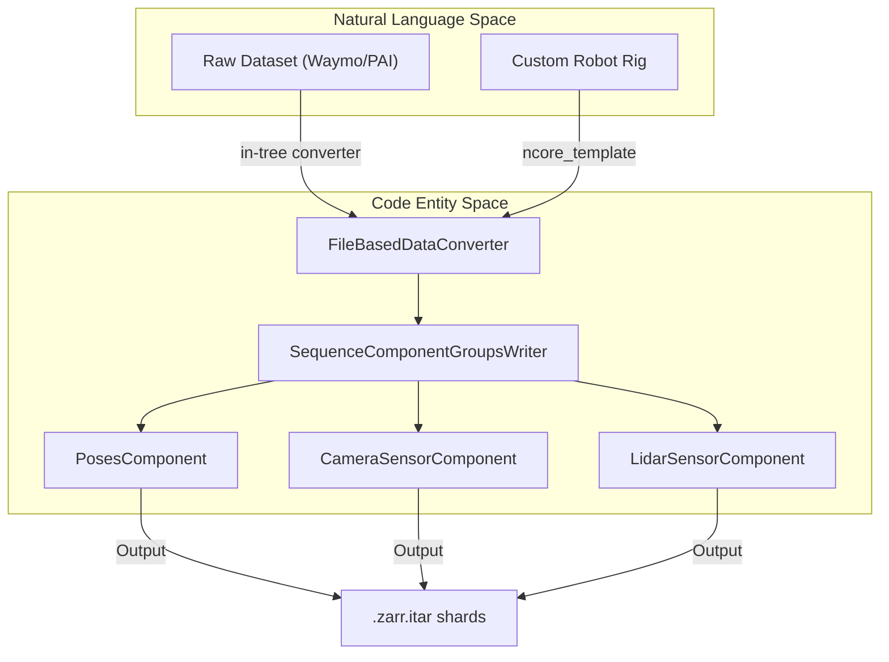
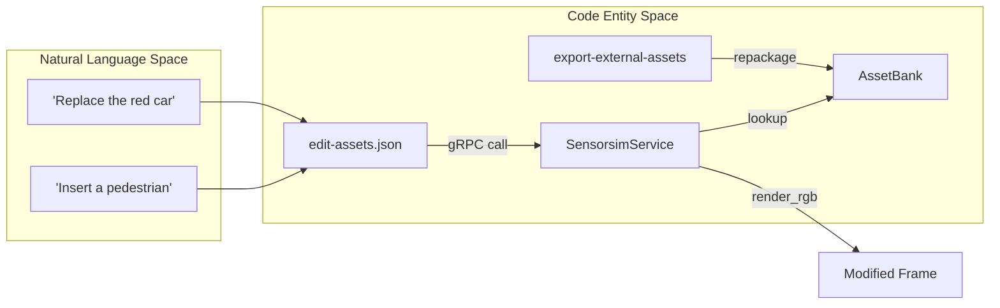

<!-- source: DeepWiki mcp.deepwiki.com · repo NVIDIA/nurec-skills · page 8 Glossary · fetched 2026-10-26 -->

# Glossary

Relevant source files

The following files were used as context for generating this wiki page:

- [README.md](README.md)
- [skills/asset-harvester/SKILL.md](skills/asset-harvester/SKILL.md)
- [skills/asset-harvester/references/cli-reference.md](skills/asset-harvester/references/cli-reference.md)
- [skills/asset-harvester/references/end-to-end-ncore.md](skills/asset-harvester/references/end-to-end-ncore.md)
- [skills/asset-harvester/references/installation.md](skills/asset-harvester/references/installation.md)
- [skills/asset-harvester/references/troubleshooting.md](skills/asset-harvester/references/troubleshooting.md)
- [skills/asset-harvester/references/workflows.md](skills/asset-harvester/references/workflows.md)
- [skills/ncore/SKILL.md](skills/ncore/SKILL.md)
- [skills/ncore/ncore_template/impl/data_converter/example_converter.py](skills/ncore/ncore_template/impl/data_converter/example_converter.py)
- [skills/nre/SKILL.md](skills/nre/SKILL.md)
- [skills/nre/references/asset-editing.md](skills/nre/references/asset-editing.md)
- [skills/nre/references/cli-reference.md](skills/nre/references/cli-reference.md)
- [skills/nre/references/configuration.md](skills/nre/references/configuration.md)
- [skills/nre/references/grpc-api.md](skills/nre/references/grpc-api.md)
- [skills/nre/references/local-render.md](skills/nre/references/local-render.md)
- [skills/nurec-fixer/SKILL.md](skills/nurec-fixer/SKILL.md)
- [skills/nurec-index/SKILL.md](skills/nurec-index/SKILL.md)
- [skills/physical-ai-datasets/SKILL.md](skills/physical-ai-datasets/SKILL.md)

This page provides technical definitions for terms, acronyms, and domain concepts specific to the NuRec Skills codebase. It serves as a bridge between high-level autonomous vehicle (AV) simulation concepts and the specific implementation details found in the `ncore`, `nre`, `asset-harvester`, and `nurec-fixer` skills.

## Core Concepts & Data Structures

### NCore V4
The standardized sensor data format consumed by the NuRec pipeline. It is designed for high-precision robotics and AV data, utilizing a sharded archive structure [skills/ncore/SKILL.md:41-43]().

*   **Store**: A collection of related data shards (e.g., RGB, LiDAR, Poses) representing a single recording session [skills/ncore/SKILL.md:72-75]().
*   **Component Group**: A logical grouping of sensors (e.g., "camera_front_wide") that share a common lifecycle or storage shard [skills/ncore/ncore_template/impl/data_converter/example_converter.py:51-52]().
*   **itar (.zarr.itar)**: An indexed TAR format used by NCore to store Zarr hierarchies. This allows for random access to compressed sensor data while remaining a single-file archive [skills/ncore/SKILL.md:12-13]().

### NRE (Neural Reconstruction Engine)
The engine responsible for training 3D Gaussian reconstructions and rendering novel views [skills/nre/SKILL.md:4-6]().

*   **3DGUT / 3DGRT**: Two flavors of Gaussian Splatting used by NRE. 3DGUT (Gaussian Universal Transformation) is the standard dynamic recipe, while 3DGRT (Gaussian Ray Tracing) is used for ray-traced variants [skills/nurec-index/SKILL.md:152-154]().
*   **USDZ Artifact**: The final output of an NRE training run. It contains the trained Gaussian parameters, the Hydra configuration, and the scene metadata required for rendering [skills/nurec-index/SKILL.md:148-149]().
*   **Rig Trajectory**: A JSON file describing the position and orientation of every sensor over time. NRE uses this to determine where to render frames [skills/nre/references/cli-reference.md:38-39]().

### Asset Harvester
A tool for extracting individual 3D objects (e.g., cars, pedestrians) from AV logs to be re-inserted into other scenes [skills/asset-harvester/SKILL.md:4-7]().

*   **SparseViewDiT**: A multiview diffusion model that generates 16 consistent views of an object from sparse inputs [skills/asset-harvester/SKILL.md:85-87]().
*   **TokenGS**: A feed-forward Gaussian lifting model that converts 2D views into a 3D Gaussian Splat (.ply) [skills/asset-harvester/SKILL.md:87-88]().

### NuRec Fixer (DiffusionHarmonizer)
A post-processing stage that uses a single-step diffusion model to clean up reconstruction artifacts and harmonize inserted objects with the scene lighting [skills/nurec-fixer/SKILL.md:58-63]().

---

## Natural Language to Code Entity Space

The following diagrams map common system concepts to the specific classes and files that implement them.

### Data Ingestion and Conversion
This diagram shows how raw sensor data is transformed into NCore V4 components.

| Concept | Code Entity | File |
| :--- | :--- | :--- |
| **Converter Base** | `FileBasedDataConverter` | [skills/ncore/ncore_template/impl/data_converter/example_converter.py:50]() |
| **Store Writer** | `SequenceComponentGroupsWriter` | [skills/ncore/ncore_template/impl/data_converter/example_converter.py:48]() |
| **Camera Data** | `CameraSensorComponent` | [skills/ncore/ncore_template/impl/data_converter/example_converter.py:40]() |
| **LiDAR Data** | `LidarSensorComponent` | [skills/ncore/ncore_template/impl/data_converter/example_converter.py:43]() |

#### Data Conversion Flow

**Sources:** [skills/ncore/ncore_template/impl/data_converter/example_converter.py:39-50](), [skills/ncore/SKILL.md:100-108]()

### Reconstruction and Asset Manipulation
This diagram maps the process of editing a scene by inserting harvested assets.

| Concept | Code Entity | File |
| :--- | :--- | :--- |
| **Scene Editor** | `SensorsimService.edit_assets` | [skills/nre/references/asset-editing.md:30]() |
| **Asset Metadata** | `external_assets_metadata` | [skills/nre/references/asset-editing.md:110]() |
| **Object Insertion** | `InsertAssetAction` | [skills/nre/references/asset-editing.md:203]() |
| **Object Removal** | `remove` list | [skills/nre/references/asset-editing.md:133]() |

#### Asset Editing Logic

**Sources:** [skills/nre/references/asset-editing.md:19-33](), [skills/nre/references/asset-editing.md:103-118]()

---

## Technical Terminology Table

| Term | Definition | Relevant Code / Files |
| :--- | :--- | :--- |
| **Aux Data** | Secondary signals like segmentation, depth, and DINOv2 embeddings used to supervise NRE training. | [skills/nre/SKILL.md:76-77](), [skills/nre/references/cli-reference.md:44]() |
| **Difix** | NRE's inline artifact removal (Diffusion Fixer). | [skills/nre/SKILL.md:81-82](), [skills/nre/references/configuration.md:127]() |
| **FTheta** | A specific fisheye camera model used for high-FOV AV cameras. | [skills/ncore/ncore_template/impl/data_converter/example_converter.py:31]() |
| **Hydra Recipe** | A YAML configuration file that defines training hyperparameters, dataset paths, and model architecture. | [skills/nre/references/configuration.md:1-11]() |
| **MCMC** | Markov Chain Monte Carlo densification; a technique used in 3DGUT to improve Gaussian distribution. | [skills/nre/references/configuration.md:45]() |
| **NCore Tracks** | Per-sensor per-frame poses exported for downstream use in robotics simulators. | [skills/nre/references/cli-reference.md:40]() |
| **PAI** | Physical AI. Specifically refers to NVIDIA's gated AV datasets. | [skills/physical-ai-datasets/SKILL.md:127-128]() |
| **r2s** | Robotics-to-Sim. A pipeline pattern for bringing real-world robotics data into simulation. | [skills/ncore/SKILL.md:91]() |
| **Sequence ID** | A unique string identifier for a specific clip or recording session. | [skills/ncore/ncore_template/impl/data_converter/example_converter.py:12-15]() |
| **Thin Client** | A lightweight Python wrapper (`NRE_RenderClient`) for the NRE gRPC API. | [skills/nurec-index/SKILL.md:38]() |
| **USDZ** | The standard 3D file format (Universal Scene Description Zip) used to store and exchange NuRec reconstructions. | [skills/nurec-index/SKILL.md:148-149]() |

**Sources:** [skills/ncore/SKILL.md:1-17](), [skills/nre/SKILL.md:47-64](), [skills/nre/references/cli-reference.md:20-57](), [skills/nre/references/configuration.md:18-34](), [skills/nre/ncore_template/impl/data_converter/example_converter.py:28-52](), [skills/nurec-index/SKILL.md:143-155]()