# Page: NuRec Skills — Overview

# NuRec Skills — Overview

<details>
<summary>Relevant source files</summary>

The following files were used as context for generating this wiki page:

- [README.md](README.md)
- [skills/asset-harvester/evals/evals.json](skills/asset-harvester/evals/evals.json)
- [skills/ncore/SKILL.md](skills/ncore/SKILL.md)
- [skills/ncore/evals/evals.json](skills/ncore/evals/evals.json)
- [skills/ncore/ncore_template/impl/data_converter/example_converter.py](skills/ncore/ncore_template/impl/data_converter/example_converter.py)
- [skills/nre/evals/evals.json](skills/nre/evals/evals.json)
- [skills/nurec-index/SKILL.md](skills/nurec-index/SKILL.md)
- [skills/nurec-index/evals/evals.json](skills/nurec-index/evals/evals.json)
- [skills/physical-ai-datasets/SKILL.md](skills/physical-ai-datasets/SKILL.md)
- [skills/physical-ai-datasets/evals/evals.json](skills/physical-ai-datasets/evals/evals.json)

</details>


NVIDIA NuRec Skills is a collection of agentic tools designed to automate the neural reconstruction and rendering pipeline for autonomous vehicles (AV) and robotics. These skills are **thin coordination layers** that teach AI agents (such as Cursor, Claude Code, or Codex) how to drive NVIDIA's public NGC containers, GitHub repositories, and Hugging Face artifacts to transform raw sensor data into high-fidelity 3D simulations [README.md:3-35]().

## Repository Purpose and Scope

The repository provides a structured way for agents to handle tasks ranging from sensor data conversion to real-time gRPC rendering. It follows the [agentskills.io](https://agentskills.io) convention, where each skill is defined by a `SKILL.md` file containing YAML frontmatter for discovery and a hand-curated recipe for execution [README.md:20-29]().

### Core Skills Catalogue

| Name | Role | Primary Task |
| :--- | :--- | :--- |
| `nurec-index` | **Router** | Dispatches tasks to the correct sub-skill [skills/nurec-index/SKILL.md:43-48](). |
| `physical-ai-datasets` | **Catalog** | Manages NVIDIA `PhysicalAI-*` datasets on Hugging Face [skills/physical-ai-datasets/SKILL.md:52-60](). |
| `ncore` | **Ingestion** | Converts raw sensor logs (ROS 2, Waymo, etc.) into NCore V4 format [skills/ncore/SKILL.md:39-46](). |
| `nre` | **Engine** | Trains 3D Gaussian reconstructions and renders novel views [skills/nre/SKILL.md:46-46](). |
| `asset-harvester` | **Extraction** | Extracts 3D Gaussian Splat assets for individual objects [README.md:47-47](). |
| `nurec-fixer` | **Refinement** | Post-processes renders using DiffusionHarmonizer [README.md:48-48](). |

**Sources:** [README.md:41-49](), [skills/nurec-index/SKILL.md:49-55]()

---

## Repository Structure and Skill Architecture

The repository is organized into flat folders under `skills/`, with a symlink at `.agents/skills/` to ensure cross-skill links resolve correctly across different agent runtimes [README.md:50-88]().

For details on the YAML frontmatter, Markdown recipes, and how agents index these skills, see **[Repository Structure and Skill Architecture](#1.1)**.

### Natural Language to Code Entity Mapping: Indexing
The following diagram illustrates how an agent moves from a user's natural language request to specific code entities within the `nurec-skills` repository.

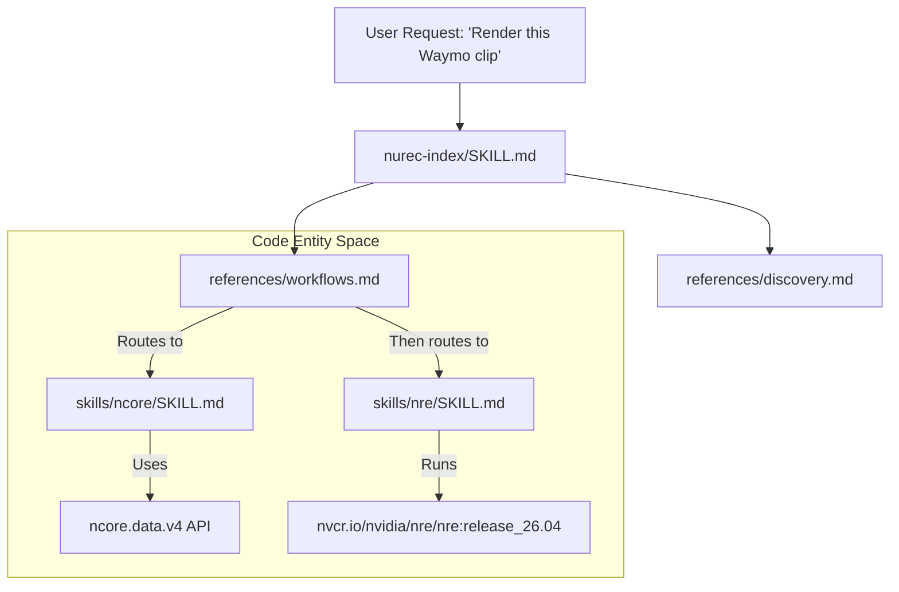
**Sources:** [README.md:50-80](), [skills/nurec-index/SKILL.md:74-87](), [skills/ncore/SKILL.md:152-153]()

---

## End-to-End Pipeline

The NuRec pipeline typically follows a linear progression from raw data to a rendered, harmonized simulation. This flow is managed through the `nurec-index` router and predefined workflows.

1.  **Ingestion:** Convert raw data (e.g., `Waymo`, `PAI`, or `ROS 2`) into `NCore V4` using `ncore` [skills/ncore/SKILL.md:98-108]().
2.  **Training:** Feed `NCore V4` to `NRE` to produce a `USDZ` reconstruction [skills/nurec-index/SKILL.md:156-163]().
3.  **Rendering:** Use `NRE` (locally or via `serve-grpc`) to generate novel views [skills/nurec-index/SKILL.md:156-163]().
4.  **Refinement:** (Optional) Use `nurec-fixer` to remove artifacts from rendered frames [README.md:48-48]().

For a deep dive into data flow between skills and specific pipeline stages, see **[End-to-End Pipeline: From Raw Sensor Data to Neural Reconstruction](#1.2)**.

### Pipeline Component Interaction
This diagram maps the high-level pipeline stages to the specific code modules and tools used at each step.

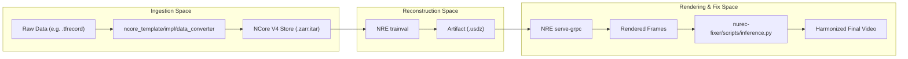
**Sources:** [skills/ncore/SKILL.md:41-46](), [skills/ncore/ncore_template/impl/data_converter/example_converter.py:9-16](), [skills/nurec-index/SKILL.md:156-163](), [README.md:48-48]()

---

## Environment Prerequisites and Setup

Running NuRec skills requires specific hardware and software configurations:
*   **Hardware:** Linux x86_64, NVIDIA GPU (Ampere+), and at least 16GB VRAM (24GB+ recommended) [README.md:132-137]().
*   **Software:** Docker 23+, NVIDIA Container Toolkit, and Python 3.10+ [README.md:138-148]().
*   **Secrets:** `NGC_API_KEY` for containers and `HF_TOKEN` for datasets/models must be configured [README.md:138-145]().

Every skill includes a `validate_setup.py` script to ensure the environment is ready before execution [README.md:69-78]().

For hardware requirements, container access, and secret management patterns, see **[Environment Prerequisites and Setup](#1.3)**.

**Sources:** [README.md:127-148](), [skills/ncore/SKILL.md:116-125]()

---

# Page: Repository Structure and Skill Architecture

# Repository Structure and Skill Architecture

<details>
<summary>Relevant source files</summary>

The following files were used as context for generating this wiki page:

- [.github/workflows/request-nvskills-ci.yml](.github/workflows/request-nvskills-ci.yml)
- [README.md](README.md)
- [skills/nurec-index/references/discovery.md](skills/nurec-index/references/discovery.md)
- [skills/nurec-index/references/teardown.md](skills/nurec-index/references/teardown.md)
- [skills/nurec-index/references/workflows.md](skills/nurec-index/references/workflows.md)

</details>


This page details the technical organization of the `nurec-skills` repository, the `agentskills.io` convention it implements, and the mechanisms through which AI agents discover and index these skills.

## The Skill Architecture

A **skill** in this repository is a specialized coordination layer designed for AI agents (such as Cursor, Claude Code, or Codex). Unlike traditional software libraries, these skills are encapsulated as Markdown files with structured metadata that teach an agent how to drive external NVIDIA infrastructure, including NGC containers, Hugging Face artifacts, and specialized GitHub repositories [README.md:20-35]().

### agentskills.io Convention
The repository follows the [agentskills.io](https://agentskills.io) standard for skill definition. Each skill is defined by a `SKILL.md` file containing two primary sections:
1.  **YAML Frontmatter**: A structured block containing the skill `name`, `description`, trigger keywords, compatibility requirements, and `upstream` pointers to the canonical source code or container tags [README.md:22-29]().
2.  **Markdown Recipe**: A hand-curated set of instructions, commands, and logic that the agent executes to perform specific tasks [README.md:26-29]().

### Skill Metadata and Upstream Mapping
Each skill maintains a `metadata:` block in its frontmatter. This block is the source of truth for versioning, pinning specific NRE container tags, Asset Harvester commits, or DiffusionHarmonizer release branches [README.md:85-88]().

| Skill Name | Upstream Source | Target Version/Tag |
| :--- | :--- | :--- |
| `nurec-index` | Hand-curated | N/A (Router) |
| `ncore` | [NVIDIA/ncore](https://github.com/NVIDIA/ncore) | `2026.04` |
| `nre` | `nvcr.io/nvidia/nre/{nre,nre-tools}` | `release_26.04` |
| `asset-harvester` | [NVIDIA/asset-harvester](https://github.com/NVIDIA/asset-harvester) | `main` |
| `nurec-fixer` | [nvidia/DiffusionHarmonizer](https://huggingface.co/nvidia/DiffusionHarmonizer) | `main` |

**Sources:** [README.md:41-48](), [README.md:85-88]()

---

## Directory Structure and Symlink Strategy

The repository uses a specific layout to ensure that agents can resolve cross-skill references regardless of their indexing root.

### The .agents/skills Symlink
The directory `.agents/skills/` is a symlink pointing to the `skills/` directory [README.md:53-53](). This strategy ensures that:
*   Agents indexing from the root (standard behavior) find skills at `.agents/skills/<name>/SKILL.md`.
*   Relative links between skills (e.g., `../nre/SKILL.md`) remain valid across different agent runtimes [README.md:82-84]().

### Internal Folder Layout
Each skill is organized as a flat folder containing the primary entry point and its supporting assets:

```text
skills/
├── <skill-name>/
│   ├── SKILL.md           # The primary recipe and metadata
│   ├── references/        # Deep-dive docs (CLI refs, schemas, workflows)
│   ├── scripts/           # Python/Bash utilities (e.g., validate_setup.py)
│   └── tests.yaml         # Skill-specific validation tests
```
**Sources:** [README.md:52-80]()

---

## Skill Discovery and Indexing

Agents discover skills through a prioritized search of local and global directories. The `nurec-index` skill serves as the central entry point for all NuRec-related tasks [README.md:38-39]().

### Resolution Order
Agent runtimes typically look for skills in the following order:
1.  `.agents/skills/<name>/SKILL.md`
2.  `.claude/skills/<name>/SKILL.md`
3.  `.cursor/skills/<name>/SKILL.md` (Project-scoped)
4.  `~/.cursor/skills/<name>/SKILL.md` (User-global)

**Sources:** [skills/nurec-index/references/discovery.md:25-30]()

### Discovery and Routing Logic
The following diagram illustrates how a user request in "Natural Language Space" is mapped to specific code entities and sibling skills via the `nurec-index` router.

**Diagram: Intent-to-Skill Mapping**
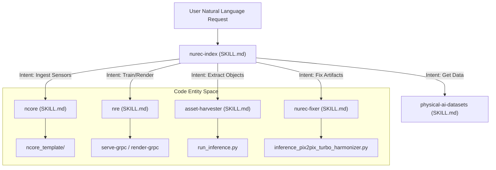
**Sources:** [README.md:38-48](), [skills/nurec-index/references/workflows.md:8-60](), [skills/nurec-index/references/discovery.md:55-56]()

---

## Skill Interaction and Data Flow

Skills are designed to be composable. The output of one skill (e.g., `ncore`) serves as the input for the next (e.g., `nre`).

### End-to-End Skill Pipeline
The reconstruction workflow transitions from raw data to a rendered, harmonized scene through a sequence of skill invocations.

**Diagram: Cross-Skill Data Flow**
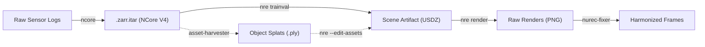
**Sources:** [skills/nurec-index/references/workflows.md:8-74]()

### Implementation Details
*   **NCore V4 Conversion**: The `ncore` skill drives the conversion of various formats (Waymo, PAI, COLMAP) into the `.zarr.itar` NCore V4 format [skills/nurec-index/references/workflows.md:13-16]().
*   **NRE Execution**: The `nre` skill orchestrates `docker run` commands for `nvcr.io/nvidia/nre/nre` to perform training and novel-view synthesis [README.md:46-46]().
*   **Asset Extraction**: `asset-harvester` utilizes `SparseViewDiT` and `TokenGS` to extract 3D Gaussian Splats from the NCore logs [README.md:47-47]().
*   **Harmonization**: `nurec-fixer` applies `DiffusionHarmonizer` (based on Cosmos Predict2) to resolve flickering and lighting mismatches in rendered frames [README.md:48-48]().

---

## Validation and CI/CD

The repository implements a standardized validation pattern to ensure environment readiness before skill execution.

### validate_setup.py Pattern
Most skills include a `scripts/validate_setup.py` utility. Agents are instructed to run this script to verify:
*   **GPU Compatibility**: Ampere or newer (Compute Capability ≥ 8.0) [README.md:134-137]().
*   **Secret Presence**: Presence of `NGC_API_KEY` and `HF_TOKEN` without leaking their values to logs [skills/nurec-index/references/teardown.md:30-48]().
*   **Container Runtimes**: Docker 23+ and NVIDIA Container Toolkit installation [README.md:138-141]().

### CI Dispatch
Automated validation is handled via the `request-nvskills-ci.yml` workflow. This workflow triggers on:
*   The `/nvskills-ci` comment command in Pull Requests [.github/workflows/request-nvskills-ci.yml:14-16]().
*   Signature pushes from the `nv-skills-ci[bot]` [.github/workflows/request-nvskills-ci.yml:17-19]().

The workflow dispatches requests to the central `NVIDIA/skills` CI infrastructure using the `NVSKILLS_CI_DISPATCH_TOKEN` [.github/workflows/request-nvskills-ci.yml:23-25]().

**Sources:** [README.md:129-148](), [skills/nurec-index/references/teardown.md:30-48](), [.github/workflows/request-nvskills-ci.yml:1-25]()

---

# Page: End-to-End Pipeline: From Raw Sensor Data to Neural Reconstruction

# End-to-End Pipeline: From Raw Sensor Data to Neural Reconstruction

<details>
<summary>Relevant source files</summary>

The following files were used as context for generating this wiki page:

- [.github/workflows/request-nvskills-ci.yml](.github/workflows/request-nvskills-ci.yml)
- [skills/asset-harvester/evals/evals.json](skills/asset-harvester/evals/evals.json)
- [skills/ncore/SKILL.md](skills/ncore/SKILL.md)
- [skills/ncore/evals/evals.json](skills/ncore/evals/evals.json)
- [skills/ncore/ncore_template/impl/data_converter/example_converter.py](skills/ncore/ncore_template/impl/data_converter/example_converter.py)
- [skills/nre/evals/evals.json](skills/nre/evals/evals.json)
- [skills/nurec-index/SKILL.md](skills/nurec-index/SKILL.md)
- [skills/nurec-index/evals/evals.json](skills/nurec-index/evals/evals.json)
- [skills/nurec-index/references/discovery.md](skills/nurec-index/references/discovery.md)
- [skills/nurec-index/references/teardown.md](skills/nurec-index/references/teardown.md)
- [skills/nurec-index/references/workflows.md](skills/nurec-index/references/workflows.md)
- [skills/physical-ai-datasets/SKILL.md](skills/physical-ai-datasets/SKILL.md)
- [skills/physical-ai-datasets/evals/evals.json](skills/physical-ai-datasets/evals/evals.json)

</details>


The NuRec pipeline is a four-stage linear workflow designed to transform raw sensor data (cameras, LiDAR, radar) into high-fidelity 3D neural reconstructions. This process involves data ingestion, neural training, object-level asset extraction, and post-process harmonization.

## Pipeline Overview

The pipeline consists of four primary "sibling" skills that communicate via standardized data formats, primarily **NCore V4** for sensor data and **USDZ** for reconstructed scenes [skills/nurec-index/SKILL.md:45-55]().

### The Four Stages

| Stage | Skill | Primary Responsibility | Input | Output |
| :--- | :--- | :--- | :--- | :--- |
| **1. Ingest** | `ncore` | Convert raw logs to NCore V4 | Raw logs (Bag, TFRecord, etc.) | `.zarr.itar` (NCore V4) |
| **2. Train** | `nre` | Neural Reconstruction Engine | NCore V4 Store | USDZ Artifact |
| **3. Harvest** | `asset-harvester` | Per-object Gaussian extraction | NCore V4 + USDZ | `.ply` + `metadata.yaml` |
| **4. Fix** | `nurec-fixer` | Diffusion-based harmonization | Rendered Frames | Refined Frames |

**Sources:** [skills/nurec-index/SKILL.md:45-55](), [skills/nurec-index/references/workflows.md:8-23]()

---

## Data Flow and Code Entities

The following diagram bridges the high-level pipeline concepts to the specific code entities and file formats used to pass data between stages.

### System Entity Mapping

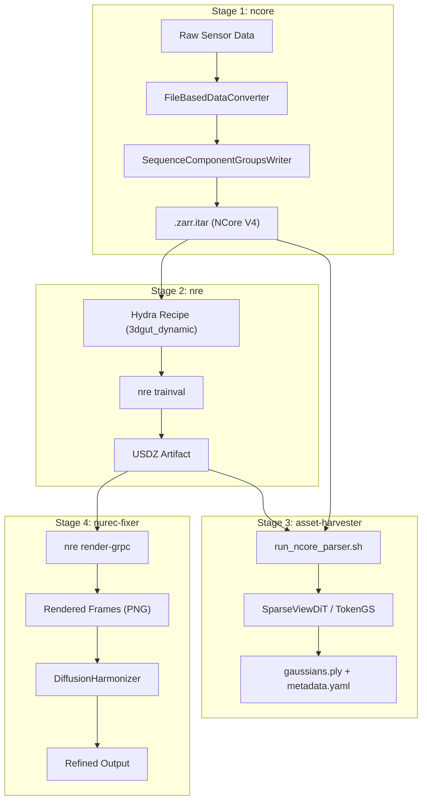
**Sources:** [skills/ncore/ncore_template/impl/data_converter/example_converter.py:48-50](), [skills/nurec-index/SKILL.md:145-155](), [skills/nurec-index/references/workflows.md:48-74]()

---

## Stage 1: NCore Ingestion (`ncore`)

The `ncore` skill serves as the entry point for all custom data. It standardizes disparate sensor formats into the NCore V4 specification, which utilizes Zarr-backed `.itar` archives for high-performance I/O [skills/ncore/SKILL.md:41-47]().

### Implementation Detail: `FileBasedDataConverter`
Custom datasets are integrated by subclassing `FileBasedDataConverter` [skills/ncore/ncore_template/impl/data_converter/example_converter.py:50](). The developer must implement:
1. `get_sequence_ids()`: Discovers available clips in the source directory.
2. `convert_sequence()`: Iterates through frames and writes components using `SequenceComponentGroupsWriter` [skills/ncore/ncore_template/impl/data_converter/example_converter.py:48]().

### Key Data Components
* **PosesComponent**: High-precision (float64) ego and sensor extrinsics [skills/ncore/ncore_template/impl/data_converter/example_converter.py:45]().
* **IntrinsicsComponent**: Camera models (Pinhole, FTheta, Fisheye) [skills/ncore/ncore_template/impl/data_converter/example_converter.py:42]().
* **CameraSensorComponent**: JPEG-encoded image streams [skills/ncore/ncore_template/impl/data_converter/example_converter.py:40]().
* **LidarSensorComponent**: Structured or unstructured point clouds [skills/ncore/ncore_template/impl/data_converter/example_converter.py:43]().

**Sources:** [skills/ncore/SKILL.md:62-66](), [skills/ncore/ncore_template/impl/data_converter/example_converter.py:39-50]()

---

## Stage 2: Neural Reconstruction (`nre`)

The Neural Reconstruction Engine (NRE) consumes the NCore V4 store to train a 3D Gaussian Splatting representation (3DGUT or 3DGRT) [skills/nurec-index/SKILL.md:152-155]().

### The Training Loop
NRE uses **Hydra** for configuration management. A typical workflow involves:
1. Generating auxiliary inputs (segmentation masks, depth estimates) using `nre-tools`.
2. Running `trainval` to optimize the Gaussian primitives.
3. Exporting the final model to a **USDZ** file, which packages the geometry, appearance, and metadata into a single portable artifact [skills/nurec-index/references/workflows.md:17-22]().

**Sources:** [skills/nurec-index/SKILL.md:51-52](), [skills/nurec-index/references/workflows.md:17-22]()

---

## Stage 3: Asset Harvesting (`asset-harvester`)

When specific objects (e.g., a particular vehicle) need to be extracted for re-insertion into other scenes, the `asset-harvester` skill is used [skills/nurec-index/references/workflows.md:48-58]().

### Workflow: Extraction to Metadata
1. **Parsing**: `run_ncore_parser.sh` extracts relevant image crops and masks from the NCore V4 log based on object track IDs [skills/nurec-index/references/workflows.md:50-51]().
2. **Reconstruction**: Uses `SparseViewDiT` and `TokenGS` to create a 3D Gaussian model from limited views.
3. **Alignment**: Produces `gaussians.ply` and a `metadata.yaml` containing the object's original scale and orientation [skills/nurec-index/references/workflows.md:52-54]().

**Sources:** [skills/nurec-index/SKILL.md:53-54](), [skills/nurec-index/references/workflows.md:48-58]()

---

## Stage 4: Post-Process Fixer (`nurec-fixer`)

The final stage addresses visual artifacts such as "floaters," ghosting, or lighting mismatches that occur during neural rendering or object insertion [skills/nurec-index/references/workflows.md:60-64]().

### DiffusionHarmonizer
The `nurec-fixer` utilizes **DiffusionHarmonizer** (based on Cosmos Predict2) to perform image-to-image refinement [skills/nurec-index/references/workflows.md:69-74](). It can be used in two modes:
* **Inline**: Integrated into the NRE gRPC server via `--enable-difix` [skills/nurec-index/references/workflows.md:66-68]().
* **Standalone**: A post-processing script that operates on a folder of rendered PNGs [skills/nurec-index/references/workflows.md:69-74]().

**Sources:** [skills/nurec-index/SKILL.md:55](), [skills/nurec-index/references/workflows.md:60-74]()

---

## Decision Matrix: Which Skill to Use?

| Scenario | Primary Skill | Handoff To |
| :--- | :--- | :--- |
| "I have a ROS2 bag and want to see it in 3D" | `ncore` | `nre` |
| "I need to download NVIDIA's sample AV data" | `physical-ai-datasets` | `nre` |
| "I want to remove a car from a scene" | `nre` (via edit-assets) | `nurec-fixer` |
| "I want to save a specific truck as a 3D asset" | `asset-harvester` | `nre` (for insertion) |
| "My renders have flickering artifacts" | `nurec-fixer` | N/A |

**Sources:** [skills/nurec-index/SKILL.md:173-185](), [skills/nurec-index/references/workflows.md:1-106]()

---

## Pipeline Governance and CI

The integrity of the end-to-end pipeline is maintained via the `request-nvskills-ci.yml` workflow. This CI process triggers validation across all skills when specific comment triggers (e.g., `/nvskills-ci`) or signature pushes are detected [github/workflows/request-nvskills-ci.yml:6-19]().

**Sources:** [.github/workflows/request-nvskills-ci.yml:1-25]()

---

# Page: Environment Prerequisites and Setup

# Environment Prerequisites and Setup

<details>
<summary>Relevant source files</summary>

The following files were used as context for generating this wiki page:

- [skills/asset-harvester/scripts/validate_setup.py](skills/asset-harvester/scripts/validate_setup.py)
- [skills/nre/references/install.md](skills/nre/references/install.md)
- [skills/nre/scripts/.env.example](skills/nre/scripts/.env.example)
- [skills/nre/scripts/validate_setup.py](skills/nre/scripts/validate_setup.py)
- [skills/nurec-fixer/scripts/.env.example](skills/nurec-fixer/scripts/.env.example)
- [skills/nurec-fixer/scripts/validate_setup.py](skills/nurec-fixer/scripts/validate_setup.py)

</details>


This page details the hardware, software, and authentication requirements for the NuRec Skills repository. To ensure consistency across diverse reconstruction tasks—ranging from sensor ingestion to neural rendering and diffusion-based fixing—the repository utilizes a standardized validation pattern to verify host readiness before execution.

## Hardware and OS Requirements

NuRec Skills requires high-performance NVIDIA hardware and a Linux environment. Windows and macOS are not supported, and Linux `aarch64` is currently excluded [skills/nre/scripts/validate_setup.py:79-85]().

### GPU and Driver Matrix
The requirements vary slightly depending on whether the host is performing full Neural Reconstruction Engine (NRE) training or only post-processing "fixing" tasks.

| Component | Minimum Requirement | Recommended |
| :--- | :--- | :--- |
| **Architecture** | Linux x86_64 [skills/nre/scripts/validate_setup.py:79-85]() | Ubuntu 22.04+ |
| **GPU VRAM** | 24 GB [skills/nre/scripts/validate_setup.py:55]() | 48 GB+ [skills/nre/scripts/validate_setup.py:56]() |
| **Compute Capability** | sm_80 (Ampere) [skills/nurec-fixer/scripts/validate_setup.py:31]() | sm_89+ (Ada/Hopper) |
| **Driver (NRE/Training)** | R570+ [skills/nre/scripts/validate_setup.py:54]() | R580+ (for Blackwell) |
| **Driver (Fixer-only)** | R535+ [skills/nre/scripts/validate_setup.py:53]() | R570+ |
| **Disk Space** | 120 GB free [skills/nurec-fixer/scripts/validate_setup.py:32]() | TBs for large datasets |

**Sources:** [skills/nre/references/install.md:54-61](), [skills/nre/scripts/validate_setup.py:53-56](), [skills/nurec-fixer/scripts/validate_setup.py:31-32]().

## Software Dependencies

The codebase relies heavily on containerization to manage complex CUDA dependencies.

### Container Runtime
*   **Docker:** Version >= 23.0.1 is required [skills/nre/references/install.md:62]().
*   **NVIDIA Container Toolkit:** Version >= 1.13.5 must be installed and configured as the `nvidia` runtime in Docker [skills/nre/references/install.md:62-64]().
*   **Shared Memory:** Training and rendering containers require significant shared memory; `--shm-size=64g` is standard for NRE workflows [skills/nre/references/install.md:73-74]().

### Python and Tools
For skills that run partially on the host (like `asset-harvester` or `ncore`), the following are checked:
*   **Python:** >= 3.10 [skills/asset-harvester/scripts/validate_setup.py:44]().
*   **Conda:** Required for local environment management in `asset-harvester` [skills/asset-harvester/scripts/validate_setup.py:77-78]().
*   **GCC:** Versions 10-13 are supported for building local extensions like `gsplat` [skills/asset-harvester/scripts/validate_setup.py:46-47]().

**Sources:** [skills/nre/references/install.md:62-74](), [skills/asset-harvester/scripts/validate_setup.py:44-47]().

## Secret Management and Authentication

NuRec Skills interacts with two primary registries: NVIDIA GPU Cloud (NGC) for container images and Hugging Face (HF) for model weights and datasets.

### Required Tokens
1.  **NGC_API_KEY:** Required to pull `nvcr.io/nvidia/nre` images and authenticate in-container model downloads [skills/nre/scripts/validate_setup.py:25-27]().
2.  **HF_TOKEN:** Required for gated datasets (e.g., `PhysicalAI-Autonomous-Vehicles-NuRec`) and model cards like `nvidia/Harmonizer` [skills/nre/scripts/.env.example:12-16]().

### Configuration via .env
Users should create a `.env` file based on the provided templates to manage these secrets locally without committing them to version control [skills/nurec-fixer/scripts/.env.example:4-6]().

**Sources:** [skills/nre/scripts/.env.example:7-17](), [skills/nurec-fixer/scripts/.env.example:1-20]().

## The Validation Pattern

Each skill includes a `validate_setup.py` script. This script performs non-networked checks to ensure the host environment matches the requirements defined in the skill's `SKILL.md`.

### Logic Flow: validate_setup.py
The validation scripts follow a common structure: they probe for executables, query `nvidia-smi` for hardware specs, and check environment variables.

### Environment Validation Logic
"The diagram below illustrates how `validate_setup.py` bridges the Natural Language requirements defined in `SKILL.md` to the Code Entity Space by executing specific system probes."

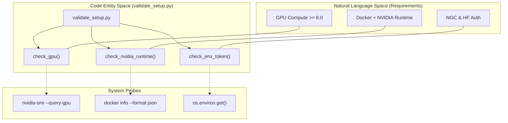
**Sources:** [skills/nurec-fixer/scripts/validate_setup.py:65-160](), [skills/nre/scripts/validate_setup.py:89-189]().

### Secret Verification Safety
The codebase enforces a length-only check for secrets to prevent accidental leakage in logs or terminal history.

### Secret Check Flow
"This diagram shows the `check_env_token` logic which prevents echoing sensitive strings while confirming their presence."

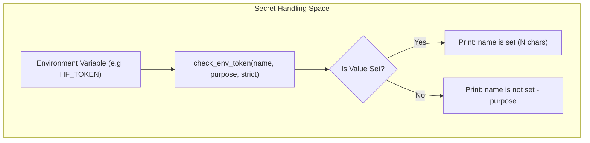
**Sources:** [skills/nurec-fixer/scripts/validate_setup.py:149-159](), [skills/nre/references/install.md:39-44]().

### Execution Summary
To validate a skill's environment, navigate to the skill directory and run:
```bash
# Example for NRE
python scripts/validate_setup.py --strict
```
A return code of `0` indicates the environment is ready for the `setup.sh` or `run.sh` entrypoints [skills/nre/scripts/validate_setup.py:29-32]().

**Sources:** [skills/nre/scripts/validate_setup.py:19-32](), [skills/asset-harvester/scripts/validate_setup.py:137-190]().

---

# Page: nurec-index: The Routing Skill

# nurec-index: The Routing Skill

<details>
<summary>Relevant source files</summary>

The following files were used as context for generating this wiki page:

- [skills/asset-harvester/evals/evals.json](skills/asset-harvester/evals/evals.json)
- [skills/ncore/SKILL.md](skills/ncore/SKILL.md)
- [skills/ncore/evals/evals.json](skills/ncore/evals/evals.json)
- [skills/ncore/ncore_template/impl/data_converter/example_converter.py](skills/ncore/ncore_template/impl/data_converter/example_converter.py)
- [skills/nre/evals/evals.json](skills/nre/evals/evals.json)
- [skills/nurec-index/SKILL.md](skills/nurec-index/SKILL.md)
- [skills/nurec-index/evals/evals.json](skills/nurec-index/evals/evals.json)
- [skills/physical-ai-datasets/SKILL.md](skills/physical-ai-datasets/SKILL.md)
- [skills/physical-ai-datasets/evals/evals.json](skills/physical-ai-datasets/evals/evals.json)

</details>


The `nurec-index` skill serves as the central dispatch hub for the NVIDIA NuRec (Neural Reconstruction) ecosystem. It is designed to classify user intent and route requests to the appropriate sibling skill within the pipeline, ensuring that complex tasks like sensor conversion, neural training, and asset extraction are handled by the correct specialized tools [skills/nurec-index/SKILL.md:43-55]().

## Purpose and Scope

This skill acts as a hand-curated router to prevent agents from guessing which sub-skill to invoke for a given task. It is a read-only index and does not execute containers, training jobs, or data conversions directly [skills/nurec-index/SKILL.md:68-73]().

**Key Use Cases:**
*   **Disambiguation:** Determining if a request like "render this clip" requires `ncore` (for conversion) or `nre` (for rendering) [skills/nurec-index/SKILL.md:76-79]().
*   **Pipeline Bootstrapping:** Planning multi-stage workflows (e.g., convert → train → render) [skills/nurec-index/SKILL.md:80-84]().
*   **Jargon Translation:** Mapping terms like "3DGUT", "NCore V4", and "USDZ" to their respective functional units [skills/nurec-index/SKILL.md:85-87]().
*   **Teardown Planning:** Managing disk cleanup across multiple skills that can consume 150 GB+ of space [skills/nurec-index/SKILL.md:91-94]().

**Out of Scope:**
*   Tasks outside the NuRec family (e.g., Isaac Sim, CARLA, or generic Cosmos training) [skills/nurec-index/SKILL.md:101-102]().
*   Direct implementation or execution steps [skills/nurec-index/SKILL.md:65-66]().

### Sources:
* [skills/nurec-index/SKILL.md:43-106]()

## Skill Routing Logic

The following table maps user goals to the specific sibling skills. For multi-stage tasks, the skills should be opened in the order indicated by arrows.

| Goal | Primary Sibling Skill |
| :--- | :--- |
| Find or download an existing NVIDIA dataset | `physical-ai-datasets` |
| Convert raw sensor data (LiDAR, Camera, etc.) to NCore V4 | `ncore` |
| Train a 3D reconstruction from an NCore clip | `ncore` → `nre` |
| Render novel views or export USDZ from a trained model | `nre` |
| Extract per-object 3D Gaussians from AV logs | `asset-harvester` |
| Clean up visual artifacts in rendered frames | `nurec-fixer` |

### Sources:
* [skills/nurec-index/SKILL.md:173-187]()

## The NuRec Pipeline Architecture

The NuRec ecosystem bridges the gap between raw physical sensor data and high-fidelity neural reconstructions. The diagram below illustrates how system components and code entities relate across the pipeline.

**NuRec Pipeline: Data Flow and Entity Mapping**
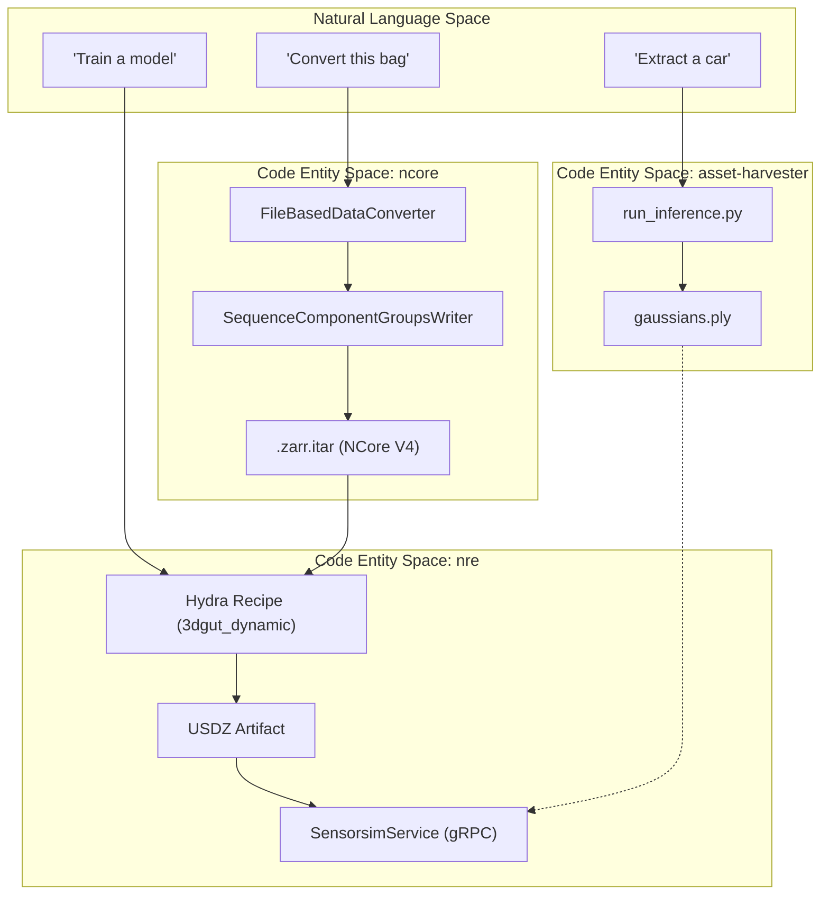

### Sources:
* [skills/nurec-index/SKILL.md:156-166]()
* [skills/ncore/SKILL.md:41-46]()
* [skills/ncore/ncore_template/impl/data_converter/example_converter.py:48-50]()
* [skills/nurec-index/evals/evals.json:1-56]()

## Reference Documentation and Workflows

The `nurec-index` skill relies on three primary reference documents to guide the agent through complex operations. For deep technical details on these logic patterns, see [Routing Logic and Workflow References](#2.1).

*   **Discovery (`references/discovery.md`):** Used to locate sibling skills that may not be present on the local disk [skills/nurec-index/SKILL.md:88-90]().
*   **Workflows (`references/workflows.md`):** Defines seven standardized multi-stage pipelines (A–G) for consistent execution [skills/nurec-index/SKILL.md:80-84]().
*   **Teardown (`references/teardown.md`):** Outlines the order of operations for reclaiming disk space and managing secrets like `NGC_API_KEY` and `HF_TOKEN` [skills/nurec-index/SKILL.md:91-94]().

### Sources:
* [skills/nurec-index/SKILL.md:80-94]()

## Physical AI Datasets

The `physical-ai-datasets` skill provides a catalog of NVIDIA's hosted datasets on Hugging Face. This is the entry point for users who do not have their own sensor data but wish to use NVIDIA-provided clips for reconstruction or robotics tasks. For a full catalog and download patterns, see [Physical AI Datasets Skill](#2.2).

**Dataset Integration Diagram**
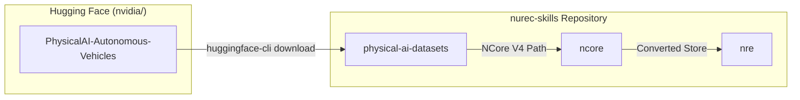

### Sources:
* [skills/physical-ai-datasets/SKILL.md:4-14]()
* [skills/physical-ai-datasets/SKILL.md:162-163]()
* [skills/nurec-index/SKILL.md:49-49]()

## Child Pages

*   [Routing Logic and Workflow References](#2.1) — Details how `nurec-index` evaluates user intent and routes to sibling skills; covers discovery, workflows, and teardown documents.
*   [Physical AI Datasets Skill](#2.2) — Documents the `physical-ai-datasets` skill: the catalog of NVIDIA `PhysicalAI-*` Hugging Face datasets, gating, and download patterns.

---

# Page: Routing Logic and Workflow References

# Routing Logic and Workflow References

<details>
<summary>Relevant source files</summary>

The following files were used as context for generating this wiki page:

- [.github/workflows/request-nvskills-ci.yml](.github/workflows/request-nvskills-ci.yml)
- [skills/ncore/SKILL.md](skills/ncore/SKILL.md)
- [skills/ncore/ncore_template/impl/data_converter/example_converter.py](skills/ncore/ncore_template/impl/data_converter/example_converter.py)
- [skills/nurec-index/BENCHMARK.md](skills/nurec-index/BENCHMARK.md)
- [skills/nurec-index/SKILL.md](skills/nurec-index/SKILL.md)
- [skills/nurec-index/references/discovery.md](skills/nurec-index/references/discovery.md)
- [skills/nurec-index/references/teardown.md](skills/nurec-index/references/teardown.md)
- [skills/nurec-index/references/workflows.md](skills/nurec-index/references/workflows.md)
- [skills/nurec-index/skill-card.md](skills/nurec-index/skill-card.md)
- [skills/physical-ai-datasets/SKILL.md](skills/physical-ai-datasets/SKILL.md)

</details>


The `nurec-index` skill serves as the central architectural router for the NVIDIA NuRec ecosystem. Its primary purpose is to evaluate user intent and dispatch requests to the appropriate specialized sibling skill within the `nurec-skills` repository. It manages the lifecycle of multi-stage pipelines, provides discovery mechanisms for skills not present on the local filesystem, and defines the standardized teardown order for reclaiming system resources.

### Sources:
- [skills/nurec-index/SKILL.md:43-66]()
- [skills/nurec-index/SKILL.md:68-95]()

---

## Routing and Intent Classification

The routing logic is defined by a mapping of user goals to specific code entities (skills). When a request is received, the system classifies the intent to determine if it requires a single-stage execution or a multi-stage workflow.

### Intent Mapping Table

| User Goal | Target Skill | Implementation Reference |
| :--- | :--- | :--- |
| Find/Download NVIDIA datasets | `physical-ai-datasets` | [skills/nurec-index/SKILL.md:175-175]() |
| Convert raw sensor data to V4 | `ncore` | [skills/nurec-index/SKILL.md:176-177]() |
| Train 3D reconstruction | `ncore` → `nre` | [skills/nurec-index/SKILL.md:178-178]() |
| Render novel views / USDZ | `nre` | [skills/nurec-index/SKILL.md:180-180]() |
| Extract 3D Gaussian objects | `asset-harvester` | [skills/nurec-index/SKILL.md:181-181]() |
| Fix artifacts / Harmonize | `nurec-fixer` | [skills/nurec-index/SKILL.md:183-183]() |

### Natural Language to Code Entity Space: Routing Logic
This diagram illustrates how user-facing "Natural Language" intents are mapped to specific skill entities and their underlying code implementations.

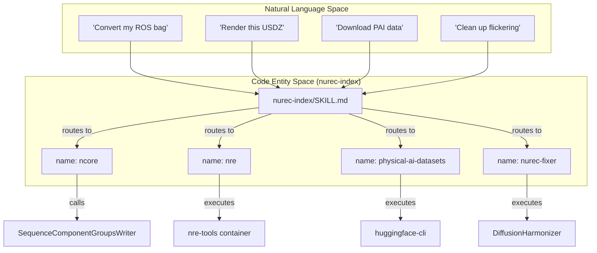

### Sources:
- [skills/nurec-index/SKILL.md:170-186]()
- [skills/ncore/ncore_template/impl/data_converter/example_converter.py:48-48]()
- [skills/nurec-index/references/workflows.md:1-106]()

---

## Standardized Workflows (A–G)

Workflows represent pre-defined sequences of skill executions designed for common end-to-end tasks. These are documented in `references/workflows.md`.

*   **Workflow A (Custom Recording):** `ncore` (Conversion) → `nre` (Train/Render).
*   **Workflow D (Object Editing):** `ncore` (Context) → `asset-harvester` (Extraction) → `nre` (Insertion via `serve-grpc --enable-editing-actors`).
*   **Workflow E (Post-Processing):** `nre` (Render) → `nurec-fixer` (Harmonization).
*   **Workflow G (Simulator Integration):** `physical-ai-datasets` (USDZ) → `nre` (`serve-grpc`).

### Natural Language to Code Entity Space: Multi-Skill Pipeline
This diagram bridges the high-level workflow descriptions to the specific command-line entry points and classes used in the pipeline.

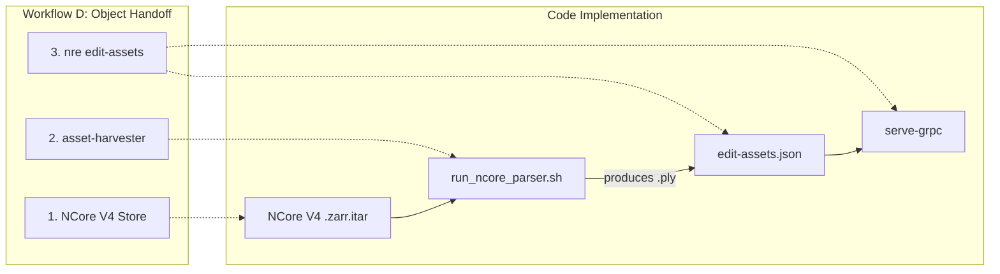

### Sources:
- [skills/nurec-index/references/workflows.md:8-22]()
- [skills/nurec-index/references/workflows.md:48-58]()
- [skills/nurec-index/references/workflows.md:60-74]()

---

## Skill Discovery and Teardown

### Discovery Mechanism
If a sibling skill is not present on the local disk, `nurec-index` follows a discovery protocol to locate the skill at `https://github.com/NVIDIA/nurec-skills`. The system checks standard paths in order:
1. `.agents/skills/<name>/SKILL.md`
2. `.claude/skills/<name>/SKILL.md`
3. `.cursor/skills/<name>/SKILL.md`

Agents are strictly prohibited from auto-cloning; they must request user consent before performing a network fetch of the repository.

### Teardown Reference
A full NuRec workflow can consume over 150 GB of disk space. The teardown sequence is critical for resource management:

| Order | Skill | Component to Remove | Est. Size |
| :--- | :--- | :--- | :--- |
| 1 | `nre` | Docker images + Hydra outputs | ~120 GB |
| 2 | `nurec-fixer` | Cosmos images + HF caches | 100 GB+ |
| 3 | `asset-harvester` | Conda envs + Checkpoints | ~30 GB |
| 4 | `ncore` | `.zarr.itar` shards | Variable |
| 5 | `physical-ai-datasets` | `~/.cache/huggingface/hub/` | Variable |

### Sources:
- [skills/nurec-index/references/discovery.md:1-60]()
- [skills/nurec-index/references/teardown.md:1-16]()

---

## Security and CI/CD

### Secret Management
All skills must adhere to the "Verify, Don't Echo" policy for `NGC_API_KEY` and `HF_TOKEN`. Implementation involves length-only checks to avoid terminal leakage:
`test -n "$HF_TOKEN" && echo "HF_TOKEN: set (${#HF_TOKEN} chars)" || echo "HF_TOKEN: missing"`

### CI Governance
The repository uses the `request-nvskills-ci.yml` workflow to trigger validation.
*   **Trigger:** Commenting `/nvskills-ci` on a PR or a signature push from `nv-skills-ci[bot]`.
*   **Action:** Dispatches to `NVIDIA/skills/.github/workflows/team-request.yml@main`.

### Sources:
- [skills/nurec-index/references/teardown.md:28-49]()
- [.github/workflows/request-nvskills-ci.yml:1-25]()

---

# Page: Physical AI Datasets Skill

# Physical AI Datasets Skill

<details>
<summary>Relevant source files</summary>

The following files were used as context for generating this wiki page:

- [skills/asset-harvester/evals/evals.json](skills/asset-harvester/evals/evals.json)
- [skills/ncore/SKILL.md](skills/ncore/SKILL.md)
- [skills/ncore/evals/evals.json](skills/ncore/evals/evals.json)
- [skills/ncore/ncore_template/impl/data_converter/example_converter.py](skills/ncore/ncore_template/impl/data_converter/example_converter.py)
- [skills/nre/evals/evals.json](skills/nre/evals/evals.json)
- [skills/nurec-index/SKILL.md](skills/nurec-index/SKILL.md)
- [skills/nurec-index/evals/evals.json](skills/nurec-index/evals/evals.json)
- [skills/physical-ai-datasets/SKILL.md](skills/physical-ai-datasets/SKILL.md)
- [skills/physical-ai-datasets/evals/evals.json](skills/physical-ai-datasets/evals/evals.json)

</details>


The `physical-ai-datasets` skill provides a comprehensive catalog and interface for discovering, evaluating, and downloading NVIDIA's Physical AI datasets hosted on Hugging Face. These datasets support a wide range of tasks including autonomous vehicle (AV) reconstruction, robotics manipulation, spatial intelligence, and neural reconstruction. This skill acts as a discovery and routing layer; it does not perform training or rendering but prepares the data for consuming skills like `ncore` and `nre` [skills/physical-ai-datasets/SKILL.md:4-14]().

## System Overview and Data Flow

The skill manages the transition from the **Natural Language Space** (user requests for specific data types) to the **Code Entity Space** (Hugging Face CLI commands and local directory structures).

### Natural Language to Code Entity Mapping

| User Intent (Natural Language) | Code Entity / Command | Target Sibling Skill |
| :--- | :--- | :--- |
| "Find AV training data" | `nvidia/PhysicalAI-Autonomous-Vehicles` | `ncore` |
| "Get robot grasping data" | `nvidia/PhysicalAI-Grasping-GraspGen` | `asset-harvester` |
| "Need sim-ready scenes" | `nvidia/PhysicalAI-SimReady-Scenes` | `nre` |
| "Download GR00T samples" | `nvidia/PhysicalAI-Robotics-GR00T-X-Embodiment` | Isaac-GR00T (Upstream) |

**Sources:** [skills/physical-ai-datasets/SKILL.md:62-73](), [skills/physical-ai-datasets/SKILL.md:126-138]()

### Data Ingestion Flow

The following diagram illustrates how a user request for a dataset is processed and handed off to downstream skills.

**Dataset Handoff Pipeline**
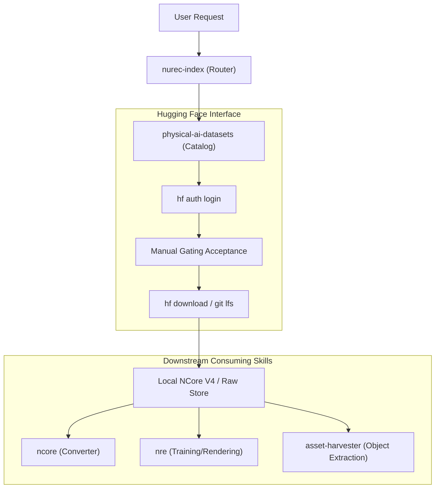
**Sources:** [skills/nurec-index/SKILL.md:45-55](), [skills/physical-ai-datasets/SKILL.md:140-160](), [skills/physical-ai-datasets/SKILL.md:175-180]()

## Implementation Details

### Catalog Organization
The skill categorizes datasets by domain to facilitate rapid lookup. Each entry includes the Hugging Face path, size, license type, and whether the dataset is gated (requires manual approval on the website) [skills/physical-ai-datasets/SKILL.md:7-12]().

### Security and Authentication
A critical component of the implementation is the safe handling of the `HF_TOKEN`. The skill enforces a "length-only" check to prevent accidental leakage of secrets in logs or terminal output [skills/physical-ai-datasets/SKILL.md:99-118]().

**Key Security Pattern:**
```bash
# Correct way to verify token presence without echoing value
test -n "$HF_TOKEN" && echo "HF_TOKEN: set (${#HF_TOKEN} chars)" || echo "HF_TOKEN: missing"
```
**Sources:** [skills/physical-ai-datasets/SKILL.md:105-117](), [skills/ncore/SKILL.md:132-144]()

### Download Patterns
The skill defines three primary download patterns depending on the dataset scale and user requirements:
1.  **Full Download:** Using `hf download` for small/medium datasets [skills/physical-ai-datasets/SKILL.md:162-163]().
2.  **Filtered Download:** Using `--include` patterns for massive datasets like `PhysicalAI-Autonomous-Vehicles` (133 TB) [skills/physical-ai-datasets/SKILL.md:165-169]().
3.  **Sparse Checkout:** Using `git-lfs` for incremental updates [skills/physical-ai-datasets/SKILL.md:171-173]().

## Technical Reference: Dataset Families

The skill maps specific `PhysicalAI-*` families to the appropriate technical tools.

| Family | Purpose | Primary Consumer |
| :--- | :--- | :--- |
| **Autonomous-Vehicles** | Raw sensor logs (Hyperion 8.1) | `ncore` |
| **Robotics-Manipulation** | Multi-modal trajectory data | Isaac Sim / Cosmos |
| **Robotics-NuRec** | Pre-trained USDZ / NCore V4 scenes | `nre` |
| **Sim-Ready** | Physically based assets/materials | `asset-harvester` |

**Sources:** [skills/physical-ai-datasets/SKILL.md:126-138](), [skills/physical-ai-datasets/SKILL.md:7-12]()

### Dependency Mapping

**Natural Language to Code Entity Space**
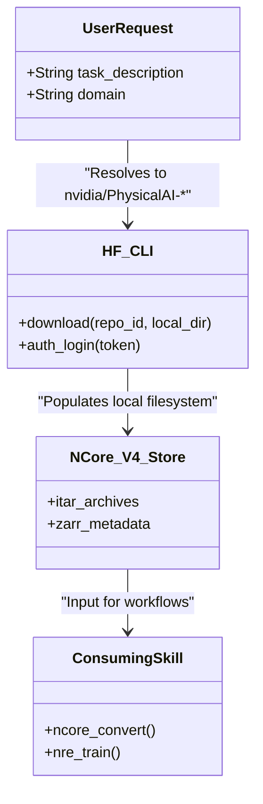
**Sources:** [skills/physical-ai-datasets/SKILL.md:52-60](), [skills/ncore/SKILL.md:41-46](), [skills/nre/SKILL.md:162-164]()

## Handoff to Consuming Skills

Once a dataset is downloaded, the agent must transition to the next skill in the pipeline.

1.  **If the data is raw sensor logs (e.g., Waymo, PAI raw):** Handoff to `ncore` for conversion to V4 format [skills/nurec-index/SKILL.md:176]().
2.  **If the data is already in NCore V4 or USDZ:** Handoff to `nre` for reconstruction or rendering [skills/nurec-index/SKILL.md:178]().
3.  **If the goal is object extraction:** Handoff to `asset-harvester` [skills/nurec-index/SKILL.md:181]().

**Sources:** [skills/nurec-index/SKILL.md:45-55](), [skills/nurec-index/SKILL.md:173-182]()

---

# Page: NCore: Sensor Data Ingestion and V4 Format

# NCore: Sensor Data Ingestion and V4 Format

<details>
<summary>Relevant source files</summary>

The following files were used as context for generating this wiki page:

- [skills/asset-harvester/evals/evals.json](skills/asset-harvester/evals/evals.json)
- [skills/ncore/SKILL.md](skills/ncore/SKILL.md)
- [skills/ncore/evals/evals.json](skills/ncore/evals/evals.json)
- [skills/ncore/ncore_template/impl/data_converter/example_converter.py](skills/ncore/ncore_template/impl/data_converter/example_converter.py)
- [skills/nre/evals/evals.json](skills/nre/evals/evals.json)
- [skills/nurec-index/SKILL.md](skills/nurec-index/SKILL.md)
- [skills/nurec-index/evals/evals.json](skills/nurec-index/evals/evals.json)
- [skills/physical-ai-datasets/SKILL.md](skills/physical-ai-datasets/SKILL.md)
- [skills/physical-ai-datasets/evals/evals.json](skills/physical-ai-datasets/evals/evals.json)

</details>


NCore is the foundational data ingestion skill for the NuRec ecosystem. Its primary purpose is to convert raw sensor recordings—ranging from autonomous vehicle (AV) logs to custom robotics rigs—into the **NCore V4** format. This standardized format is a prerequisite for downstream tasks such as training reconstructions in NRE or extracting objects via Asset Harvester [skills/ncore/SKILL.md:4-17]().

NCore provides two primary paths for data ingestion: driving existing in-tree converters (e.g., PAI, Waymo, COLMAP) or authoring new converters using a provided template for custom sensor configurations [skills/ncore/SKILL.md:40-46]().

## System Architecture: Data Ingestion Flow

The following diagram illustrates how raw sensor data is transformed into the NCore V4 format and handed off to the Neural Reconstruction Engine (NRE).

### Sensor Ingestion to NRE Pipeline
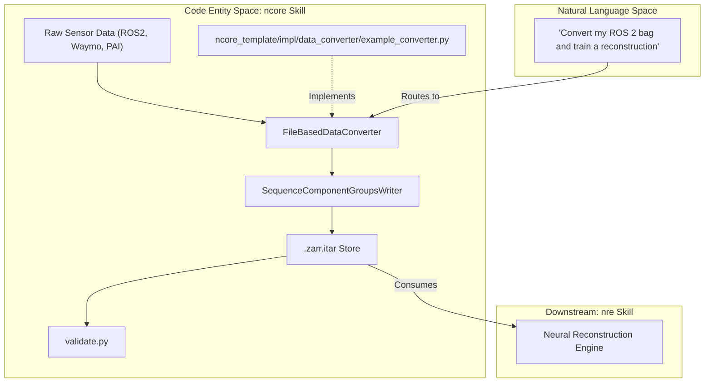
**Sources:** [skills/ncore/SKILL.md:4-17](), [skills/ncore/SKILL.md:98-109](), [skills/ncore/ncore_template/impl/data_converter/example_converter.py:48-50]()

## Mental Model: The V4 Store

The NCore V4 format is designed for high-precision spatial data, utilizing `.zarr.itar` archives to store multi-modal sensor streams. It organizes data into **Component Groups** (e.g., `camera`, `lidar`, `poses`) that are linked by a common `sequence_id`.

| Component | Description | Code Entity |
| :--- | :--- | :--- |
| **Poses** | Ego-motion and sensor extrinsics (float64) | `PosesComponent` |
| **Intrinsics** | Camera models (Pinhole, Fisheye, F-Theta) | `IntrinsicsComponent` |
| **Sensors** | Raw data: JPEG images or LiDAR point clouds | `CameraSensorComponent` / `LidarSensorComponent` |
| **Cuboids** | 3D bounding box tracks for dynamic objects | `CuboidsComponent` |

For a deep dive into the archive structure, float64 re-referencing for precision, and the lifecycle of a store, see **[NCore V4 Data Model and Store Lifecycle](#3.1)**.

**Sources:** [skills/ncore/ncore_template/impl/data_converter/example_converter.py:39-49](), [skills/ncore/SKILL.md:72-75]()

## Authoring Converters

Users can ingest data via two distinct paths depending on the source format:

*   **Path A: In-Tree Converters:** Pre-built Bazel-based tools for common datasets like **PAI** (NVIDIA Physical AI), **Waymo Open**, and **COLMAP** outputs [skills/ncore/SKILL.md:98-104]().
*   **Path B: Custom Templates:** For unsupported formats (e.g., PandaSet, NuScenes, custom ROS 2 bags), NCore provides a `FileBasedDataConverter` scaffold. Developers implement `get_sequence_ids` and `convert_sequence` to map their data into the V4 schema [skills/ncore/ncore_template/impl/data_converter/example_converter.py:11-16]().

For implementation details and code examples, see **[Authoring Converters: In-Tree and Custom Templates](#3.2)**.

**Sources:** [skills/ncore/SKILL.md:98-109](), [skills/ncore/ncore_template/impl/data_converter/example_converter.py:50]()

## Robotics-to-Sim (r2s) Sharding

In complex robotics pipelines, NCore supports a **sharding pattern**. Instead of one monolithic file, a sequence is broken into modular shards (e.g., `.poses.zarr.itar`, `.masks.zarr.itar`). This allows for:
1.  **Modular Refinement:** Updating poses or masks without re-writing bulky raw image data.
2.  **LiDAR Motion Compensation:** Handling rolling-shutter effects in LiDAR sweeps during conversion.

For details on the sharding architecture and its use in robotics pipelines, see **[r2s Sharding Pattern and Robotics Pipelines](#3.3)**.

### Shard Relationship Diagram
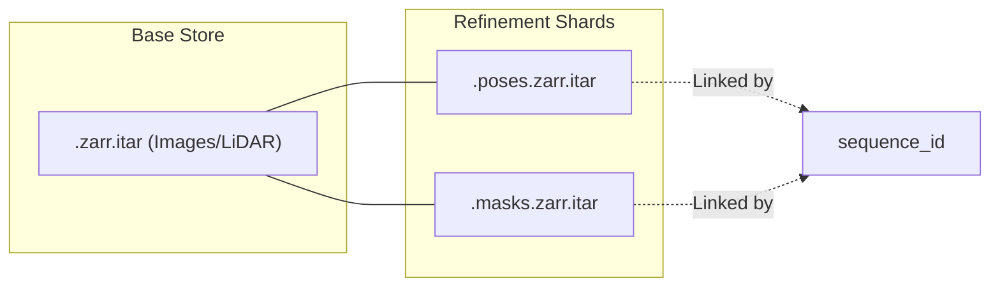
**Sources:** [skills/ncore/SKILL.md:91-92](), [skills/ncore/ncore_template/impl/data_converter/example_converter.py:48-49]()

## Supported Dataset Recipes

NCore includes specific recipes for popular AV and robotics datasets:
*   **PAI (NVIDIA Physical AI):** Consumed directly via `pai-v4` or `pai-stream-v4` [skills/ncore/SKILL.md:77-78]().
*   **Waymo Open:** Converts `.tfrecord` files via `waymo-v4` [skills/ncore/SKILL.md:103]().
*   **Sensor-Only Rigs:** Specific guidance for Mono+Depth, Multi-Stereo, and Livox (non-repetitive) LiDAR [skills/ncore/SKILL.md:81-89]().

To find and download these datasets before conversion, refer to the [Physical AI Datasets Skill](#2.2) [skills/nurec-index/SKILL.md:49]().

**Sources:** [skills/ncore/SKILL.md:76-90](), [skills/nurec-index/SKILL.md:49]()

---

# Page: NCore V4 Data Model and Store Lifecycle

# NCore V4 Data Model and Store Lifecycle

<details>
<summary>Relevant source files</summary>

The following files were used as context for generating this wiki page:

- [skills/ncore/SKILL.md](skills/ncore/SKILL.md)
- [skills/ncore/ncore_template/__init__.py](skills/ncore/ncore_template/__init__.py)
- [skills/ncore/ncore_template/impl/__init__.py](skills/ncore/ncore_template/impl/__init__.py)
- [skills/ncore/ncore_template/impl/data_converter/__init__.py](skills/ncore/ncore_template/impl/data_converter/__init__.py)
- [skills/ncore/ncore_template/impl/data_converter/example_converter.py](skills/ncore/ncore_template/impl/data_converter/example_converter.py)
- [skills/nurec-index/SKILL.md](skills/nurec-index/SKILL.md)
- [skills/physical-ai-datasets/SKILL.md](skills/physical-ai-datasets/SKILL.md)

</details>


This page provides a technical deep dive into the **NCore V4** data format, the lifecycle of a V4 store, and the underlying implementation details of the ingestion pipeline. NCore V4 is the unified sensor data format used by the NuRec ecosystem to represent multi-modal recordings (Camera, LiDAR, Radar, Poses) for neural reconstruction and robotics-to-sim (r2s) workflows.

## The V4 Store Architecture

An NCore V4 store is conceptually a collection of **Component Groups** that describe a sequence of sensor data over time. Physically, these are stored as `.zarr.itar` archives, which combine the Zarr format's chunked, compressed N-dimensional array capabilities with an indexed-TAR (`.itar`) wrapper for efficient cloud and local streaming [skills/ncore/SKILL.md:42-46]().

### Core Entities and Data Model

The data model is hierarchical, starting from a **Sequence** and branching into specialized **Components**.

| Entity | Description | Code Reference |
| :--- | :--- | :--- |
| **Component Group** | A logical grouping of related data (e.g., `observations`, `poses`, `calibration`). | [skills/ncore/ncore_template/impl/data_converter/example_converter.py:52-52]() |
| **Sequence** | A single continuous recording identified by a unique `sequence_id`. | [skills/ncore/ncore_template/impl/data_converter/example_converter.py:12-12]() |
| **Poses** | High-precision trajectory data (6-DoF) for the ego-vehicle or sensors. | [skills/ncore/ncore_template/impl/data_converter/example_converter.py:45-45]() |
| **CameraSensor** | RAW or JPEG compressed imagery with associated timestamps. | [skills/ncore/ncore_template/impl/data_converter/example_converter.py:40-40]() |
| **LidarSensor** | Structured or unstructured point clouds with intensity and timing. | [skills/ncore/ncore_template/impl/data_converter/example_converter.py:43-43]() |
| **Intrinsics** | Mathematical models for sensors (FTheta, Pinhole, Fisheye). | [skills/ncore/ncore_template/impl/data_converter/example_converter.py:42-42]() |

### Precision and Re-referencing
To maintain `float64` precision for global coordinates (e.g., UTM or WGS84) without losing accuracy in `float32` neural networks, NCore V4 employs **re-referencing**. All poses are typically stored relative to a local origin (the first frame of a sequence) while preserving the global offset in metadata [skills/ncore/SKILL.md:112-113]().

**Sources:** [skills/ncore/SKILL.md:42-46](), [skills/ncore/ncore_template/impl/data_converter/example_converter.py:39-53]()

---

## Data Flow: Ingestion to V4 Store

The lifecycle of data conversion involves reading raw formats (ROS bags, Waymo TFRecords, etc.) and writing them using the `SequenceComponentGroupsWriter`.

### System Entity Mapping

This diagram bridges the natural language concepts of "Recording" and "Store" to the specific classes in `ncore.data.v4`.

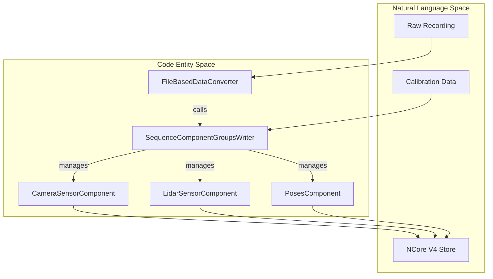
**Sources:** [skills/ncore/ncore_template/impl/data_converter/example_converter.py:39-50](), [skills/ncore/SKILL.md:42-50]()

---

## The Writer Lifecycle

The `SequenceComponentGroupsWriter` is the primary interface for creating V4 stores. It ensures that all components (poses, images, point clouds) are synchronized and adhere to the V4 specification.

### Key Functions and Workflow

1.  **Initialization**: The writer is initialized with a `root_dir` and `sequence_id` [skills/ncore/ncore_template/impl/data_converter/example_converter.py:48-48]().
2.  **Component Registration**: Components like `PosesComponent` or `CameraSensorComponent` are added to the writer.
3.  **Frame Writing**: Data is appended per-frame. For sensors, this includes the raw bytes and a nanosecond-precision timestamp.
4.  **Finalization**: The writer flushes buffers and writes the Zarr metadata, finalizing the `.zarr.itar` archive.

### Data Flow Diagram

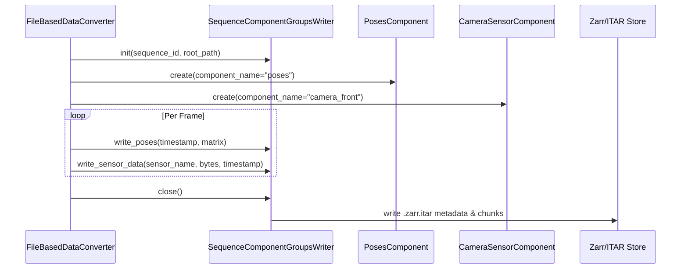
**Sources:** [skills/ncore/ncore_template/impl/data_converter/example_converter.py:39-50](), [skills/ncore/ncore_template/impl/data_converter/example_converter.py:11-16]()

---

## Sensor Models in V4

NCore V4 supports sophisticated sensor models to ensure high-fidelity reconstruction in NRE.

### Camera Models
Supported models include:
*   **OpenCVPinhole**: Standard rectilinear projection [skills/ncore/ncore_template/impl/data_converter/example_converter.py:34-34]().
*   **OpenCVFisheye**: For wide-angle lenses [skills/ncore/ncore_template/impl/data_converter/example_converter.py:33-33]().
*   **FTheta**: Used for high-distortion fisheye cameras common in AV rigs [skills/ncore/ncore_template/impl/data_converter/example_converter.py:31-31]().

### LiDAR Models
NCore handles both structured (spinning) and unstructured LiDAR. A critical implementation detail for spinning LiDAR is the `RowOffsetStructuredSpinningLidarModelParameters`, which defines:
*   `spinning_direction`: "cw" (clockwise) or "ccw" (counter-clockwise). Most automotive LiDARs are "cw" [skills/ncore/ncore_template/impl/data_converter/example_converter.py:112-112]().
*   `row_elevations_rad`: Must be in **descending order** (highest beam first) [skills/ncore/ncore_template/impl/data_converter/example_converter.py:81-83]().

**Sources:** [skills/ncore/ncore_template/impl/data_converter/example_converter.py:31-38](), [skills/ncore/ncore_template/impl/data_converter/example_converter.py:68-108]()

---

## Validation and Conventions

All NCore V4 stores must pass the `validate.py` suite before they are consumed by NRE or other downstream skills.

### Key Validation Checks
*   **Timestamp Monotonicity**: Timestamps within a component must strictly increase.
*   **Coordinate Systems**: NCore uses a Right-Handed System (RHS). For cameras, X is Right, Y is Down, and Z is Forward (Optical frame).
*   **Pose Continuity**: Large jumps in ego-motion are flagged as potential calibration errors.

### Directory Structure Convention
A standard V4 store follows this layout:
```text
<sequence_id>/
├── observations.zarr.itar  # Images, LiDAR, Radar
├── poses.zarr.itar         # Ego and Sensor poses
├── calibration.json        # Static extrinsics and intrinsics
└── metadata.json           # Sequence-level info
```

**Sources:** [skills/ncore/SKILL.md:92-93](), [skills/ncore/SKILL.md:75-75](), [skills/ncore/ncore_template/impl/data_converter/example_converter.py:11-16]()

---

# Page: Authoring Converters: In-Tree and Custom Templates

# Authoring Converters: In-Tree and Custom Templates

<details>
<summary>Relevant source files</summary>

The following files were used as context for generating this wiki page:

- [skills/ncore/SKILL.md](skills/ncore/SKILL.md)
- [skills/ncore/ncore_template/__init__.py](skills/ncore/ncore_template/__init__.py)
- [skills/ncore/ncore_template/impl/__init__.py](skills/ncore/ncore_template/impl/__init__.py)
- [skills/ncore/ncore_template/impl/data_converter/__init__.py](skills/ncore/ncore_template/impl/data_converter/__init__.py)
- [skills/ncore/ncore_template/impl/data_converter/example_converter.py](skills/ncore/ncore_template/impl/data_converter/example_converter.py)
- [skills/nurec-index/SKILL.md](skills/nurec-index/SKILL.md)
- [skills/physical-ai-datasets/SKILL.md](skills/physical-ai-datasets/SKILL.md)

</details>


This page documents the two primary pathways for ingesting sensor data into the NCore V4 format. Converting raw data into a valid NCore V4 store is a prerequisite for training neural reconstructions with NRE or performing per-object extraction with the Asset Harvester [skills/ncore/SKILL.md:40-46]().

## Conversion Strategy Overview

The repository provides two distinct paths for data conversion based on the source format's maturity and complexity.

| Path | Use Case | Implementation Method |
| :--- | :--- | :--- |
| **Path A: In-Tree** | PAI, Waymo, COLMAP, ScanNet++ | Bazel-based command line tools [skills/ncore/SKILL.md:99-104]() |
| **Path B: Custom** | PandaSet, NuScenes, ROS 2, Custom Rigs | Python subclass of `FileBasedDataConverter` [skills/ncore/SKILL.md:106-108]() |

### System to Code Entity Mapping: Conversion Flow

The following diagram maps the high-level conversion concepts to their specific code entities within the `ncore` skill.

**NCore Conversion Entity Map**
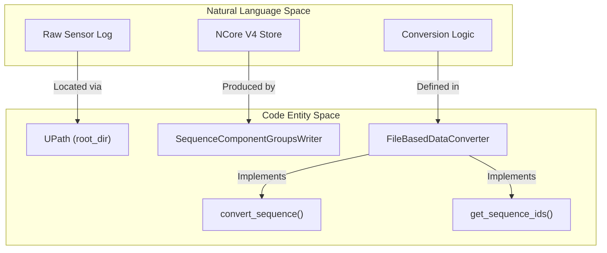
Sources: [skills/ncore/ncore_template/impl/data_converter/example_converter.py:48-53](), [skills/ncore/SKILL.md:152-159]()

---

## Path A: In-Tree Bazel Converters

In-tree converters are optimized for high-performance processing of large-scale datasets. They handle complex sensor calibrations (e.g., FTheta models, rolling shutter timing) and coordinate system transformations [skills/ncore/SKILL.md:110-113]().

### Supported In-Tree Formats
*   **PAI (Physical AI):** Ingests NVIDIA Physical AI datasets from Hugging Face or local disk using `tools/data_converter/pai:convert` [skills/ncore/SKILL.md:102]().
*   **Waymo Open:** Processes `.tfrecord` files via `tools/data_converter/waymo:convert` [skills/ncore/SKILL.md:103]().
*   **COLMAP / ScanNet++:** Converts SfM (Structure from Motion) outputs to V4 using `tools/data_converter/colmap:convert` [skills/ncore/SKILL.md:104]().

### Usage Pattern
These converters are typically invoked via Bazel:
```bash
bazel run //tools/data_converter/pai:convert -- --input_path /data/pai_clip --output_path /data/v4_store
```
Sources: [skills/ncore/SKILL.md:102-105](), [skills/ncore/SKILL.md:120-121]()

---

## Path B: Custom FileBasedDataConverter

For unsupported formats or custom robotics rigs, users should implement a converter using the `ncore_template` scaffold. This template provides a boilerplate for managing the V4 store lifecycle [skills/ncore/SKILL.md:44-46]().

### Key Class: `ExampleConverter`
The `ExampleConverter` (found in `skills/ncore/ncore_template/impl/data_converter/example_converter.py`) serves as the reference implementation [skills/ncore/ncore_template/impl/data_converter/example_converter.py:11-16]().

**Converter Class Hierarchy**
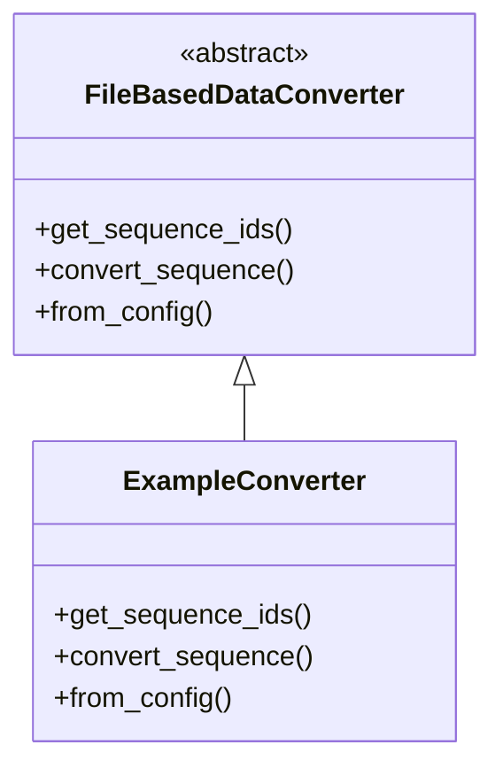
Sources: [skills/ncore/ncore_template/impl/data_converter/example_converter.py:159-165](), [skills/ncore/ncore_template/impl/data_converter/example_converter.py:448-450]()

### Implementation Methods

#### 1. `get_sequence_ids`
This method scans the `root_dir` and returns a list of unique sequence identifiers found in the raw data [skills/ncore/ncore_template/impl/data_converter/example_converter.py:12]().

#### 2. `convert_sequence`
The core logic where raw sensor data is mapped to V4 components. It utilizes the `SequenceComponentGroupsWriter` to commit data to the store [skills/ncore/ncore_template/impl/data_converter/example_converter.py:48-49]().

#### 3. `from_config`
A factory method that instantiates the converter using a `FileBasedDataConverterConfig` object [skills/ncore/ncore_template/impl/data_converter/example_converter.py:159-160]().

### Component Writers
Within `convert_sequence`, data is written using specific V4 component writers:
*   `PosesComponent`: 6-DoF ego-vehicle or sensor poses [skills/ncore/ncore_template/impl/data_converter/example_converter.py:45]().
*   `IntrinsicsComponent`: Camera (Pinhole, Fisheye, FTheta) or LiDAR models [skills/ncore/ncore_template/impl/data_converter/example_converter.py:42]().
*   `CameraSensorComponent`: Raw image bytes (JPEG/PNG) [skills/ncore/ncore_template/impl/data_converter/example_converter.py:40]().
*   `LidarSensorComponent`: Range, intensity, and elongation data [skills/ncore/ncore_template/impl/data_converter/example_converter.py:43]().

Sources: [skills/ncore/ncore_template/impl/data_converter/example_converter.py:39-50](), [skills/ncore/ncore_template/impl/data_converter/example_converter.py:65-108]()

---

## Data Flow: Raw to NCore V4

The conversion process follows a structured data flow where raw files are parsed into NumPy arrays before being serialized into `.zarr.itar` archives.

**Conversion Data Flow**
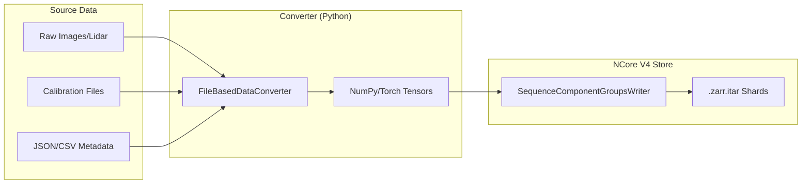
Sources: [skills/ncore/ncore_template/impl/data_converter/example_converter.py:25-49](), [skills/ncore/SKILL.md:40-46]()

### Critical Calibration Parameters
When authoring custom converters, specifically for spinning LiDARs, four parameters must be verified to avoid "silent correctness traps":
1.  `spinning_direction`: "cw" (clockwise) or "ccw" (counter-clockwise) [skills/ncore/ncore_template/impl/data_converter/example_converter.py:70-73]().
2.  `row_elevations_rad`: Actual per-beam inclination angles (descending order) [skills/ncore/ncore_template/impl/data_converter/example_converter.py:78-84]().
3.  `column_azimuths_rad`: Per-column azimuth at frame start [skills/ncore/ncore_template/impl/data_converter/example_converter.py:86-97]().
4.  `row_azimuth_offsets_rad`: Per-beam offsets (e.g., for Ouster sensors) [skills/ncore/ncore_template/impl/data_converter/example_converter.py:99-103]().

Sources: [skills/ncore/ncore_template/impl/data_converter/example_converter.py:65-108]()

---

# Page: r2s Sharding Pattern and Robotics Pipelines

# r2s Sharding Pattern and Robotics Pipelines

<details>
<summary>Relevant source files</summary>

The following files were used as context for generating this wiki page:

- [skills/asset-harvester/evals/evals.json](skills/asset-harvester/evals/evals.json)
- [skills/ncore/SKILL.md](skills/ncore/SKILL.md)
- [skills/ncore/evals/evals.json](skills/ncore/evals/evals.json)
- [skills/ncore/ncore_template/impl/data_converter/example_converter.py](skills/ncore/ncore_template/impl/data_converter/example_converter.py)
- [skills/nre/evals/evals.json](skills/nre/evals/evals.json)
- [skills/nurec-index/SKILL.md](skills/nurec-index/SKILL.md)
- [skills/nurec-index/evals/evals.json](skills/nurec-index/evals/evals.json)
- [skills/physical-ai-datasets/SKILL.md](skills/physical-ai-datasets/SKILL.md)
- [skills/physical-ai-datasets/evals/evals.json](skills/physical-ai-datasets/evals/evals.json)

</details>


The **robotics-to-sim (r2s)** sharding architecture is a modular data pattern designed for high-performance ingestion and refinement of robotics sensor data within the NCore V4 ecosystem. Unlike monolithic files, r2s leverages sharded `.zarr.itar` archives to allow independent updates to poses, masks, and sensor data without re-writing the entire dataset [skills/ncore/SKILL.md:91-91]().

## Purpose and Scope

The r2s pattern enables:
1.  **Modular Refinement**: Updating ego-poses or semantic masks (e.g., from a new SLAM run or SAM2 model) without touching multi-gigabyte camera/LiDAR shards [skills/ncore/SKILL.md:44-46]().
2.  **LiDAR Motion Compensation**: Handling the rolling-shutter effect of spinning LiDARs through precise per-column azimuth and pose interpolation [skills/ncore/ncore_template/impl/data_converter/example_converter.py:65-108]().
3.  **Cross-Skill Handoff**: Providing a stable interface between `ncore` (ingestion), `nre` (reconstruction), and `asset-harvester` (object extraction) [skills/nurec-index/SKILL.md:80-84]().

## Architecture Overview

In an r2s pipeline, a single logical sequence is split across multiple physical shards linked by a common `sequence_id`.

### Shard Types

| Shard Extension | Content Description | Key Code Entities |
| :--- | :--- | :--- |
| `.zarr.itar` | **Base Shard**: Raw sensor data (JPEG images, LiDAR points, Radar). | `CameraSensorComponent`, `LidarSensorComponent` |
| `.poses.zarr.itar` | **Pose Shard**: 6-DoF trajectory of the rig and individual sensors. | `PosesComponent` |
| `.masks.zarr.itar` | **Mask Shard**: Ego-vehicle masks or semantic segmentation. | `MasksComponent` |
| `.intrinsics.zarr.itar` | **Intrinsics Shard**: Camera models (FTheta, Pinhole) and LiDAR beam elevations. | `IntrinsicsComponent` |

### System Data Flow

The following diagram bridges the robotics data space to the NCore V4 code entities.

**Robotics-to-Sim Data Flow**
```mermaid
graph TD
    subgraph "Robotics Space (Raw Data)"
        A["ROS2 Bag / MCAP"]
        B["SLAM Trajectory"]
        C["SAM2 / Segmentation"]
    end

    subgraph "NCore V4 Sharding (Code Entities)"
        D["SequenceComponentGroupsWriter"]
        E[".zarr.itar (Base)"]
        F[".poses.zarr.itar"]
        G[".masks.zarr.itar"]
    end

    subgraph "Downstream Consumers"
        H["NRE (Training)"]
        I["Asset Harvester"]
    end

    A -->|"FileBasedDataConverter"| D
    B -->|"PosesComponent"| D
    C -->|"MasksComponent"| D
    
    D --> E
    D --> F
    D --> G

    E & F & G -->|"SequenceComponentGroupsReader"| H
    E & F & G -->|"SequenceComponentGroupsReader"| I
```
**Sources:** [skills/ncore/ncore_template/impl/data_converter/example_converter.py:39-50](), [skills/ncore/SKILL.md:41-46]()

## LiDAR Motion Compensation

A critical component of robotics pipelines is the handling of spinning LiDAR sensors (e.g., Velodyne, Ouster, Hesai). The `ncore` implementation requires specific parameters to ensure spatial consistency in the reconstruction [skills/ncore/ncore_template/impl/data_converter/example_converter.py:65-108]().

### Key Parameters in `RowOffsetStructuredSpinningLidarModelParameters`

*   **`spinning_direction`**: Determines if the column index increases clockwise (`cw`) or counter-clockwise (`ccw`). A mismatch results in a Z-flip in NuRec [skills/ncore/ncore_template/impl/data_converter/example_converter.py:70-76]().
*   **`row_elevations_rad`**: Must be actual per-beam inclination angles. NCore requires these in **descending order** (highest beam first) [skills/ncore/ncore_template/impl/data_converter/example_converter.py:78-84]().
*   **`column_azimuths_rad`**: The actual per-column azimuth at frame start. NCore validates that azimuths are strictly increasing relative to the spin direction [skills/ncore/ncore_template/impl/data_converter/example_converter.py:86-97]().

**LiDAR Ingestion Logic**
```mermaid
graph LR
    subgraph "example_converter.py"
        P["_SPINNING_LIDAR_PARAMS"]
        M["RowOffsetStructuredSpinningLidarModel"]
        W["LidarSensorComponent"]
    end

    P -->|"defines geometry"| M
    M -->|"elements_to_sensor_rays()"| W
    W -->|"write to shard"| S[".zarr.itar"]
```
**Sources:** [skills/ncore/ncore_template/impl/data_converter/example_converter.py:110-156]()

## Modular Refinement Workflow

The sharding pattern allows for a "multi-pass" refinement of the robotics data.

1.  **Initial Ingestion**: Convert raw logs using `FileBasedDataConverter` to create the base `.zarr.itar` and an initial `.poses.zarr.itar` [skills/ncore/ncore_template/impl/data_converter/example_converter.py:50-52]().
2.  **Pose Optimization**: Run a high-precision SLAM or bundle adjustment. The resulting poses are written to a *new* `.poses.zarr.itar` shard using `SequenceComponentGroupsWriter` [skills/ncore/ncore_template/impl/data_converter/example_converter.py:48-49]().
3.  **Semantic Masking**: Apply a model like SAM2 to the images in the base shard. The masks are saved to `.masks.zarr.itar` [skills/ncore/ncore_template/impl/data_converter/example_converter.py:44-44]().
4.  **Linking**: The `SequenceComponentGroupsReader` automatically links these shards by their shared `sequence_id` during NRE training [skills/ncore/ncore_template/impl/data_converter/example_converter.py:47-47]().

## Implementation Reference

### Key Classes
*   **`FileBasedDataConverter`**: The base class for authoring new robotics converters [skills/ncore/ncore_template/impl/data_converter/example_converter.py:50-50]().
*   **`SequenceComponentGroupsWriter`**: Handles the physical writing of shards to disk [skills/ncore/ncore_template/impl/data_converter/example_converter.py:48-48]().
*   **`PosesComponent` / `MasksComponent`**: Specific component writers that enforce V4 schema compliance [skills/ncore/ncore_template/impl/data_converter/example_converter.py:44-45]().

### Common Robotics Recipes
*   **ROS2 Bag (MCAP/SQLite3)**: Ingesting via `ncore` to handle multi-modal synchronization [skills/ncore/evals/evals.json:18-28]().
*   **Multi-Stereo Rigs**: Handling surround-view camera pairs with overlapping fields of view [skills/ncore/evals/evals.json:32-42]().
*   **Solid-State LiDAR (Livox)**: Managing non-repetitive scan patterns within the V4 structured format [skills/ncore/evals/evals.json:21-28]().

**Sources:**
- [skills/ncore/SKILL.md:41-46]()
- [skills/ncore/SKILL.md:91-91]()
- [skills/ncore/ncore_template/impl/data_converter/example_converter.py:39-52]()
- [skills/ncore/ncore_template/impl/data_converter/example_converter.py:65-108]()
- [skills/ncore/ncore_template/impl/data_converter/example_converter.py:110-156]()
- [skills/ncore/evals/evals.json:18-42]()
- [skills/nurec-index/SKILL.md:80-84]()

---

# Page: NRE: Neural Reconstruction Engine

# NRE: Neural Reconstruction Engine

<details>
<summary>Relevant source files</summary>

The following files were used as context for generating this wiki page:

- [skills/asset-harvester/SKILL.md](skills/asset-harvester/SKILL.md)
- [skills/nre/BENCHMARK.md](skills/nre/BENCHMARK.md)
- [skills/nre/SKILL.md](skills/nre/SKILL.md)
- [skills/nre/references/workflows.md](skills/nre/references/workflows.md)
- [skills/nre/skill-card.md](skills/nre/skill-card.md)

</details>


The **Neural Reconstruction Engine (NRE)** is the core skill for training, rendering, and manipulating 3D Gaussian Splatting reconstructions within the NuRec ecosystem. It consumes sensor data in **NCore V4** format and produces high-fidelity, renderable USDZ artifacts. NRE supports both local batch rendering and a high-performance gRPC-based sensor simulation API.

## Core Capabilities and Architecture

NRE is delivered via two primary Docker containers: `nvcr.io/nvidia/nre/nre` for training and gRPC services, and `nvcr.io/nvidia/nre/nre-tools` for auxiliary data generation [skills/nre/SKILL.md:38-39](). The engine implements the **3DGUT** (Gaussian Universal Training) and **3DGRT** (Ray-Traced) backends to reconstruct dynamic AV scenes [skills/nre/SKILL.md:53-54]().

### Natural Language to Code Entity Mapping

The following diagram bridges high-level user intents to the specific CLI commands and configuration entities used within the NRE skill.

**Intent-to-Entity Mapping**
```mermaid
graph TD
    subgraph "User Intent (Natural Language)"
        A["'Train a new scene'"]
        B["'Render a video'"]
        C["'Start a simulation server'"]
        D["'Add a new car to the scene'"]
    end

    subgraph "Code Entity Space (NRE CLI & Config)"
        A1["nre trainval"]
        A2["configs/apps/AV/Waymo/3dgut_dynamic.yaml"]
        B1["nre render"]
        B2["nre-tools aux-data"]
        C1["nre serve-grpc"]
        C2["SensorsimService (gRPC)"]
        D1["nre export-external-assets"]
        D2["edit-assets.json"]
    end

    A --> A1
    A --> A2
    B --> B1
    B --> B2
    C --> C1
    C --> C2
    D --> D1
    D --> D2

    style A1 stroke-width:2px
    style B1 stroke-width:2px
    style C1 stroke-width:2px
    style D1 stroke-width:2px
```
Sources: [skills/nre/SKILL.md:74-88](), [skills/nre/references/workflows.md:7-54]()

## Data Flow and Pipeline

The NRE pipeline typically follows a linear progression from NCore shards to final rendered outputs.

**NRE Internal Data Flow**
```mermaid
graph LR
    subgraph "Inputs"
        NC["NCore V4 (.zarr.itar)"]
        AUX["Aux Data (.aux.sseg.zarr)"]
    end

    subgraph "Processing (nre container)"
        TR["trainval (Hydra Config)"]
        EX["export-usdz-artifact"]
    end

    subgraph "Outputs"
        USDZ["last.usdz (Artifact)"]
        MET["metrics.yaml"]
    end

    NC --> TR
    AUX --> TR
    TR --> EX
    EX --> USDZ
    TR --> MET
```
Sources: [skills/nre/SKILL.md:113-118](), [skills/nre/references/workflows.md:7-23]()

## Key Sub-Topics

### [NRE Installation and Container Images](#4.1)
Covers the setup of the `nre` and `nre-tools` containers. It details the requirement for `NGC_API_KEY`, GPU prerequisites (Ampere/Hopper/Blackwell), and mandatory Docker configurations like `--shm-size=64g` [skills/nre/SKILL.md:18-24]().
*For details, see [NRE Installation and Container Images](#4.1).*

### [Hydra Configuration and Training Recipes](#4.2)
NRE uses Hydra to manage complex training parameters. Key recipes include `3dgut_dynamic.yaml` for Waymo and `car2sim_6cam.yaml` (via the `pai.yaml` overlay) for NVIDIA Physical AI datasets [skills/nre/SKILL.md:124-137]().
*For details, see [Hydra Configuration and Training Recipes](#4.2).*

### [NRE CLI Reference and Auxiliary Data](#4.3)
A comprehensive guide to the `nre` and `nre-tools` CLI. This includes training commands, artifact upgrading (`upgrade-artifact`), and the generation of semantic segmentation or depth shards required for high-quality reconstruction [skills/nre/SKILL.md:74-95]().
*For details, see [NRE CLI Reference and Auxiliary Data](#4.3).*

### [Local Rendering and Custom Rig Trajectories](#4.4)
Explains how to use `nre render` for offline batch processing. It covers rendering along the original sensor poses or defining custom trajectories for novel-view synthesis [skills/nre/references/workflows.md:19-20]().
*For details, see [Local Rendering and Custom Rig Trajectories](#4.4).*

### [gRPC Rendering API and Thin Client](#4.5)
Documents the `SensorsimService` gRPC interface. This allows low-latency, programmatically controlled rendering of RGB and LiDAR data, supporting integration with simulators like CARLA or Isaac Sim [skills/nre/references/workflows.md:20-22]().
*For details, see [gRPC Rendering API and Thin Client](#4.5).*

### [Asset Editing: Scene Manipulation via edit-assets.json](#4.6)
Describes the workflow for modifying scenes by inserting or removing actors. This utilizes `export-external-assets` to package **Asset Harvester** outputs and `edit-assets.json` to define scene transformations [skills/nre/references/workflows.md:43-54]().
*For details, see [Asset Editing: Scene Manipulation via edit-assets.json](#4.6).*

### [Example Workflows: Bash, Hydra, and OSMO](#4.7)
Provides ready-to-use templates for common tasks, including multi-GPU training (`trainer.world_size`), resuming from checkpoints (`resume=last`), and running end-to-end PAI pipelines [skills/nre/references/workflows.md:55-86]().
*For details, see [Example Workflows: Bash, Hydra, and OSMO](#4.7).*

### [NRE Troubleshooting and Teardown](#4.8)
A reference for resolving common issues such as OOM (Out of Memory) errors, container authentication failures, and disk space management [skills/nre/BENCHMARK.md:23-28]().
*For details, see [NRE Troubleshooting and Teardown](#4.8).*

## Summary Table of NRE Operations

| Operation | Tool / Command | Primary Output |
| :--- | :--- | :--- |
| **Train** | `nre trainval` | `last.ckpt`, `metrics.yaml` |
| **Export** | `nre export-usdz-artifact` | `last.usdz` |
| **Render (Local)** | `nre render` | `.mp4`, `.png` |
| **Render (API)** | `nre serve-grpc` | gRPC Stream (RGB/LiDAR) |
| **Aux Gen** | `nre-tools aux-data` | `.aux.sseg.zarr`, `.aux.depth.zarr` |
| **Edit** | `nre export-external-assets` | Repackaged USDZ + `edit-assets.json` |

Sources: [skills/nre/SKILL.md:74-95](), [skills/nre/references/workflows.md:7-54]()

---

# Page: NRE Installation and Container Images

# NRE Installation and Container Images

<details>
<summary>Relevant source files</summary>

The following files were used as context for generating this wiki page:

- [skills/nre/references/install.md](skills/nre/references/install.md)
- [skills/nre/references/ngc-and-registry.md](skills/nre/references/ngc-and-registry.md)
- [skills/nre/references/nre-image-notes.md](skills/nre/references/nre-image-notes.md)

</details>


This page documents the installation procedures, container image architecture, and environment configuration for the Neural Reconstruction Engine (NRE). It covers the transition between General Availability (GA) and floating tags, security practices for secret management, and the specific container runtime requirements for high-fidelity neural rendering.

## Container Image Architecture

NRE is distributed via two primary container images hosted on the NVIDIA GPU Cloud (NGC) registry (`nvcr.io`). These images encapsulate the complex CUDA, PyTorch, and TensorRT dependencies required for Gaussian Splatting and volumetric rendering.

| Image Name | Primary Use Cases | SHM Requirement |
|:---|:---|:---|
| `nre/nre` | Training, Validation, Rendering (CLI/gRPC), USDZ Export, Model Serving. | `--shm-size=64g` |
| `nre-tools` | Auxiliary data generation, Asset Harvester subcommands, NCore V4 parsing. | `--shm-size=2g` |

### Tagging Strategy: GA vs. Floating
NRE follows a dual-tagging strategy to balance stability with ease of use:
*   **Floating Tags (`:latest`):** These tags always point to the most recent stable build. While convenient for initial setup, they may change behavior between checkout sessions [skills/nre/references/install.md:13-15]().
*   **Release Tags (`:25.11`, `:26.04`):** Pinned versions used when re-runnability and bit-exact reproducibility are required [skills/nre/references/install.md:13-15]().
*   **GA Channel:** General Availability builds are often mirrored with a `-ga` suffix (e.g., `nre-ga:latest`) for users directed to the enterprise-stable channel [skills/nre/references/install.md:17-20]().

### Image Selection Logic
When multiple NRE images are cached locally, the system uses a version-parsing logic to select the highest-versioned renderer image while excluding the `nre-tools` sibling.

**Image Discovery Data Flow**
```mermaid
graph TD
    subgraph "Image Selection [nre-image-notes.md]"
        A["Check $NRE_IMAGE Env Var"] -- "Set" --> B["Use Explicit Image"]
        A -- "Empty" --> C["docker images --format '{{.Repository}}:{{.Tag}}'"]
        C --> D["Filter: grep '/nre[-_:]'"]
        D --> E["Exclude: grep -v 'tools'"]
        E --> F["Extract Version X.Y.Z from Tag"]
        F --> G["Sort -V -r (Version Sort)"]
        G --> H["Pick Highest Version"]
    end
    
    H --> I["Selected Image"]
    B --> I
```
Sources: [skills/nre/references/nre-image-notes.md:24-49]()

## Installation and Authentication

### Registry Access
Accessing NRE images requires an NVIDIA NGC account and an API Key. The system resolves keys in a specific priority order to support both developer environments and automated CI/CD pipelines.

**Credential Resolution Order:**
1.  `$NGC_CLI_API_KEY`: Primary source, often exported by automated provisioning systems [skills/nre/references/ngc-and-registry.md:19-21]().
2.  `$NGC_API_KEY`: Secondary fallback [skills/nre/references/ngc-and-registry.md:22-22]().
3.  **User Prompt:** Interactive fallback if no environment variables are detected [skills/nre/references/ngc-and-registry.md:23-24]().

### Authentication Commands
To authenticate the local Docker daemon:
```bash
echo "$NGC_KEY" | docker login nvcr.io -u '$oauthtoken' --password-stdin
```
The use of `--password-stdin` is mandatory to prevent the API key from appearing in process tables or shell history [skills/nre/references/install.md:47-50]().

## Prerequisites and Host Configuration

### Hardware Matrix
NRE requires modern NVIDIA hardware with high VRAM capacity for the 3D Gaussian Splatting (3DGS) optimization process.

| Component | Requirement | Notes |
|:---|:---|:---|
| **CPU Arch** | x86_64 | aarch64 is not supported [skills/nre/references/install.md:54-54](). |
| **GPU** | NVIDIA Ampere, Ada, Hopper, or Blackwell | >= 24GB VRAM (48GB+ recommended) [skills/nre/references/install.md:55-56](). |
| **Driver** | R550+ (R570+ recommended) | Blackwell requires R580+ [skills/nre/references/install.md:57-60](). |
| **Runtime** | Docker >= 23.0.1 + NVIDIA Container Toolkit >= 1.13.5 | Must support `--runtime=nvidia` [skills/nre/references/install.md:62-64](). |

### Bind-Mount and UID Threading
The NRE container expects two primary host bind mounts:
1.  **Dataset Mount:** Read-only access to NCore V4 shards and auxiliary data [skills/nre/references/install.md:22-23]().
2.  **Output Mount:** Read-write access for artifacts, checkpoints, and renders [skills/nre/references/install.md:22-23]().

To prevent permission issues where output files are owned by `root`, all `docker run` commands should thread the host's UID and GID:
```bash
docker run -u "$(id -u):$(id -g)" ...
```
Sources: [skills/nre/references/install.md:75-80]()

## Security and Validation

### Safe Secret Verification
Ad-hoc bash scripts that interpolate secrets can inadvertently leak tokens to logs. NRE documentation mandates a length-only check for verification.

**Validation Logic**
```mermaid
graph LR
    subgraph "validate_setup.py [scripts/validate_setup.py]"
        V["Start Validation"] --> K["Check $NGC_API_KEY"]
        K -- "Present" --> L["echo 'set (N chars)'"]
        K -- "Missing" --> M["echo 'missing'"]
    end
    
    subgraph "Security Constraint"
        L -.-> NO["NEVER echo actual value"]
    end
```
Sources: [skills/nre/references/install.md:27-45]()

### Memory and SHM Sizing
Shared memory (`/dev/shm`) is critical for the multi-GPU communication and data loading patterns in NRE.
*   **Training/Render:** Requires `--shm-size=64g` to accommodate large Gaussian attribute tensors [skills/nre/references/install.md:73-74]().
*   **Tools:** Requires `--shm-size=2g` for basic NCore parsing [skills/nre/references/install.md:73-74]().

## Version-Specific Rendering Flags

The NRE image family introduces specific flags starting with version `26.04` to handle different rendering backends.

| Flag | Behavior |
|:---|:---|
| `--renderer default` | **Recommended.** Loads the artifact's natively-trained renderer (e.g., `3dgut-gsplat` or `3dgut-nrend`) [skills/nre/references/nre-image-notes.md:100-103](). |
| `--renderer gsplat` | Forces the `gsplat` rasterizer. Compatible with all 3DGUT artifacts but may cause flicker on `nrend`-trained models [skills/nre/references/nre-image-notes.md:103-110](). |
| `--renderer nrend` | Uses the `NRendWrapper` (C++/CUDA) path. Highly sensitive to spherical harmonic (SH) tensor shapes [skills/nre/references/nre-image-notes.md:118-124](). |
| `--image-format jpeg` | **Default.** 10x faster encoding and 6x smaller file sizes than PNG [skills/nre/references/nre-image-notes.md:126-134](). |

Sources: [skills/nre/references/nre-image-notes.md:59-69](), [skills/nre/references/nre-image-notes.md:100-124]()

---

# Page: Hydra Configuration and Training Recipes

# Hydra Configuration and Training Recipes

<details>
<summary>Relevant source files</summary>

The following files were used as context for generating this wiki page:

- [skills/nre/references/configs/pai.yaml](skills/nre/references/configs/pai.yaml)
- [skills/nre/references/configuration.md](skills/nre/references/configuration.md)
- [skills/nre/references/example-workflows/hydra/download-pai-samples.yaml](skills/nre/references/example-workflows/hydra/download-pai-samples.yaml)
- [skills/nre/references/example-workflows/hydra/nre-overrides/pai.yaml](skills/nre/references/example-workflows/hydra/nre-overrides/pai.yaml)
- [skills/nre/references/example-workflows/hydra/nre-overrides/waymo.yaml](skills/nre/references/example-workflows/hydra/nre-overrides/waymo.yaml)
- [skills/nre/references/example-workflows/hydra/paths.yaml](skills/nre/references/example-workflows/hydra/paths.yaml)

</details>


The Neural Reconstruction Engine (NRE) utilizes [Hydra](https://hydra.cc/) to manage its extensive configuration space. Training recipes are structured hierarchically, allowing users to inherit from production-grade baselines while overriding dataset-specific parameters such as sensor IDs, sampling rates, and loss weights.

## Configuration Hierarchy and Resolution

NRE configuration is resolved at runtime by the containerized training application. The `--config-name` passed to the entrypoint is interpreted relative to the internal `configs/` tree within the NRE image [skills/nre/references/configuration.md:20-22]().

### Base Recipes
Base recipes define the fundamental model architecture and densification strategies. Key families include:

| Recipe Family | Purpose | Key Files |
|:---|:---|:---|
| **3DGUT** | 3D Gaussian Uncertainty-aware Training. | `configs/apps/AV/Waymo/3dgut_dynamic.yaml` [skills/nre/references/configuration.md:44]() |
| **3DGRT** | 3D Gaussian Ray Tracing. | `configs/apps/AV/NV/3dgrt_dynamic.yaml` [skills/nre/references/configuration.md:104]() |
| **Car2Sim** | Hyperion-8.1 6-camera production recipe. | `/apps/prod/Hyperion-8.1/car2sim_6cam.yaml` [skills/nre/references/configuration.md:68]() |

### Dataset-Specific Overlays
Overlays adapt base recipes to specific dataset rigs. For example, the Waymo recipes bake in `camera_front_50fov` and `lidar_top` [skills/nre/references/configuration.md:54-57](), while PandaSet recipes include a 260-pixel bottom mask for the `back_camera` [skills/nre/references/configuration.md:115-118]().

### Configuration Data Flow
The following diagram illustrates how high-level dataset requirements are transformed into specific code entities via the Hydra override pattern.

**Title: Configuration Override and Resolution Flow**
```mermaid
graph TD
    subgraph "Natural Language Space"
        A["'Train on NVIDIA PAI Dataset'"]
        B["'Use 6-Camera Hyperion Rig'"]
        C["'Enable Lidar Intensity Supervision'"]
    end

    subgraph "Code Entity Space"
        D["external_overrides.yaml (pai.yaml)"]
        E["/apps/prod/Hyperion-8.1/car2sim_6cam.yaml"]
        F["dataset.camera_ids"]
        G["loss.intensity.lambda_"]
        H["NRE Entrypoint"]
    end

    A --> D
    B --> E
    D -- "defaults: [E]" --> E
    D -- "overrides" --> F
    C --> G
    E --> H
    D --> H
    F --> H
    G --> H
```
**Sources:** [skills/nre/references/configs/pai.yaml:1-21](), [skills/nre/references/configuration.md:59-81]()

---

## The `pai.yaml` Override Pattern

For the NVIDIA Physical AI (PAI) dataset, NRE uses a "thin overlay" pattern. Instead of modifying the base `car2sim_6cam.yaml`, users mount a custom `pai.yaml` into the container to handle PAI-specific requirements [skills/nre/references/configs/pai.yaml:1-4]().

### Key Overrides in `pai.yaml`
1.  **Sensor Guard**: Explicitly defines `camera_ids` (front wide, tele, cross, and rear) and `lidar_ids` (`lidar_top_360fov`) to match the `pai-to-ncore` export [skills/nre/references/configs/pai.yaml:23-44]().
2.  **Lidar Intensity**: Adds `intensity` as an extra signal to all model layers (background, road, dynamic) so the model predicts it during validation [skills/nre/references/configs/pai.yaml:12-20]().
3.  **Loss Supervision**: Sets `loss.intensity.lambda_: 1.0` to ensure the predicted intensity is learned rather than remaining meaningless [skills/nre/references/configs/pai.yaml:53-59]().

**Sources:** [skills/nre/references/configs/pai.yaml:10-59](), [skills/nre/references/example-workflows/hydra/nre-overrides/pai.yaml:1-59]()

---

## The `parsed.yaml` Lifecycle

When an NRE training run begins, Hydra resolves the entire configuration tree into a single, flat file named `parsed.yaml`.

### Purpose and Location
*   **Location**: Found at `/workdir/output/<RUN-ID>/config/parsed.yaml` [skills/nre/references/configuration.md:142]().
*   **Reproducibility**: This file contains every parameter used for the run, including defaults that were not explicitly overridden.
*   **Resumption**: To resume a training run or perform additional validation, users can pass `--config-name=parsed.yaml` (after mounting the previous output directory) to ensure bit-identical configuration [skills/nre/references/configuration.md:7-8]().

**Sources:** [skills/nre/references/configuration.md:1-12](), [skills/nre/references/configuration.md:140-142]()

---

## Multi-GPU Training and Hydra Execution

NRE supports multi-GPU training via `torchrun` or internal distribution logic. Configuration for distributed runs is typically handled via Hydra system overrides.

### Execution Workflow
The following diagram bridges the user command-line intent to the internal execution entities.

**Title: NRE Execution and Config Injection**
```mermaid
graph LR
    subgraph "Natural Language Space"
        User["'Run training on 8 GPUs'"]
        Dataset["'Use Waymo NCore data'"]
    end

    subgraph "Code Entity Space"
        CLI["docker run ..."]
        ConfigName["--config-name=3dgut_dynamic"]
        DatasetPath["dataset.path=/data/ncore.json"]
        Hydra["Hydra Application"]
        Parsed["parsed.yaml"]
        Trainer["NRE Trainer Class"]
    end

    User --> CLI
    Dataset --> DatasetPath
    CLI -- "injects" --> ConfigName
    CLI -- "injects" --> DatasetPath
    ConfigName --> Hydra
    DatasetPath --> Hydra
    Hydra -- "generates" --> Parsed
    Parsed --> Trainer
    Trainer -- "spawns" --> GPU_Processes["Multi-GPU Context"]
```
**Sources:** [skills/nre/references/configuration.md:3-16](), [skills/nre/references/example-workflows/hydra/nre-overrides/waymo.yaml:1-47]()

### Common CLI Overrides
When launching via `docker run`, the following Hydra overrides are standard [skills/nre/references/configuration.md:9-11]():
*   `mode=<train|val|trainval>`: Defines the execution phase.
*   `dataset.path=<path>`: The path to the NCore JSON index inside the container.
*   `out_dir=<path>`: The target directory for checkpoints and artifacts.
*   `trainer.max_epochs`: Overrides the default training duration [skills/nre/references/example-workflows/hydra/nre-overrides/waymo.yaml:22]().

**Sources:** [skills/nre/references/configuration.md:1-16](), [skills/nre/references/example-workflows/hydra/nre-overrides/waymo.yaml:8-47]()

---

# Page: NRE CLI Reference and Auxiliary Data

# NRE CLI Reference and Auxiliary Data

<details>
<summary>Relevant source files</summary>

The following files were used as context for generating this wiki page:

- [skills/nre/references/aux-data.md](skills/nre/references/aux-data.md)
- [skills/nre/references/cli-reference.md](skills/nre/references/cli-reference.md)
- [skills/nre/references/cookbook.md](skills/nre/references/cookbook.md)
- [skills/nre/references/long-running-tasks.md](skills/nre/references/long-running-tasks.md)

</details>


This page provides a comprehensive technical reference for the Neural Reconstruction Engine (NRE) command-line interface and the auxiliary data pipeline. The NRE CLI is the primary interface for training reconstructions, rendering frames, and exporting assets, while the `nre-tools` container handles the generation of required per-frame signals.

## 1. NRE Container Entry Points

The NRE system is distributed via the `nvcr.io/nvidia/nre/nre` Docker image. It uses a dual-mode entry point: if no sub-command is provided, it defaults to the Hydra training/validation application; otherwise, it dispatches to specific utility sub-commands [skills/nre/references/cli-reference.md:63-69]().

### 1.1 Training and Validation (Default Mode)
Training is the core operation of NRE, consuming NCore V4 datasets and producing USDZ artifacts.

| Override | Default | Purpose |
|----------|---------|---------|
| `--config-name` | (required) | Path to the Hydra recipe (e.g., `configs/apps/AV/Waymo/3dgut_dynamic.yaml`) [skills/nre/references/cli-reference.md:88](). |
| `mode` | `trainval` | Execution mode: `train`, `val`, or `trainval` [skills/nre/references/cli-reference.md:89](). |
| `dataset.path` | (required) | Path to the NCore JSON manifest inside the container [skills/nre/references/cli-reference.md:90](). |
| `out_dir` | (required) | Output directory for checkpoints and logs [skills/nre/references/cli-reference.md:91](). |

**Implementation Detail:** Training utilizes `torch.set_float32_matmul_precision` (defaulting to `medium`) and supports multi-GPU scaling via `trainer.world_size` [skills/nre/references/cli-reference.md:95-96]().

### 1.2 Sub-command Reference Table

| Sub-command | Primary Function |
|-------------|------------------|
| `render` | Local (non-gRPC) frame rendering from a USDZ artifact [skills/nre/references/cli-reference.md:25](). |
| `serve-grpc` | Launches the `SensorsimService` for remote rendering [skills/nre/references/cli-reference.md:26](). |
| `export-gaussian-plys` | Exports per-layer Gaussian `.ply` files [skills/nre/references/cli-reference.md:29](). |
| `export-mesh` | Generates Poisson triangle meshes from fused point clouds [skills/nre/references/cli-reference.md:31](). |
| `export-external-assets` | Repackages Asset-Harvester output for NRE ingestion [skills/nre/references/cli-reference.md:42](). |
| `eval-rendering-metrics` | Computes PSNR, SSIM, and LPIPS against ground truth [skills/nre/references/cli-reference.md:51](). |
| `upgrade-artifact` | Migrates a `.usdz` file to a newer NRE version schema [skills/nre/references/cli-reference.md:49](). |

**Sources:** [skills/nre/references/cli-reference.md:20-57](), [skills/nre/references/cli-reference.md:86-106]()

---

## 2. Auxiliary Data Pipeline (nre-tools)

Before NRE can begin training, it requires auxiliary signals (semantics, depth, ego-masks) produced by the `nvcr.io/nvidia/nre/nre-tools` container [skills/nre/references/aux-data.md:3-9]().

### 2.1 Data Flow and Generation
The `nre-tools` pipeline processes NCore V4 shards to generate `.aux.<kind>.zarr` files.

**Natural Language to Code Entity Mapping: Aux Pipeline**
```mermaid
graph TD
    subgraph "Natural Language Space"
        A["Generate Semantics"]
        B["Estimate Ego Mask"]
        C["Process LiDAR"]
    end

    subgraph "Code Entity Space (nre-tools)"
        A --> D["--segmentation-backend mask2former"]
        B --> E["--ego-mask (SAM2-based)"]
        C --> F["--lidar-seg-camvis"]
    end

    D --> G[".aux.seg.zarr"]
    E --> H[".aux.egomask.zarr"]
    F --> I[".aux.lidarseg.zarr"]
```

### 2.2 Key Configuration Flags
*   **Segmentation:** Controlled by `--segmentation-backend` (defaults to `mask2former`) [skills/nre/references/aux-data.md:104]().
*   **Depth:** Supports `depthanythingv2` via `--depth-backend` [skills/nre/references/aux-data.md:112]().
*   **Ego-Mask:** Automatic SAM2-based estimation enabled via `--ego-mask` [skills/nre/references/aux-data.md:117]().
*   **Storage:** Defaults to `itar` (indexed tar) for production efficiency [skills/nre/references/aux-data.md:121]().

**Sources:** [skills/nre/references/aux-data.md:10-26](), [skills/nre/references/aux-data.md:91-129]()

---

## 3. Rendering Operations

NRE supports two primary rendering paths: local CLI-based rendering and gRPC-based service rendering.

### 3.1 Local Rendering (`render`)
The `render` sub-command is used for high-fidelity playback or generating training-view replicates without a server.

**Code Entity Association: Render Parameters**
```mermaid
graph LR
    subgraph "CLI Flags"
        F1["--replicate-training-views"]
        F2["--image-scale"]
        F3["--renderer"]
    end

    subgraph "System Behavior"
        F1 -- "Locks to" --> B1["training-sensor-poses-calib"]
        F2 -- "Sets resolution" --> B2["Output Dimensions"]
        F3 -- "Selects" --> B3["nrend (C++/CUDA path)"]
    end
```

### 3.2 Exporting Artifacts
NRE provides specialized exporters to bridge the gap between neural reconstructions and standard 3D formats.
*   **`export-usdz-artifact`**: Re-bundles a configuration and checkpoint into a portable USDZ [skills/nre/references/cli-reference.md:43]().
*   **`export-gaussian-usd-asset`**: Specifically for downstream USD pipelines [skills/nre/references/cli-reference.md:30]().
*   **`export-external-assets`**: Creates the `edit-assets.json` stub required for actor insertion [skills/nre/references/cli-reference.md:42]().

**Sources:** [skills/nre/references/cli-reference.md:25-43](), [skills/nre/references/cookbook.md:91-145]()

---

## 4. Execution Conventions

### 4.1 Long-Running Task Protocol
Any NRE task expected to exceed 5 minutes (e.g., training, batch renders, custom rig bakes) must follow the subagent delegation rule [skills/nre/references/long-running-tasks.md:15-19]().

1.  **Delegation:** Use the `Task` tool to spawn a subagent [skills/nre/references/long-running-tasks.md:106]().
2.  **Ticker:** The subagent must report status every 5 minutes including `state`, `elapsed`, and `last log line` [skills/nre/references/long-running-tasks.md:18-24]().
3.  **Non-blocking:** The parent agent remains responsive to user queries while the subagent polls the background process [skills/nre/references/long-running-tasks.md:116-118]().

### 4.2 Resource Management
*   **Shared Memory:** NRE training requires significant SHM (e.g., `--shm-size=64g`) [skills/nre/references/cli-reference.md:74]().
*   **Permissions:** Use `-u "$(id -u):$(id -g)"` to ensure output files are owned by the host user [skills/nre/references/cookbook.md:17]().

**Sources:** [skills/nre/references/long-running-tasks.md:1-33](), [skills/nre/references/long-running-tasks.md:101-119](), [skills/nre/references/cookbook.md:15-30]()

---

# Page: Local Rendering and Custom Rig Trajectories

# Local Rendering and Custom Rig Trajectories

<details>
<summary>Relevant source files</summary>

The following files were used as context for generating this wiki page:

- [skills/nre/references/asset-editing.md](skills/nre/references/asset-editing.md)
- [skills/nre/references/custom-rig-trajectories/048b974e_custom_rig_trajectories.json](skills/nre/references/custom-rig-trajectories/048b974e_custom_rig_trajectories.json)
- [skills/nre/references/custom-rig-trajectories/0fd06bc3_custom_rig_trajectories.json](skills/nre/references/custom-rig-trajectories/0fd06bc3_custom_rig_trajectories.json)
- [skills/nre/references/local-render.md](skills/nre/references/local-render.md)
- [skills/nre/references/mp4-encoding.md](skills/nre/references/mp4-encoding.md)
- [skills/nre/references/rig-json/augmented_rig.json](skills/nre/references/rig-json/augmented_rig.json)
- [skills/nre/references/rig-json/rig.json](skills/nre/references/rig-json/rig.json)

</details>


This page documents the local rendering capabilities of the Neural Reconstruction Engine (NRE). While NRE supports gRPC-based rendering for high-throughput applications, local rendering via the CLI allows for direct interaction with trained artifacts for validation, visualization, and custom trajectory generation using the host's GPU.

## Overview and Execution Environment

Local rendering is performed using the `nre` container image via `docker run`. It requires a host with NVIDIA GPU support (`--gpus all`) and appropriate mount points for input USDZ artifacts, rig definitions, and output directories [skills/nre/references/local-render.md:18-34]().

### Host Mount Conventions
*   **INPUT_USDZ_HOST** → `/inputs/usdz`: Contains the `.usdz` reconstruction files [skills/nre/references/local-render.md:32-32]().
*   **INPUT_RIG_HOST** → `/inputs/augmented_rig`: Contains `*_augmented.json` rig definitions [skills/nre/references/local-render.md:33-33]().
*   **OUTPUT_HOST** → `/outputs`: Destination for rendered frames and metadata [skills/nre/references/local-render.md:34-34]().

### Code Entity Space: Local Rendering Flow
The following diagram illustrates the relationship between CLI commands and the data they consume or produce.

```mermaid
graph TD
    subgraph "CLI Command Space"
        A["nre export-custom-rig-trajectory"]
        B["nre render"]
        C["ffmpeg (Host)"]
    end

    subgraph "Data Space"
        D[".usdz Artifact"]
        E["augmented_rig.json"]
        F["custom_rig_trajectories.json"]
        G["JPEG/PNG Frames"]
        H["camera_id.mp4"]
    end

    D --> A
    E --> A
    A --> F
    F --> B
    D --> B
    B --> G
    G --> C
    C --> H

    style A stroke-width:2px
    style B stroke-width:2px
    style C stroke-width:2px
```
**Sources:** [skills/nre/references/local-render.md:88-116](), [skills/nre/references/mp4-encoding.md:46-63]()

## Render Modes

NRE provides two primary options for local rendering based on the complexity of the desired camera movement.

### Option 1: Rig Offset (Simple)
Used when the target view is a fixed translation or rotation offset from the original recorded rig. It does not require an external JSON rig file [skills/nre/references/local-render.md:67-67]().
*   **Parameters:** `--rig-translation-offset` and `--rig-rotation-offset`.
*   **Rotation Convention:** `(yaw, -roll, -pitch)` in degrees [skills/nre/references/local-render.md:70-72]().

### Option 2: Custom Rig Trajectory (Full)
Used when a user provides a completely new or augmented rig definition (e.g., a "virtual" camera rig). This requires a two-step process unless a cache hit occurs [skills/nre/references/local-render.md:68-68]().

1.  **Export Trajectory:** Call `export-custom-rig-trajectory` to bake the augmented rig into the scene's coordinate system, producing a `custom_rig_trajectories.json` [skills/nre/references/local-render.md:96-97]().
2.  **Render:** Call `render --custom-rig-trajectory <path_to_json>` to generate frames [skills/nre/references/local-render.md:98-98]().

**Sources:** [skills/nre/references/local-render.md:63-75]()

## Performance Characteristics

Local rendering via the CLI incurs a "Cold-Start Tax" because every `docker run` invocation must initialize the CUDA context and deserialize the USDZ artifact.

| Phase | Duration (A100 40GB) | Description |
| :--- | :--- | :--- |
| **CLI Cold-Start Tax** | ~50s per container | Docker boot, Python imports, CUDA init, USDZ deserialization [skills/nre/references/local-render.md:104-106](). |
| **Option 2 Total Tax** | ~85s per turn | Requires two containers (Export + Render) [skills/nre/references/local-render.md:109-111](). |
| **Pre-baked Cache Hit** | ~50s per turn | Elides the export step if the rig/UUID matches the cache [skills/nre/references/local-render.md:115-117](). |
| **Steady-State Render** | 22–42 ms/frame | The actual neural rendering time per frame [skills/nre/references/local-render.md:145-145](). |

### Pre-baked Trajectory Cache
To mitigate the cold-start tax for common evaluation clips, NRE looks for pre-computed trajectories in `skills/nre/references/custom-rig-trajectories/` [skills/nre/references/local-render.md:92-95](). If the USDZ matches a cached UUID prefix (e.g., `048b974e_custom_rig_trajectories.json`), the export step is skipped [skills/nre/references/custom-rig-trajectories/048b974e_custom_rig_trajectories.json:1-60]().

**Sources:** [skills/nre/references/local-render.md:78-150](), [skills/nre/references/custom-rig-trajectories/048b974e_custom_rig_trajectories.json:1-85]()

## Asset Editing and Scene Manipulation

Local rendering supports scene modification through `edit-assets.json`. This allows for removing, replacing, or inserting 3D assets (e.g., cars, trucks) into the reconstruction.

### Data Flow: Asset Insertion
```mermaid
graph LR
    subgraph "Asset Harvester"
        AH[".ply + metadata.yaml"]
    end
    
    subgraph "NRE CLI"
        EXP["export-external-assets"]
        EDT["edit-assets.json"]
        RND["render --edit-assets"]
    end

    AH --> EXP
    EXP --> EDT
    EDT --> RND
```
**Sources:** [skills/nre/references/asset-editing.md:11-33]()

### Implementation Details
*   **`remove`**: A list of `track_id` strings to filter out at render time [skills/nre/references/asset-editing.md:126-133]().
*   **`replace`**: Maps an `original_id` from the artifact to a `replacement_id` from external assets [skills/nre/references/asset-editing.md:143-151]().
*   **`insert`**: Adds new tracks using the `CuboidTracks.to_dict()` layout, specifying poses and timestamps [skills/nre/references/asset-editing.md:189-199]().

**Sources:** [skills/nre/references/asset-editing.md:101-199]()

## MP4 Encoding

NRE renders produce individual image frames (JPEG or PNG). These must be encoded into MP4s for viewing.

### Host-side ffmpeg
The recommended approach is using `ffmpeg` on the host after the container exits. This streams frames from disk and avoids container memory overhead [skills/nre/references/mp4-encoding.md:15-19]().

**Naming Convention (Required for Viewers):**
*   `gt_camera_<id>.mp4`: Ground Truth [skills/nre/references/mp4-encoding.md:35-35]().
*   `camera_<id>.mp4`: Adapted/Neural Render [skills/nre/references/mp4-encoding.md:36-36]().

### Encoding Command Template
```bash
ffmpeg -y -framerate 30 -pattern_type glob -i "${FRAME_DIR}/*.jpeg" \
  -c:v libx264 -pix_fmt yuv420p \
  "$SEQ_DIR/${CAMERA_ID}.mp4"
```
[skills/nre/references/mp4-encoding.md:60-63]()

**Sources:** [skills/nre/references/mp4-encoding.md:1-70]()

---

# Page: gRPC Rendering API and Thin Client

# gRPC Rendering API and Thin Client

<details>
<summary>Relevant source files</summary>

The following files were used as context for generating this wiki page:

- [skills/nre/references/NRE_RenderClient/README.md](skills/nre/references/NRE_RenderClient/README.md)
- [skills/nre/references/NRE_RenderClient/scripts/setup_protos.sh](skills/nre/references/NRE_RenderClient/scripts/setup_protos.sh)
- [skills/nre/references/NRE_RenderClient/scripts/thin_client.py](skills/nre/references/NRE_RenderClient/scripts/thin_client.py)
- [skills/nre/references/grpc-api.md](skills/nre/references/grpc-api.md)
- [skills/nre/scripts/session_teardown.sh](skills/nre/scripts/session_teardown.sh)
- [skills/nre/scripts/session_warm_server.sh](skills/nre/scripts/session_warm_server.sh)

</details>


The Neural Reconstruction Engine (NRE) provides a high-performance gRPC interface for remote rendering, enabling external clients to request RGB and LiDAR frames from trained reconstructions without the overhead of per-frame CLI invocations [skills/nre/references/grpc-api.md:3-5](). This architecture supports "warm-server" sessions where a single long-running container serves multiple rendering requests, significantly reducing latency by avoiding repeated CUDA context initialization and model loading [skills/nre/references/NRE_RenderClient/README.md:4-15]().

## System Architecture

The gRPC rendering ecosystem consists of three primary components:
1.  **SensorsimService (Server):** The NRE container running the `serve-grpc` command [skills/nre/references/grpc-api.md:9]().
2.  **NRE_RenderClient (Thin Client):** A host-side Python client (`scripts/thin_client.py`) that communicates with the server via gRPC stubs [skills/nre/references/NRE_RenderClient/README.md:21-27]().
3.  **Session Orchestration:** Scripts for idempotent server lifecycle management (`session_warm_server.sh` and `session_teardown.sh`) [skills/nre/scripts/session_warm_server.sh:2-9]().

### Data Flow: Natural Language to Code Entity Space

The following diagram illustrates how a high-level user request for a "novel view" translates into specific code entities and gRPC messages.

**Diagram: Novel View Request Flow**
```mermaid
graph TD
    subgraph "Natural Language Space"
        User["User: 'Shift rig 0.5m left and render'"]
    end

    subgraph "Code Entity Space (Thin Client)"
        TC["scripts/thin_client.py"]
        PO["pose_offsets_to_se3()"]
        GRPC_P["se3_to_grpc_pose()"]
    end

    subgraph "gRPC Protocol Space"
        REQ["RGBRenderRequest"]
        POSE["common_pb2.Pose"]
    end

    subgraph "Code Entity Space (Server)"
        S["serve-grpc"]
        R["Renderer (nrend/gsplat)"]
    end

    User -->|"--rig-translation-offset 0 0.5 0"| TC
    TC --> PO
    PO -->|4x4 SE3| GRPC_P
    GRPC_P -->|Pose Message| REQ
    REQ -->|Network| S
    S --> R
    R -->|Image Bytes| REQ
```
**Sources:** [skills/nre/references/NRE_RenderClient/scripts/thin_client.py:31-37](), [skills/nre/references/NRE_RenderClient/scripts/thin_client.py:167-173](), [skills/nre/references/grpc-api.md:112-113]()

---

## SensorsimService Interface

The gRPC service is defined in `nre/grpc/protos/sensorsim.proto` [skills/nre/references/grpc-api.md:18](). It manages scene loading, camera discovery, and frame synthesis.

### Core RPC Methods

| RPC Method | Request Type | Purpose |
| :--- | :--- | :--- |
| `render_rgb` | `RGBRenderRequest` | Renders a single RGB frame for a specific camera and pose [skills/nre/references/grpc-api.md:112](). |
| `batch_render_rgb` | `BatchRGBRenderRequest` | Renders multiple cameras/frames in one server-side scheduling unit [skills/nre/references/grpc-api.md:113](). |
| `render_lidar` | `LidarRenderRequest` | Generates a LiDAR sweep (returns XYZ and intensity buffers) [skills/nre/references/grpc-api.md:114](). |
| `edit_assets` | `EditAssetsRequest` | Mutates the model by replacing or inserting dynamic-object tracks [skills/nre/references/grpc-api.md:110](). |
| `restore_model_parameters`| `RestoreModelParametersRequest` | Reverts asset edits to the original trained state [skills/nre/references/grpc-api.md:111](). |
| `get_available_scenes` | `Empty` | Lists USDZ scene IDs currently loaded or discoverable [skills/nre/references/grpc-api.md:104](). |

**Sources:** [skills/nre/references/grpc-api.md:100-115]()

---

## NRE Render Client (Thin Client)

The `thin_client.py` script provides a low-latency alternative to the `nre render` CLI. It bypasses the "Docker cold-start tax" (Docker boot, Python interpreter startup, and CUDA context init) by maintaining a persistent connection to a warm server [skills/nre/references/NRE_RenderClient/README.md:4-9]().

### Key Features
*   **Novel View Generation:** Supports `--rig-translation-offset` and `--rig-rotation-offset` to shift the ego-vehicle rig relative to the recorded trajectory [skills/nre/references/NRE_RenderClient/scripts/thin_client.py:31-37]().
*   **Rig Overrides:** The `--rig-file` flag allows overriding camera intrinsics (e.g., adding windshield distortion) at request time [skills/nre/references/NRE_RenderClient/scripts/thin_client.py:44-51]().
*   **Runtime Scene Loading:** Uses `SceneDownloadInterceptor` to register new USDZ scenes via `--scene-url` without restarting the server [skills/nre/references/NRE_RenderClient/scripts/thin_client.py:38-43]().

### Setup and Stub Extraction
Because the gRPC stubs (`_pb2.py`) must match the server's protobuf version, the `setup_protos.sh` script extracts the pre-generated stubs directly from the NRE Docker image [skills/nre/references/NRE_RenderClient/scripts/setup_protos.sh:2-4]().

**Diagram: Client Bootstrap and Execution**
```mermaid
sequenceDiagram
    participant Host as Host Machine
    participant Image as NRE Docker Image
    participant Server as serve-grpc (Container)

    Note over Host, Image: Bootstrap Phase
    Host->>Image: setup_protos.sh (docker create + cp)
    Image-->>Host: ~/.cache/nre-render-client/proto/
    
    Note over Host, Server: Execution Phase
    Host->>Host: thin_client.py imports stubs
    Host->>Server: get_available_cameras(scene_id)
    Server-->>Host: CameraSpec (intrinsics + extrinsics)
    Host->>Server: batch_render_rgb(poses)
    Server-->>Host: JPEG/PNG Byte Stream
```
**Sources:** [skills/nre/references/NRE_RenderClient/scripts/setup_protos.sh:154-159](), [skills/nre/references/NRE_RenderClient/scripts/thin_client.py:12-20](), [skills/nre/references/NRE_RenderClient/README.md:105-107]()

---

## Session Management

To facilitate "warm" sessions, the repository provides orchestration scripts that handle image discovery and container lifecycle.

### `session_warm_server.sh`
This script performs an idempotent boot of the gRPC server. It:
1.  **Discovers Images:** Iterates through locally cached NRE images, sorting by version tag to find the highest compatible version (>= 26.04) [skills/nre/scripts/session_warm_server.sh:117-132]().
2.  **Validates Capabilities:** Checks if the image supports required features like `SceneDownloadInterceptor` [skills/nre/scripts/session_warm_server.sh:81-83]().
3.  **Manages Mounts:** Bind-mounts a host directory (via `NRE_GRPC_USDZ_HOST_DIR`) where USDZ artifacts are stored [skills/nre/scripts/session_warm_server.sh:47-52]().
4.  **Tracks State:** Writes the container ID and port to `/tmp/nre-grpc-session.state` for later teardown [skills/nre/scripts/session_warm_server.sh:85-86]().

### `session_teardown.sh`
Stops and removes the warm server container. It is idempotent and ensures the container is fully reaped from `docker ps` before exiting to prevent naming collisions on subsequent boots [skills/nre/scripts/session_teardown.sh:2-12]().

**Sources:** [skills/nre/scripts/session_warm_server.sh:2-86](), [skills/nre/scripts/session_teardown.sh:2-24]()

---

# Page: Asset Editing: Scene Manipulation via edit-assets.json

# Asset Editing: Scene Manipulation via edit-assets.json

<details>
<summary>Relevant source files</summary>

The following files were used as context for generating this wiki page:

- [skills/nre/references/asset-editing.md](skills/nre/references/asset-editing.md)
- [skills/nre/references/cli-reference.md](skills/nre/references/cli-reference.md)
- [skills/nre/references/grpc-api.md](skills/nre/references/grpc-api.md)
- [skills/nre/references/local-render.md](skills/nre/references/local-render.md)

</details>


This section documents the end-to-end lifecycle for manipulating 3D assets within a trained Neural Reconstruction Engine (NRE) scene. The system supports removing original dynamic actors, replacing them with new assets, or inserting entirely new actors into the reconstruction using a JSON-driven orchestration layer.

## Pipeline Architecture

Asset editing bridges the output of **Asset-Harvester** (which extracts 3D Gaussian Splat assets from raw data) with the **NRE gRPC Server** (which renders the modified scene). The process involves repackaging the trained USDZ artifact to include external assets and then applying mutations in memory during a rendering session.

### Data Flow: Asset Harvesting to Rendering

The diagram below illustrates how natural language concepts (like "replacing a car") translate into specific code entities and CLI operations.

**Natural Language to Code Entity Mapping**
```mermaid
graph TD
    subgraph "Natural Language Space"
        A["'Replace the car at ID 8 with a truck'"]
        B["'Add a new pedestrian at these coordinates'"]
    end

    subgraph "Code Entity Space (NRE / Asset-Harvester)"
        C["Asset-Harvester .ply + metadata.yaml"]
        D["export-external-assets (CLI)"]
        E["edit-assets.json (Schema)"]
        F["SensorsimService.edit_assets (gRPC)"]
        G["AssetBank (Class)"]
        H["restore_model_parameters (RPC)"]
    end

    A --> D
    C --> D
    D --> E
    E --> F
    F --> G
    B --> E
    G --> H
```
Sources: [skills/nre/references/asset-editing.md:9-33](), [skills/nre/references/grpc-api.md:109-111]()

## 1. Repackaging: export-external-assets

The first step in the editing lifecycle is incorporating harvested assets into the NRE environment. The `export-external-assets` sub-command takes a trained USDZ and a directory of Asset-Harvester outputs to create a new, "editable" USDZ artifact.

### Artifact Structure
When repackaged, the new USDZ contains an `external_assets/` directory in its internal zip layout:
*   **`<track_id>/<track_id>.ply`**: The Gaussian splat geometry for each asset.
*   **`metadata.yaml`**: A mirror of the Asset-Harvester metadata, including `label_class` and `cuboid_dims`.

Sources: [skills/nre/references/asset-editing.md:71-96](), [skills/nre/references/cli-reference.md:42-42]()

## 2. The edit-assets.json Schema

The `edit-assets.json` file is the primary interface for defining scene mutations. It is a structured JSON representation of the operations supported by the `SensorsimService.edit_assets` gRPC call.

### Operation Types

| Operation | Target | Description |
| :--- | :--- | :--- |
| `remove` | `original_id` | Filters out dynamic actors from the original reconstruction so they are not rendered. |
| `replace` | `original_id` + `replacement_id` | Swaps an original actor with a harvested asset, optionally overriding the AABB size. |
| `insert` | `asset_ids` + `data` | Injects a new actor with a custom trajectory (poses and timestamps) into the scene. |

### Implementation Detail: replace and insert
For `replace` operations, the `object_size` (AABB in meters) is required. If omitted in the JSON, the system falls back to the `cuboid_dims` recorded in the artifact's metadata. For `insert` operations, the `data` block must follow the `CuboidTracks.to_dict()` layout used in NCore.

Sources: [skills/nre/references/asset-editing.md:101-200]()

## 3. Runtime Manipulation via gRPC

Editing is performed in-memory on the NRE server. The server must be started with the `--enable-editing-actors` flag to allow these mutations.

### Sequence of Operations
1.  **`serve-grpc --enable-editing-actors`**: The server initializes and prepares an `AssetBank` to manage Gaussian parameters.
2.  **`edit_assets` RPC**: The client sends the `EditAssetsRequest`. The server mutates the loaded Gaussians in memory.
3.  **Rendering**: Subsequent `render_rgb` or `render_lidar` calls reflect the modified scene state.
4.  **`restore_model_parameters` RPC**: Reverts the in-memory Gaussians to their original trained state, ensuring the server remains clean for the next request or tenant.

**gRPC Interaction Logic**
```mermaid
sequenceDiagram
    participant Client
    participant Server as SensorsimService
    participant Bank as AssetBank

    Client->>Server: edit_assets(scene_id, replace_list, insert_list)
    Server->>Bank: Backup original parameters
    Server->>Bank: Apply Gaussian mutations (replace/insert)
    Server-->>Client: EditAssetsResponse(success=True)
    
    loop Rendering Loop
        Client->>Server: render_rgb(scene_id, trajectory)
        Server-->>Client: image_bytes (modified scene)
    end

    Client->>Server: restore_model_parameters(scene_id)
    Server->>Bank: Revert to backup parameters
    Server-->>Client: Empty
```
Sources: [skills/nre/references/asset-editing.md:26-33](), [skills/nre/references/grpc-api.md:109-111](), [skills/nre/references/grpc-api.md:50-50]()

## 4. Multi-Tenant Safety and Performance

The NRE server implements several safeguards to handle asset editing in shared environments:

*   **Parameter Restoration**: The mandatory use of `restore_model_parameters` prevents "leaking" edits from one simulation run into another.
*   **AssetBank LRU Cache**: The server manages a count-based LRU cache (default size 10) for loaded backends. If a new scene or edit exceeds GPU memory, the server auto-evicts the oldest backend to free resources.
*   **JIT Loading**: The first time a scene is edited, there is a small "JIT-load tax" (~7-10s) as the `SceneDownloadInterceptor` fetches the USDZ and the first render RPC uploads the modified model to the GPU. Subsequent renders in the same session are performed at steady-state speeds (~25-40ms per frame).

Sources: [skills/nre/references/grpc-api.md:51-51](), [skills/nre/references/local-render.md:127-144](), [skills/nre/references/asset-editing.md:35-39]()

---

# Page: Example Workflows: Bash, Hydra, and OSMO

# Example Workflows: Bash, Hydra, and OSMO

<details>
<summary>Relevant source files</summary>

The following files were used as context for generating this wiki page:

- [skills/nre/references/example-workflows/bash/aux.sh](skills/nre/references/example-workflows/bash/aux.sh)
- [skills/nre/references/example-workflows/bash/export_usdz.sh](skills/nre/references/example-workflows/bash/export_usdz.sh)
- [skills/nre/references/example-workflows/bash/nurec.sh](skills/nre/references/example-workflows/bash/nurec.sh)
- [skills/nre/references/example-workflows/bash/nurec_workflow_pai.md](skills/nre/references/example-workflows/bash/nurec_workflow_pai.md)
- [skills/nre/references/example-workflows/bash/render.sh](skills/nre/references/example-workflows/bash/render.sh)
- [skills/nre/references/example-workflows/bash/start_grpc.sh](skills/nre/references/example-workflows/bash/start_grpc.sh)
- [skills/nre/references/example-workflows/hydra/download-waymo-samples.yaml](skills/nre/references/example-workflows/hydra/download-waymo-samples.yaml)
- [skills/nre/references/example-workflows/hydra/ncore-steps.yaml](skills/nre/references/example-workflows/hydra/ncore-steps.yaml)
- [skills/nre/references/example-workflows/hydra/nurec-steps.yaml](skills/nre/references/example-workflows/hydra/nurec-steps.yaml)
- [skills/nre/references/example-workflows/hydra/pai-nurec.yaml](skills/nre/references/example-workflows/hydra/pai-nurec.yaml)
- [skills/nre/references/example-workflows/hydra/pai-steps.yaml](skills/nre/references/example-workflows/hydra/pai-steps.yaml)
- [skills/nre/references/example-workflows/hydra/pai-to-ncore.yaml](skills/nre/references/example-workflows/hydra/pai-to-ncore.yaml)
- [skills/nre/references/example-workflows/hydra/personal-template.yaml](skills/nre/references/example-workflows/hydra/personal-template.yaml)
- [skills/nre/references/example-workflows/hydra/render-pai-nurec.yaml](skills/nre/references/example-workflows/hydra/render-pai-nurec.yaml)
- [skills/nre/references/example-workflows/hydra/tools.yaml](skills/nre/references/example-workflows/hydra/tools.yaml)
- [skills/nre/references/example-workflows/hydra/waymo-nurec.yaml](skills/nre/references/example-workflows/hydra/waymo-nurec.yaml)
- [skills/nre/references/example-workflows/osmo/pai-nurec.yaml](skills/nre/references/example-workflows/osmo/pai-nurec.yaml)
- [skills/nre/references/example-workflows/osmo/render-usdz.yaml](skills/nre/references/example-workflows/osmo/render-usdz.yaml)

</details>


This page provides a technical reference for the example workflow implementations within the NuRec repository. These workflows automate the transition from raw sensor data (e.g., NVIDIA Physical AI or Waymo) to NCore V4 shards, neural reconstruction training, and final artifact export.

The repository supports three primary execution modalities:
1.  **Bash Scripts**: Low-level Docker wrappers for local execution and debugging.
2.  **Hydra Workflows**: Structured, multi-step YAML recipes for local or remote orchestration.
3.  **OSMO DAGs**: Cloud-native Directed Acyclic Graphs for distributed scaling on Kubernetes/MinIO backends.

## 1. Bash Workflow Implementation

The bash scripts provide the most direct interface to the NRE (Neural Reconstruction Engine) container images. They handle volume mounting, UID/GID mapping for file permission consistency, and the required `--shm-size` overrides for PyTorch multiprocessing [skills/nre/references/example-workflows/bash/nurec.sh:31-32]().

### Data Flow: Local Reconstruction
The following diagram illustrates the sequence of bash scripts required to reconstruct a PAI clip.

**Diagram: Bash Workflow Execution Sequence**
```mermaid
graph TD
    subgraph "Local Environment"
        A["aux.sh"] -- "nre-tools-ga" --> B["Auxiliary Data (.zarr.itar)"]
        B --> C["nurec.sh"]
        C -- "nre-ga:train" --> D["last.ckpt + parsed.yaml"]
        D --> E["export_usdz.sh"]
        E -- "nre-ga:export-usdz-artifact" --> F["volume_raw.usdz"]
        F --> G["start_grpc.sh"]
        G -- "nre-ga:serve-grpc" --> H["gRPC SensorsimService"]
    end

    Sources["Sources: [skills/nre/references/example-workflows/bash/aux.sh:13-16](), [skills/nre/references/example-workflows/bash/nurec.sh:37-41](), [skills/nre/references/example-workflows/bash/export_usdz.sh:13-17](), [skills/nre/references/example-workflows/bash/start_grpc.sh:14-16]()"]
```

### Key Script Details
*   **`nurec.sh`**: Drives the training process using the `external_overrides.yaml` pattern. It mounts a local `pai.yaml` configuration into the container's Hydra search path at `/app/run.runfiles/_main/configs` [skills/nre/references/example-workflows/bash/nurec.sh:29-36]().
*   **`aux.sh`**: Invokes `nre-tools-ga` to generate LiDAR segmentation and camera visibility masks required for high-fidelity reconstruction [skills/nre/references/example-workflows/bash/aux.sh:13-18]().
*   **`start_grpc.sh`**: Launches the `serve-grpc` entrypoint with `--enable-editing-actors`, allowing downstream skills like the Asset Harvester to modify the scene [skills/nre/references/example-workflows/bash/start_grpc.sh:15-18]().

**Sources:** [skills/nre/references/example-workflows/bash/nurec.sh:1-50](), [skills/nre/references/example-workflows/bash/aux.sh:1-25](), [skills/nre/references/example-workflows/bash/start_grpc.sh:1-20]()

## 2. Hydra YAML Workflows

Hydra workflows provide a modular abstraction over the bash scripts, allowing for complex multi-step pipelines like `pai-nurec`. These workflows utilize a shared library of steps defined in `nurec-steps.yaml` and `pai-steps.yaml` [skills/nre/references/example-workflows/hydra/pai-nurec.yaml:26-27]().

### Implementation Architecture
The Hydra system maps natural language concepts (e.g., "download clip") to specific Dockerized Bazel commands.

**Diagram: Hydra Workflow Mapping**
```mermaid
graph LR
    subgraph "Hydra Config Space"
        W["pai-nurec.yaml"] --> S1["clone_ncore_repo"]
        W --> S2["download_pai_clip"]
        W --> S3["run_pai_to_ncore"]
        W --> S4["training"]
    end

    subgraph "Code Entity Space"
        S1 --> C1["git clone https://github.com/nvidia/ncore.git"]
        S2 --> C2["bazel run //tools/data_converter/pai/pai_remote:pai-clip-dl"]
        S3 --> C3["bazel run //tools/data_converter/pai:convert -- pai-v4"]
        S4 --> C4["docker run nvcr.io/nvidia/nre/nre-ga mode=train"]
    end

    Sources["Sources: [skills/nre/references/example-workflows/hydra/pai-steps.yaml:70-81](), [skills/nre/references/example-workflows/hydra/pai-steps.yaml:108-127](), [skills/nre/references/example-workflows/hydra/pai-steps.yaml:137-169](), [skills/nre/references/example-workflows/hydra/pai-nurec.yaml:31-39]()"]
```

### Workflow Specifications
| Workflow | Purpose | Key Steps |
| :--- | :--- | :--- |
| `pai-to-ncore` | Converts PAI raw data to NCore V4 | `clone_ncore_repo`, `run_pai_to_ncore` [skills/nre/references/example-workflows/hydra/pai-to-ncore.yaml:33-35]() |
| `pai-nurec` | End-to-end PAI reconstruction | `generate_aux_data`, `training`, `export_usdz_artifact` [skills/nre/references/example-workflows/hydra/pai-nurec.yaml:31-39]() |
| `render-pai-nurec` | Renders a trained PAI artifact | `ngc_login`, `render_pai_usdz` [skills/nre/references/example-workflows/hydra/render-pai-nurec.yaml:23-26]() |

**Sources:** [skills/nre/references/example-workflows/hydra/pai-nurec.yaml:1-113](), [skills/nre/references/example-workflows/hydra/pai-steps.yaml:1-170](), [skills/nre/references/example-workflows/hydra/pai-to-ncore.yaml:1-36]()

## 3. OSMO DAG Pipelines

OSMO workflows are designed for Kubernetes environments using the OSMO orchestrator. They leverage `outputs.dataset` to pass state between isolated tasks in a cluster [skills/nre/references/example-workflows/osmo/render-usdz.yaml:21-22]().

### `pai-nurec.yaml` Pipeline
This pipeline automates the ingestion of PAI clips directly from Hugging Face into a cloud-based reconstruction.

*   **Task `convert-pai-to-ncore`**: Clones the `ncore` repository, builds the converter via Bazel, and streams data from Hugging Face using the provided `hf-token` [skills/nre/references/example-workflows/osmo/pai-nurec.yaml:75-101]().
*   **Task `training`**: Consumes the `pai-ncore-data` dataset and runs the NRE training container with a 64Gi `/dev/shm` remount to prevent bus errors [skills/nre/references/example-workflows/osmo/pai-nurec.yaml:51-57]().

### `render-usdz.yaml` (Carline Demo)
A specialized DAG for rendering augmented scenes (e.g., car-line adaptation). It implements a two-step rig application flow:
1.  **`export-rig-trajectory`**: Generates a custom camera path based on an `augmented_rig.json` [skills/nre/references/example-workflows/osmo/render-usdz.yaml:5-6]().
2.  **`render-augmented`**: Uses the exported trajectory to render the neural volume [skills/nre/references/example-workflows/osmo/render-usdz.yaml:27-30]().

**Diagram: OSMO Task Dependencies**
```mermaid
graph TD
    subgraph "OSMO DAG: render-usdz.yaml"
        HF["download-from-hf"] -- "usdz_dataset" --> RIG["export-rig-trajectory"]
        HF -- "reference_mp4" --> CP["convert-and-pair"]
        RIG -- "rig_trajectory_dataset" --> RA["render-augmented"]
        RA -- "render_dataset" --> CP
        CP -- "outputs.dataset" --> OUT["carline-demo-compare"]
    end

    Sources["Sources: [skills/nre/references/example-workflows/osmo/render-usdz.yaml:56-58](), [skills/nre/references/example-workflows/osmo/render-usdz.yaml:106-148]()"]
```

### Resource Requirements
OSMO tasks specify distinct resource pools for CPU-bound conversion and GPU-bound training:
*   **GPU Tasks**: Request `gpu: 1` and typically `32Gi` to `64Gi` of memory [skills/nre/references/example-workflows/osmo/pai-nurec.yaml:66-70]().
*   **Shared Memory**: The workflows include explicit `shm_size` parameters (e.g., `16g` or `64g`) which must be matched by the underlying Kubernetes pod template's `emptyDir` size limit [skills/nre/references/example-workflows/osmo/render-usdz.yaml:80-83]().

**Sources:** [skills/nre/references/example-workflows/osmo/pai-nurec.yaml:1-207](), [skills/nre/references/example-workflows/osmo/render-usdz.yaml:1-148]()

---

# Page: NRE Troubleshooting and Teardown

# NRE Troubleshooting and Teardown

<details>
<summary>Relevant source files</summary>

The following files were used as context for generating this wiki page:

- [skills/nre/references/physical-ai-render.md](skills/nre/references/physical-ai-render.md)
- [skills/nre/references/teardown.md](skills/nre/references/teardown.md)
- [skills/nre/references/troubleshooting.md](skills/nre/references/troubleshooting.md)
- [skills/nre/scripts/session_teardown.sh](skills/nre/scripts/session_teardown.sh)

</details>


This page provides technical guidance for resolving common failure modes in the Neural Reconstruction Engine (NRE) and details the procedures for reclaiming system resources after training or rendering sessions. It covers hardware-specific crashes, memory management, and the lifecycle of the gRPC server containers.

## Common Failure Modes and Resolutions

NRE operations involving high-fidelity 3D Gaussian Splatting (3DGS) are resource-intensive. The following table details known error states and their remediation.

| Error Symptom | Root Cause | Resolution |
|:---|:---|:---|
| `OOM Killed` / `CUDA out of memory` | Training recipes default to $\ge$ 48 GB VRAM [skills/nre/references/troubleshooting.md:9-9](). | Reduce `dataset.camera_ids`, lower `trainer.max_epochs`, or use `trainer.precision=16-mixed` [skills/nre/references/troubleshooting.md:9-9](). |
| `RuntimeError: ... torch.cuda.is_available() is False` | Missing `--gpus all` flag or NVIDIA Container Toolkit [skills/nre/references/troubleshooting.md:8-8](). | Ensure `--gpus all` is passed to `docker run`; verify Toolkit $\ge$ 1.13.5 [skills/nre/references/troubleshooting.md:8-8](). |
| Multi-GPU crash with `dataset.aux_data=false` | Known regression in 25.06–25.07 releases [skills/nre/references/troubleshooting.md:19-19](). | Use single-GPU for debugging or pre-generate aux data via `nre-tools` [skills/nre/references/troubleshooting.md:19-19](). |
| `wandb` prompt blocks execution | Non-interactive shell waiting for telemetry choice [skills/nre/references/troubleshooting.md:10-10](). | Set `WANDB_MODE=disabled` or `logger=tensorboard` in the environment [skills/nre/references/troubleshooting.md:10-10](). |
| `replacement_id not found` | `export-external-assets` skipped or USDZ mismatch [skills/nre/references/troubleshooting.md:14-14](). | Re-run `export-external-assets` with correct `--external-assets-dir` [skills/nre/references/troubleshooting.md:14-14](). |
| Slow USDZ loading | Legacy artifact format requiring in-memory upgrade [skills/nre/references/troubleshooting.md:21-21](). | Run `upgrade-artifact --input old.usdz --output upgraded.usdz` [skills/nre/references/troubleshooting.md:21-21](). |

### Multi-GPU and Driver Constraints
For users on Blackwell architecture (e.g., RTX Pro 6000D), ensure the host driver is updated to R580+ to avoid kernel mismatches [skills/nre/references/troubleshooting.md:18-18](). When performing distributed training, NRE relies on `parsed.yaml` to maintain volume mount consistency; ensure the host paths for datasets match exactly between `trainval` and `export-*` commands [skills/nre/references/troubleshooting.md:11-11]().

**Sources:** [skills/nre/references/troubleshooting.md:5-22]()

---

## Physical AI Render Logic

When rendering NVIDIA Physical AI datasets, users often need to align custom trajectories (e.g., from a simulator) to the NuRec coordinate frame. The system uses a coordinate chain: **NuRec $\rightarrow$ ECEF $\rightarrow$ ENU (Map)** [skills/nre/references/physical-ai-render.md:99-99]().

### Coordinate Space Mapping
The transformation `T_nurec_map` is derived by combining the rig's ECEF pose at frame 0 with the OpenDRIVE georeference [skills/nre/references/physical-ai-render.md:102-106]().

**NuRec Coordinate Alignment Flow**
```mermaid
graph TD
    subgraph "Natural Language Space"
        A["OpenDRIVE Map (ENU)"]
        B["Global Coordinates (ECEF)"]
        C["Reconstruction Space"]
    end

    subgraph "Code Entity Space"
        D["parse_opendrive_georeference()"]
        E["lat_lng_alt_to_ecef()"]
        F["ecef_to_enu_transform()"]
        G["T_rig_ecef (from rig_trajectories.json)"]
        H["T_nurec_map"]
    end

    D -->|"+lat_0, +lon_0"| E
    E --> F
    F -->|T_ecef_enu| H
    G -->|T_world_base| H
    H -->|inv| I["map_to_nurec()"]
```
**Sources:** [skills/nre/references/physical-ai-render.md:102-106](), [skills/nre/references/physical-ai-render.md:114-130](), [skills/nre/references/physical-ai-render.md:150-162](), [skills/nre/references/physical-ai-render.md:165-171]()

---

## Session Teardown and Resource Reclamation

A full NRE execution can consume significant disk space ($\approx$ 120 GB for container images alone) [skills/nre/references/teardown.md:3-3](). The `session_teardown.sh` script provides an automated, idempotent way to stop the gRPC server and clean up state files.

### The `session_teardown.sh` Logic
The script addresses race conditions where `docker rm -f` returns before the Docker daemon has fully reaped the container record [skills/nre/scripts/session_teardown.sh:8-12]().

**Teardown Sequence**
```mermaid
sequenceDiagram
    participant User
    participant Script as "session_teardown.sh"
    participant Docker as "Docker Daemon"
    participant FS as "File System"

    User->>Script: Execute
    Script->>Docker: docker ps -a (check CONTAINER_NAME)
    alt Container Exists
        Script->>Docker: docker rm -f nre-grpc-session
        loop Until Reaped or Timeout
            Script->>Docker: docker ps -a
            Docker-->>Script: Status
        end
    end
    Script->>FS: rm -f /tmp/nre-grpc-session.state
    Script-->>User: DONE
```
**Sources:** [skills/nre/scripts/session_teardown.sh:22-57]()

### Manual Disk Reclamation
To manually clear the environment, follow these steps:

1.  **Stop Containers:** Identify and kill any `serve-grpc` instances [skills/nre/references/teardown.md:9-10]().
2.  **Remove Images:** Delete `nre` and `nre-tools` images and prune builders [skills/nre/references/teardown.md:13-14]().
3.  **Clear Caches:** Remove Hydra-resolved configs and Fixer weights located at `${HOME}/.cache/nre` [skills/nre/references/teardown.md:17-17]().
4.  **Delete Artifacts:** Remove output directories. If training was run without the `-u $(id -u):$(id -g)` flag, `sudo` may be required to delete root-owned outputs [skills/nre/references/teardown.md:29-34]().

**Sources:** [skills/nre/references/teardown.md:1-38]()

---

# Page: Asset Harvester: Per-Object 3D Gaussian Extraction

# Asset Harvester: Per-Object 3D Gaussian Extraction

<details>
<summary>Relevant source files</summary>

The following files were used as context for generating this wiki page:

- [skills/asset-harvester/BENCHMARK.md](skills/asset-harvester/BENCHMARK.md)
- [skills/asset-harvester/SKILL.md](skills/asset-harvester/SKILL.md)
- [skills/asset-harvester/skill-card.md](skills/asset-harvester/skill-card.md)
- [skills/nre/SKILL.md](skills/nre/SKILL.md)

</details>


The **Asset Harvester** skill provides a specialized pipeline for extracting individual 3D Gaussian Splat assets from sparse autonomous vehicle (AV) observations. Unlike full-scene reconstruction, this skill focuses on isolating specific actors (e.g., vehicles, pedestrians) from driving logs or single masked images to create simulation-ready `.ply` assets for use in NVIDIA Omniverse NuRec.

## Purpose and Scope

Asset Harvester bridges the gap between raw sensor data and object-level scene augmentation. It utilizes a two-stage deep learning architecture: **SparseViewDiT** for multiview diffusion (generating 16 consistent views) and **TokenGS** for feed-forward Gaussian lifting [skills/asset-harvester/SKILL.md:85-93]().

The primary outputs are:
*   `gaussians.ply`: The 3D Gaussian Splat asset [skills/asset-harvester/SKILL.md:5-6]().
*   `metadata.yaml`: Integration data for NuRec object insertion [skills/asset-harvester/SKILL.md:7-8]().
*   `multiview/` and `3d_lifted/` renders: Diagnostic MP4 videos and images [skills/asset-harvester/SKILL.md:109-111]().

### High-Level Data Flow

```mermaid
graph TD
    subgraph "Input Modalities"
        A["NCore V4 Logs"] -- "run_ncore_parser.sh" --> B["Rectified AV Objects"]
        C["Single Masked Image"] -- "run_inference.py" --> D["3D Lifting Pipeline"]
    end

    subgraph "Asset Harvester Core"
        B --> D
        D --> E["SparseViewDiT (Multiview Diffusion)"]
        E --> F["TokenGS (Gaussian Lifting)"]
    end

    subgraph "Outputs & Integration"
        F --> G["gaussians.ply"]
        G --> H["orient_gaussians_for_nurec"]
        H --> I["NRE Actor Editing Loop"]
    end
```
**Sources:** [skills/asset-harvester/SKILL.md:89-93](), [skills/asset-harvester/SKILL.md:149-152]()

## System Architecture and Code Entities

The following diagram maps the logical components of the harvesting process to the specific scripts and checkpoints defined in the codebase.

### Mapping Natural Language to Code Entities

```mermaid
graph LR
    subgraph "Model Checkpoints (HF: nvidia/asset-harvester)"
        M1["AH_object_seg_jit.pt"]
        M2["AH_multiview_diffusion.safetensors"]
        M3["AH_camera_estimator.safetensors"]
        M4["AH_tokengs_lifting.safetensors"]
    end

    subgraph "Execution Layer"
        S1["run_inference.py"]
        S2["run.sh"]
        S3["run_ncore_parser.sh"]
    end

    subgraph "Utility Layer"
        U1["validate_setup.py"]
        U2["orient_gaussians_for_nurec"]
        U3["generate_external_assets_metadata"]
    end

    S1 -- "uses" --> M2
    S1 -- "uses" --> M4
    S3 -- "pre-processes" --> S1
    S1 -- "outputs" --> U2
```
**Sources:** [skills/asset-harvester/SKILL.md:95-99](), [skills/asset-harvester/SKILL.md:138-142](), [skills/asset-harvester/SKILL.md:149-151]()

## Child Page Overview

### [Asset Harvester Installation and Environment](#5.1)
This section covers the setup of the local environment. Asset Harvester requires a specific Conda environment and a pinned build of the `gsplat` library. It also details the hardware constraints (16GB+ VRAM recommended) and the use of `validate_setup.py` to verify CUDA 12.8 and GCC compatibility.
*   **Key Entities:** `setup.sh`, `validate_setup.py`, `HF_TOKEN`.
*   **For details, see [Asset Harvester Installation and Environment](#5.1).**

### [Asset Harvester Workflows and CLI Reference](#5.2)
This section provides the operational guide for running inference. It details three main paths:
1.  **Rectified AV Objects:** Using pre-cropped images from the `data_samples`.
2.  **Single Uncalibrated Images:** Leveraging the `AH_camera_estimator` for pose estimation.
3.  **NCore V4 Logs:** The end-to-end path for extracting objects directly from driving logs using `run_ncore_parser.sh`.
*   **Key Entities:** `run_inference.py`, `--offload_model_to_cpu`, `run_ncore_parser.sh`.
*   **For details, see [Asset Harvester Workflows and CLI Reference](#5.2).**

### [Asset Harvester Integration with NRE](#5.3)
This section explains how to move from a standalone `.ply` file to a dynamic actor inside an NRE scene. It covers the critical `orient_gaussians_for_nurec` step which aligns the coordinate system of the harvested asset with the NuRec world space, and how to generate the `metadata.yaml` required by NRE's `export-external-assets` command.
*   **Key Entities:** `orient_gaussians_for_nurec`, `metadata.yaml`, `edit-assets.json`.
*   **For details, see [Asset Harvester Integration with NRE](#5.3).**

## When to Use Asset Harvester

| Use Case | Recommended Skill |
| :--- | :--- |
| Extracting a specific car from a Waymo or PAI clip | **Asset Harvester** |
| Reconstructing an entire city intersection | **NRE** |
| Generating 3D assets from a single masked photo | **Asset Harvester** |
| Converting raw sensor logs to a structured format | **NCore** |
| Harmonizing lighting on an inserted object | **NuRec Fixer** |

**Sources:** [skills/asset-harvester/SKILL.md:59-81](), [skills/nre/SKILL.md:9-11]()

---

# Page: Asset Harvester Installation and Environment

# Asset Harvester Installation and Environment

<details>
<summary>Relevant source files</summary>

The following files were used as context for generating this wiki page:

- [skills/asset-harvester/references/cli-reference.md](skills/asset-harvester/references/cli-reference.md)
- [skills/asset-harvester/references/end-to-end-ncore.md](skills/asset-harvester/references/end-to-end-ncore.md)
- [skills/asset-harvester/references/installation.md](skills/asset-harvester/references/installation.md)
- [skills/asset-harvester/references/troubleshooting.md](skills/asset-harvester/references/troubleshooting.md)
- [skills/asset-harvester/references/workflows.md](skills/asset-harvester/references/workflows.md)
- [skills/asset-harvester/scripts/validate_setup.py](skills/asset-harvester/scripts/validate_setup.py)

</details>


The Asset Harvester skill requires a specialized environment to handle 3D Gaussian Splatting (3DGS) lifting, multiview diffusion, and NCore V4 data parsing. This page documents the dual-environment strategy, strict CUDA/GCC constraints for source-built dependencies, and the lifecycle of model checkpoints.

## Environment Bifurcation

Asset Harvester utilizes two distinct Conda environments to manage conflicting dependency requirements between the core reconstruction pipeline and the evaluation benchmark suite.

| Environment Name | Primary Purpose | Key Constraints |
| :--- | :--- | :--- |
| `asset-harvester` | Core inference: Diffusion + TokenGS lifting | `transformers==4.48.3`, `torch==2.10.0`, `gsplat` (pinned source build) |
| `av-object-benchmark` | Quantitative evaluation (PSNR, LPIPS, DINOv3) | `transformers>=4.56.0`, `pytorch-lightning`, `sam-3d-body` |

The `av-object-benchmark` environment is created by cloning the base `asset-harvester` environment and applying an additional installation script to upgrade specific libraries required for modern vision foundation models [skills/asset-harvester/references/troubleshooting.md:16-16](), [skills/asset-harvester/references/end-to-end-ncore.md:69-76]().

### Dependency Resolution and CUDA ABI
A critical requirement for the `asset-harvester` environment is the source-build of `gsplat`. Installing `gsplat` via PyPI wheels often leads to CUDA ABI mismatches [skills/asset-harvester/references/troubleshooting.md:9-9](). The installation must use the pinned commit `b60e917c95afc449c5be33a634f1f457e116ff5e` [skills/asset-harvester/references/installation.md:20-21]().

**Sources:**
- [skills/asset-harvester/references/troubleshooting.md:16-16]()
- [skills/asset-harvester/references/end-to-end-ncore.md:69-76]()
- [skills/asset-harvester/references/installation.md:20-21]()

## Automated and Manual Installation

### One-Shot Setup
The recommended installation path uses `setup.sh`, which automates git submodule initialization, Conda environment creation, and the complex `gsplat` build process [skills/asset-harvester/references/installation.md:18-22]().

```bash
# Automated install (approx. 20 minutes)
bash setup.sh
conda activate asset-harvester
```

### Manual Installation Sequence
If `setup.sh` cannot be used, the following sequence ensures the `gsplat` build uses the correct CUDA toolkit and host compiler [skills/asset-harvester/references/installation.md:24-36]().

```mermaid
graph TD
    subgraph "Environment Setup"
        A["Create Conda Env (Python 3.10)"] --> B["Install PyTorch 2.10.0 (CU128)"]
    end
    subgraph "Pinned Source Builds"
        B --> C["Build gsplat from Source (Commit b60e917)"]
    end
    subgraph "Skill Installation"
        C --> D["Editable Install [ncore-parser, multiview_diffusion, tokengs, camera-estimator]"]
    end
    D --> E["Verify gsplat: from gsplat.cuda._backend import _C"]
```

**Sources:**
- [skills/asset-harvester/references/installation.md:9-14]()
- [skills/asset-harvester/references/installation.md:24-36]()
- [skills/asset-harvester/references/installation.md:40-42]()

## System Constraints and Validation

### Hardware and Toolchain Prerequisites
The pipeline has specific requirements for the host compiler and GPU drivers to support CUDA 12.8 and the 3DGS kernels.

*   **GPU Driver:** Minimum version 570 [skills/asset-harvester/scripts/validate_setup.py:45-45]().
*   **VRAM:** ~16 GB recommended. Systems with less memory should use `--offload_model_to_cpu` [skills/asset-harvester/references/troubleshooting.md:11-11]().
*   **Compiler:** GCC version must be between 10 and 13. GCC 12 is recommended [skills/asset-harvester/references/troubleshooting.md:10-10](), [skills/asset-harvester/scripts/validate_setup.py:46-47]().

### Validation Utility (`validate_setup.py`)
The `scripts/validate_setup.py` utility performs non-network checks to ensure the host environment is prepared for the `setup.sh` process [skills/asset-harvester/scripts/validate_setup.py:4-12]().

| Check | Function | Target |
| :--- | :--- | :--- |
| Python | `check_python` | >= 3.10 [skills/asset-harvester/scripts/validate_setup.py:67-73]() |
| Driver | `check_driver` | >= 570 via `nvidia-smi` [skills/asset-harvester/scripts/validate_setup.py:85-104]() |
| Compiler | `check_gcc` | 10-13 window [skills/asset-harvester/scripts/validate_setup.py:107-123]() |
| Secrets | `check_hf_token` | Verifies `HF_TOKEN` presence [skills/asset-harvester/scripts/validate_setup.py:126-134]() |

**Sources:**
- [skills/asset-harvester/scripts/validate_setup.py:4-12]()
- [skills/asset-harvester/scripts/validate_setup.py:44-47]()
- [skills/asset-harvester/references/troubleshooting.md:10-11]()

## Checkpoint Management

Asset Harvester requires four primary model checkpoints hosted on Hugging Face. These are downloaded via the `huggingface_hub` CLI [skills/asset-harvester/references/installation.md:46-50]().

### Checkpoint Inventory
The following files must be present in the `checkpoints/` directory for full functionality:

1.  **`AH_multiview_diffusion.safetensors`**: The SparseViewDiT model for generating consistent novel views [skills/asset-harvester/references/cli-reference.md:11-11]().
2.  **`AH_tokengs_lifting.safetensors`**: The TokenGS model for lifting 2D images into 3D Gaussian Splats [skills/asset-harvester/references/cli-reference.md:12-12]().
3.  **`AH_camera_estimator.safetensors`**: Required for single-image mode to predict camera intrinsics/extrinsics [skills/asset-harvester/references/cli-reference.md:13-13]().
4.  **`AH_object_seg_jit.pt`**: Mask2Former JIT model for foreground segmentation [skills/asset-harvester/references/cli-reference.md:50-50]().

### Secret Handling (`HF_TOKEN`)
Access to `nvidia/asset-harvester` checkpoints requires a Hugging Face token. The codebase enforces safe verification of these secrets to prevent accidental exposure in logs [skills/asset-harvester/references/installation.md:62-82]().

```mermaid
flowchart LR
    subgraph "Credential Flow"
        T["HF_TOKEN (Env Var)"] --> V["validate_setup.py"]
        V -->|Length Check| L["Terminal (Safe)"]
        T --> H["huggingface-cli login"]
        H --> C["Checkpoints Download"]
    end
    
    subgraph "Code Entities"
        V_code["scripts/validate_setup.py:check_hf_token"]
        I_code["references/installation.md:62-82"]
    end
    
    V -.-> V_code
    L -.-> I_code
```

**Sources:**
- [skills/asset-harvester/references/installation.md:46-60]()
- [skills/asset-harvester/references/installation.md:62-82]()
- [skills/asset-harvester/references/cli-reference.md:11-13]()
- [skills/asset-harvester/references/cli-reference.md:50-50]()

## Environment Teardown

A full installation consumes approximately 30–40 GB of disk space [skills/asset-harvester/references/troubleshooting.md:21-24](). To clean the environment, follow the sequence below to remove Conda environments, model caches, and output artifacts [skills/asset-harvester/references/troubleshooting.md:26-49]().

1.  **Deactivate and remove Conda envs**: `asset-harvester` and `av-object-benchmark`.
2.  **Clear Model Hubs**: Delete `checkpoints/` and the Hugging Face hub cache for `nvidia/asset-harvester`.
3.  **Purge Caches**: Run `pip cache purge` and `conda clean --all`.

**Sources:**
- [skills/asset-harvester/references/troubleshooting.md:21-24]()
- [skills/asset-harvester/references/troubleshooting.md:26-49]()

---

# Page: Asset Harvester Workflows and CLI Reference

# Asset Harvester Workflows and CLI Reference

<details>
<summary>Relevant source files</summary>

The following files were used as context for generating this wiki page:

- [skills/asset-harvester/SKILL.md](skills/asset-harvester/SKILL.md)
- [skills/asset-harvester/references/cli-reference.md](skills/asset-harvester/references/cli-reference.md)
- [skills/asset-harvester/references/end-to-end-ncore.md](skills/asset-harvester/references/end-to-end-ncore.md)
- [skills/asset-harvester/references/installation.md](skills/asset-harvester/references/installation.md)
- [skills/asset-harvester/references/troubleshooting.md](skills/asset-harvester/references/troubleshooting.md)
- [skills/asset-harvester/references/workflows.md](skills/asset-harvester/references/workflows.md)
- [skills/nre/SKILL.md](skills/nre/SKILL.md)

</details>


The Asset Harvester skill provides a specialized pipeline for extracting high-quality, per-object 3D Gaussian Splat assets from autonomous vehicle (AV) data. This page documents the operational workflows, command-line interfaces, and data transformation utilities required to move from raw NCore logs or single images to simulation-ready `.ply` assets compatible with the Neural Reconstruction Engine (NRE).

## Input Modalities and Data Flow

Asset Harvester supports three primary input modalities, each targeting different levels of available sensor data and calibration.

### 1. Rectified AV Objects
This modality consumes pre-processed multi-view crops where camera intrinsics are already rectified. It bypasses the NCore parsing and camera estimation stages.
*   **Entrypoint:** `run_inference.py` with `--data_root` [skills/asset-harvester/references/cli-reference.md:14-14]().
*   **Use Case:** Rapid testing using bundled repo samples in `data_samples/rectified_AV_objects/` [skills/asset-harvester/references/workflows.md:8-10]().

### 2. Single Uncalibrated Images
Generates 3D assets from a single `frame.jpeg` and `mask.png`. It utilizes a dedicated camera estimator to predict the AV camera pose.
*   **Entrypoint:** `run_inference.py` with `--image_dir` and `--ahc_checkpoint` [skills/asset-harvester/references/cli-reference.md:13-15]().
*   **Utility:** `asset_harvester.utils.image_segment` can be used to generate the required `mask.png` if only the frame is available [skills/asset-harvester/references/cli-reference.md:57-68]().

### 3. NCore V4 Logs (End-to-End)
The standard production workflow for extracting assets from driving logs. It involves a two-step process: parsing the NCore manifest into object crops, followed by diffusion and lifting.
*   **Step 1:** `scripts/run_ncore_parser.sh` [skills/asset-harvester/references/workflows.md:88-89]().
*   **Step 2:** `run.sh` [skills/asset-harvester/references/workflows.md:92-95]().

### System Data Flow Diagram
This diagram maps the high-level conceptual flow to the specific scripts and checkpoints used in the implementation.

"Asset Harvester Data Flow"
```mermaid
graph TD
    subgraph "Input Space"
        NCore["NCore V4 (.json/.zarr.itar)"]
        SingleImg["Single Image (frame.jpeg)"]
    end

    subgraph "Processing Space (Code Entities)"
        Parser["run_ncore_parser.sh"]
        Seg["asset_harvester.utils.image_segment"]
        Inf["run_inference.py / run.sh"]
        Orient["orient_gaussians_for_nurec"]
        Meta["generate_external_assets_metadata"]
    end

    subgraph "Model Checkpoints"
        CKPT_SEG["AH_object_seg_jit.pt"]
        CKPT_MV["AH_multiview_diffusion.safetensors"]
        CKPT_CAM["AH_camera_estimator.safetensors"]
        CKPT_GS["AH_tokengs_lifting.safetensors"]
    end

    NCore --> Parser
    CKPT_SEG --> Parser
    SingleImg --> Seg
    CKPT_SEG --> Seg
    
    Parser -- "sample_paths.json" --> Inf
    Seg -- "mask.png" --> Inf
    
    CKPT_MV --> Inf
    CKPT_CAM --> Inf
    CKPT_GS --> Inf
    
    Inf -- "gaussians.ply" --> Orient
    Orient --> Meta
    Meta -- "metadata.yaml" --> NRE["NRE External Asset Ingestion"]

    Sources: [skills/asset-harvester/SKILL.md:89-93](), [skills/asset-harvester/references/workflows.md:73-95](), [skills/asset-harvester/references/cli-reference.md:7-31]()
```

## CLI Reference

### Primary Inference Entrypoints

| Component | Command | Key Flags | Description |
| :--- | :--- | :--- | :--- |
| **NCore Parser** | `run_ncore_parser.sh` | `--component-store`, `--camera-ids`, `--track-ids` | Extracts per-track object crops from NCore V4 clips [skills/asset-harvester/references/cli-reference.md:44-53](). |
| **Inference Wrapper** | `run.sh` | `--data-root`, `--num-steps`, `--offload` | Wraps `run_inference.py` for standard NCore-to-3D workflows [skills/asset-harvester/references/cli-reference.md:19-31](). |
| **Direct Inference** | `run_inference.py` | `--diffusion_checkpoint`, `--lifting_checkpoint`, `--offload_model_to_cpu` | The core Python entrypoint for all image-to-3D logic [skills/asset-harvester/references/cli-reference.md:7-17](). |

### NRE Integration Utilities

Once `gaussians.ply` files are generated, they must be processed for compatibility with the Neural Reconstruction Engine.

*   **`orient_gaussians_for_nurec`**: Rotates the Gaussian PLY files into the coordinate system expected by NuRec. By default, it applies a 90° Y-axis rotation [skills/asset-harvester/references/cli-reference.md:75-86]().
*   **`generate_external_assets_metadata`**: Scans the output directory and generates a `metadata.yaml` file, which is mandatory for NRE's `export-external-assets` and actor-editing features [skills/asset-harvester/references/cli-reference.md:87-95]().

### Logic Mapping: CLI to Implementation
The following diagram bridges the CLI commands to the underlying Python modules and utility functions.

"CLI to Code Entity Mapping"
```mermaid
graph LR
    subgraph "CLI Surface"
        CLI_P["ncore-parser"]
        CLI_I["run_inference.py"]
        CLI_O["orient_gaussians"]
    end

    subgraph "Implementation Space (Python)"
        M_P["asset_harvester.ncore_parser"]
        M_I["asset_harvester.tokengs"]
        M_D["asset_harvester.sparseview_dit"]
        U_O["asset_harvester.utils.orient_gaussians_for_nurec"]
        U_M["asset_harvester.utils.generate_external_assets_metadata"]
    end

    CLI_P --> M_P
    CLI_I --> M_D
    CLI_I --> M_I
    CLI_O --> U_O
    CLI_O --> U_M

    Sources: [skills/asset-harvester/references/cli-reference.md:96-102](), [skills/asset-harvester/references/cli-reference.md:75-95]()
```

## End-to-End NCore Workflow

The standard workflow for converting a Physical AI NCore clip into assets involves the following sequence:

1.  **NCore Parsing**: Execute `run_ncore_parser.sh` providing the `.json` manifest. This produces `outputs/ncore_parser/` containing cropped images and a `sample_paths.json` manifest [skills/asset-harvester/references/end-to-end-ncore.md:27-34]().
2.  **Asset Generation**: Execute `run.sh` pointing to the parser output. This performs the diffusion-based view synthesis and TokenGS lifting [skills/asset-harvester/references/end-to-end-ncore.md:45-51]().
3.  **Coordinate Alignment**: Run `orient_gaussians_for_nurec` to ensure the `.ply` files match the NuRec scene orientation [skills/asset-harvester/references/end-to-end-ncore.md:108-112]().
4.  **Metadata Generation**: Run `generate_external_assets_metadata` to create the `metadata.yaml` required for scene insertion [skills/asset-harvester/references/end-to-end-ncore.md:119-122]().

### VRAM Management
For GPUs with less than 16 GB VRAM, the `--offload_model_to_cpu` (for `run_inference.py`) or `--offload` (for `run.sh`) flag must be used to prevent Out-of-Memory (OOM) errors [skills/asset-harvester/references/cli-reference.md:17-31]().

### Sources:
*   [skills/asset-harvester/SKILL.md:49-55]()
*   [skills/asset-harvester/SKILL.md:89-93]()
*   [skills/asset-harvester/references/workflows.md:1-117]()
*   [skills/asset-harvester/references/cli-reference.md:1-115]()
*   [skills/asset-harvester/references/end-to-end-ncore.md:1-149]()

---

# Page: Asset Harvester Integration with NRE

# Asset Harvester Integration with NRE

<details>
<summary>Relevant source files</summary>

The following files were used as context for generating this wiki page:

- [skills/asset-harvester/SKILL.md](skills/asset-harvester/SKILL.md)
- [skills/asset-harvester/references/cli-reference.md](skills/asset-harvester/references/cli-reference.md)
- [skills/asset-harvester/references/end-to-end-ncore.md](skills/asset-harvester/references/end-to-end-ncore.md)
- [skills/asset-harvester/references/installation.md](skills/asset-harvester/references/installation.md)
- [skills/asset-harvester/references/troubleshooting.md](skills/asset-harvester/references/troubleshooting.md)
- [skills/asset-harvester/references/workflows.md](skills/asset-harvester/references/workflows.md)
- [skills/nre/SKILL.md](skills/nre/SKILL.md)
- [skills/nre/references/asset-editing.md](skills/nre/references/asset-editing.md)
- [skills/nre/references/local-render.md](skills/nre/references/local-render.md)

</details>


The integration between the **Asset Harvester** skill and the **Neural Reconstruction Engine (NRE)** enables a complete actor-editing loop. This workflow allows users to extract high-fidelity 3D Gaussian assets from sparse sensor observations (e.g., AV logs) and re-insert them into a reconstructed 3D scene. This process facilitates scene augmentation, such as replacing a vehicle in a driving log with a different model or inserting new dynamic actors into a static environment [skills/nre/SKILL.md:87-88]().

## Data Flow and Integration Architecture

The integration relies on a structured handoff where harvested `.ply` files and their associated metadata are packaged into an NRE-compatible USDZ artifact.

### Integration Pipeline

| Stage | Process | Entity / Tool |
| :--- | :--- | :--- |
| **1. Extraction** | Extract `.ply` from NCore V4 or images | `run_inference.py` [skills/asset-harvester/references/cli-reference.md:7-17]() |
| **2. Alignment** | Coordinate transformation for NRE | `orient_gaussians_for_nurec` [skills/asset-harvester/references/cli-reference.md:75-85]() |
| **3. Metadata** | Generate asset manifest | `generate_external_assets_metadata.py` [skills/asset-harvester/references/cli-reference.md:87-94]() |
| **4. Packaging** | Inject assets into USDZ | `export-external-assets` [skills/nre/references/asset-editing.md:19-23]() |
| **5. Editing** | Define scene modifications | `edit-assets.json` [skills/nre/references/asset-editing.md:101-119]() |
| **6. Rendering** | Render modified scene | `serve-grpc --enable-editing-actors` [skills/nre/references/asset-editing.md:26-31]() |

### System Integration Diagram
This diagram bridges the conceptual "Asset Harvesting" space to the "NRE Scene Editing" code space.

**Asset to Scene Integration Flow**
```mermaid
graph TD
    subgraph "Asset Harvester Space"
        A["run_inference.py"] -->|"gaussians.ply"| B["orient_gaussians_for_nurec"]
        B --> C["generate_external_assets_metadata.py"]
        C -->|"metadata.yaml"| D["Asset Directory"]
    end

    subgraph "NRE Integration Space"
        D --> E["export-external-assets"]
        F["Trained last.usdz"] --> E
        E -->|"repackaged"| G["New USDZ with AssetBank"]
        E -->|"stub"| H["edit-assets.json"]
    end

    subgraph "NRE Runtime"
        G --> I["serve-grpc"]
        H --> J["render-grpc --edit-assets"]
        J -->|"RPC: edit_assets"| I
        I --> K["Rendered Augmented Frame"]
    end
```
**Sources:** [skills/nre/references/asset-editing.md:9-33](), [skills/asset-harvester/references/end-to-end-ncore.md:104-127]()

---

## Coordinate Alignment and Metadata

Before harvested assets can be used in NRE, they must be aligned to the coordinate system expected by the NRE renderer.

### orient_gaussians_for_nurec
The `orient_gaussians_for_nurec` utility rotates Gaussian PLY files. By default, it applies a 90-degree Y-axis rotation to align the Asset Harvester output with the NuRec external-assets insertion requirements [skills/asset-harvester/references/cli-reference.md:75-85]().
*   **Input:** Directory containing per-sample `gaussians.ply`.
*   **Flag:** `--degrees` (Default: 90) [skills/asset-harvester/references/cli-reference.md:85]().
*   **Flag:** `--in-place` to mutate the source directory directly [skills/asset-harvester/references/end-to-end-ncore.md:114]().

### Metadata Generation
The `generate_external_assets_metadata.py` script creates a `metadata.yaml` file at the root of the asset directory [skills/asset-harvester/references/cli-reference.md:87-94](). This file is required for NRE to understand the dimensions and classification of the harvested assets.

**Metadata Schema Example:**
```yaml
assets:
  "track_8":
    ply_file: "track_8/gaussians.ply"
    label_class: "car"
    cuboids_dims: [4.5, 2.0, 1.8]   # [size_x, size_y, size_z] in meters
```
**Sources:** [skills/nre/references/asset-editing.md:54-64](), [skills/asset-harvester/references/end-to-end-ncore.md:119-122]()

---

## Asset Packaging via export-external-assets

The NRE CLI command `export-external-assets` is the bridge that merges harvested assets into a NuRec scene [skills/nre/references/asset-editing.md:71-85]().

### Implementation Details
When executed, this command performs three primary tasks:
1.  **USDZ Repackaging:** It takes an existing trained USDZ and adds the harvested `.ply` files into a specific internal zip structure under `external_assets/<track_id>/` [skills/nre/references/asset-editing.md:91-96]().
2.  **AssetBank Registration:** It mirrors the `metadata.yaml` into the USDZ so the renderer can resolve asset IDs to physical dimensions [skills/nre/references/asset-editing.md:94-95]().
3.  **JSON Stub Generation:** It writes a starter `edit-assets.json` file pre-populated with the `external_assets_metadata` found in the harvesting output [skills/nre/references/asset-editing.md:98-119]().

**Sources:** [skills/nre/references/asset-editing.md:71-100](), [skills/nre/SKILL.md:55-57]()

---

## Actor Editing Loop

Once the assets are packaged, the scene is manipulated via the `edit-assets.json` configuration or direct gRPC calls.

### Scene Manipulation Logic
The editing operations live in the renderable model's memory on the NRE server. They mutate the loaded Gaussians until a `restore_model_parameters` RPC is called [skills/nre/references/asset-editing.md:35-39]().

**Entity Relationship: Editing Operations**
```mermaid
classDiagram
    class edit_assets_json {
        +metadata informational
        +list remove
        +list replace
        +dict insert
    }
    class remove_op {
        +string track_id
    }
    class replace_op {
        +string original_id
        +string replacement_id
        +float3 object_size
    }
    class insert_op {
        +list asset_ids
        +dict tracks_data
    }

    edit_assets_json --> remove_op : contains
    edit_assets_json --> replace_op : contains
    edit_assets_json --> insert_op : contains
```
**Sources:** [skills/nre/references/asset-editing.md:103-118]()

### Key Operations
*   **Remove:** Prevents specific `track_id`s from the original `sequence_tracks.json` from rendering [skills/nre/references/asset-editing.md:126-134]().
*   **Replace:** Maps an `original_id` (from the scene) to a `replacement_id` (from the Asset Harvester). It uses `object_size` to scale the new asset to fit the original's cuboid [skills/nre/references/asset-editing.md:141-157]().
*   **Insert:** Injects an entirely new track. The user must provide `tracks_poses` and `tracks_timestamps_us` following the standard NCore `CuboidTracks` format [skills/nre/references/asset-editing.md:182-197]().

### Important Integration Constraints
*   **PPISP:** Post-Process Intensity Super-Resolution (PPISP) must be **disabled** during the original scene reconstruction in NRE. If enabled, inserted assets from Asset Harvester will appear over-saturated [skills/asset-harvester/references/end-to-end-ncore.md:131-132]().
*   **Scale:** Asset Harvester does not predict physical scale. NRE reads the scale from the source clip's cuboid dimensions [skills/asset-harvester/references/end-to-end-ncore.md:133-134]().

**Sources:** [skills/nre/references/asset-editing.md:126-197](), [skills/asset-harvester/references/end-to-end-ncore.md:129-137]()

---

# Page: NuRec Fixer: DiffusionHarmonizer Post-Processing

# NuRec Fixer: DiffusionHarmonizer Post-Processing

<details>
<summary>Relevant source files</summary>

The following files were used as context for generating this wiki page:

- [skills/nurec-fixer/BENCHMARK.md](skills/nurec-fixer/BENCHMARK.md)
- [skills/nurec-fixer/SKILL.md](skills/nurec-fixer/SKILL.md)
- [skills/nurec-fixer/skill-card.md](skills/nurec-fixer/skill-card.md)

</details>


The `nurec-fixer` skill provides a post-processing pipeline for enhancing rendered frames from neural reconstructions. It utilizes **NVIDIA DiffusionHarmonizer**, a single-step, temporally-aware image diffusion enhancer based on the Cosmos Predict2 architecture [skills/nurec-fixer/SKILL.md:58-63]().

The primary purpose of this skill is to bridge the gap between neural reconstructions (NeRF, 3DGS, NuRec) and photorealistic simulation by improving realism, reducing reconstruction artifacts, and harmonizing inserted dynamic objects with the surrounding scene [skills/nurec-fixer/SKILL.md:58-63]().

### Conceptual Overview

DiffusionHarmonizer operates in two distinct modes:
*   **Offline:** Enhances pseudo-training views to distill improvements back into the 3D representation [skills/nurec-fixer/SKILL.md:131-133]().
*   **Online:** Harmonizes color, lighting, and shadows for inserted actors during simulation or inference [skills/nurec-fixer/SKILL.md:134-137]().

The skill is built upon the public `NVIDIA/harmonizer` release and replaces older, obsolete Fixer recipes [skills/nurec-fixer/SKILL.md:86-90]().

### System Architecture: Code Entity Mapping

The following diagram maps the high-level functional components to the specific Python entry points and configuration files within the `nurec-fixer` directory.

**NuRec Fixer Component Map**
```mermaid
graph TD
    subgraph "Natural Language Space"
        A["Enhance Frames"]
        B["Calculate Metrics"]
        C["Fine-tune Model"]
        D["Environment Setup"]
    end

    subgraph "Code Entity Space"
        A --> E["inference_pix2pix_turbo_harmonizer.py"]
        B --> F["evaluate_test_dataset.py"]
        C --> G["train_pix2pix_turbo_harmonizer.py"]
        D --> H["Dockerfile.cosmos"]
        D --> I["download_checkpoints.sh"]
        D --> J["validate_setup.py"]
    end

    E -- "Uses" --> K["diffusion_harmonizer.pkl"]
    G -- "Uses" --> L["Harmonizer-Dataset"]
```
Sources: [skills/nurec-fixer/SKILL.md:97-108](), [skills/nurec-fixer/skill-card.md:22-30]()

### Skill Workflow and Dependencies

The `nurec-fixer` skill relies on specific hardware and software prerequisites, including NVIDIA Ampere+ GPUs and authenticated access to Hugging Face for model weights [skills/nurec-fixer/SKILL.md:16-26]().

**Data and Execution Flow**
```mermaid
graph LR
    subgraph "External Resources"
        HF[("Hugging Face: Harmonizer & Cosmos")]
        NGC[("NGC: PyTorch Base Image")]
    end

    subgraph "nurec-fixer Skill"
        VS["validate_setup.py"]
        DC["download_checkpoints.sh"]
        INF["inference_pix2pix_turbo_harmonizer.py"]
    end

    subgraph "Outputs"
        FR["Enhanced Frames"]
        MET["PSNR / LPIPS Metrics"]
    end

    HF --> DC
    NGC --> VS
    DC --> INF
    INF --> FR
    INF --> MET
```
Sources: [skills/nurec-fixer/SKILL.md:143-164](), [skills/nurec-fixer/skill-card.md:22-24]()

---

## 6.1 DiffusionHarmonizer Setup and Container Environment
The setup process involves building a specialized Docker environment (`harmonizer-cosmos-env`) derived from the `nvcr.io/nvidia/pytorch:25.10-py3` base image [skills/nurec-fixer/SKILL.md:24-26](). Users must download checkpoints using the provided shell script, which fetches the `diffusion_harmonizer.pkl` and the `Cosmos-Predict2-0.6B` base model [skills/nurec-fixer/SKILL.md:97-101]().

For detailed setup instructions, model dependencies, and validation steps, see [DiffusionHarmonizer Setup and Container Environment](#6.1).

## 6.2 Inference: Frame Enhancement and Temporal Conditioning
Inference is handled by `inference_pix2pix_turbo_harmonizer.py`. This script supports single-step enhancement and includes a temporal feedback loop to ensure consistency across video frames [skills/nurec-fixer/SKILL.md:58-63](). It requires specific CLI flags for input resolution and model paths, typically achieving ~212 ms latency on H100 hardware.

For details on CLI flags, temporal conditioning, and output conventions, see [Inference: Frame Enhancement and Temporal Conditioning](#6.2).

## 6.3 Evaluation, Training, and Troubleshooting
The skill includes tools for measuring performance via PSNR and LPIPS metrics using `evaluate_test_dataset.py` [skills/nurec-fixer/SKILL.md:107](). Additionally, `train_pix2pix_turbo_harmonizer.py` allows for fine-tuning the model on custom datasets using the `accelerate` launch utility [skills/nurec-fixer/SKILL.md:108]().

For metrics definitions, training configurations, and common troubleshooting steps, see [Evaluation, Training, and Troubleshooting](#6.3).

---
### Summary Table: Key Entry Points

| Task | File Path | Primary Dependency |
| :--- | :--- | :--- |
| **Setup Validation** | `scripts/validate_setup.py` | Docker, HF_TOKEN |
| **Checkpoint Download** | `./download_checkpoints.sh` | `huggingface_hub` |
| **Frame Enhancement** | `src/inference_pix2pix_turbo_harmonizer.py` | `diffusion_harmonizer.pkl` |
| **Metrics/Eval** | `src/evaluate_test_dataset.py` | Test Dataset Layout |
| **Fine-tuning** | `src/train_pix2pix_turbo_harmonizer.py` | `Harmonizer-Dataset` |

Sources: [skills/nurec-fixer/SKILL.md:92-108](), [skills/nurec-fixer/skill-card.md:22-30]()

---

# Page: DiffusionHarmonizer Setup and Container Environment

# DiffusionHarmonizer Setup and Container Environment

<details>
<summary>Relevant source files</summary>

The following files were used as context for generating this wiki page:

- [skills/nurec-fixer/SKILL.md](skills/nurec-fixer/SKILL.md)
- [skills/nurec-fixer/references/wrapper-image.md](skills/nurec-fixer/references/wrapper-image.md)
- [skills/nurec-fixer/scripts/.env.example](skills/nurec-fixer/scripts/.env.example)
- [skills/nurec-fixer/scripts/validate_setup.py](skills/nurec-fixer/scripts/validate_setup.py)

</details>


The `nurec-fixer` skill provides the environment and tools to run **NVIDIA DiffusionHarmonizer**, a single-step, temporally-aware image diffusion enhancer designed for neural reconstruction artifacts and object-insertion harmonization [skills/nurec-fixer/SKILL.md:54-63](). This page details the setup of the `harmonizer-cosmos-env` container, model dependency management via Hugging Face, and host validation procedures.

## System Architecture and Data Flow

The setup process bridges the local host environment with the containerized runtime. The `nurec-fixer` skill relies on a specific container image built from the upstream `NVIDIA/harmonizer` repository, which integrates the `cosmos-predict2` library [skills/nurec-fixer/SKILL.md:23-26]().

### Setup and Initialization Flow

The following diagram illustrates the relationship between host prerequisites, the container build process, and the model checkpoint acquisition.

**Diagram: DiffusionHarmonizer Setup Workflow**
```mermaid
graph TD
    subgraph "Host Environment"
        V["validate_setup.py"]
        HFT["HF_TOKEN"]
        NGC["NGC_API_KEY"]
    end

    subgraph "Code & Build"
        CLONE["git clone NVIDIA/harmonizer"]
        DF["Dockerfile.cosmos"]
        PATCH["*.patch files"]
        IMG["harmonizer-cosmos-env (Image)"]
    end

    subgraph "Model Assets"
        DSC["download_checkpoints.sh"]
        HM["nvidia/Harmonizer"]
        CB["nvidia/Cosmos-Predict2-0.6B"]
    end

    V -->|checks| HFT
    V -->|checks| NGC
    CLONE --> DF
    DF -->|applies| PATCH
    DF -->|pulls from nvcr.io| IMG
    HFT -->|auth| DSC
    DSC -->|populates| HM
    DSC -->|populates| CB
    IMG -->|mounts| HM
    IMG -->|mounts| CB
```
**Sources:** [skills/nurec-fixer/SKILL.md:92-103](), [skills/nurec-fixer/references/wrapper-image.md:9-23](), [skills/nurec-fixer/scripts/validate_setup.py:4-15]()

## Container Environment: harmonizer-cosmos-env

The runtime environment is defined by `Dockerfile.cosmos` located in the root of the `NVIDIA/harmonizer` repository [skills/nurec-fixer/SKILL.md:23-26]().

### Image Composition
*   **Base Image:** `nvcr.io/nvidia/pytorch:25.10-py3` [skills/nurec-fixer/references/wrapper-image.md:21-21]().
*   **Core Libraries:** Installs `cosmos-predict2` and dependencies from `requirements.txt` [skills/nurec-fixer/references/wrapper-image.md:21-23]().
*   **Patches:** The build process applies `tokenizer.patch` and `text2image_dit.patch` to the base environment to ensure compatibility with the Harmonizer architecture [skills/nurec-fixer/references/wrapper-image.md:21-23]().

### Build Command
To create the reproducible environment, the image should be built from the repository root:
```bash
docker build -t harmonizer-cosmos-env -f Dockerfile.cosmos .
```
[skills/nurec-fixer/references/wrapper-image.md:15-18]()

## Model Dependencies and Checkpoints

DiffusionHarmonizer requires two distinct sets of model weights fetched from Hugging Face. These are managed by the `download_checkpoints.sh` script [skills/nurec-fixer/SKILL.md:97-101]().

| Model Asset | Source | Local Path (Container) |
| :--- | :--- | :--- |
| **Harmonizer Weights** | `nvidia/Harmonizer` | `/work/models/diffusion_harmonizer.pkl` |
| **Cosmos Base Model** | `nvidia/Cosmos-Predict2-0.6B-Text2Image` | `/work/src/checkpoints/nvidia/...` |

**Sources:** [skills/nurec-fixer/SKILL.md:97-101](), [skills/nurec-fixer/references/wrapper-image.md:40-48]()

## Prerequisite Validation

Before execution, the `scripts/validate_setup.py` utility must be run to ensure the host meets the minimum hardware and software requirements [skills/nurec-fixer/SKILL.md:167-173]().

### Validation Logic
The script `check_gpu()` verifies that `nvidia-smi` is present and that at least one GPU meets the **Compute Capability >= 8.0** (Ampere architecture or newer) requirement [skills/nurec-fixer/scripts/validate_setup.py:90-131]().

**Diagram: validate_setup.py Execution Logic**
```mermaid
flowchart TD
    START["main()"] --> DOCKER["check_docker()"]
    DOCKER -->|OK| NVRT["check_nvidia_runtime()"]
    NVRT -->|OK| GPU["check_gpu()"]
    GPU -->|CC >= 8.0| GIT["check_executable('git')"]
    GIT -->|OK| HFCLI["check_hf_cli()"]
    HFCLI -->|OK| HFT["check_env_token('HF_TOKEN')"]
    HFT -->|OK| DISK["check_disk_space()"]
    DISK -->|>= 120GB| SUCCESS["Exit 0"]

    GPU -.->|Fail| ERR["Exit 1"]
    DISK -.->|Fail| ERR
```
**Sources:** [skills/nurec-fixer/scripts/validate_setup.py:177-211](), [skills/nurec-fixer/scripts/validate_setup.py:31-32]()

### Configuration Environment
Secrets and tokens are managed via a `.env` file, which must be sourced before running the validation or download scripts [skills/nurec-fixer/scripts/.env.example:1-6]().
*   `HF_TOKEN`: Required for gated access to `nvidia/Harmonizer` and `nvidia/Cosmos-Predict2` [skills/nurec-fixer/scripts/.env.example:8-13]().
*   `NGC_API_KEY`: Required for authenticating with `nvcr.io` to pull the PyTorch base image [skills/nurec-fixer/scripts/.env.example:15-19]().

## Resource Requirements
The skill has significant storage and compute requirements:
*   **Disk Space:** ~120 GB free disk space is recommended for the container image, checkpoints, and datasets [skills/nurec-fixer/SKILL.md:19-19](), [skills/nurec-fixer/scripts/validate_setup.py:32-32]().
*   **Compute:** Minimum NVIDIA Ampere+ (A100, A10, L40, H100, RTX 30/40) [skills/nurec-fixer/SKILL.md:17-19]().

**Sources:** [skills/nurec-fixer/SKILL.md:16-26](), [skills/nurec-fixer/scripts/validate_setup.py:31-32]()

---

# Page: Inference: Frame Enhancement and Temporal Conditioning

# Inference: Frame Enhancement and Temporal Conditioning

<details>
<summary>Relevant source files</summary>

The following files were used as context for generating this wiki page:

- [skills/nurec-fixer/SKILL.md](skills/nurec-fixer/SKILL.md)
- [skills/nurec-fixer/evals/evals.json](skills/nurec-fixer/evals/evals.json)
- [skills/nurec-fixer/references/inference.md](skills/nurec-fixer/references/inference.md)

</details>


This page documents the inference procedures for the `nurec-fixer` skill, specifically focusing on the use of **NVIDIA DiffusionHarmonizer** to enhance neural reconstructions. DiffusionHarmonizer is a single-step, temporally-aware image diffusion enhancer designed to improve realism, reduce reconstruction artifacts, and harmonize inserted dynamic objects within 3DGS or NeRF renderings [skills/nurec-fixer/SKILL.md:58-63]().

## Core Inference Script: `inference_pix2pix_turbo_harmonizer.py`

The primary entry point for inference is `src/inference_pix2pix_turbo_harmonizer.py` [skills/nurec-fixer/SKILL.md:104-106](). This script distills a multi-step diffusion model into a single-step enhancer, making it suitable for both offline data cleanup and online simulation enhancement [skills/nurec-fixer/SKILL.md:121-127]().

### Operational Context and Data Flow
The script must be executed from within the `/work/src` directory of the container to ensure sibling modules and checkpoints are correctly resolved [skills/nurec-fixer/references/inference.md:58-60](). 

**Data Flow Overview:**
1.  **Input:** A directory containing rendered RGB frames (`.png`, `.jpg`, `.jpeg`) [skills/nurec-fixer/references/inference.md:105-105]().
2.  **Processing:** The script loads the base Cosmos Predict2 model and the Harmonizer adapter [skills/nurec-fixer/references/inference.md:58-63]().
3.  **Output:** Enhanced frames are written to a sibling directory named `<input_dir>_<model_identifier>` [skills/nurec-fixer/references/inference.md:61-63](). Note that there is no explicit `--output` flag [skills/nurec-fixer/references/inference.md:63-63]().

### System Architecture: Natural Language to Code Entity Space

The following diagram bridges the high-level concepts of the "Fixer" pipeline to the specific code entities and files used during inference.

**Inference System Mapping**
```mermaid
graph TD
    subgraph "Natural Language Space"
        A["Rendered Frames"]
        B["Temporal Consistency"]
        C["Enhancement Model"]
    end

    subgraph "Code Entity Space"
        A -->|"--input_image"| D["inference_pix2pix_turbo_harmonizer.py"]
        B -->|"--offset_list"| D
        C -->|"--model_path"| D
        
        D --> E["Cosmos-Predict2-0.6B-Text2Image"]
        D --> F["diffusion_harmonizer.pkl"]
        
        E -.->|Location| G["src/checkpoints/nvidia/"]
        F -.->|Location| H["models/"]
    end
```
Sources: [skills/nurec-fixer/references/inference.md:56-118](), [skills/nurec-fixer/SKILL.md:92-108]()

## CLI Configuration and Flags

The inference script exposes several flags to control the diffusion process, resolution, and temporal behavior.

| Flag | Default | Purpose |
| :--- | :--- | :--- |
| `--input_image` | (Required) | Directory of input frames to process [skills/nurec-fixer/references/inference.md:105-105](). |
| `--model_path` | (Required) | Path to the Harmonizer checkpoint (`diffusion_harmonizer.pkl`) [skills/nurec-fixer/references/inference.md:106-106](). |
| `--model_identifier` | `fixer` | Suffix for the output folder [skills/nurec-fixer/references/inference.md:107-107](). |
| `--timestep` | `250` | Diffusion timestep for the distilled model [skills/nurec-fixer/references/inference.md:108-108](). |
| `--resolution` | `1024` | Internal size key. `1024` maps to `1024x576` [skills/nurec-fixer/references/inference.md:109-109](). |
| `--nontemporal` | (Off) | Disables temporal conditioning for independent frame processing [skills/nurec-fixer/references/inference.md:117-117](). |
| `--offset_list` | `-1 -2 -3 -4` | Negative offsets for temporal reference frames [skills/nurec-fixer/references/inference.md:116-116](). |
| `--use_sched` | (Off) | Enables the scheduler for improved quality [skills/nurec-fixer/references/inference.md:110-110](). |

Sources: [skills/nurec-fixer/references/inference.md:101-118]()

## Temporal Feedback Loop

DiffusionHarmonizer is **temporal by default** [skills/nurec-fixer/references/inference.md:125-125](). It maintains consistency by using previously enhanced frames as conditioning for the current frame.

**Temporal Logic:**
*   **Feedback Mechanism:** Once enough history is generated, the script uses the four previous enhanced frames (defined by `--offset_list -1 -2 -3 -4`) as temporal references [skills/nurec-fixer/references/inference.md:125-127]().
*   **Cold Start:** Early frames in a sequence fall back to a non-temporal pass until the history buffer is filled [skills/nurec-fixer/references/inference.md:127-128]().
*   **Isolation Requirement:** Because outputs are fed back as future references, users must keep output folders separate to prevent stale temporal data from being reused [skills/nurec-fixer/references/inference.md:128-130]().

**Temporal Conditioning Flow**
```mermaid
graph LR
    subgraph "Frame t"
        F_t["Rendered Frame (t)"]
    end

    subgraph "Temporal History"
        H_t["Enhanced Frame (t-1..t-4)"]
    end

    subgraph "Processing"
        D["inference_pix2pix_turbo_harmonizer.py"]
    end

    F_t --> D
    H_t -->|"--offset_list"| D
    D --> E_t["Enhanced Frame (t)"]
    E_t -->|Feedback Loop| H_t
```
Sources: [skills/nurec-fixer/references/inference.md:123-130]()

## Performance and Latency

Inference performance is optimized for high-end NVIDIA hardware. On an **NVIDIA H100 GPU**, the model achieves a per-frame latency of approximately **212 ms** [skills/nurec-fixer/references/inference.md:119-121]().

**Capacity Planning Considerations:**
*   **Compute:** Requires Ampere+ architecture (compute capability >= 8.0) [skills/nurec-fixer/SKILL.md:17-18]().
*   **Memory:** The `harmonizer-cosmos-env` container should be run with `--ipc=host` to avoid shared memory bottlenecks [skills/nurec-fixer/references/inference.md:69-69]().
*   **Resolution:** Latency is tied to the `--resolution` key; supported keys include `1024`, `960`, and `1360` [skills/nurec-fixer/references/inference.md:109-109]().

Sources: [skills/nurec-fixer/SKILL.md:17-18](), [skills/nurec-fixer/references/inference.md:109-121]()

---

# Page: Evaluation, Training, and Troubleshooting

# Evaluation, Training, and Troubleshooting

<details>
<summary>Relevant source files</summary>

The following files were used as context for generating this wiki page:

- [skills/nurec-fixer/references/evaluation.md](skills/nurec-fixer/references/evaluation.md)
- [skills/nurec-fixer/references/teardown.md](skills/nurec-fixer/references/teardown.md)
- [skills/nurec-fixer/references/training.md](skills/nurec-fixer/references/training.md)
- [skills/nurec-fixer/references/troubleshooting.md](skills/nurec-fixer/references/troubleshooting.md)

</details>


This page provides technical details for the evaluation, training, and maintenance of the `nurec-fixer` skill. It covers quantitative performance measurement using standard metrics, the fine-tuning pipeline for the DiffusionHarmonizer model, and operational procedures for troubleshooting and disk reclamation.

## Quantitative Evaluation

The `evaluate_test_dataset.py` script provides a standardized interface for measuring the quality of enhanced renders against ground truth (GT) data. It calculates Peak Signal-to-Noise Ratio (PSNR) and Learned Perceptual Image Patch Similarity (LPIPS) [skills/nurec-fixer/references/evaluation.md:3-3]() [skills/nurec-fixer/references/evaluation.md:29-32]().

### Test Dataset Layout
To run evaluation, the dataset must be structured with paired `render` and `gt` directories. Filenames and camera subdirectories must match exactly between the two sets [skills/nurec-fixer/references/evaluation.md:7-25]().

```text
test_dataset/
├── {scene_id_1}/
│   ├── render/
│   │   ├── {camera_id_1}/
│   │   │   ├── {timestamp_1}.png
│   │   └── {camera_id_2}/
│   └── gt/
│       ├── {camera_id_1}/
│       │   ├── {timestamp_1}.png
│       └── {camera_id_2}/
```

### Execution Logic
The script requires the base Cosmos model checkpoints to be present in `src/checkpoints/` and the trained harmonizer model path passed via `--model` [skills/nurec-fixer/references/evaluation.md:29-45]().

| Flag | Description |
| :--- | :--- |
| `--model` | Path to the trained `.pkl` checkpoint. |
| `--input` | Path to the root of the `test_dataset`. |
| `--output` | Directory where enhanced images and metrics will be saved. |
| `--calculate-for-input` | Optional: Reports metrics for the raw input renders vs GT as a baseline. |

**Sources:** [skills/nurec-fixer/references/evaluation.md:27-56](), [skills/nurec-fixer/references/troubleshooting.md:109-129]()

---

## Model Training and Fine-Tuning

Training for `nurec-fixer` utilizes `train_pix2pix_turbo_harmonizer.py` launched via the `accelerate` framework to support multi-GPU distribution [skills/nurec-fixer/references/training.md:53-70]().

### Training Data Strategy
The system supports a curated dataset of ~350K synthetic-real pairs designed to address specific neural reconstruction failure modes [skills/nurec-fixer/references/training.md:8-22]().

| Failure Mode | Data Source |
| :--- | :--- |
| **ISP Drift** | ISP Modification (color/tone mismatch) |
| **Illumination Mismatch** | Relighting (inserted objects vs scene) |
| **Missing Shadows** | PBR Shadow Simulation / Asset Re-insertion |
| **Novel-view Artifacts** | Artifacts Correction (blur, ghosting, spurious geometry) |

**Sources:** [skills/nurec-fixer/references/training.md:24-31]()

### Training Implementation
Training is performed in `bf16` mixed precision. When training on the standard release dataset, the `--fixing_data_weight 3` flag is used to prioritize artifact-correction examples [skills/nurec-fixer/references/training.md:64-110]().

**Entity Mapping: Training Launch**
> This diagram bridges the logical training requirements to the specific CLI arguments in `train_pix2pix_turbo_harmonizer.py`.

```mermaid
graph TD
    subgraph "LogicSpace [Natural Language]"
        A["Artifact Correction Priority"]
        B["Mixed Precision"]
        C["Base Model Initialization"]
        D["Multi-GPU Distribution"]
    end

    subgraph "CodeSpace [train_pix2pix_turbo_harmonizer.py]"
        A --> AR1["--fixing_data_weight 3"]
        B --> AR2["--mixed_precision=bf16"]
        C --> AR3["--pretrained_path"]
        D --> AR4["accelerate launch --multi_gpu"]
    end
```
**Sources:** [skills/nurec-fixer/references/training.md:64-110]()

---

## Troubleshooting and Failure Modes

### Environment and Setup
*   **Authentication:** 401/403 errors during `docker pull` from `nvcr.io` require authentication using the `$oauthtoken` username and the `NGC_API_KEY` [skills/nurec-fixer/references/troubleshooting.md:12-21]().
*   **Checkpoint Visibility:** `inference_pix2pix_turbo_harmonizer.py` expects sibling modules in `src/` and checkpoints in `src/checkpoints/`. The container must be launched with `-w /work/src` to ensure these paths resolve correctly [skills/nurec-fixer/references/troubleshooting.md:67-75]().

### Runtime Issues
*   **Temporal Artifacts:** If enhanced frames show flickering, ensure input filenames are zero-padded (e.g., `frame_0001.png`) for correct natural sorting. For unordered images, use the `--nontemporal` flag to disable the feedback loop [skills/nurec-fixer/references/troubleshooting.md:93-99]().
*   **Output Permissions:** Files created by the container may be owned by `root` if the `-u $(id -u):$(id -g)` flag is omitted during `docker run` [skills/nurec-fixer/references/troubleshooting.md:83-91]().

**Entity Mapping: Common Failure Resolutions**
> Maps runtime symptoms to specific file locations and resolution steps.

```mermaid
graph TD
    S1["'diffusion_harmonizer.pkl' not found"] --> R1["Run download_checkpoints.sh"]
    S2["'ModuleNotFoundError' on src/"] --> R2["Set -w /work/src in Docker"]
    S3["Temporal Artifacts"] --> R3["Use --nontemporal flag"]
    S4["OOM during Training"] --> R4["Lower --resolution or batch size"]

    R1 -.-> F1["download_checkpoints.sh"]
    R2 -.-> F2["inference_pix2pix_turbo_harmonizer.py"]
    R3 -.-> F2
    R4 -.-> F3["train_pix2pix_turbo_harmonizer.py"]
```
**Sources:** [skills/nurec-fixer/references/troubleshooting.md:50-106]()

---

## Disk Teardown and Resource Reclamation

A full training and inference workflow can consume over 100 GB of disk space [skills/nurec-fixer/references/teardown.md:3-5]().

### Cleanup Procedure
1.  **Docker Images:** Remove the `harmonizer-cosmos-env` and base PyTorch images [skills/nurec-fixer/references/teardown.md:24-29]().
2.  **Hugging Face Cache:** Use `hf cache delete` to remove cached models from `nvidia/Harmonizer` and `nvidia/Cosmos-Predict2` [skills/nurec-fixer/references/teardown.md:43-55]().
3.  **Local Artifacts:** Delete the `models/`, `src/checkpoints/`, and `data/` directories within the checkout [skills/nurec-fixer/references/teardown.md:33-38]().

### Artifact Size Reference
| Artifact | Source | Approx. Size |
| :--- | :--- | :--- |
| `harmonizer-cosmos-env` | `docker build` | Tens of GB |
| `diffusion_harmonizer.pkl` | `nvidia/Harmonizer` | Model-dependent |
| `Cosmos-Predict2-0.6B` | `nvidia/Cosmos-Predict2` | Model-dependent |
| `Harmonizer-Dataset` | `nvidia/Harmonizer-Dataset` | Large |

**Sources:** [skills/nurec-fixer/references/teardown.md:7-17](), [skills/nurec-fixer/references/teardown.md:31-62]()

---

# Page: CI/CD, Governance, and Contributing

# CI/CD, Governance, and Contributing

<details>
<summary>Relevant source files</summary>

The following files were used as context for generating this wiki page:

- [.github/ISSUE_TEMPLATE/bug_report_template.md](.github/ISSUE_TEMPLATE/bug_report_template.md)
- [.github/ISSUE_TEMPLATE/config.yml](.github/ISSUE_TEMPLATE/config.yml)
- [.github/ISSUE_TEMPLATE/documentation_request_template.md](.github/ISSUE_TEMPLATE/documentation_request_template.md)
- [.github/ISSUE_TEMPLATE/feature_request_template.md](.github/ISSUE_TEMPLATE/feature_request_template.md)
- [.github/workflows/request-nvskills-ci.yml](.github/workflows/request-nvskills-ci.yml)
- [SECURITY.md](SECURITY.md)
- [skills/nurec-index/references/discovery.md](skills/nurec-index/references/discovery.md)
- [skills/nurec-index/references/teardown.md](skills/nurec-index/references/teardown.md)
- [skills/nurec-index/references/workflows.md](skills/nurec-index/references/workflows.md)

</details>


This page provides a high-level overview of the governance structures, automated testing pipelines, and contribution protocols for the NuRec Skills repository. It defines how the project maintains security standards, manages community feedback via issues, and utilizes GitHub Actions for continuous integration.

## Governance and Repository Standards

The `nurec-skills` repository follows the `agentskills.io` standard for skill discovery and portability. Governance is centralized around the `nurec-index` skill, which serves as the primary router for the ecosystem [skills/nurec-index/references/discovery.md:19-23](). 

Key governance policies include:
*   **Thin-Local-Skill Policy**: The skills in this repository act as coordination layers for upstream projects like NCore, NRE, and Asset Harvester [skills/nurec-index/references/discovery.md:67-84]().
*   **Security-First Automation**: Automated workflows and scripts are designed to prevent secret leakage (e.g., `NGC_API_KEY` or `HF_TOKEN`) by enforcing validation through `validate_setup.py` rather than ad-hoc shell interpolation [skills/nurec-index/references/teardown.md:28-36]().
*   **Explicit Consent for Network Fetching**: Agents are prohibited from auto-cloning external dependencies without explicit user confirmation to mitigate supply-chain risks [skills/nurec-index/references/discovery.md:34-44]().

### Governance Entity Mapping
The following diagram bridges the high-level governance concepts to the specific code entities that enforce them.

**Diagram: Governance to Code Mapping**
```mermaid
graph TD
    subgraph "Natural Language Space"
        A["Skill Discovery Policy"]
        B["Secret Safety Policy"]
        C["Upstream Source Policy"]
    end

    subgraph "Code Entity Space"
        A --> D[".agents/skills/<name>/SKILL.md"]
        B --> E["scripts/validate_setup.py"]
        C --> F["metadata.upstream"]
    end

    D -- "Defines name for" --> G["agentskills.io standard"]
    E -- "Prevents" --> H["Bash interpolation leaks"]
    F -- "Links to" --> I["NVIDIA Upstream Repos"]
```
Sources: [skills/nurec-index/references/discovery.md:19-23](), [skills/nurec-index/references/teardown.md:28-36](), [skills/nurec-index/references/discovery.md:67-84]()

## CI/CD Pipeline: GitHub Actions

The repository utilizes GitHub Actions to validate skill integrity and ensure that changes do not break the end-to-end NuRec pipeline. The primary entry point for automation is the `request-nvskills-ci` workflow.

### The `request-nvskills-ci` Workflow
This workflow acts as a gateway for triggering NVIDIA's internal skill validation suites. It is triggered by specific `issue_comment` events (e.g., `/nvskills-ci`) or by signature pushes from the `nv-skills-ci[bot]` [.github/workflows/request-nvskills-ci.yml:6-19](). 

The workflow dispatches requests to the `NVIDIA/skills` central repository using a dedicated dispatch token [.github/workflows/request-nvskills-ci.yml:23-25]().

For technical details on trigger conditions and dispatch logic, see [GitHub Actions CI: request-nvskills-ci Workflow](#7.1).

## Security Policy

NVIDIA maintains a strict security protocol for all source code repositories. Security vulnerabilities must **never** be reported via GitHub Issues. Instead, all findings should be submitted through the NVIDIA Vulnerability Disclosure Program (VDP) hosted on Intigriti [SECURITY.md:5-11]().

Reports should include:
*   Affected product and version/branch.
*   Vulnerability type and potential impact.
*   Detailed reproduction instructions and Proof-of-Concept (PoC) material [SECURITY.md:12-14]().

For detailed submission links and PSIRT policies, see [Security Policy and Issue Reporting](#7.2).

Sources: [SECURITY.md:1-23]()

## Contributing and Issue Reporting

Contributions are managed through structured GitHub Issue templates to ensure maintainers have sufficient context to act on reports. 

### Issue Templates
The repository provides three primary templates for community interaction:
1.  **Bug Report**: Used for reproducible problems with a specific skill, requiring environment details and steps to reproduce [.github/ISSUE_TEMPLATE/bug_report_template.md:1-51]().
2.  **Feature Request**: Used to suggest improvements or new capabilities within the NuRec routing model [.github/ISSUE_TEMPLATE/feature_request_template.md:1-42]().
3.  **Documentation Request**: Used to report incorrect or missing information in the skill guides [.github/ISSUE_TEMPLATE/documentation_request_template.md:1-45]().

### Support and Discussions
For general usage questions, how-to guides, and community discussion, users are directed to the **NVIDIA Developer Forum** under the Omniverse / NuRec category [.github/ISSUE_TEMPLATE/config.yml:3-9]().

### CI/CD and Contribution Workflow
The following diagram illustrates the flow from a contributor's action to the automated CI response.

**Diagram: Contribution to CI Workflow**
```mermaid
graph LR
    subgraph "Contributor Action"
        PR["Open Pull Request"]
        CM["Comment '/nvskills-ci'"]
        SP["Signature Push"]
    end

    subgraph "CI Orchestration"
        RW["request-nvskills-ci.yml"]
        NVB["nv-skills-ci[bot]"]
        TR["team-request.yml"]
    end

    PR --> CM
    CM -- "Trigger" --> RW
    SP -- "Triggered by" --> NVB
    NVB -- "Signature" --> RW
    RW -- "Dispatch with NVSKILLS_CI_DISPATCH_TOKEN" --> TR
```
Sources: [.github/workflows/request-nvskills-ci.yml:6-25](), [.github/ISSUE_TEMPLATE/bug_report_template.md:1-7]()

For details on how to use these templates and where to report specific issues, see [Security Policy and Issue Reporting](#7.2).

---

# Page: GitHub Actions CI: request-nvskills-ci Workflow

# GitHub Actions CI: request-nvskills-ci Workflow

<details>
<summary>Relevant source files</summary>

The following files were used as context for generating this wiki page:

- [.github/workflows/request-nvskills-ci.yml](.github/workflows/request-nvskills-ci.yml)
- [skills/nurec-index/references/discovery.md](skills/nurec-index/references/discovery.md)
- [skills/nurec-index/references/teardown.md](skills/nurec-index/references/teardown.md)
- [skills/nurec-index/references/workflows.md](skills/nurec-index/references/workflows.md)

</details>


The `request-nvskills-ci.yml` workflow serves as the primary entry point for triggering Continuous Integration (CI) tasks within the `nurec-skills` repository. It acts as a bridge between the public repository and NVIDIA's internal CI infrastructure by dispatching requests to a centralized skills validation pipeline.

## Purpose and Scope

The workflow is designed to:
1.  **Authorize CI Execution**: Ensure that only authorized users or automated bots can trigger resource-intensive CI tasks.
2.  **Dispatch to Centralized CI**: Forward valid requests to the `NVIDIA/skills` repository's `team-request.yml` workflow using a secure dispatch token.
3.  **Support Manual and Automated Triggers**: Handle both human-initiated comments on Pull Requests and automated signature pushes from the `nv-skills-ci` bot.

## Trigger Conditions

The workflow is triggered by two specific event types defined in [.github/workflows/request-nvskills-ci.yml:6-9](): `issue_comment` (specifically when created) and `push`.

### 1. Comment Trigger (`/nvskills-ci`)
A user can manually trigger the CI by commenting on a Pull Request. The workflow evaluates the following logic to determine if it should proceed:
*   The event must be an `issue_comment` [.github/workflows/request-nvskills-ci.yml:14]().
*   The comment must be associated with a Pull Request [.github/workflows/request-nvskills-ci.yml:15]().
*   The comment body must start with the command `/nvskills-ci` [.github/workflows/request-nvskills-ci.yml:16]().

### 2. Signature Push Trigger
The CI can be triggered automatically when specific validation signatures are attached to the repository. This is controlled by environment variables and actor checks:
*   The actor must be the authorized bot, defaulting to `nv-skills-ci[bot]` [.github/workflows/request-nvskills-ci.yml:18]().
*   The commit message must start with a specific signature title, defaulting to `Attach NVSkills validation signatures` [.github/workflows/request-nvskills-ci.yml:19]().

### Workflow Trigger Logic

The following diagram illustrates the decision flow for triggering the CI request.

**Trigger Decision Flow**
```mermaid
graph TD
    Start["GitHub Event"] --> EventCheck{"Event Type?"}
    
    EventCheck -- "issue_comment" --> IsPR{"Is Pull Request?"}
    IsPR -- "Yes" --> CommentMatch{"Starts with /nvskills-ci?"}
    CommentMatch -- "Yes" --> Dispatch["Job: request"]
    
    EventCheck -- "push" --> ActorCheck{"Actor == nv-skills-ci[bot]?"}
    ActorCheck -- "Yes" --> MsgCheck{"Msg == 'Attach NVSkills...'?"}
    MsgCheck -- "Yes" --> Dispatch
    
    IsPR -- "No" --> End["Ignore"]
    CommentMatch -- "No" --> End
    ActorCheck -- "No" --> End
    MsgCheck -- "No" --> End
```
Sources: [.github/workflows/request-nvskills-ci.yml:13-19]()

## Implementation and Data Flow

The workflow does not execute CI tests directly. Instead, it utilizes the `uses` keyword to call a remote reusable workflow [.github/workflows/request-nvskills-ci.yml:23]().

### Key Components
*   **Remote Workflow**: `NVIDIA/skills/.github/workflows/team-request.yml@main` [.github/workflows/request-nvskills-ci.yml:23]().
*   **Permissions**: The job requires `contents: read` and `pull-requests: read` to validate the context of the trigger [.github/workflows/request-nvskills-ci.yml:20-22]().
*   **Secrets**: The `NVSKILLS_CI_DISPATCH_TOKEN` is passed to the remote workflow to authorize the cross-repository dispatch [.github/workflows/request-nvskills-ci.yml:24-25]().

### Data Flow Diagram
This diagram bridges the GitHub Action configuration to the external CI entities.

**CI Dispatch Data Flow**
```mermaid
sequenceDiagram
    participant GH as "GitHub Event (push/comment)"
    participant W as ".github/workflows/request-nvskills-ci.yml"
    participant S as "Secrets: NVSKILLS_CI_DISPATCH_TOKEN"
    participant R as "NVIDIA/skills/team-request.yml"

    GH->>W: Triggers Workflow
    W->>W: Evaluate Condition (if: >)
    Note over W: Checks actor and message patterns
    W->>S: Fetch Dispatch Token
    W->>R: Call reusable workflow with token
    Note over R: Internal NVIDIA CI Processing
```
Sources: [.github/workflows/request-nvskills-ci.yml:11-25]()

## Configuration Variables

The workflow behavior can be customized using GitHub Actions variables. If these variables are not set in the repository settings, the workflow falls back to hardcoded defaults.

| Variable Name | Default Value | Usage |
| :--- | :--- | :--- |
| `NVSKILLS_SIGNATURE_PUSH_ACTOR` | `nv-skills-ci[bot]` | Identifies the authorized bot for push triggers [.github/workflows/request-nvskills-ci.yml:18](). |
| `NVSKILLS_SIGNATURE_COMMIT_TITLE` | `Attach NVSkills validation signatures` | The required commit message prefix for automated triggers [.github/workflows/request-nvskills-ci.yml:19](). |

Sources: [.github/workflows/request-nvskills-ci.yml:17-19]()

## Security and Best Practices

As the workflow handles sensitive tokens and interacts with external repositories, it adheres to several security principles mentioned across the repository documentation:

1.  **Token Rotation**: If the `NVSKILLS_CI_DISPATCH_TOKEN` is ever exposed, it must be rotated immediately in the repository secrets [skills/nurec-index/references/teardown.md:24-27]().
2.  **Secret Masking**: GitHub Actions automatically masks the `NVSKILLS_CI_DISPATCH_TOKEN` in logs, but developers are cautioned against using bash patterns that might leak variables during debugging [skills/nurec-index/references/teardown.md:38-43]().
3.  **Permission Limitation**: The workflow uses the minimum required permissions (`read` access) to perform its dispatch function [.github/workflows/request-nvskills-ci.yml:20-22]().

Sources: [.github/workflows/request-nvskills-ci.yml:20-25](), [skills/nurec-index/references/teardown.md:24-43]()

---

# Page: Security Policy and Issue Reporting

# Security Policy and Issue Reporting

<details>
<summary>Relevant source files</summary>

The following files were used as context for generating this wiki page:

- [.github/ISSUE_TEMPLATE/bug_report_template.md](.github/ISSUE_TEMPLATE/bug_report_template.md)
- [.github/ISSUE_TEMPLATE/config.yml](.github/ISSUE_TEMPLATE/config.yml)
- [.github/ISSUE_TEMPLATE/documentation_request_template.md](.github/ISSUE_TEMPLATE/documentation_request_template.md)
- [.github/ISSUE_TEMPLATE/feature_request_template.md](.github/ISSUE_TEMPLATE/feature_request_template.md)
- [LICENSE](LICENSE)
- [LICENSE-CC-BY-4.0](LICENSE-CC-BY-4.0)
- [NOTICE](NOTICE)
- [SECURITY.md](SECURITY.md)
- [THIRD_PARTY_NOTICES.md](THIRD_PARTY_NOTICES.md)

</details>


This page outlines the protocols for reporting security vulnerabilities and general issues within the `nurec-skills` repository. NVIDIA maintains a strict separation between security disclosures and functional issue tracking to ensure the safety of its users and infrastructure.

## Security Vulnerability Disclosure

NVIDIA is dedicated to the security and trust of its software products [SECURITY.md:1-3](). All security-related concerns for the NuRec Skills repository must be handled through official NVIDIA security channels.

### Prohibition on GitHub Security Reports
**Do not report security vulnerabilities through GitHub Issues.** [SECURITY.md:5-6](). Publicly disclosing vulnerabilities before a fix is available puts all users at risk.

### Reporting Channels
Potential security vulnerabilities should be submitted via **NVIDIA's Vulnerability Disclosure Program (VDP)** hosted on the Intigriti platform [SECURITY.md:8-11]().

| Channel | Purpose | Link |
| :--- | :--- | :--- |
| **Intigriti VDP** | Reporting specific vulnerabilities in `nurec-skills` code or dependencies. | [NVIDIA VDP](https://app.intigriti.com/programs/nvidia/nvidiavdp/detail) |
| **Product Security Portal** | General security concerns and global NVIDIA security information. | [NVIDIA Product Security](https://www.nvidia.com/en-us/security) |
| **PSIRT Policies** | Detailed information on coordinated disclosure and incident response. | [PSIRT Policies](https://www.nvidia.com/en-us/security/psirt-policies/) |

### Required Information for Security Reports
When submitting to the VDP, include the following details [SECURITY.md:12-14]():
1.  **Affected Component:** Specify the skill path (e.g., `skills/nre`) and the specific commit or version.
2.  **Vulnerability Type:** Categorize the flaw (e.g., Remote Code Execution, Path Traversal).
3.  **Reproduction Instructions:** Clear, step-by-step guide to trigger the issue.
4.  **Proof-of-Concept (PoC):** Material or scripts demonstrating the exploit.
5.  **Potential Impact:** Assessment of how this affects the NuRec pipeline or user data.

**Sources:** [SECURITY.md:1-23]()

---

## Issue Reporting and Feedback

For non-security related items, such as bugs, feature requests, or documentation gaps, users should utilize the GitHub Issue templates. Blank issues are disabled to ensure all reports contain necessary technical context [/.github/ISSUE_TEMPLATE/config.yml:1]().

### Communication Data Flow
The following diagram illustrates how different types of feedback are routed to the appropriate entities.

**Feedback Routing and Data Flow**
```mermaid
graph TD
    User["User/Developer"] -->|"Security Flaw"| VDP["NVIDIA VDP (Intigriti)"]
    User -->|"Usage Question"| Forum["NVIDIA Developer Forum"]
    User -->|"Code/Doc Issue"| GH["GitHub Issues"]

    subgraph "GitHub Issue Templates"
        GH --> T1["[BUG] bug_report_template.md"]
        GH --> T2["[FEA] feature_request_template.md"]
        GH --> T3["[DOC] documentation_request_template.md"]
    end

    VDP --> PSIRT["NVIDIA PSIRT Team"]
    Forum --> Support["Omniverse/NuRec Support Team"]
    T1 --> Maintainer["daehyoungko (Assignee)"]
    T2 --> Maintainer
    T3 --> Maintainer
```
**Sources:** [/.github/ISSUE_TEMPLATE/config.yml:1-10](), [/.github/ISSUE_TEMPLATE/bug_report_template.md:1-7](), [/.github/ISSUE_TEMPLATE/feature_request_template.md:1-7](), [/.github/ISSUE_TEMPLATE/documentation_request_template.md:1-7]()

### Issue Templates Reference

The repository provides three structured templates to streamline triage. All templates are automatically assigned to the lead maintainer `daehyoungko` [/.github/ISSUE_TEMPLATE/bug_report_template.md:6]().

#### 1. Bug Reports (`[BUG]`)
Used for reporting reproducible problems with a NuRec skill [/.github/ISSUE_TEMPLATE/bug_report_template.md:2-4]().
*   **Key Fields:** Affected skill path, commit version, agent/runtime (e.g., Codex, Claude Code), and environment details (GPU/CUDA versions) [/.github/ISSUE_TEMPLATE/bug_report_template.md:9-45]().
*   **Constraint:** Users must remove credentials and private data before posting [/.github/ISSUE_TEMPLATE/bug_report_template.md:25-26]().

#### 2. Feature Requests (`[FEA]`)
Used for suggesting improvements to skills or workflows [/.github/ISSUE_TEMPLATE/feature_request_template.md:2-4]().
*   **Key Fields:** Identification of where the new capability fits in the `nurec-index` routing model, upstream dependencies, and acceptance criteria [/.github/ISSUE_TEMPLATE/feature_request_template.md:9-36]().

#### 3. Documentation Requests (`[DOC]`)
Used for reporting incorrect or missing documentation [/.github/ISSUE_TEMPLATE/documentation_request_template.md:2-4]().
*   **Key Fields:** Permalink to the affected file/section and suggested corrections [/.github/ISSUE_TEMPLATE/documentation_request_template.md:9-28]().

### Usage Questions
General "how-to" questions and usage discussions should not be opened as GitHub Issues. These are redirected to the **NVIDIA Developer Forum** under the Omniverse/NuRec category [/.github/ISSUE_TEMPLATE/config.yml:3-9]().

**Sources:** [/.github/ISSUE_TEMPLATE/bug_report_template.md:1-51](), [/.github/ISSUE_TEMPLATE/feature_request_template.md:1-42](), [/.github/ISSUE_TEMPLATE/documentation_request_template.md:1-45](), [/.github/ISSUE_TEMPLATE/config.yml:1-10]()

---

## Third-Party Notices and Licensing

The `nurec-skills` repository is primarily composed of NVIDIA-authored Markdown, helper scripts, and templates [NOTICE:5-7](). 

### Dependency Policy
*   **No Vendoring:** The repository does not vendor or redistribute third-party OSS source code or binary dependencies [THIRD_PARTY_NOTICES.md:3-4]().
*   **External Artifacts:** Workflow instructions may point to external tools or models (e.g., Hugging Face models, Docker containers). These retain their own license terms and are not part of this repository [NOTICE:9-12]().
*   **Templates:** The `skills/ncore/ncore_template/` may import user-installed packages like `numpy` or `universal-pathlib` during execution, but these are not distributed within the repo [THIRD_PARTY_NOTICES.md:18-24]().

### Licensing
The repository is governed by the **Apache License 2.0** [LICENSE:1-200]() and **Creative Commons Attribution 4.0 International** [LICENSE-CC-BY-4.0:1-85]().

**Code-to-Entity Mapping: Licensing and Notices**
```mermaid
graph LR
    subgraph "Legal Entities"
        LICENSE["LICENSE (Apache 2.0)"]
        CC["LICENSE-CC-BY-4.0"]
        TPN["THIRD_PARTY_NOTICES.md"]
        NT["NOTICE"]
    end

    subgraph "Code Entities"
        NCORE_T["skills/ncore/ncore_template/"]
        VAL["validate_setup.py"]
    end

    NT -->|"Defines Ownership"| NCORE_T
    TPN -->|"Lists External Imports"| NCORE_T
    TPN -->|"Standard Library Only"| VAL
    LICENSE -->|"Applies To"| NCORE_T
```
**Sources:** [NOTICE:1-12](), [THIRD_PARTY_NOTICES.md:1-24](), [LICENSE:1-10](), [LICENSE-CC-BY-4.0:1-10]()

---

# Page: Glossary

# Glossary

<details>
<summary>Relevant source files</summary>

The following files were used as context for generating this wiki page:

- [README.md](README.md)
- [skills/asset-harvester/SKILL.md](skills/asset-harvester/SKILL.md)
- [skills/asset-harvester/references/cli-reference.md](skills/asset-harvester/references/cli-reference.md)
- [skills/asset-harvester/references/end-to-end-ncore.md](skills/asset-harvester/references/end-to-end-ncore.md)
- [skills/asset-harvester/references/installation.md](skills/asset-harvester/references/installation.md)
- [skills/asset-harvester/references/troubleshooting.md](skills/asset-harvester/references/troubleshooting.md)
- [skills/asset-harvester/references/workflows.md](skills/asset-harvester/references/workflows.md)
- [skills/ncore/SKILL.md](skills/ncore/SKILL.md)
- [skills/ncore/ncore_template/impl/data_converter/example_converter.py](skills/ncore/ncore_template/impl/data_converter/example_converter.py)
- [skills/nre/SKILL.md](skills/nre/SKILL.md)
- [skills/nre/references/asset-editing.md](skills/nre/references/asset-editing.md)
- [skills/nre/references/cli-reference.md](skills/nre/references/cli-reference.md)
- [skills/nre/references/configuration.md](skills/nre/references/configuration.md)
- [skills/nre/references/grpc-api.md](skills/nre/references/grpc-api.md)
- [skills/nre/references/local-render.md](skills/nre/references/local-render.md)
- [skills/nurec-fixer/SKILL.md](skills/nurec-fixer/SKILL.md)
- [skills/nurec-index/SKILL.md](skills/nurec-index/SKILL.md)
- [skills/physical-ai-datasets/SKILL.md](skills/physical-ai-datasets/SKILL.md)

</details>


This page provides technical definitions for terms, acronyms, and domain concepts specific to the NuRec Skills codebase. It serves as a bridge between high-level autonomous vehicle (AV) simulation concepts and the specific implementation details found in the `ncore`, `nre`, `asset-harvester`, and `nurec-fixer` skills.

## Core Concepts & Data Structures

### NCore V4
The standardized sensor data format consumed by the NuRec pipeline. It is designed for high-precision robotics and AV data, utilizing a sharded archive structure [skills/ncore/SKILL.md:41-43]().

*   **Store**: A collection of related data shards (e.g., RGB, LiDAR, Poses) representing a single recording session [skills/ncore/SKILL.md:72-75]().
*   **Component Group**: A logical grouping of sensors (e.g., "camera_front_wide") that share a common lifecycle or storage shard [skills/ncore/ncore_template/impl/data_converter/example_converter.py:51-52]().
*   **itar (.zarr.itar)**: An indexed TAR format used by NCore to store Zarr hierarchies. This allows for random access to compressed sensor data while remaining a single-file archive [skills/ncore/SKILL.md:12-13]().

### NRE (Neural Reconstruction Engine)
The engine responsible for training 3D Gaussian reconstructions and rendering novel views [skills/nre/SKILL.md:4-6]().

*   **3DGUT / 3DGRT**: Two flavors of Gaussian Splatting used by NRE. 3DGUT (Gaussian Universal Transformation) is the standard dynamic recipe, while 3DGRT (Gaussian Ray Tracing) is used for ray-traced variants [skills/nurec-index/SKILL.md:152-154]().
*   **USDZ Artifact**: The final output of an NRE training run. It contains the trained Gaussian parameters, the Hydra configuration, and the scene metadata required for rendering [skills/nurec-index/SKILL.md:148-149]().
*   **Rig Trajectory**: A JSON file describing the position and orientation of every sensor over time. NRE uses this to determine where to render frames [skills/nre/references/cli-reference.md:38-39]().

### Asset Harvester
A tool for extracting individual 3D objects (e.g., cars, pedestrians) from AV logs to be re-inserted into other scenes [skills/asset-harvester/SKILL.md:4-7]().

*   **SparseViewDiT**: A multiview diffusion model that generates 16 consistent views of an object from sparse inputs [skills/asset-harvester/SKILL.md:85-87]().
*   **TokenGS**: A feed-forward Gaussian lifting model that converts 2D views into a 3D Gaussian Splat (.ply) [skills/asset-harvester/SKILL.md:87-88]().

### NuRec Fixer (DiffusionHarmonizer)
A post-processing stage that uses a single-step diffusion model to clean up reconstruction artifacts and harmonize inserted objects with the scene lighting [skills/nurec-fixer/SKILL.md:58-63]().

---

## Natural Language to Code Entity Space

The following diagrams map common system concepts to the specific classes and files that implement them.

### Data Ingestion and Conversion
This diagram shows how raw sensor data is transformed into NCore V4 components.

| Concept | Code Entity | File |
| :--- | :--- | :--- |
| **Converter Base** | `FileBasedDataConverter` | [skills/ncore/ncore_template/impl/data_converter/example_converter.py:50]() |
| **Store Writer** | `SequenceComponentGroupsWriter` | [skills/ncore/ncore_template/impl/data_converter/example_converter.py:48]() |
| **Camera Data** | `CameraSensorComponent` | [skills/ncore/ncore_template/impl/data_converter/example_converter.py:40]() |
| **LiDAR Data** | `LidarSensorComponent` | [skills/ncore/ncore_template/impl/data_converter/example_converter.py:43]() |

#### Data Conversion Flow
```mermaid
graph TD
    subgraph "Natural Language Space"
        A["Raw Dataset (Waymo/PAI)"]
        B["Custom Robot Rig"]
    end

    subgraph "Code Entity Space"
        C["FileBasedDataConverter"]
        D["SequenceComponentGroupsWriter"]
        E["PosesComponent"]
        F["CameraSensorComponent"]
        G["LidarSensorComponent"]
    end

    A -->|"in-tree converter"| C
    B -->|"ncore_template"| C
    C --> D
    D --> E
    D --> F
    D --> G
    E & F & G -->|"Output"| H[".zarr.itar shards"]
```
**Sources:** [skills/ncore/ncore_template/impl/data_converter/example_converter.py:39-50](), [skills/ncore/SKILL.md:100-108]()

### Reconstruction and Asset Manipulation
This diagram maps the process of editing a scene by inserting harvested assets.

| Concept | Code Entity | File |
| :--- | :--- | :--- |
| **Scene Editor** | `SensorsimService.edit_assets` | [skills/nre/references/asset-editing.md:30]() |
| **Asset Metadata** | `external_assets_metadata` | [skills/nre/references/asset-editing.md:110]() |
| **Object Insertion** | `InsertAssetAction` | [skills/nre/references/asset-editing.md:203]() |
| **Object Removal** | `remove` list | [skills/nre/references/asset-editing.md:133]() |

#### Asset Editing Logic
```mermaid
graph LR
    subgraph "Natural Language Space"
        I["'Replace the red car'"]
        J["'Insert a pedestrian'"]
    end

    subgraph "Code Entity Space"
        K["edit-assets.json"]
        L["SensorsimService"]
        M["export-external-assets"]
        N["AssetBank"]
    end

    I --> K
    J --> K
    K -->|"gRPC call"| L
    M -->|"repackage"| N
    L -->|"lookup"| N
    L -->|"render_rgb"| O["Modified Frame"]
```
**Sources:** [skills/nre/references/asset-editing.md:19-33](), [skills/nre/references/asset-editing.md:103-118]()

---

## Technical Terminology Table

| Term | Definition | Relevant Code / Files |
| :--- | :--- | :--- |
| **Aux Data** | Secondary signals like segmentation, depth, and DINOv2 embeddings used to supervise NRE training. | [skills/nre/SKILL.md:76-77](), [skills/nre/references/cli-reference.md:44]() |
| **Difix** | NRE's inline artifact removal (Diffusion Fixer). | [skills/nre/SKILL.md:81-82](), [skills/nre/references/configuration.md:127]() |
| **FTheta** | A specific fisheye camera model used for high-FOV AV cameras. | [skills/ncore/ncore_template/impl/data_converter/example_converter.py:31]() |
| **Hydra Recipe** | A YAML configuration file that defines training hyperparameters, dataset paths, and model architecture. | [skills/nre/references/configuration.md:1-11]() |
| **MCMC** | Markov Chain Monte Carlo densification; a technique used in 3DGUT to improve Gaussian distribution. | [skills/nre/references/configuration.md:45]() |
| **NCore Tracks** | Per-sensor per-frame poses exported for downstream use in robotics simulators. | [skills/nre/references/cli-reference.md:40]() |
| **PAI** | Physical AI. Specifically refers to NVIDIA's gated AV datasets. | [skills/physical-ai-datasets/SKILL.md:127-128]() |
| **r2s** | Robotics-to-Sim. A pipeline pattern for bringing real-world robotics data into simulation. | [skills/ncore/SKILL.md:91]() |
| **Sequence ID** | A unique string identifier for a specific clip or recording session. | [skills/ncore/ncore_template/impl/data_converter/example_converter.py:12-15]() |
| **Thin Client** | A lightweight Python wrapper (`NRE_RenderClient`) for the NRE gRPC API. | [skills/nurec-index/SKILL.md:38]() |
| **USDZ** | The standard 3D file format (Universal Scene Description Zip) used to store and exchange NuRec reconstructions. | [skills/nurec-index/SKILL.md:148-149]() |

**Sources:** [skills/ncore/SKILL.md:1-17](), [skills/nre/SKILL.md:47-64](), [skills/nre/references/cli-reference.md:20-57](), [skills/nre/references/configuration.md:18-34](), [skills/nre/ncore_template/impl/data_converter/example_converter.py:28-52](), [skills/nurec-index/SKILL.md:143-155]()