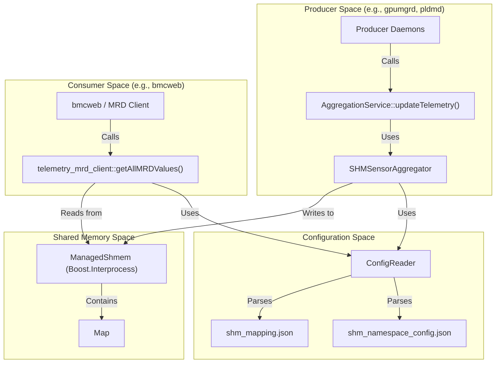
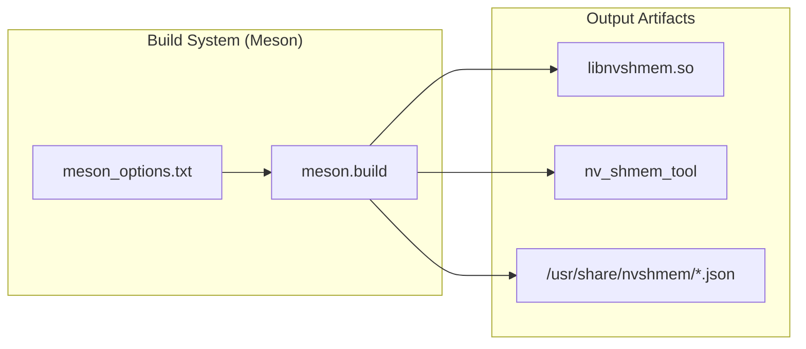

<!-- source: DeepWiki mcp.deepwiki.com · repo NVIDIA/nv-bmc-shmem · page 1 Overview · fetched 2026-10-26 -->

# Overview

Relevant source files

The following files were used as context for generating this wiki page:

- [README.md](README.md)
- [lib/include/shm_common.h](lib/include/shm_common.h)
- [meson.build](meson.build)
- [meson_options.txt](meson_options.txt)

The `nv-bmc-shmem` repository provides a high-performance shared memory (SHM) framework designed to aggregate sensor data and telemetry for the OpenBMC ecosystem. It serves as a low-latency cache between data producers (e.g., sensor daemons) and consumers (e.g., `bmcweb` for Redfish Metric Reports), significantly reducing the overhead associated with traditional D-Bus object management [README.md:1-22]().

## Purpose and Problem Statement

In standard OpenBMC architectures, `bmcweb` fulfills Redfish Metric Report Definition (MRD) requests by making multiple D-Bus calls via `ObjectManager`. This approach often leads to performance bottlenecks, such as PID loop outliers and failure to meet Service Level Agreements (SLAs) for telemetry turnaround time (TAT) [README.md:9-13]().

`nv-bmc-shmem` addresses these issues by:
*   **Caching Telemetry:** Storing sensor values in shared memory segments for near-instantaneous access [README.md:16-18]().
*   **Decoupling Producers and Consumers:** Allowing producers like `gpumgrd`, `pldmd`, or `hwmontemp` to push data into SHM independently of consumer read requests [README.md:18-21]().
*   **Optimizing Redfish Responses:** Providing a specialized API that aggregates data across namespaces to prepare Redfish-compliant responses efficiently [README.md:92-97]().

## High-Level Architecture

The system follows a producer-consumer model where multiple data sources write to specific SHM namespaces, and clients read from them using a unified API.

### System Interaction Diagram

This diagram bridges the natural language concepts of "Producers" and "Clients" to the core code entities used to facilitate communication.

**Sources:** [README.md:56-80](), [lib/include/aggregation_service.hpp:24-40](), [lib/include/telemetry_mrd_client.hpp:24-45]()

## Core Components

### 1. Shared Memory Management
The library abstracts raw memory management using `Boost.Interprocess`. Data is organized into namespaces (e.g., `MemoryMetrics`, `ProcessorMetrics`), each backed by a `ManagedShmem` segment [lib/include/shmem_managed_segment.hpp:33-45](). Within these segments, data is stored in a specialized `Map` structure that supports concurrent access via named upgradable mutexes [lib/include/shmem_map.hpp:45-60]().

### 2. Producer API (Writing Data)
Producers use the `AggregationService` to push telemetry. The system handles D-Bus path resolution and automatically maps sensor objects to the correct SHM namespace based on configuration files [README.md:82-89]().
*   For details on integrating a producer, see **[Producer API](#3)**.

### 3. Client API (Reading Data)
The client API, primarily used by `bmcweb`, provides functions like `getAllMRDValues()`. This function performs a "lookup and aggregate" operation: it identifies which SHM segments contain the requested metrics and returns a consolidated view of the data [README.md:90-97]().
*   For details on reading data, see **[Client API](#4)**.

### 4. Configuration and Mapping
The behavior of the library is driven by two primary JSON files:
*   `shm_mapping.json`: Defines the size of SHM segments and the producers authorized to write to them [README.md:151-159]().
*   `shm_namespace_config.json`: Maps Redfish Metric namespaces to specific D-Bus object path keywords and property lists [README.md:126-149]().

| Feature | Description |
| :--- | :--- |
| **Namespaces** | Logical groupings of metrics (e.g., `PlatformEnvironmentMetrics`) [README.md:129](). |
| **Producers** | List of processes allowed to update a namespace [README.md:156](). |
| **SizeInBytes** | Pre-allocated size for each SHM segment [README.md:158](). |

*   For details on configuration, see **[Configuration Files Reference](#1.2)**.

## Integration with OpenBMC

The library is integrated into the OpenBMC build system via Meson. It provides several build-time options to customize platform-specific behavior, such as `platform-system-id` for Redfish URI generation [meson_options.txt:4-9]().

**Sources:** [meson.build:1-31](), [meson_options.txt:1-21]()

*   To learn how to build and install the library, see **[Getting Started: Build and Configuration](#1.1)**.

## Developer Tools
The repository includes `nv_shmem_tool`, a CLI utility for inspecting, creating, and erasing SHM segments manually, which is essential for field debugging [README.md:51-53]().
*   For tool usage, see **[Developer Tools](#6)**.

---
**Sources:**
* [README.md:1-170]()
* [meson.build:1-40]()
* [meson_options.txt:1-34]()
* [lib/include/shm_common.h:32-114]()

---

