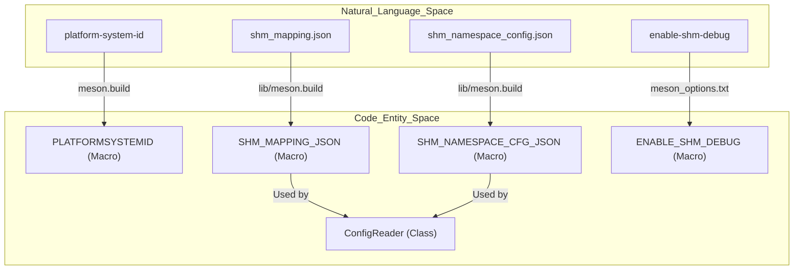
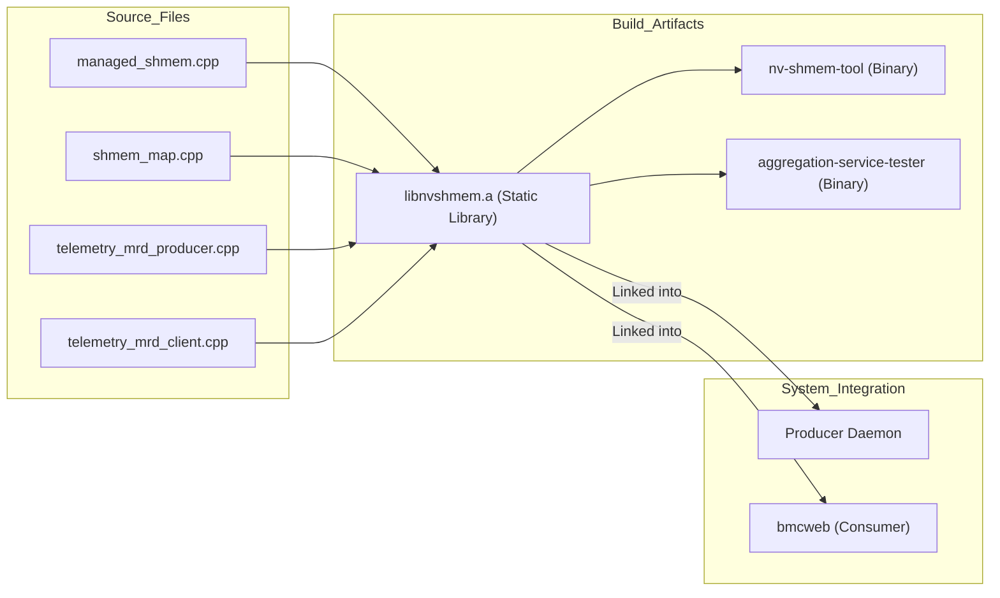

<!-- source: DeepWiki mcp.deepwiki.com · repo NVIDIA/nv-bmc-shmem · page 1.1 Getting Started: Build and Configuration · fetched 2026-10-26 -->

# Getting Started: Build and Configuration

Relevant source files

The following files were used as context for generating this wiki page:

- [.gitignore](.gitignore)
- [README.md](README.md)
- [lib/include/meson.build](lib/include/meson.build)
- [lib/meson.build](lib/meson.build)
- [meson.build](meson.build)
- [meson_options.txt](meson_options.txt)
- [tools/meson.build](tools/meson.build)

This page provides technical details on building the `nv-bmc-shmem` library, configuring its platform-specific parameters, and integrating it into the OpenBMC ecosystem. The library uses the Meson build system and relies on JSON configuration files to define shared memory (SHM) segments and sensor mappings.

## Build System Overview

The project is built using Meson (version >= 1.3.0) and requires a C++23 compliant compiler [meson.build:4-7](). It generates a static library named `libnvshmem` [lib/meson.build:35-48]() and a set of CLI tools for debugging and testing [tools/meson.build:2-14]().

### Build Options

Key build parameters are defined in `meson_options.txt` and processed in `lib/meson.build` to generate a `config.h` header used throughout the source code [lib/meson.build:30-33]().

| Option | Type | Default | Description |
| :--- | :--- | :--- | :--- |
| `platform-system-id` | `string` | `"system"` | Sets the `PLATFORMSYSTEMID` macro used for Redfish URI generation [meson_options.txt:4-9](). |
| `platform-device-prefix`| `string` | `""` | Sets the `PLATFORMDEVICEPREFIX` macro for platform-specific metric naming [meson_options.txt:10-15](). |
| `enable-shm-debug` | `feature`| `disabled` | Enables the `ENABLE_SHM_DEBUG` macro for verbose tracing [meson_options.txt:16-21](). |
| `libonly` | `boolean`| `false` | If true, skips building tools and tests [meson_options.txt:1](). |
| `log_interval_seconds` | `integer`| `2700` | Suppression window for duplicate error logs [meson_options.txt:22-27](). |
| `max_log_entries` | `integer`| `10000` | Capacity of the internal error tracking map [meson_options.txt:28-33](). |

**Sources:** [meson_options.txt:1-34](), [lib/meson.build:10-33]()

---

## Installation and Integration

### Installation Paths
When the library is installed, the following files are deployed to the system:
- **Headers:** `shm_common.h`, `telemetry_mrd_producer.hpp`, and `telemetry_mrd_client.hpp` [lib/include/meson.build:2-6]().
- **Library:** `libnvshmem.a` [lib/meson.build:35-48]().
- **Configurations:** `shm_mapping.json` and `shm_namespace_config.json` are installed to the package data directory (e.g., `/usr/share/nvshmem/`) [meson.build:17-31]().
- **Tools:** `nv-shmem-tool` and `aggregation-service-tester` [tools/meson.build:2-14]().

### Integration Requirements
To utilize the shared memory system, both producers and consumers must link against `libnvshmem`.

1.  **Producers (e.g., gpumgrd, pldmd):** Must call `AggregationService::namespaceInit()` to initialize their namespace and use `AggregationService::updateTelemetry()` to push data [README.md:82-89]().
2.  **Consumers (bmcweb):** Use `getAllMRDValues()` to read and aggregate telemetry across namespaces [README.md:90-97]().
3.  **D-Bus Policy:** Since the library uses `Boost.Interprocess`, the user running the producer/consumer processes must have appropriate permissions to create/access files in `/dev/shm`.

**Sources:** [README.md:82-97](), [lib/meson.build:17-24](), [lib/include/meson.build:2-6]()

---

## Configuration Architecture

The library behavior is governed by two primary JSON files. These files can be overridden via Bitbake appends in platform-specific recipes to adjust SHM sizes or sensor mappings [README.md:106-108]().

### 1. Shared Memory Mapping (`shm_mapping.json`)
Defines the physical characteristics of the SHM segments.
- **Producers:** A list of process names authorized to write to the namespace [README.md:153-157]().
- **SizeInBytes:** The total size allocated for the segment. This is typically calculated as a power of 2 based on expected sensor count [README.md:158-170]().

### 2. Namespace Configuration (`shm_namespace_config.json`)
Maps Redfish Metric Report Definition (MRD) namespaces to D-Bus object paths and properties.
- **Namespace:** The logical grouping (e.g., `MemoryMetrics`) [README.md:129]().
- **ObjectpathKeywords:** Keywords used to filter D-Bus paths for inclusion in this namespace [README.md:130]().
- **PropertyList:** The specific D-Bus properties to be cached in SHM [README.md:131]().

**Sources:** [README.md:99-170]()

---

## Data Flow and Build Entities

The following diagram illustrates how build-time options and configuration files flow into the code entities of the library.

### Configuration to Code Mapping
"Natural Language Space" refers to the JSON configurations and Meson options, while "Code Entity Space" refers to the classes and macros that consume them.

**Sources:** [lib/meson.build:10-29](), [meson_options.txt:4-21]()

### Build and Execution Pipeline
This diagram shows the relationship between the source files, the generated library, and the resulting binaries.

**Sources:** [lib/meson.build:35-48](), [tools/meson.build:2-14]()

---

