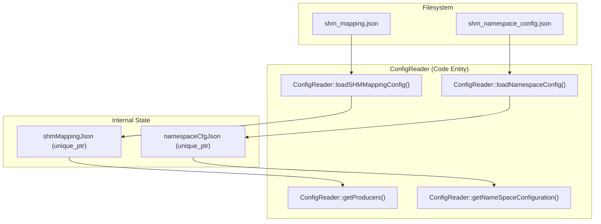
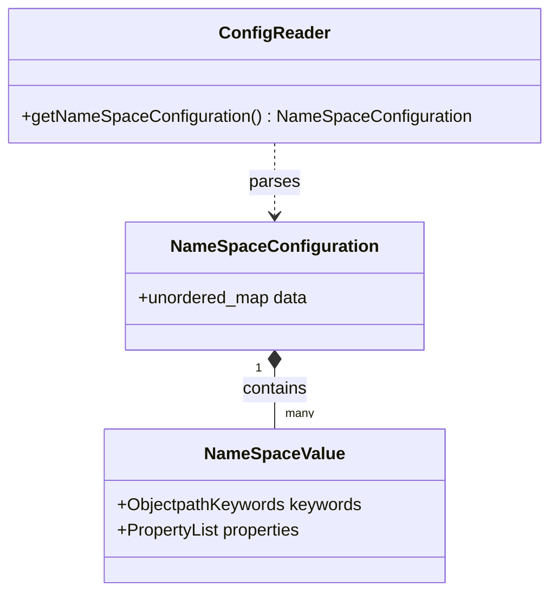

<!-- source: DeepWiki mcp.deepwiki.com · repo NVIDIA/nv-bmc-shmem · page 1.2 Configuration Files Reference · fetched 2026-10-26 -->

# Configuration Files Reference

<details>
<summary>Relevant source files</summary>

The following files were used as context for generating this wiki page:

- [configurations/shm_mapping.json](configurations/shm_mapping.json)
- [configurations/shm_namespace_config.json](configurations/shm_namespace_config.json)
- [lib/config_json_reader.cpp](lib/config_json_reader.cpp)
- [lib/impl/config_json_reader.hpp](lib/impl/config_json_reader.hpp)
- [lib/utils/port_utils.hpp](lib/utils/port_utils.hpp)

</details>


The `nv-bmc-shmem` library relies on two primary JSON configuration files to define how telemetry data is organized, which daemons (producers) are authorized to write to specific segments, and how D-Bus object paths map to shared memory namespaces. These configurations allow the system to be platform-agnostic while supporting specific hardware overrides via Bitbake.

## Configuration Architecture

The configuration is handled by the `ConfigReader` class, which lazily loads and parses the JSON files using `nlohmann::json` [lib/config_json_reader.cpp:26-27]().

### Configuration Data Flow
The following diagram illustrates how `ConfigReader` translates JSON files into the internal `NameSpaceConfiguration` used by the `SHMSensorAggregator`.

**Configuration Parsing Logic**

**Sources:** [lib/impl/config_json_reader.hpp:43-108](), [lib/config_json_reader.cpp:29-83]()

---

## 1. shm_mapping.json

This file defines the physical properties of the shared memory segments. It maps a `Namespace` to the specific system daemons allowed to produce data for it and defines the memory allocation size.

### Schema Reference
| Key | Type | Description |
| :--- | :--- | :--- |
| `Namespaces` | Object | Root object containing all namespace definitions. |
| `[NamespaceName]` | Object | A unique string identifier (e.g., `ProcessorMetrics`). |
| `Producers` | Array | List of binary names (e.g., `gpumgrd`) allowed to initialize this SHM segment. |
| `SizeInBytes` | Integer | The maximum size of the Boost.Interprocess segment. |

### Example
[configurations/shm_mapping.json:1-36]()
```json
{
    "Namespaces": {
        "PlatformEnvironmentMetrics": {
            "Producers": ["gpumgrd", "hwmontemp"],
            "SizeInBytes": 131072
        },
        "ProcessorPortMetrics": {
            "Producers": ["gpumgrd"],
            "SizeInBytes": 1024000
        }
    }
}
```

**Implementation Details:**
- **Validation:** The `ConfigReader::getSHMSize` function verifies that the calling `producerName` exists in the `Producers` array before returning the segment size [lib/config_json_reader.cpp:163-186]().
- **Default Sizes:** Sizes typically range from 128KB for environment metrics to 1MB for high-density port telemetry [configurations/shm_mapping.json:5-17]().

**Sources:** [configurations/shm_mapping.json:1-36](), [lib/config_json_reader.cpp:163-195]()

---

## 2. shm_namespace_config.json

This file defines the logical mapping between D-Bus telemetry and shared memory. It determines which D-Bus properties are captured based on keywords in the object path.

### Schema Reference
| Key | Type | Description |
| :--- | :--- | :--- |
| `SensorNamespaces` | Array | List of mapping rules. |
| `Namespace` | String | The target namespace defined in `shm_mapping.json`. |
| `ObjectpathKeywords` | String | A substring used to match D-Bus object paths (e.g., `sensors/temperature`). |
| `PropertyList` | Array | List of D-Bus property names to be aggregated into SHM. |

### Path Resolution Logic
When a producer calls `updateTelemetry(path, properties)`, the `SHMSensorAggregator` iterates through these rules. If the `path` contains the `ObjectpathKeywords`, the properties specified in `PropertyList` are extracted and written to the segment associated with `Namespace` [lib/config_json_reader.cpp:114-150]().

**Mapping Entity Relationship**

**Sources:** [lib/impl/config_json_reader.hpp:36-41](), [lib/config_json_reader.cpp:114-161]()

### Example
[configurations/shm_namespace_config.json:2-17]()
```json
{
    "SensorNamespaces": [
        {
            "Namespace": "PlatformEnvironmentMetrics",
            "ObjectpathKeywords": "sensors/temperature",
            "PropertyList": ["Value"]
        }
    ]
}
```

---

## Adding New Namespaces or Properties

To extend the telemetry coverage, follow these steps:

1.  **Define the Segment:** Add a new entry to `shm_mapping.json`. Ensure `SizeInBytes` is sufficient for the expected number of sensors (approx. 512 bytes per sensor entry is a safe buffer).
2.  **Define the Filter:** Add a new entry to `shm_namespace_config.json`.
    *   Choose `ObjectpathKeywords` that uniquely identify the sensor group.
    *   List all properties (e.g., `Value`, `Status`, `OperatingSpeed`) that the producer daemon will update.
3.  **Update Producer:** Ensure the producer daemon passes the correct binary name to `AggregationService::namespaceInit(producerName)` so it matches the `Producers` list in the mapping file.

---

## Platform-Specific Overrides

The library supports platform-specific configurations via the Yocto/Bitbake build system. This allows different NVIDIA platforms (e.g., HGX vs. MGX) to have different memory limits or property mappings.

### Bitbake Implementation
Platform recipes should use `FILESEXTRAPATHS` and `.bbappend` files to override the default JSON files installed by the `nv-bmc-shmem` recipe.

**Installation Paths:**
- Default: `/usr/share/nv-bmc-shmem/`
- Overrides are placed in the same directory, replacing the base files during the image construction phase.

### Compile-Time Constants
The `ConfigReader` uses macros defined in `config.h` (generated by Meson) to locate these files.
- `SHM_MAPPING_JSON`: Defaults to `/usr/share/nv-bmc-shmem/shm_mapping.json` [lib/config_json_reader.cpp:63-65]().
- `SHM_NAMESPACE_CFG_JSON`: Defaults to `/usr/share/nv-bmc-shmem/shm_namespace_config.json` [lib/config_json_reader.cpp:35-37]().

**Sources:** [lib/config_json_reader.cpp:18-83]()

---

## Metric Translation Reference

The `PropertyList` in `shm_namespace_config.json` often contains D-Bus strings that require translation to Redfish enums. The following static maps in `port_utils.hpp` are used by the client to interpret these values:

| PDI Value Substring | Redfish Output | Map Name |
| :--- | :--- | :--- |
| `PortState.LinkStatusType.LinkUp` | `LinkUp` | `linkStatusTypeMap` |
| `PortState.LinkStates.Disabled` | `Disabled` | `linkStateTypeMap` |
| `PowerSystemInputs.Status.Good` | `Normal` | `powerSystemInputTypeTypeMap` |

**Sources:** [lib/utils/port_utils.hpp:32-64]()

---

