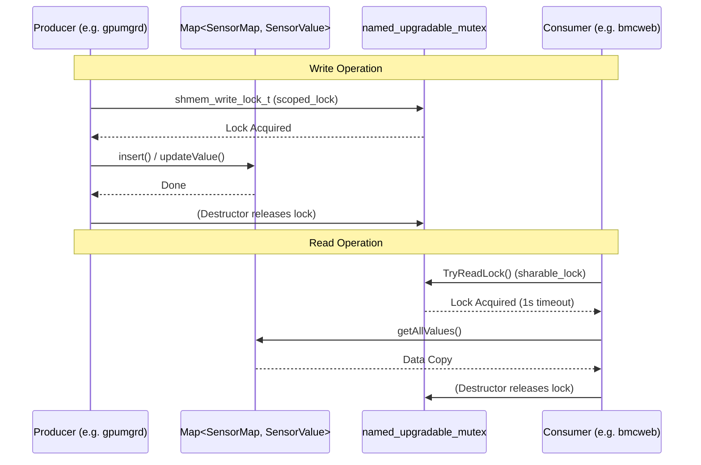

<!-- source: DeepWiki mcp.deepwiki.com · repo NVIDIA/nv-bmc-shmem · page 2 Core Architecture · fetched 2026-10-26 -->

# Core Architecture

<details>
<summary>Relevant source files</summary>

The following files were used as context for generating this wiki page:

- [lib/impl/managed_shmem.hpp](lib/impl/managed_shmem.hpp)
- [lib/impl/shmem_map.hpp](lib/impl/shmem_map.hpp)
- [lib/include/telemetry_mrd_producer.hpp](lib/include/telemetry_mrd_producer.hpp)
- [lib/managed_shmem.cpp](lib/managed_shmem.cpp)
- [lib/shmem_map.cpp](lib/shmem_map.cpp)
- [tools/nv_shmem_tool.cpp](tools/nv_shmem_tool.cpp)

</details>


The `nv-bmc-shmem` library implements a high-performance, layered architecture designed to move telemetry data from producer daemons to consumer services (like `bmcweb`) via Linux shared memory. This design bypasses the overhead of the D-Bus system bus for high-frequency telemetry while maintaining a structured, type-safe data model.

### Architectural Layers

The system is organized into four distinct layers, moving from raw memory management to high-level application interfaces:

1.  **Shared Memory Segment Layer**: Manages raw `boost::interprocess` segments and synchronization primitives.
2.  **Map Abstraction Layer**: Provides a templated, key-value store interface (`Map`) that resides entirely within the shared memory segment.
3.  **Namespace Management Layer**: Orchestrates multiple `Map` instances (namespaces) to organize data by producer or device type.
4.  **Service Facade Layer**: Provides the public `AggregationService` and `telemetry_mrd_client` APIs used by external daemons.

#### System Component Diagram

The following diagram illustrates how code entities bridge the gap between high-level concepts and the underlying shared memory implementation.

**Diagram: System Entity Mapping**
```mermaid
graph TD
    subgraph "Application Space"
        [Producer] -- "updateTelemetry()" --> [AggregationService]
        [Consumer] -- "getAllMRDValues()" --> [ClientAPI]
    end

    subgraph "Logic Layer (ShmSensorMapIntf)"
        [AggregationService] --> [SHMSensorAggregator]
        [SHMSensorAggregator] --> [ShmSensorMapIntf]
    end

    subgraph "Data Layer (lib/impl)"
        [ShmSensorMapIntf] --> [Map_SensorMap_SensorValue]
        [Map_SensorMap_SensorValue] -- "inherits" --> [ManagedShmem]
    end

    subgraph "OS/Shared Memory"
        [ManagedShmem] --> [boost_managed_shared_memory]
        [ManagedShmem] --> [boost_named_upgradable_mutex]
    end

    style [AggregationService] stroke-dasharray: 5 5
    style [Map_SensorMap_SensorValue] stroke-dasharray: 5 5
```
**Sources:** [lib/include/telemetry_mrd_producer.hpp:120-159](), [lib/impl/shmem_map.hpp:52-68](), [lib/impl/managed_shmem.hpp:47-68]()

---

### Core Components

#### ManagedShmem and Map
At the base of the stack, `ManagedShmem` wraps `boost::interprocess::managed_shared_memory` [lib/impl/managed_shmem.hpp:63](). It handles the lifecycle of the segment and a `named_upgradable_mutex` [lib/impl/managed_shmem.hpp:65]() used for multi-process synchronization.

The `Map` class template extends `ManagedShmem` to provide a structured container for `SensorValue` objects [lib/impl/shmem_map.hpp:52](). It uses a custom `void_allocator_t` to ensure that all map nodes and strings are allocated within the shared memory segment itself, rather than the process heap [lib/managed_shmem.cpp:58-60]().

For details, see [Shared Memory Segments: ManagedShmem and Map](#2.1).

#### ShmSensorMapIntf
The `ShmSensorMapIntf` (referenced in higher-level logic) acts as a manager for these `Map` instances. It abstracts the complexities of segment initialization and provides a simplified interface for inserting and updating telemetry [lib/shmem_map.cpp:160-178](). It ensures that producers can write to specific namespaces (e.g., `gpumgrd_shm`) without managing raw pointers.

For details, see [ShmSensorMapIntf: Namespace Management Layer](#2.2).

#### Data Structures and Type System
The system relies on a specialized type system to ensure compatibility across process boundaries. This includes `char_string_t` (a Boost-compatible string) and `SensorMapValue`, which aggregates the metric value, a Redfish-style timestamp string, and a Unix timestamp [lib/shmem_map.cpp:166-170]().

For details, see [Data Structures and Type System](#2.3).

---

### Data Flow and Synchronization

The architecture employs a single-writer, multi-reader synchronization model using an upgradable mutex.

**Diagram: Thread Synchronization and Data Flow**


| Component | Synchronization Type | Timeout / Behavior |
| :--- | :--- | :--- |
| **Write Lock** | `scoped_lock` | Exclusive access; blocks until acquired [lib/impl/managed_shmem.hpp:37-38](). |
| **Read Lock** | `sharable_lock` | Concurrent access; 1-second timeout before throwing `LockAcquisitionException` [lib/managed_shmem.cpp:73-85](). |
| **Memory Access** | `offset_ptr` | Ensures pointers are valid across different process base addresses [lib/impl/shmem_map.hpp:186](). |

**Sources:** [lib/impl/managed_shmem.hpp:37-41](), [lib/managed_shmem.cpp:73-85](), [lib/shmem_map.cpp:116-121](), [lib/shmem_map.cpp:181-183]()

---

