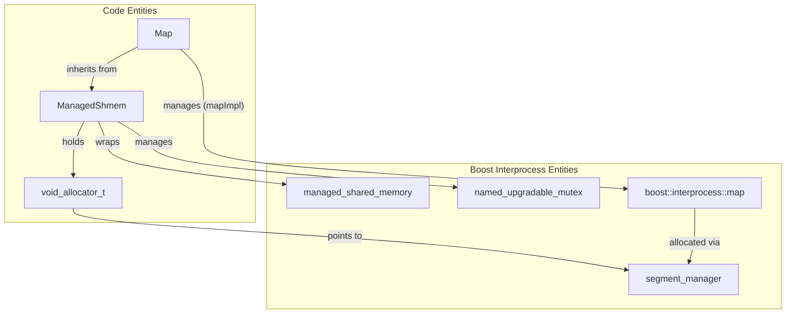
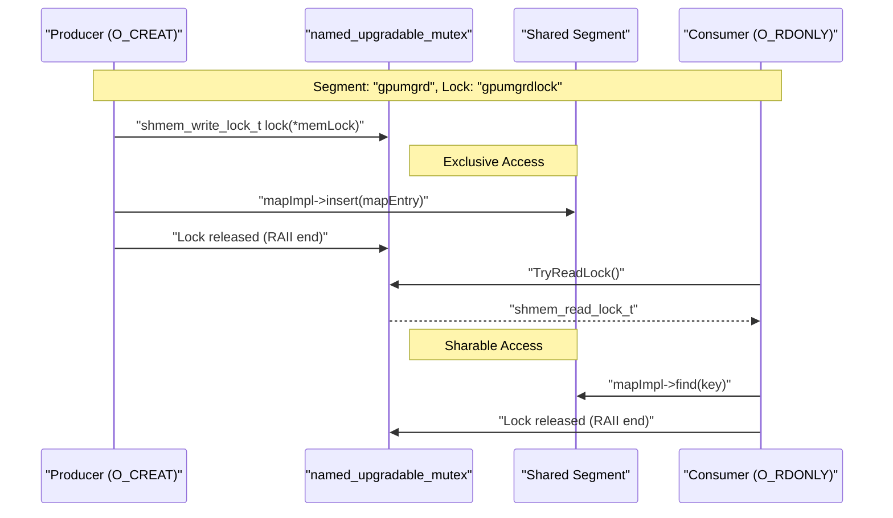

<!-- source: DeepWiki mcp.deepwiki.com · repo NVIDIA/nv-bmc-shmem · page 2.1 Shared Memory Segments: ManagedShmem and Map · fetched 2026-10-26 -->

# Shared Memory Segments: ManagedShmem and Map

Relevant source files

The following files were used as context for generating this wiki page:

- [lib/impl/managed_shmem.hpp](lib/impl/managed_shmem.hpp)
- [lib/impl/shmem_map.hpp](lib/impl/shmem_map.hpp)
- [lib/include/telemetry_mrd_producer.hpp](lib/include/telemetry_mrd_producer.hpp)
- [lib/managed_shmem.cpp](lib/managed_shmem.cpp)
- [lib/shmem_map.cpp](lib/shmem_map.cpp)
- [tools/nv_shmem_tool.cpp](tools/nv_shmem_tool.cpp)

This page provides a deep dive into the low-level shared memory layer of the `nv-bmc-shmem` library. It covers the management of raw Boost.Interprocess segments via `ManagedShmem`, the templated `Map` abstraction for sensor data, and the synchronization strategies employed to ensure data integrity between producers and consumers.

## ManagedShmem: Lifecycle and Mutex Management

`ManagedShmem` serves as the foundational wrapper for `boost::interprocess::managed_shared_memory` [lib/impl/managed_shmem.hpp:63](). It abstracts the complexity of segment initialization, cleanup, and inter-process synchronization.

### Lifecycle Management
The class supports two primary modes of operation based on the `opts` flag:
1.  **Creation Mode (`O_CREAT`)**: Used by producers. It attempts to remove any existing segment and lock with the same name before creating a new one to ensure a clean state [lib/managed_shmem.cpp:34-55]().
2.  **Open-Only Mode**: Used by consumers (e.g., `bmcweb`). It opens existing segments and locks in a read-only or shared capacity [lib/managed_shmem.cpp:65-71]().

### Synchronization: named_upgradable_mutex
Synchronization is handled via `boost::interprocess::named_upgradable_mutex` [lib/impl/managed_shmem.hpp:22](). This allows for multiple concurrent readers or a single exclusive writer. 
*   **Read Locks**: Implemented as `shmem_read_lock_t` (a `sharable_lock`) [lib/impl/managed_shmem.hpp:39-40]().
*   **Write Locks**: Implemented as `shmem_write_lock_t` (a `scoped_lock`) [lib/impl/shmem_map.hpp:103]().

The library uses a timed acquisition strategy for read locks. The `TryReadLock()` function attempts to acquire a sharable lock within a 1-second timeout; failure to do so results in a `LockAcquisitionException` [lib/managed_shmem.cpp:73-85]().

**Sources:** [lib/impl/managed_shmem.hpp:47-85](), [lib/managed_shmem.cpp:31-85]()

## The Map Template

The `Map<MapType, ValueType>` class is a templated abstraction that manages a specific data structure within the shared memory segment [lib/impl/shmem_map.hpp:51-53](). In the context of this library, it is almost exclusively instantiated as `Map<SensorMap, SensorValue>` [lib/shmem_map.cpp:23-24]().

### Internal Layout
The `Map` class holds a reference to the internal Boost map via an `offset_ptr` [lib/impl/shmem_map.hpp:186](). This pointer is valid across different process address spaces because it stores the offset from the start of the shared memory segment rather than an absolute address.

### Key Operations
| Function | Lock Type | Description |
| :--- | :--- | :--- |
| `insert` | Write | Inserts or updates a `SensorMapValue`. Requires `O_CREAT` [lib/shmem_map.cpp:160-178](). |
| `getValue` | Read | Retrieves a single `SensorValue` by key [lib/shmem_map.cpp:94-107](). |
| `getAllValues` | Read | Returns a `std::vector` of all values in the map [lib/shmem_map.cpp:70-82](). |
| `updateValue` | Write | Updates only the sensor string value for an existing key [lib/shmem_map.cpp:136-157](). |
| `erase` | Write | Removes a specific key from the map [lib/impl/shmem_map.hpp:99-110](). |

**Sources:** [lib/impl/shmem_map.hpp:51-187](), [lib/shmem_map.cpp:23-205]()

## Memory Allocation and void_allocator_t

Because standard C++ containers (like `std::map` or `std::string`) allocate memory on the heap of the local process, they cannot be used directly in shared memory. Instead, the library uses Boost.Interprocess containers with a custom allocator.

### The void_allocator_t Pattern
The `void_allocator_t` is initialized from the segment manager of the managed shared memory [lib/managed_shmem.cpp:58-59](). This allocator is passed to the constructors of shared memory objects to ensure their internal nodes and dynamic data are allocated within the shared segment boundaries.

### Data Flow: From String to char_string_t
When a standard `std::string` key is passed to the map, it must be converted to a `char_string_t` (a Boost-compatible string using the segment allocator) before it can be used for lookups or insertions [lib/impl/shmem_map.hpp:178-183]().

**Sources:** [lib/impl/managed_shmem.hpp:64](), [lib/managed_shmem.cpp:58-60](), [lib/impl/shmem_map.hpp:178-183]()

## Entity Mapping Diagrams

### Code Entity to Shared Memory Mapping
This diagram shows how the C++ classes relate to the underlying Boost Interprocess entities.

**Sources:** [lib/impl/managed_shmem.hpp:47-68](), [lib/impl/shmem_map.hpp:51-53](), [lib/shmem_map.cpp:28-33]()

### Producer-Consumer Synchronization Flow
This diagram illustrates the locking mechanism used when a Producer (e.g., `nv_shmem_tool` in create mode) and a Consumer (e.g., `nv_shmem_tool` in read mode) access the same segment.

**Sources:** [lib/managed_shmem.cpp:73-85](), [lib/shmem_map.cpp:160-178](), [tools/nv_shmem_tool.cpp:51-62](), [tools/nv_shmem_tool.cpp:145-163]()

---

