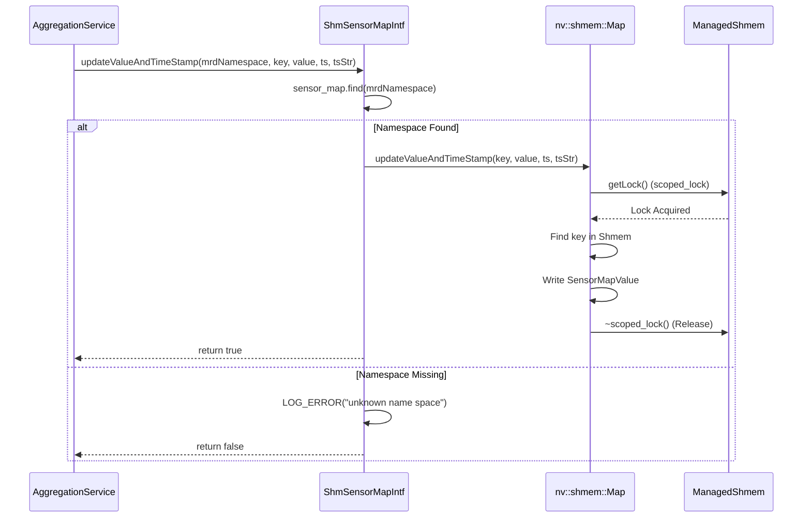

<!-- source: DeepWiki mcp.deepwiki.com · repo NVIDIA/nv-bmc-shmem · page 2.2 ShmSensorMapIntf: Namespace Management Layer · fetched 2026-10-26 -->

# ShmSensorMapIntf: Namespace Management Layer

<details>
<summary>Relevant source files</summary>

The following files were used as context for generating this wiki page:

- [lib/impl/shm_sensormap_intf.hpp](lib/impl/shm_sensormap_intf.hpp)
- [lib/include/shm_common.h](lib/include/shm_common.h)

</details>


The `ShmSensorMapIntf` class serves as the management and orchestration layer for shared memory namespaces. It acts as a bridge between high-level producer services (like `AggregationService`) and the low-level `Map` instances that reside within raw shared memory segments. Its primary responsibility is maintaining a collection of named `Map` objects and routing telemetry updates to the correct memory segment based on the provided namespace.

## Class Architecture

`ShmSensorMapIntf` manages a local `unordered_map` that associates a namespace string (e.g., "GPU", "Switch") with a unique pointer to a `sensor_map_type`. This `sensor_map_type` is a template instantiation of `nv::shmem::Map` using `SensorMap` as the key type and `SensorValue` as the value type [lib/impl/shm_sensormap_intf.hpp:32-33]().

### Code Entity Relationship
The following diagram illustrates how `ShmSensorMapIntf` bridges the logical MRD (Metric Report Definition) namespaces to the physical shared memory `Map` objects.

**Diagram: Namespace Routing Logic**
```mermaid
graph TD
    subgraph "Producer Layer"
        "AggregationService" --> "ShmSensorMapIntf"
    end

    subgraph "Management Layer (ShmSensorMapIntf)"
        "ShmSensorMapIntf" -- "contains" --> "sensor_map[std::unordered_map]"
        "sensor_map[std::unordered_map]" -- "mrdNamespace" --> "MapInstance[nv::shmem::Map]"
    end

    subgraph "Physical SHM Layer"
        "MapInstance[nv::shmem::Map]" -- "interacts" --> "ManagedShmem"
        "ManagedShmem" -- "allocates" --> "Boost.Interprocess.Segment"
    end
```
**Sources:** [lib/impl/shm_sensormap_intf.hpp:39-43](), [lib/impl/shm_sensormap_intf.hpp:240-241]()

## Key Operations

The class provides a set of CRUD-like operations for managing telemetry data within specific namespaces.

### Namespace Lifecycle
*   **`createNamespace(nameSpace, shmSize)`**: Initializes a new shared memory segment. It attempts to create a new `sensor_map_type` with `O_CREAT` flags and the specified size in bytes [lib/impl/shm_sensormap_intf.hpp:68-84]().
*   **`isNameSpacePresent(nameSpace)`**: Checks the internal `sensor_map` registry to verify if a namespace has been initialized [lib/impl/shm_sensormap_intf.hpp:52-59]().

### Data Manipulation
All data operations follow a pattern: resolve the namespace to a `Map` pointer, then delegate the operation to that `Map`.

| Function | Purpose | Logic |
| :--- | :--- | :--- |
| `insert` | Adds a new key-value pair to a namespace. | Finds namespace in `sensor_map`, calls `itr->second->insert(key, value)` [lib/impl/shm_sensormap_intf.hpp:95-122](). |
| `updateValueAndTimeStamp` | Updates telemetry and its associated timing data. | Atomic-style update of value, epoch timestamp, and ISO string [lib/impl/shm_sensormap_intf.hpp:225-238](). |
| `updateTimeStamp` | Updates only the timing metadata for a key. | Used when a sensor is polled but the value hasn't changed [lib/impl/shm_sensormap_intf.hpp:134-168](). |
| `erase` | Removes a specific key from a namespace. | Calls `itr->second->erase(key)` [lib/impl/shm_sensormap_intf.hpp:250-273](). |

**Sources:** [lib/impl/shm_sensormap_intf.hpp:52-273]()

## Data Flow: Telemetry Update

When a producer daemon updates a sensor, the data flows through `ShmSensorMapIntf` as shown below.

**Diagram: Telemetry Update Sequence**

**Sources:** [lib/impl/shm_sensormap_intf.hpp:225-247](), [lib/impl/shm_sensormap_intf.hpp:108-112]()

## Error Handling and Logging

`ShmSensorMapIntf` uses a combination of `phosphor-logging` (lg2) for critical failures and a custom `ErrorLogger` for rate-limited error reporting.

1.  **Exception Safety**: Every public method is wrapped in a `try-catch` block to prevent shared memory corruption or crashes from propagating to the producer daemon [lib/impl/shm_sensormap_intf.hpp:115-121]().
2.  **Rate-Limited Logging**: If a namespace is missing or a key is invalid, the class uses the `LOG_ERROR` macro [lib/impl/shm_sensormap_intf.hpp:111](). This routes through `ErrorLogger` to ensure the system logs are not flooded during high-frequency telemetry cycles.
3.  **Return Values**: Most methods return a `bool` indicating success or failure, allowing the `AggregationService` to take corrective action (such as attempting to re-initialize a namespace) [lib/impl/shm_sensormap_intf.hpp:83-105]().

**Sources:** [lib/impl/shm_sensormap_intf.hpp:19](), [lib/impl/shm_sensormap_intf.hpp:108-113](), [lib/impl/shm_sensormap_intf.hpp:163-167]()

---

