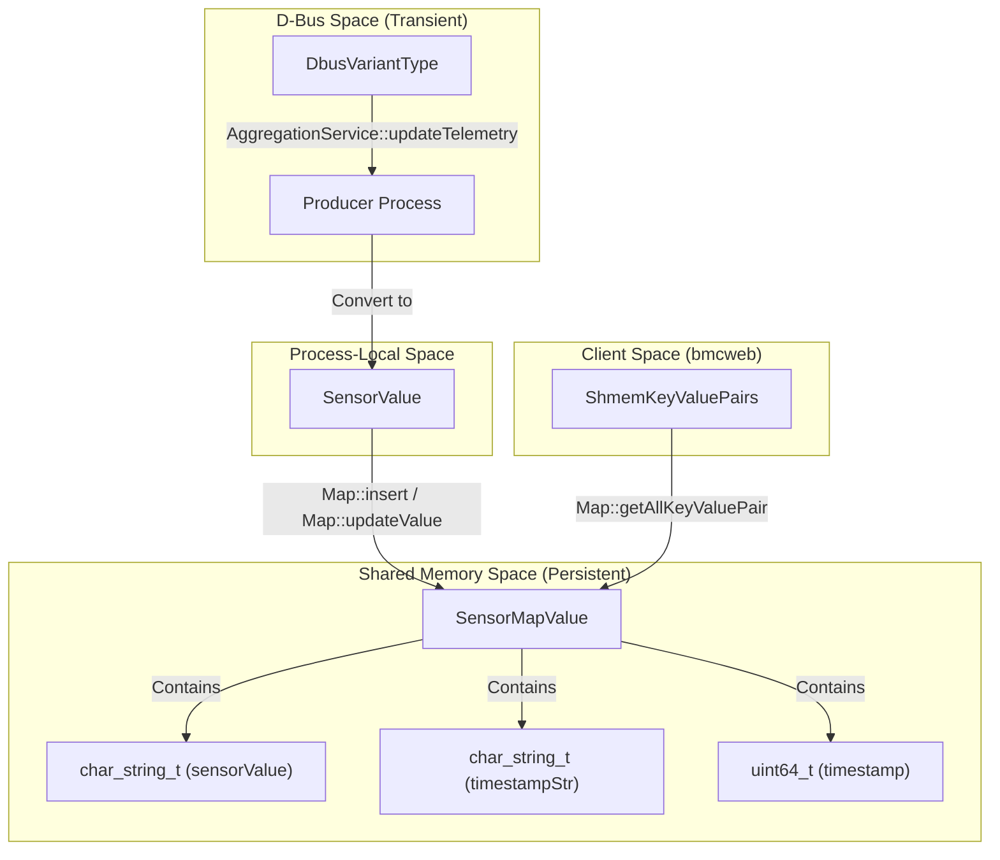
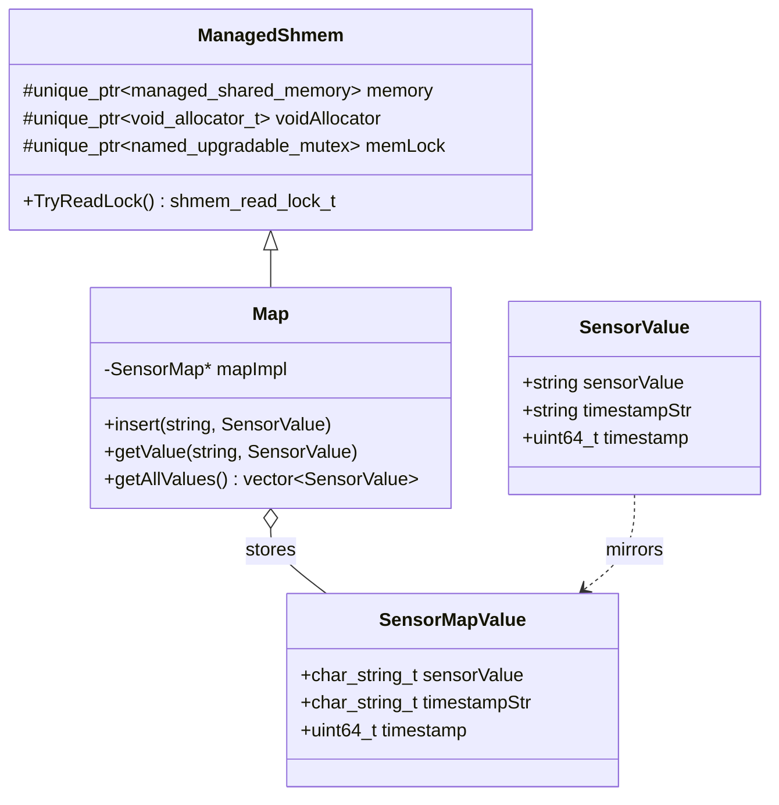

<!-- source: DeepWiki mcp.deepwiki.com · repo NVIDIA/nv-bmc-shmem · page 2.3 Data Structures and Type System · fetched 2026-10-26 -->

# Data Structures and Type System

<details>
<summary>Relevant source files</summary>

The following files were used as context for generating this wiki page:

- [lib/impl/managed_shmem.hpp](lib/impl/managed_shmem.hpp)
- [lib/include/shm_common.h](lib/include/shm_common.h)
- [lib/include/telemetry_mrd_producer.hpp](lib/include/telemetry_mrd_producer.hpp)
- [lib/shmem_map.cpp](lib/shmem_map.cpp)

</details>


The `nv-bmc-shmem` library employs a specialized type system designed to facilitate the storage of complex D-Bus telemetry data within POSIX shared memory segments. Because standard C++ containers (like `std::string` or `std::map`) typically allocate memory on the process heap, they cannot be directly shared across different process address spaces. This system utilizes **Boost.Interprocess** and **Boost.Container** to provide memory-segment-aware alternatives that allow producers and consumers to interact with a unified data model.

## Core Data Types

The type system is divided into two primary categories: **D-Bus Interface Types**, used for interacting with the OpenBMC D-Bus ecosystem, and **Shared Memory Types**, which are optimized for persistence in shared memory segments.

### D-Bus Interface Types

The `DbusVariantType` is a comprehensive `std::variant` that encompasses all possible data types emitted by OpenBMC sensor producers.

| Type Name | Definition | Role |
| :--- | :--- | :--- |
| `DbusVariantType` | `std::variant<...>` | A union of all supported D-Bus property types including scalars, strings, object paths, and complex nested tuples/vectors. |

**Implementation Details:**
- Defined in `[lib/include/shm_common.h:37-53]()`.
- Includes support for specialized `sdbusplus` types like `unix_fd` and `object_path` `[lib/include/shm_common.h:41-42]()`.
- Handles complex telemetry structures such as GPU metric arrays and nested sensor associations `[lib/include/shm_common.h:43-51]()`.

### Shared Memory Types

These structures are designed to reside within a `boost::interprocess::managed_shared_memory` segment.

| Type Name | Definition | Role |
| :--- | :--- | :--- |
| `char_string_t` | `boost::container::basic_string<char, ...>` | A shared-memory-compatible string using a segment-specific allocator. |
| `SensorMapValue` | `struct` | The raw storage format for a sensor entry within the SHM segment. |
| `SensorValue` | `struct` | A "mirrored" version of `SensorMapValue` using `std::string` for use in process-local memory. |
| `ShmemKeyValuePairs` | `std::unordered_map<std::string, std::string>` | A standard map used by clients to retrieve bulk snapshots of SHM data. |

**Implementation Details:**
- `char_string_t` is used instead of `std::string` because standard library implementations are often not flexible enough to support Boost's segment managers `[lib/include/shm_common.h:67-72]()`.
- `SensorMapValue` requires a `void_allocator_t` during construction to ensure its internal strings are allocated within the shared segment `[lib/include/shm_common.h:80-83]()`.

### Data Entity Mapping

The following diagram illustrates how D-Bus telemetry data is transformed from transient D-Bus types into persistent shared memory structures.

**Telemetry Data Flow and Type Mapping**

**Sources:** `[lib/include/shm_common.h:37-112]()`, `[lib/shmem_map.cpp:160-178]()`, `[lib/include/telemetry_mrd_producer.hpp:153-158]()`.

---

## The Shared Memory Allocator System

To manage memory within a segment, the library defines several allocator types tied to the Boost `segment_manager`.

| Allocator Type | Definition | Usage |
| :--- | :--- | :--- |
| `segment_manager_t` | `managed_shared_memory::segment_manager` | The underlying manager for the SHM segment. |
| `void_allocator_t` | `allocator<void, segment_manager_t>` | A generic allocator used to initialize complex structures like `SensorMap`. |
| `char_allocator_t` | `allocator<char, segment_manager_t>` | Specifically for allocating `char` buffers for `char_string_t`. |

**Implementation Details:**
- These types are defined in `[lib/include/shm_common.h:61-66]()`.
- The `void_allocator_t` is passed into the `SensorMap` constructor to allow the map to allocate its internal nodes within the shared memory region `[lib/shmem_map.cpp:31-33]()`.

---

## Container Architecture: Boost vs. Std

The library explicitly avoids `std` containers for data stored inside the SHM segment.

### Why Boost?
1. **Pointer Compatibility:** `std::string` and `std::map` use raw pointers. In shared memory, the base address of the segment may differ between processes. Boost containers use **offset pointers** (relative addresses) which remain valid regardless of the process's mapping address.
2. **Allocator Injection:** Boost containers allow passing a custom allocator (like `void_allocator_t`) to every internal allocation call `[lib/shmem_map.cpp:33]()`.
3. **Inter-Process Mutexes:** The system uses `boost::interprocess::named_upgradable_mutex` to synchronize access between the producer (writer) and consumer (reader) `[lib/impl/managed_shmem.hpp:37-40]()`.

### Type Mirroring Pattern
To simplify the API for developers, the library uses a mirroring pattern:
- **Storage:** `SensorMapValue` (Boost-based) `[lib/include/shm_common.h:73-84]()`.
- **Interface:** `SensorValue` (Std-based) `[lib/include/shm_common.h:86-100]()`.

The `SensorValue` class provides an assignment operator that automatically converts Boost `char_string_t` into `std::string` when reading data out of the segment:
```cpp
SensorValue& operator=(const SensorMapValue& mapValue)
{
    metricProperty = mapValue.metricProperty;
    timestampStr = mapValue.timestampStr;
    sensorValue = mapValue.sensorValue;
    timestamp = mapValue.timestamp;
    return *this;
}
```
**Sources:** `[lib/include/shm_common.h:102-110]()`.

---

## Class Relationship Diagram

This diagram shows the relationship between the low-level memory management and the high-level data types used by the `Map` class.

**Shared Memory Type Hierarchy**

**Sources:** `[lib/impl/managed_shmem.hpp:47-68]()`, `[lib/shmem_map.cpp:23-41]()`, `[lib/include/shm_common.h:73-110]()`.

---

