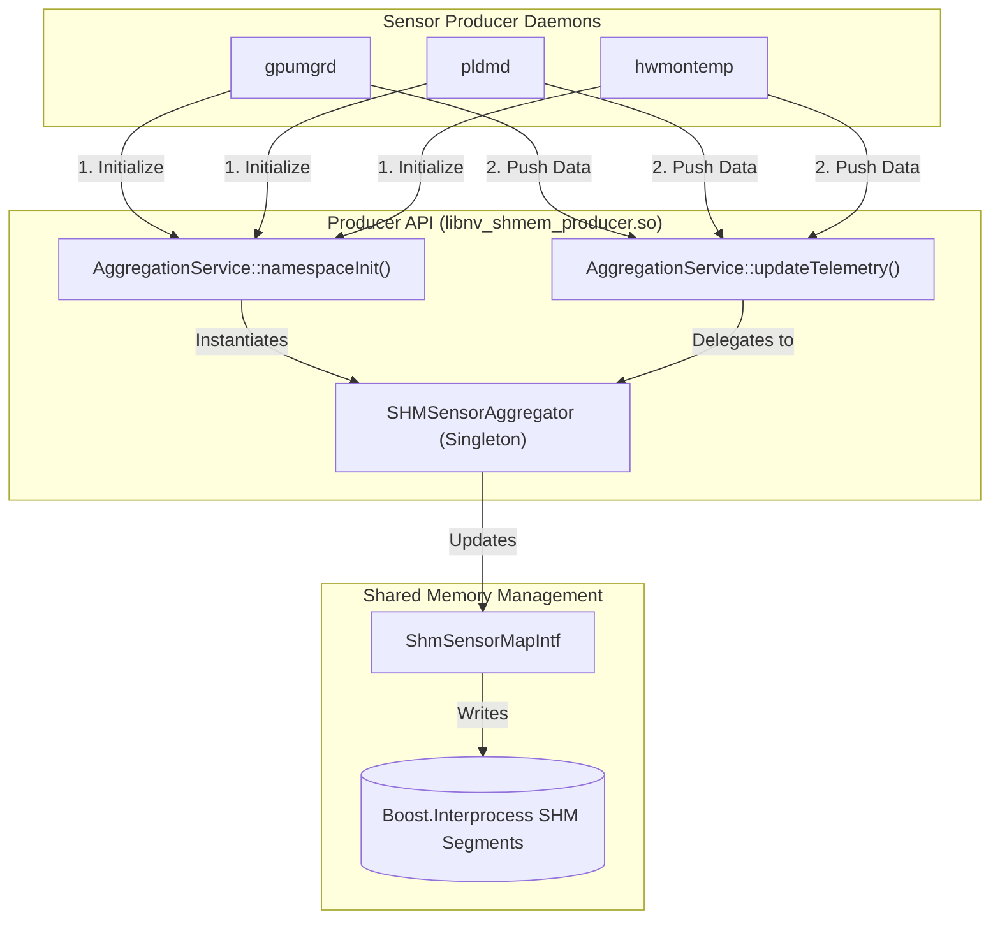
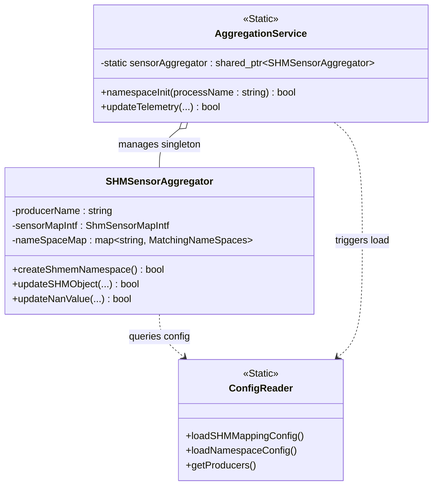

<!-- source: DeepWiki mcp.deepwiki.com · repo NVIDIA/nv-bmc-shmem · page 3 Producer API · fetched 2026-10-26 -->

# Producer API

Relevant source files

The following files were used as context for generating this wiki page:

- [lib/shm_sensor_aggregator.cpp](lib/shm_sensor_aggregator.cpp)
- [lib/telemetry_mrd_producer.cpp](lib/telemetry_mrd_producer.cpp)

The Producer API provides a high-level interface for sensor producer daemons (such as `gpumgrd`, `pldmd`, and `hwmontemp`) to write telemetry data into shared memory segments. By using this API, producers abstract away the complexities of shared memory management, synchronization, and D-Bus path-to-SHM mapping.

The architecture relies on two primary components:
1.  **`AggregationService`**: The public-facing static interface used by producers.
2.  **`SHMSensorAggregator`**: The internal engine that handles path resolution, lifecycle management, and data updates.

### Producer Workflow Overview

The following diagram illustrates the flow from a producer daemon into the shared memory system via the Producer API.

**Producer Data Flow**

**Sources:** [lib/telemetry_mrd_producer.cpp:26-113](), [lib/shm_sensor_aggregator.cpp:159-181]()

---

### AggregationService: Public Producer Interface

The `AggregationService` class acts as the primary facade for the library. It is designed to be used as a static service, holding a singleton instance of the internal aggregator.

Key responsibilities include:
*   **Initialization**: `namespaceInit(processName)` loads the required JSON configurations and prepares the shared memory segments for the specific producer [lib/telemetry_mrd_producer.cpp:28-81]().
*   **Telemetry Updates**: `updateTelemetry()` accepts standard D-Bus parameters (path, interface, property, value) and routes them to the correct memory location [lib/telemetry_mrd_producer.cpp:83-113]().
*   **Error Handling**: It handles error return codes (`rc`) from producers by automatically converting failed sensor reads into `NaN` values in shared memory [lib/telemetry_mrd_producer.cpp:94-102]().

For details on the API signature and usage examples, see **[AggregationService: Public Producer Interface](#3.1)**.

**Sources:** [lib/telemetry_mrd_producer.cpp:26-113]()

---

### SHMSensorAggregator: Path Resolution and Lifecycle

While `AggregationService` provides the interface, `SHMSensorAggregator` performs the heavy lifting. It manages the lifecycle of the shared memory segments and resolves D-Bus object paths into specific shared memory namespaces.

Key internal mechanisms include:
*   **Path Parsing**: Uses `parseDevicePath` and `getMatchCount` to determine which SHM namespace a specific D-Bus object belongs to based on `shm_namespace_config.json` [lib/shm_sensor_aggregator.cpp:31-157]().
*   **Cache Management**: Maintains a `nameSpaceMap` to cache resolved paths and a `notApplicableKeys` list to skip properties that do not require aggregation, optimizing performance for high-frequency updates.
*   **Timestamp Synchronization**: Ensures that telemetry timestamps are correctly synchronized between the producer's clock and the system clock used in shared memory.
*   **Thread Safety**: Utilizes `std::scoped_lock` and internal mutexes to ensure that concurrent updates from different threads within a producer daemon do not corrupt the shared memory segment.

For details on path heuristics and array handling, see **[SHMSensorAggregator: Path Resolution and SHM Lifecycle](#3.2)**.

**Sources:** [lib/shm_sensor_aggregator.cpp:31-157](), [lib/shm_sensor_aggregator.cpp:159-181]()

---

### Component Relationship

The relationship between the static interface and the internal aggregator is established during the initialization phase.

**Class Relationship and Initialization**

**Sources:** [lib/telemetry_mrd_producer.cpp:26-52](), [lib/shm_sensor_aggregator.cpp:162-176]()

---

