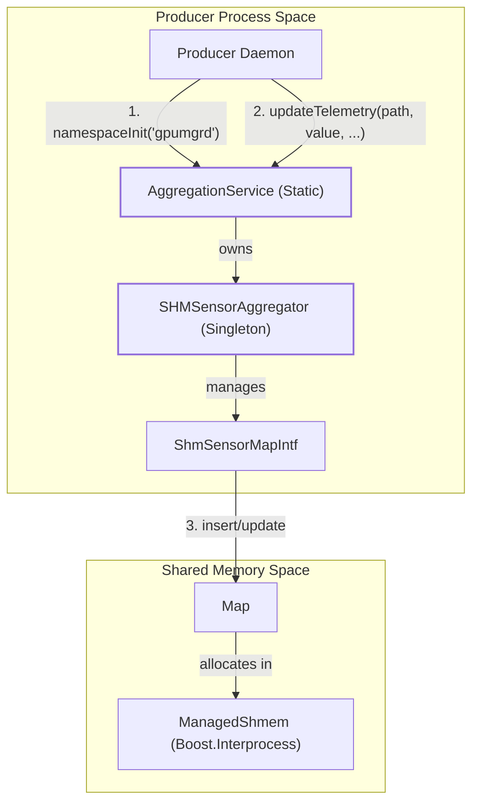
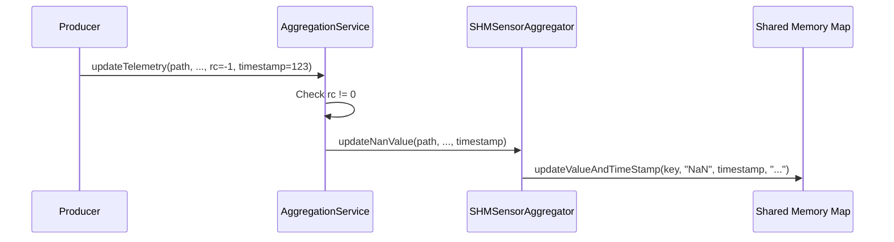

<!-- source: DeepWiki mcp.deepwiki.com · repo NVIDIA/nv-bmc-shmem · page 3.1 AggregationService: Public Producer Interface · fetched 2026-10-26 -->

# AggregationService: Public Producer Interface

<details>
<summary>Relevant source files</summary>

The following files were used as context for generating this wiki page:

- [lib/impl/managed_shmem.hpp](lib/impl/managed_shmem.hpp)
- [lib/include/telemetry_mrd_client.hpp](lib/include/telemetry_mrd_client.hpp)
- [lib/include/telemetry_mrd_producer.hpp](lib/include/telemetry_mrd_producer.hpp)
- [lib/shmem_map.cpp](lib/shmem_map.cpp)
- [lib/telemetry_mrd_producer.cpp](lib/telemetry_mrd_producer.cpp)

</details>


The `AggregationService` serves as the primary facade for producer daemons (such as `gpumgrd` or `pldmd`) to write telemetry data into shared memory. It abstracts the complexities of path resolution, shared memory segment management, and concurrency control behind a simplified static API.

## Core Singleton Pattern

The `AggregationService` operates using a static singleton pattern, holding a shared pointer to an internal `SHMSensorAggregator` instance. This aggregator is responsible for the actual mapping of D-Bus paths to shared memory namespaces.

### Data Flow: Producer to Shared Memory

The following diagram illustrates how a producer call to `updateTelemetry` propagates through the system layers into the physical shared memory segment.

**Producer Data Flow Architecture**

Sources: [lib/telemetry_mrd_producer.hpp:120-161](), [lib/telemetry_mrd_producer.cpp:26-26]()

---

## API Reference

### namespaceInit()

This function must be called exactly once by a producer before any telemetry updates are attempted. It initializes the configuration readers and instantiates the internal aggregator.

**Signature:**
`static bool namespaceInit(std::string processName);` [lib/include/telemetry_mrd_producer.hpp:136-136]()

**Parameters:**
* `processName`: The name of the producer service (e.g., "gpumgrd"). This string is used as a suffix for identifying relevant shared memory namespaces in the configuration. [lib/include/telemetry_mrd_producer.hpp:132-132]()

**Implementation Details:**
1. Calls `ConfigReader::loadSHMMappingConfig()` to parse the global SHM mapping. [lib/telemetry_mrd_producer.cpp:34-34]()
2. Calls `ConfigReader::loadNamespaceConfig()` to parse the specific namespace definitions. [lib/telemetry_mrd_producer.cpp:45-45]()
3. Instantiates the `SHMSensorAggregator` singleton. [lib/telemetry_mrd_producer.cpp:50-52]()
4. Triggers `createShmemNamespace()` to ensure the physical segments exist and are mapped. [lib/telemetry_mrd_producer.cpp:73-73]()

Sources: [lib/telemetry_mrd_producer.cpp:28-81]()

### updateTelemetry()

The primary entry point for writing telemetry. It handles both initial creation of sensor objects and subsequent value/timestamp updates.

**Signature:**
```cpp
static bool updateTelemetry(const std::string& devicePath,
                            const std::string& interface,
                            const std::string& propName,
                            DbusVariantType& value,
                            const uint64_t timestamp, 
                            int rc,
                            const std::string associatedEntityPath = {});
```
[lib/include/telemetry_mrd_producer.hpp:153-158]()

**Parameters:**
| Parameter | Description |
| :--- | :--- |
| `devicePath` | The full D-Bus object path (e.g., `/xyz/openbmc_project/sensors/temperature/GPU_0`). |
| `interface` | The D-Bus interface name (e.g., `xyz.openbmc_project.Sensor.Value`). |
| `propName` | The specific property being updated (e.g., `Value`). |
| `value` | A `DbusVariantType` containing the data (double, int64, string, etc.). |
| `timestamp` | The sample time (milliseconds since epoch). |
| `rc` | Return Code. If non-zero, triggers NaN/Error handling. |
| `associatedEntityPath` | Optional. Required for `PlatformEnvironmentMetrics` to resolve parent/child relationships. |

Sources: [lib/include/telemetry_mrd_producer.hpp:141-158]()

---

## NaN and Error Handling

The `rc` (Return Code) parameter determines how the system treats the incoming `value`. This allows producers to signal that a sensor is in an error state or currently unavailable without needing to change the `DbusVariantType` contents.

**Logic Flow:**
* **If `rc != 0` and `timestamp != 0`**: The system ignores the `value` parameter and calls `sensorAggregator->updateNanValue()`. This sets the internal state for that sensor to "NaN" (Not a Number) in shared memory, signaling to consumers that the reading is invalid. [lib/telemetry_mrd_producer.cpp:94-102]()
* **If `rc == 0`**: The system calls `sensorAggregator->updateSHMObject()`, which persists the actual `value` and `timestamp`. [lib/telemetry_mrd_producer.cpp:109-111]()

**NaN Update Sequence**

Sources: [lib/telemetry_mrd_producer.cpp:94-112](), [lib/shmem_map.cpp:181-205]()

---

## Usage Examples

### Initializing a Producer
```cpp
std::string producerName = "gpumgrd";
if (!nv::shmem::AggregationService::namespaceInit(producerName)) {
    // Handle initialization failure (e.g., config file missing)
}
```
Sources: [lib/include/telemetry_mrd_producer.hpp:38-39]()

### Updating a Numeric Sensor
```cpp
std::string path = "/xyz/openbmc_project/sensors/temperature/HSC_Temp";
std::string interface = "xyz.openbmc_project.Sensor.Value";
nv::shmem::DbusVariantType value = 45.5;
uint64_t ts = 1712345678000;

nv::shmem::AggregationService::updateTelemetry(path, interface, "Value", value, ts, 0, "Chassis_0");
```
Sources: [lib/include/telemetry_mrd_producer.hpp:54-70]()

### Reporting a Sensor Error (NaN)
```cpp
// Pass a non-zero rc to signal error/NaN
nv::shmem::AggregationService::updateTelemetry(path, interface, "Value", value, ts, -1);
```
Sources: [lib/include/telemetry_mrd_producer.hpp:90-91]()

---

## Thread Safety and Concurrency

The `AggregationService` delegates thread safety to the underlying layers:
1. **Singleton Protection**: The `sensorAggregator` is initialized during `namespaceInit`. [lib/telemetry_mrd_producer.cpp:50-52]()
2. **Write Locking**: Every call to `updateTelemetry` eventually invokes `Map::updateValueAndTimeStamp` or `Map::insert`. These functions utilize `shmem_write_lock_t`, which wraps a `boost::interprocess::named_upgradable_mutex`. [lib/shmem_map.cpp:165-165](), [lib/shmem_map.cpp:187-187]()
3. **Timed Locks**: Locks are typically acquired with a timeout to prevent a hung producer from deadlocking the entire telemetry subsystem. [lib/impl/managed_shmem.hpp:70-75]()

Sources: [lib/impl/managed_shmem.hpp:37-40](), [lib/shmem_map.cpp:181-205]()

---

