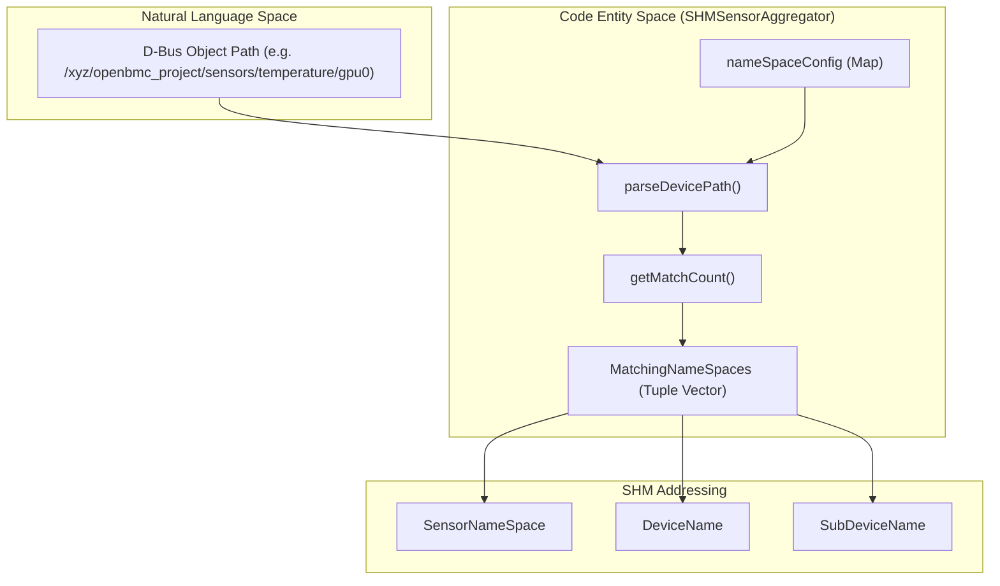
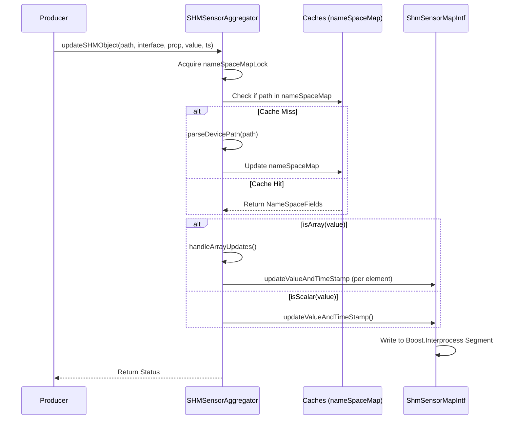

<!-- source: DeepWiki mcp.deepwiki.com · repo NVIDIA/nv-bmc-shmem · page 3.2 SHMSensorAggregator: Path Resolution and SHM Lifecycle · fetched 2026-10-26 -->

# SHMSensorAggregator: Path Resolution and SHM Lifecycle

Relevant source files

The following files were used as context for generating this wiki page:

- [lib/impl/shm_sensor_aggregator.hpp](lib/impl/shm_sensor_aggregator.hpp)
- [lib/shm_sensor_aggregator.cpp](lib/shm_sensor_aggregator.cpp)

The `SHMSensorAggregator` class is the internal engine responsible for mapping D-Bus telemetry data to shared memory (SHM) structures. It handles the complexity of parsing D-Bus object paths to determine the correct SHM namespace, manages the lifecycle of SHM segments for producers, and ensures thread-safe updates to telemetry values, including complex array-based metrics.

### Path Resolution Heuristics

When a producer submits telemetry, the aggregator must resolve the D-Bus object path into a specific SHM namespace, device name, and sub-device name. This is performed by `parseDevicePath` and `getMatchCount`.

#### Path Parsing Logic
The aggregator compares the incoming D-Bus path against patterns defined in the `nameSpaceConfig` [lib/impl/shm_sensor_aggregator.hpp:77-78]().

1.  **Tokenization**: The input path and the configuration keywords are split by the `/` delimiter [lib/shm_sensor_aggregator.cpp:35-36]().
2.  **Match Counting**: `getMatchCount` iterates through the tokens to find the longest prefix match between the object path and the configured keywords [lib/shm_sensor_aggregator.cpp:31-61]().
3.  **Heuristic Mapping**: Based on the match count and the prefix of the path (e.g., `xyz/openbmc_project/sensors`), the aggregator extracts `deviceName` and `subDeviceName` [lib/shm_sensor_aggregator.cpp:93-142]().
    *   Paths starting with `xyz/openbmc_project/state` typically map the filename to `subDeviceName` [lib/shm_sensor_aggregator.cpp:95]().
    *   Paths containing `ResetStatistics` extract the parent path's filename as the `deviceName` [lib/shm_sensor_aggregator.cpp:127-128]().

#### Entity Relationship Diagram: Path Resolution
This diagram illustrates how D-Bus path strings are transformed into code entities used for SHM addressing.

Sources: [lib/shm_sensor_aggregator.cpp:31-61](), [lib/shm_sensor_aggregator.cpp:63-157](), [lib/impl/shm_sensor_aggregator.hpp:53-54]()

### SHM Lifecycle and Namespace Management

The aggregator manages the creation and initialization of SHM segments based on the producer's configuration.

*   **Namespace Creation**: `createShmemNamespace()` identifies the namespaces owned by the current producer via `ConfigReader::getProducers()` [lib/shm_sensor_aggregator.cpp:162-164](). It constructs a unique SHM name using the pattern: `{producerName}_{PLATFORMDEVICEPREFIX}{namespace}_{index}` [lib/shm_sensor_aggregator.cpp:169-170]().
*   **Size Determination**: The size of the SHM segment is retrieved from the configuration using `ConfigReader::getSHMSize()` [lib/shm_sensor_aggregator.cpp:175-176]().
*   **Initialization**: The `shmem::ShmSensorMapIntf` is used to physically create the segment if it does not already exist [lib/shm_sensor_aggregator.cpp:171-177]().

Sources: [lib/shm_sensor_aggregator.cpp:159-195](), [lib/impl/shm_sensor_aggregator.hpp:131]()

### Caching and Thread Safety

To minimize the overhead of path parsing and configuration lookups, `SHMSensorAggregator` maintains internal caches.

*   **nameSpaceMap**: A cache of type `NameSpaceMap` (mapping a string key to `NameSpaceFields`) that stores previously resolved path-to-namespace mappings [lib/impl/shm_sensor_aggregator.hpp:51,132]().
*   **notApplicableKeys**: A cache used to quickly skip D-Bus paths that do not match any configured SHM namespace [lib/impl/shm_sensor_aggregator.hpp:133]().
*   **Thread Safety**: Access to these caches is protected by `std::mutex` using `std::scoped_lock` to prevent race conditions during concurrent telemetry updates from the same producer [lib/impl/shm_sensor_aggregator.hpp:128-129]().

Sources: [lib/impl/shm_sensor_aggregator.hpp:128-133]()

### Array Handling and Value Updates

The `handleArrayUpdates` function manages metrics that are represented as lists or arrays in D-Bus.

*   **Index-Based Storage**: Array elements are stored in SHM with indexed keys (e.g., `MetricName_0`, `MetricName_1`) [lib/shm_sensor_aggregator.cpp:1910-1915]().
*   **Dynamic Resizing**: If the incoming array size differs from the existing size in SHM, the aggregator performs a "diff":
    *   If the new array is smaller, trailing elements are removed from SHM [lib/shm_sensor_aggregator.cpp:1930-1945]().
    *   If the new array is larger, new entries are inserted [lib/shm_sensor_aggregator.cpp:1910-1915]().
*   **NaN Handling**: When a producer reports an error (non-zero return code), `updateNanValue` is called. For arrays, this results in the array being truncated to a single element with the value `nan` [lib/impl/shm_sensor_aggregator.hpp:116-117]().

Sources: [lib/shm_sensor_aggregator.cpp:1900-1950](), [lib/impl/shm_sensor_aggregator.hpp:181-195]()

### Timestamp Synchronization

The aggregator ensures that telemetry is associated with both a high-resolution monotonic timestamp and a wall-clock timestamp.

*   **Clock Sync**: It uses `steady_clock` for internal duration tracking and `system_clock` for Redfish-compliant ISO 8601 strings.
*   **Redfish Formatting**: The `getDateTimeUintMs` utility converts the epoch timestamp provided by the producer into the formatted string required for the `Timestamp` field in SHM [lib/shm_sensor_aggregator.cpp:1880-1885]().

### Internal Data Flow Diagram
This diagram shows the lifecycle of a telemetry update from the `updateSHMObject` call to the final SHM write.

Sources: [lib/shm_sensor_aggregator.cpp:1780-1850](), [lib/shm_sensor_aggregator.cpp:1900-1950](), [lib/impl/shm_sensor_aggregator.hpp:98-101]()

---

