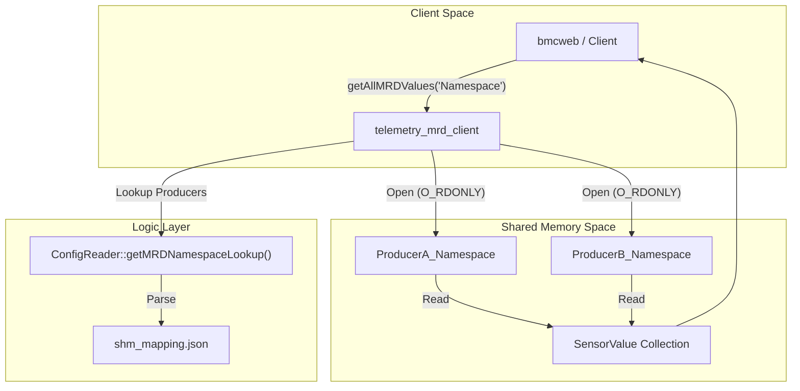
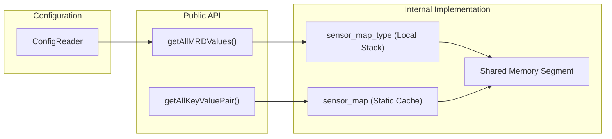

<!-- source: DeepWiki mcp.deepwiki.com · repo NVIDIA/nv-bmc-shmem · page 4 Client API · fetched 2026-10-26 -->

# Client API

Relevant source files

The following files were used as context for generating this wiki page:

- [lib/include/telemetry_mrd_client.hpp](lib/include/telemetry_mrd_client.hpp)
- [lib/telemetry_mrd_client.cpp](lib/telemetry_mrd_client.cpp)

The Client API provides a high-level interface for consumers, such as `bmcweb`, to retrieve aggregated telemetry data from shared memory segments. Instead of interacting with raw shared memory primitives, clients use the `telemetry_mrd_client` functions to query data by Metric Report Definition (MRD) namespaces. The library handles the complexity of mapping these high-level namespaces to specific producer segments and aggregating the results.

### Overview of Client Interaction

The client-side logic is designed for read-only access (`O_RDONLY`). When a client requests data for a namespace like `PlatformEnvironmentMetrics`, the library performs a lookup to identify all producers (e.g., `gpumgrd`, `pldmd`) that contribute to that specific metric type. It then iterates through the corresponding shared memory segments, collects the telemetry records, and returns them as a unified collection.

#### Data Retrieval Flow
The following diagram illustrates how a client request for an MRD namespace is resolved into physical shared memory access.

**Client Request Resolution**

**Sources:** [lib/telemetry_mrd_client.cpp:63-119](), [lib/include/telemetry_mrd_client.hpp:19-23]()

### Key Code Entities

The Client API is primarily defined in `telemetry_mrd_client.hpp` and implemented in `telemetry_mrd_client.cpp`. It relies on `ConfigReader` to understand the system topology.

| Entity | Role |
| :--- | :--- |
| `getAllMRDValues` | Aggregates `SensorValue` objects across all producers for a given MRD namespace. |
| `getAllKeyValuePair` | Returns raw key-value pairs from a specific shared memory namespace. |
| `getMrdNamespacesValues` | Returns a list of all valid MRD namespaces defined in the configuration. |
| `ConfigReader` | Internal utility that parses JSON configuration to map MRDs to producers. |
| `NameSpaceNotFoundException` | Thrown when a requested namespace is missing from the configuration or SHM. |
| `NoElementsException` | Thrown when a namespace exists but contains no telemetry data. |

**Sources:** [lib/include/telemetry_mrd_client.hpp:53-100](), [lib/telemetry_mrd_client.cpp:40-131]()

### Functional Components

The client functionality is split into two main areas: the data retrieval functions and the configuration resolution logic.

#### [Client Functions: getAllMRDValues and getAllKeyValuePair](#4.1)
This component provides the primary entry points for reading telemetry. `getAllMRDValues()` is the standard tool for Redfish-style aggregation, while `getAllKeyValuePair()` provides access to raw data. The implementation uses lazy initialization to open shared memory segments and ensures that segments are accessed in read-only mode to prevent accidental corruption of producer data.

For details, see [Client Functions: getAllMRDValues and getAllKeyValuePair](#4.1).

**Sources:** [lib/telemetry_mrd_client.cpp:40-61](), [lib/telemetry_mrd_client.cpp:63-119]()

#### [ConfigReader: Namespace Lookup and JSON Parsing](#4.2)
`ConfigReader` is the backbone of the client API. It parses `shm_mapping.json` and `shm_namespace_config.json` to determine which producers are responsible for which metrics. This allows the client API to abstract away the physical naming of SHM segments (which are usually prefixed by the producer name) from the high-level MRD names used in Redfish.

For details, see [ConfigReader: Namespace Lookup and JSON Parsing](#4.2).

**Sources:** [lib/telemetry_mrd_client.cpp:65-66](), [lib/telemetry_mrd_client.cpp:123-124]()

### System Integration Diagram

This diagram shows the relationship between the high-level API functions and the underlying `sensor_map_type` (the shared memory map abstraction).

**API to Code Entity Mapping**

**Sources:** [lib/telemetry_mrd_client.cpp:42-51](), [lib/telemetry_mrd_client.cpp:75-76]()

---

