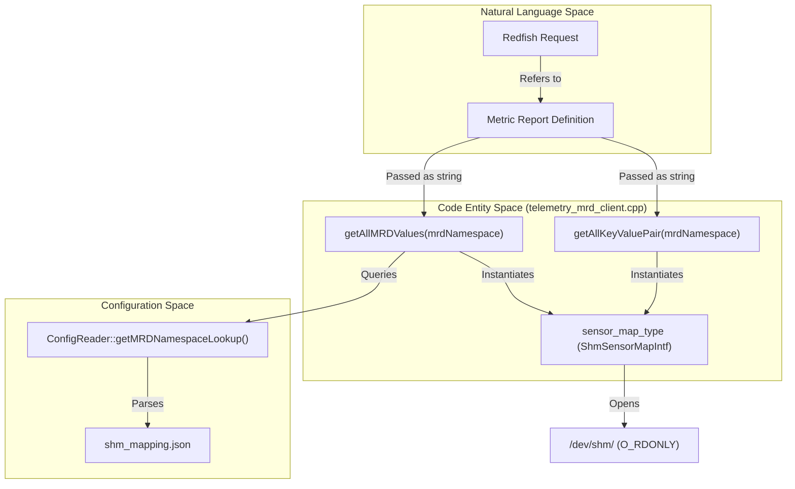
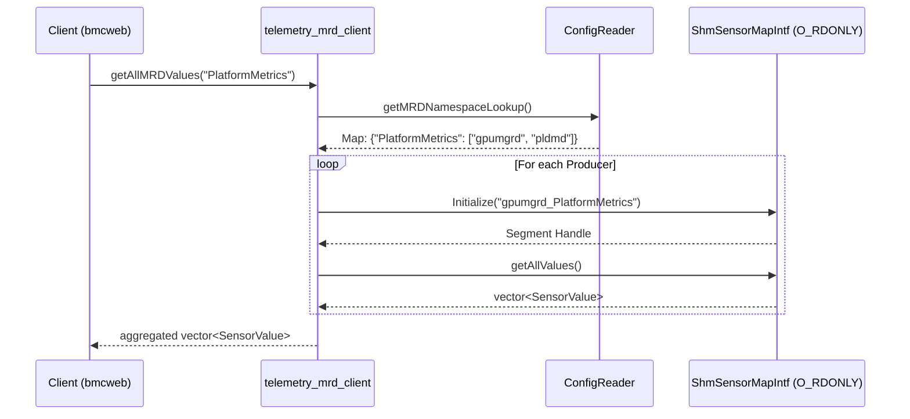

<!-- source: DeepWiki mcp.deepwiki.com · repo NVIDIA/nv-bmc-shmem · page 4.1 Client Functions: getAllMRDValues and getAllKeyValuePair · fetched 2026-10-26 -->

# Client Functions: getAllMRDValues and getAllKeyValuePair

Relevant source files

The following files were used as context for generating this wiki page:

- [lib/include/telemetry_mrd_client.hpp](lib/include/telemetry_mrd_client.hpp)
- [lib/telemetry_mrd_client.cpp](lib/telemetry_mrd_client.cpp)

This page provides a detailed technical reference for the client-side API of the `nv-bmc-shmem` library. These functions are primarily utilized by consumers like `bmcweb` to retrieve aggregated telemetry data from shared memory segments produced by various BMC daemons.

## Overview

The client API provides a high-level abstraction for reading telemetry data without requiring the consumer to manage shared memory segments or synchronization directly. It handles the resolution of Metric Report Definition (MRD) namespaces to physical shared memory segments, performs lazy initialization of segment connections in read-only mode, and aggregates data across multiple producers.

### Data Flow and Code Entity Mapping

The following diagram illustrates how the client functions bridge the gap between a Redfish-style MRD namespace and the underlying shared memory infrastructure.

**Client-Side Data Resolution**

Sources: [lib/telemetry_mrd_client.cpp:40-119](), [lib/include/telemetry_mrd_client.hpp:18-39]()

---

## Core Client Functions

### getAllMRDValues()

The `getAllMRDValues` function is the primary entry point for bmcweb to fetch all metrics belonging to a specific MRD category (e.g., `PlatformEnvironmentMetrics`).

**Implementation Details:**
1.  **Namespace Lookup**: It retrieves the mapping between MRD namespaces and producers using `ConfigReader::getMRDNamespaceLookup()` [lib/telemetry_mrd_client.cpp:65-66]().
2.  **Aggregation Loop**: It iterates through every producer associated with the requested `mrdNamespace`. For each producer, it constructs a specific SHM namespace string: `producerName + "_" + mrdNamespace` [lib/telemetry_mrd_client.cpp:70-74]().
3.  **Lazy Segment Access**: It creates a local instance of `sensor_map_type` (which is an alias for `ShmSensorMapIntf`) in `O_RDONLY` mode for that specific segment [lib/telemetry_mrd_client.cpp:75]().
4.  **Data Collection**: It calls `getAllValues()` on the segment and appends the results to a master vector of `SensorValue` objects [lib/telemetry_mrd_client.cpp:76-83]().
5.  **Error Handling**: If a specific producer's segment is missing or empty, it logs the error but continues to the next producer to ensure partial data availability [lib/telemetry_mrd_client.cpp:85-98]().

Sources: [lib/telemetry_mrd_client.cpp:63-119](), [lib/include/telemetry_mrd_client.hpp:53-62]()

### getAllKeyValuePair()

This function provides raw access to the key-value pairs stored in a specific shared memory namespace. Unlike `getAllMRDValues`, it maintains a static cache of open segments to improve performance for repeated lookups.

**Implementation Details:**
1.  **Static Cache**: It uses a `static unordered_map<string, unique_ptr<sensor_map_type>> sensor_map` to persist connections to shared memory segments across function calls [lib/telemetry_mrd_client.cpp:42]().
2.  **Lazy Initialization**: If the requested namespace is not in the cache, it instantiates a new `sensor_map_type` in `O_RDONLY` mode and stores it [lib/telemetry_mrd_client.cpp:45-50]().
3.  **Data Retrieval**: It returns a `ShmemKeyValuePairs` object containing the raw keys and their associated `SensorValue` structures [lib/telemetry_mrd_client.cpp:51]().

Sources: [lib/telemetry_mrd_client.cpp:40-61](), [lib/include/telemetry_mrd_client.hpp:66-76]()

### getMrdNamespacesValues()

A utility function that returns a list of all valid MRD namespaces currently defined in the system configuration.

**Implementation Details:**
1.  It queries `ConfigReader::getMRDNamespaceLookup()` [lib/telemetry_mrd_client.cpp:123-124]().
2.  It extracts and returns all keys from the lookup map [lib/telemetry_mrd_client.cpp:126-130]().

Sources: [lib/telemetry_mrd_client.cpp:121-131]()

---

## Internal Mechanisms

### Lazy SHM Segment Opening
Both primary functions open shared memory segments using the `O_RDONLY` flag. This ensures that the client cannot inadvertently modify telemetry data or interfere with the producer's write operations. The segments are accessed via the `ShmSensorMapIntf` class (aliased as `sensor_map_type`).

### Exception Handling
The library defines specific exceptions to signal state issues to the caller:

| Exception | Trigger Condition |
| :--- | :--- |
| `NameSpaceNotFoundException` | Thrown when a requested MRD namespace does not exist in the configuration lookup or the physical SHM file cannot be found [lib/include/telemetry_mrd_client.hpp:82-87](). |
| `NoElementsException` | Thrown when the namespace exists but contains no telemetry data [lib/include/telemetry_mrd_client.hpp:94-99](). |

In `getAllMRDValues`, the function will only throw `NoElementsException` if *all* associated producers return no data [lib/telemetry_mrd_client.cpp:100-110]().

Sources: [lib/telemetry_mrd_client.cpp:58-60](), [lib/telemetry_mrd_client.cpp:109-117](), [lib/include/telemetry_mrd_client.hpp:82-99]()

---

## Implementation Diagram

The following diagram details the internal logic flow within `telemetry_mrd_client.cpp`.

**Internal Logic Flow**

Sources: [lib/telemetry_mrd_client.cpp:63-119](), [lib/include/telemetry_mrd_client.hpp:18-39]()

---

