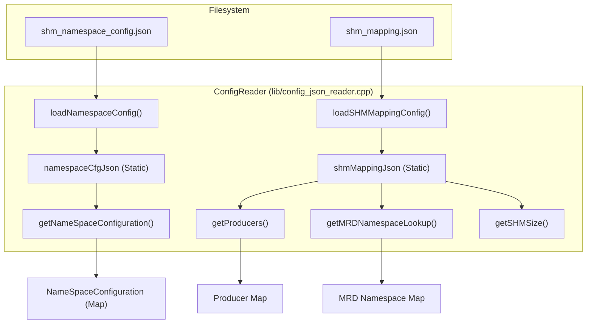

<!-- source: DeepWiki mcp.deepwiki.com · repo NVIDIA/nv-bmc-shmem · page 4.2 ConfigReader: Namespace Lookup and JSON Parsing · fetched 2026-10-26 -->

# ConfigReader: Namespace Lookup and JSON Parsing

<details>
<summary>Relevant source files</summary>

The following files were used as context for generating this wiki page:

- [configurations/shm_mapping.json](configurations/shm_mapping.json)
- [configurations/shm_namespace_config.json](configurations/shm_namespace_config.json)
- [lib/config_json_reader.cpp](lib/config_json_reader.cpp)
- [lib/impl/config_json_reader.hpp](lib/impl/config_json_reader.hpp)
- [lib/utils/port_utils.hpp](lib/utils/port_utils.hpp)

</details>


The `ConfigReader` struct is a static utility class responsible for loading, parsing, and providing access to the JSON configuration files that define the shared memory ecosystem. It acts as the source of truth for both producers (to determine which D-Bus properties to aggregate) and clients (to determine which physical shared memory segments correspond to a Redfish Metric Report Definition namespace).

## Configuration Files and Loading

`ConfigReader` manages two primary configuration files:
1.  **shm_namespace_config.json**: Defines the mapping between Redfish namespaces, D-Bus object path keywords, and the specific property lists to be collected. [configurations/shm_namespace_config.json:1-194]()
2.  **shm_mapping.json**: Defines the relationship between namespaces, the producer daemons authorized to write to them, and the allocated size for each shared memory segment. [configurations/shm_mapping.json:1-36]()

### Initialization Logic
The class uses a lazy-loading pattern with static `std::unique_ptr<Json>` members to ensure files are parsed only once.

*   `loadNamespaceConfig()`: Checks for the existence of `SHM_NAMESPACE_CFG_JSON`, parses it using `nlohmann::json`, and handles errors via `LOG_ERROR` and exceptions. [lib/config_json_reader.cpp:29-55]()
*   `loadSHMMappingConfig()`: Performs similar operations for `SHM_MAPPING_JSON`. [lib/config_json_reader.cpp:57-83]()

### Configuration Data Flow
The following diagram illustrates how `ConfigReader` transforms raw JSON files into structured data for the system.

**Diagram: ConfigReader Data Transformation**

Sources: [lib/impl/config_json_reader.hpp:43-108](), [lib/config_json_reader.cpp:26-112]()

## Core Methods and Data Structures

### Namespace Configuration
The `getNameSpaceConfiguration()` method returns a `NameSpaceConfiguration` object, which is an `unordered_map` where the key is the `SensorNameSpace` (e.g., "ProcessorMetrics") and the value is a vector of pairs containing path keywords and property lists. [lib/impl/config_json_reader.hpp:41-41]()

| Method | Return Type | Purpose |
| :--- | :--- | :--- |
| `getNameSpaceConfiguration()` | `NameSpaceConfiguration` | Maps namespaces to D-Bus keywords and properties. [lib/config_json_reader.cpp:114-161]() |
| `getProducers()` | `unordered_map<string, vector<string>>` | Returns which daemons (e.g., `gpumgrd`) produce data for which namespace. [lib/config_json_reader.cpp:85-112]() |
| `getSHMSize()` | `size_t` | Retrieves the `SizeInBytes` for a specific namespace/producer pair. [lib/config_json_reader.cpp:163-195]() |
| `getMRDNamespaceLookup()` | `unordered_map<string, vector<string>>` | Resolves MRD namespaces to their constituent producer segments. [lib/impl/config_json_reader.hpp:107-107]() |

### Producer Resolution
The `getProducers()` method parses the `Namespaces` object in `shm_mapping.json`. It iterates through each entry to extract the `Producers` array, allowing the `AggregationService` to identify which shared memory segments need to be initialized. [lib/config_json_reader.cpp:94-103]()

Sources: [lib/config_json_reader.cpp:85-161](), [lib/impl/config_json_reader.hpp:35-41]()

## Client-Side Namespace Resolution

The client (typically `bmcweb`) uses `getMRDNamespaceLookup()` to resolve a Redfish Metric Report Definition (MRD) namespace to the physical shared memory segments on the system.

**Diagram: Client-Side Namespace to SHM Resolution**
```mermaid
sequenceDiagram
    participant C as Client (telemetry_mrd_client)
    participant R as ConfigReader
    participant J as shm_mapping.json

    C->>R: getMRDNamespaceLookup()
    R->>R: loadSHMMappingConfig()
    R->>J: Parse "Namespaces" key
    loop For each Namespace in JSON
        R->>R: Extract "Producers" list
        R->>R: Map Namespace -> Producers
    end
    R-->>C: unordered_map<string, vector<string>>
    Note over C: Client uses this to open<br/>/dev/shm/&lt;Producer&gt;_&lt;Namespace&gt;
```
Sources: [lib/config_json_reader.cpp:85-112](), [lib/impl/config_json_reader.hpp:107-107]()

## Implementation Details

### Error Handling
`ConfigReader` is designed to be fail-fast during initialization but resilient during parsing:
*   **File Missing**: Throws `std::invalid_argument` if the JSON files are not found at the paths defined by `SHM_NAMESPACE_CFG_JSON` or `SHM_MAPPING_JSON`. [lib/config_json_reader.cpp:35-41]()
*   **Malformed JSON**: Throws `std::runtime_error` if `Json::parse` returns a discarded value. [lib/config_json_reader.cpp:44-51]()
*   **Missing Keys**: If a specific entry in `shm_namespace_config.json` is missing required keys like `Namespace` or `PropertyList`, the reader logs an error via `LOG_ERROR` but continues parsing subsequent entries to maximize available telemetry. [lib/config_json_reader.cpp:151-157]()

### Static Storage
The use of static `unique_ptr` for `namespaceCfgJson` and `shmMappingJson` ensures that the memory consumed by the JSON DOM is managed for the lifetime of the process and shared across all calls within the same library instance. [lib/impl/config_json_reader.hpp:46-47]()

Sources: [lib/config_json_reader.cpp:26-55](), [lib/config_json_reader.cpp:151-157]()

---

