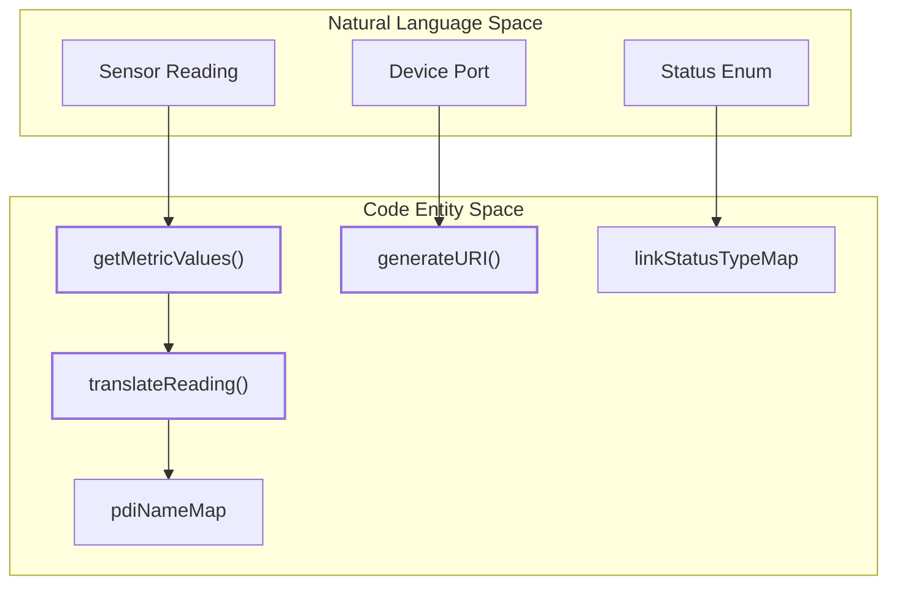
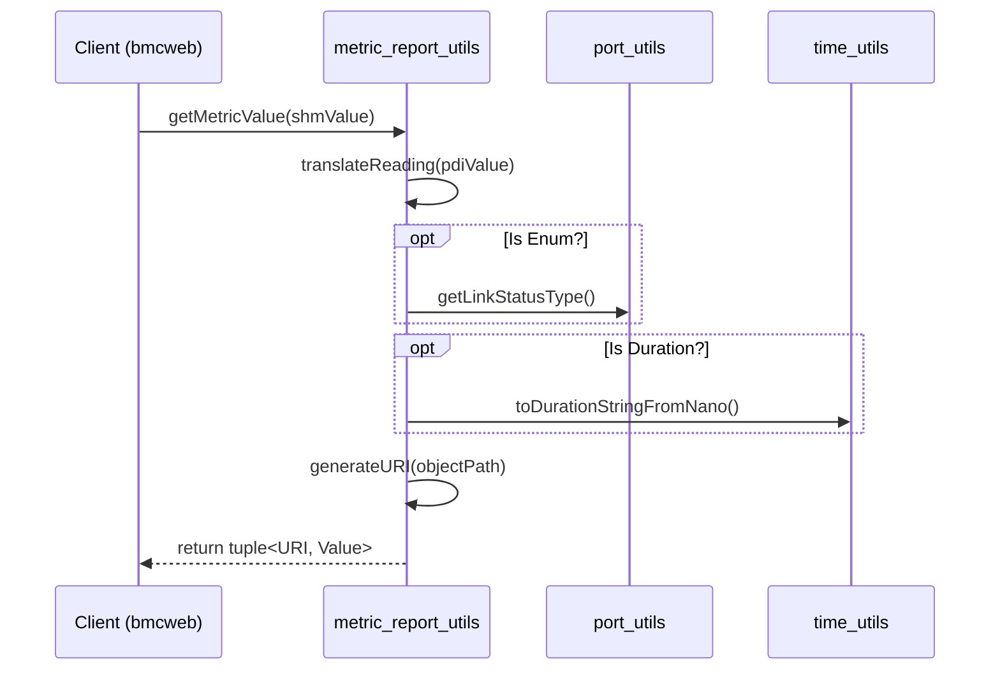

<!-- source: DeepWiki mcp.deepwiki.com · repo NVIDIA/nv-bmc-shmem · page 5 Metric Translation and Redfish URI Generation · fetched 2026-10-26 -->

# Metric Translation and Redfish URI Generation

Relevant source files

The following files were used as context for generating this wiki page:

- [configurations/shm_mapping.json](configurations/shm_mapping.json)
- [configurations/shm_namespace_config.json](configurations/shm_namespace_config.json)
- [lib/utils/metric_report_utils.hpp](lib/utils/metric_report_utils.hpp)
- [lib/utils/port_utils.hpp](lib/utils/port_utils.hpp)

The Metric Translation and Redfish URI Generation layer serves as the semantic bridge between the internal D-Bus/Phosphor-D-Bus-Interface (PDI) representations stored in shared memory and the external Redfish-compliant data structures required by `bmcweb`. This utility layer ensures that raw telemetry data is correctly contextualized with URIs and that PDI enums/values are translated into standard Redfish strings.

### High-Level Architecture

The utility layer is primarily consumed by the client API (e.g., `bmcweb` integration) to transform the flat key-value pairs retrieved from shared memory into structured Redfish Metric Reports.

Metric Translation and URI Logic Overview:

**Sources:** [lib/utils/metric_report_utils.hpp:42-50](), [lib/utils/port_utils.hpp:32-42]()

---

### Redfish URI Construction

The `generateURI` function is responsible for creating the `MetricProperty` field (the Redfish URI) for each metric. It utilizes platform-specific macros and device-specific logic to derive the correct path.

Key features include:
*   **Device Contextualization**: Supports various namespaces such as `PlatformEnvironmentMetrics`, `CpuProcessorMetrics`, and `NVSwitchPortMetrics` [configurations/shm_namespace_config.json:4-192]().
*   **Macro Integration**: Uses `PLATFORMSYSTEMID` and `PLATFORMDEVICEPREFIX` to ensure URIs match the specific system topology.
*   **Port Derivation**: Special logic in `getCpuPortMetricNames` handles the mapping of CLink and NVLink port IDs for processors [lib/utils/metric_report_utils.hpp:47-50]().

For a deep dive into URI formatting and supported device types, see **[generateURI: Redfish URI Construction](#5.1)**.

---

### PDI-to-Redfish Value Translation

Raw data in shared memory often uses D-Bus PDI paths for enums (e.g., `xyz.openbmc_project.State.ProcessorPerformance.PerformanceStates.Normal`). The translation layer converts these into human-readable Redfish strings (e.g., `"Normal"`).

| Component | Logic Entity | Description |
| :--- | :--- | :--- |
| **Dispatcher** | `translateReading` | The central entry point for value conversion based on property type. |
| **Metric Mapping** | `pdiNameMap` | Static lookup for general metric names. |
| **Enum Maps** | `reasonTypeMap`, `pcieTypeMap` | Specific maps for throttling reasons, PCIe generations, and reset types. |
| **Pipeline** | `getMetricValues` | Orchestrates the extraction of multiple metrics from a SHM segment. |

For detailed mapping tables and the translation pipeline, see **[Value Translation: PDI-to-Redfish Mapping Tables](#5.2)**.

**Sources:** [lib/utils/metric_report_utils.hpp:53-136]()

---

### Port and Time Utilities

The library provides specialized headers for handling hardware-specific states and standardized time formatting.

*   **Port Utilities**: Defined in `port_utils.hpp`, these functions translate link statuses (Up, Down, Training) and link states (Enabled, Disabled) using maps like `linkStatusTypeMap` and `linkStateTypeMap` [lib/utils/port_utils.hpp:32-53]().
*   **Time Utilities**: Defined in `time_utils.hpp`, these handle the conversion of raw nanosecond timestamps or millisecond counters into ISO 8601 duration strings (e.g., `P0DT0H0M1S`) required by Redfish.

For details on status mapping and ISO 8601 formatting, see **[Port and Time Utilities](#5.3)**.

---

### Functional Flow

The following diagram illustrates how the utility layer processes a single data point from Shared Memory to a Redfish-ready tuple.

Metric Processing Pipeline:

**Sources:** [lib/utils/metric_report_utils.hpp:46-48](), [lib/utils/port_utils.hpp:72-79](), [lib/utils/time_utils.hpp]()

---

