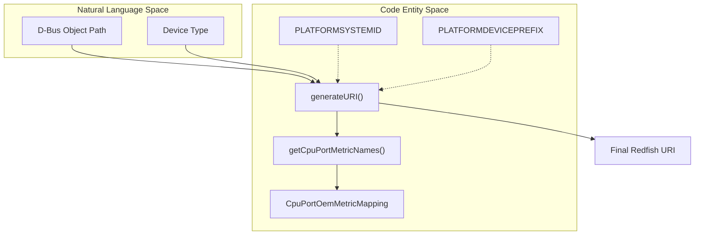
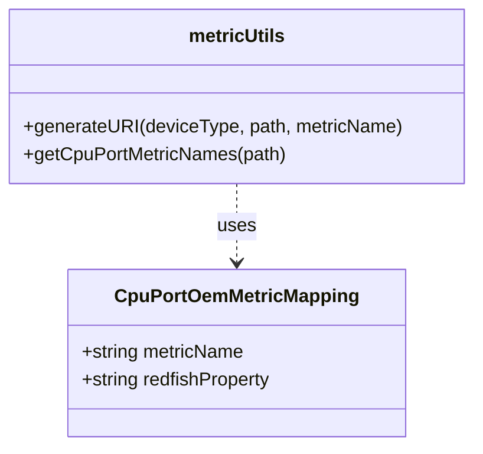

<!-- source: DeepWiki mcp.deepwiki.com · repo NVIDIA/nv-bmc-shmem · page 5.1 generateURI: Redfish URI Construction · fetched 2026-10-26 -->

# generateURI: Redfish URI Construction

Relevant source files

The following files were used as context for generating this wiki page:

- [lib/utils/metric_report_utils.hpp](lib/utils/metric_report_utils.hpp)

The `generateURI` utility is a core component of the `nv-bmc-shmem` library responsible for translating internal device identifiers and D-Bus object paths into standardized Redfish URI strings. This function ensures that telemetry data stored in shared memory can be correctly mapped to the Redfish resource tree (e.g., `/redfish/v1/Chassis/HGX_Resources_0/Sensors/GPU_0_Core_Temp`).

## Overview and Purpose

The URI generation logic is centralized in `lib/utils/metric_report_utils.hpp`. It relies on build-time configuration macros and runtime path parsing to determine the correct Redfish collection and resource ID for various hardware components including CPUs, GPUs, NVSwitches, and their respective ports.

### Key Configuration Macros
The URI structure is influenced by two primary macros defined during the build process:
*   `PLATFORMSYSTEMID`: The identifier for the system (e.g., "HGX_System_0"). [lib/utils/metric_report_utils.hpp:245-247]()
*   `PLATFORMDEVICEPREFIX`: The prefix used for chassis or resource containers (e.g., "HGX_"). [lib/utils/metric_report_utils.hpp:249-251]()

Sources: [lib/utils/metric_report_utils.hpp:19-22](), [lib/utils/metric_report_utils.hpp:245-251]()

## Supported Device Types

The `generateURI` function uses a `deviceType` parameter to determine the URI template. The following table maps the supported types to their Redfish URI patterns:

| Device Type | URI Pattern |
| :--- | :--- |
| `PlatformEnvironmentMetrics` | `/redfish/v1/Chassis/<PLATFORMDEVICEPREFIX>Resources_0/Sensors/<MetricName>` |
| `CpuProcessorMetrics` | `/redfish/v1/Systems/<PLATFORMSYSTEMID>/Processors/<DeviceID>` |
| `ProcessorPortMetrics` | `/redfish/v1/Systems/<PLATFORMSYSTEMID>/Processors/<DeviceID>/Ports/<PortID>` |
| `NVSwitchProcessorMetrics` | `/redfish/v1/Chassis/<PLATFORMDEVICEPREFIX>NVSwitch_<DeviceID>/Processors/<DeviceID>` |
| `NVSwitchPortMetrics` | `/redfish/v1/Chassis/<PLATFORMDEVICEPREFIX>NVSwitch_<DeviceID>/Ports/<PortID>` |
| `MemoryMetrics` | `/redfish/v1/Systems/<PLATFORMSYSTEMID>/Processors/<DeviceID>/Memory/<MemoryID>` |

Sources: [lib/utils/metric_report_utils.hpp:253-335]()

## Logic Flow: From D-Bus Path to Redfish URI

The following diagram illustrates how `generateURI` processes an input D-Bus path and device type to produce a Redfish URI.

### URI Generation Pipeline

Sources: [lib/utils/metric_report_utils.hpp:245-335](), [lib/utils/metric_report_utils.hpp:345-360]()

## Port Metric Derivation

For `ProcessorPortMetrics` and `NVSwitchPortMetrics`, the library must derive specific port identifiers (like CLink or NVLink IDs) from the D-Bus path.

### getCpuPortMetricNames
This function parses the D-Bus object path to extract the Processor ID and Port ID. It specifically handles CLink (Compute Link) and NVLink identifiers.
*   **CLink Identification**: If the path contains `clink`, it extracts the numeric index following the string. [lib/utils/metric_report_utils.hpp:345-360]()
*   **NVLink Identification**: It uses regex or string splitting to isolate the port number from the object path. [lib/utils/metric_report_utils.hpp:345-360]()

### CpuPortOemMetricMapping
This structure is used to map specific OEM-defined metrics to their respective Redfish properties within the port resource. It ensures that vendor-specific telemetry (like NVIDIA-specific link error counts) is placed under the correct `Oem` extension in the Redfish JSON response.

### Component Association Diagram

Sources: [lib/utils/metric_report_utils.hpp:345-360](), [lib/utils/metric_report_utils.hpp:42-50]()

## Implementation Details

### String Sanitization
The `generateURI` function performs string manipulation to ensure Redfish compliance:
1.  **Regex Matching**: It uses `std::regex` to extract IDs from D-Bus paths (e.g., extracting `0` from `/xyz/openbmc_project/inventory/system/chassis/HGX_Resources_0`). [lib/utils/metric_report_utils.hpp:253-270]()
2.  **Case Transformation**: While D-Bus paths are often lowercase, the function ensures the resulting URI segments match the expected Redfish casing (e.g., `NVSwitch` vs `nvswitch`). [lib/utils/metric_report_utils.hpp:300-315]()

### Handling NVSwitch Ports
For NVSwitch ports, the URI requires both the Switch ID and the Port ID. The function splits the D-Bus path (typically delimited by `/`) and identifies the indices for the switch instance and the port instance to construct the path: `/redfish/v1/Chassis/<PREFIX>NVSwitch_<ID>/Ports/<PortID>`. [lib/utils/metric_report_utils.hpp:315-330]()

Sources: [lib/utils/metric_report_utils.hpp:253-335](), [lib/utils/metric_report_utils.hpp:345-360]()

---

