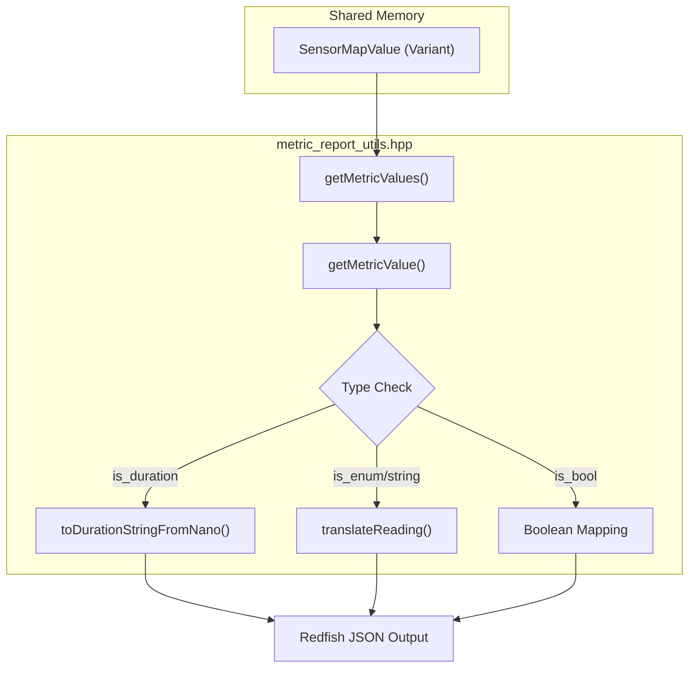
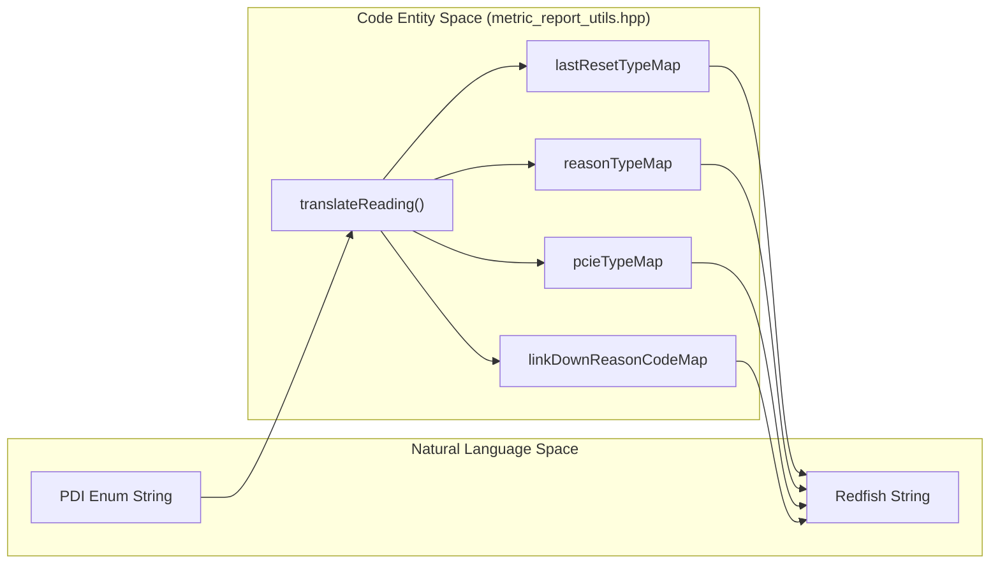

<!-- source: DeepWiki mcp.deepwiki.com · repo NVIDIA/nv-bmc-shmem · page 5.2 Value Translation: PDI-to-Redfish Mapping Tables · fetched 2026-10-26 -->

# Value Translation: PDI-to-Redfish Mapping Tables

Relevant source files

The following files were used as context for generating this wiki page:

- [configurations/shm_mapping.json](configurations/shm_mapping.json)
- [configurations/shm_namespace_config.json](configurations/shm_namespace_config.json)
- [lib/utils/metric_report_utils.hpp](lib/utils/metric_report_utils.hpp)
- [lib/utils/port_utils.hpp](lib/utils/port_utils.hpp)

The `nv-bmc-shmem` library provides a translation layer that converts internal D-Bus Phantom Data Interface (PDI) representations into Redfish-compliant strings and formatted values. This ensures that telemetry data stored in shared memory by various producers (e.g., `gpumgrd`, `hwmontemp`) can be directly consumed by `bmcweb` and presented in the Redfish API without further logic in the webserver.

## Translation Pipeline

The translation process is primarily handled by the `getMetricValues` and `getMetricValue` functions. These functions act as a pipeline, taking raw shared memory data and applying formatting based on the metric type (boolean, duration, or enum).

### Data Flow: getMetricValues Pipeline

The following diagram illustrates how a raw value from the `SensorMap` is processed into a Redfish-ready string.

**Metric Translation Flow**

**Sources:** [lib/utils/metric_report_utils.hpp:672-736](), [lib/utils/time_utils.hpp:95-107]()

## Static Mapping Tables

The library utilizes several static lookup tables to map PDI property names and values to their Redfish equivalents.

### PDI Name Mapping (`pdiNameMap`)
This table maps PDI interface property names to Redfish Metric names, organized by the PDI interface string. It is used to resolve how a specific D-Bus property should appear in a Redfish Metric Report.

| PDI Interface | Property | Redfish Metric Name |
| :--- | :--- | :--- |
| `xyz.openbmc_project.Inventory.Item.PCIeDevice` | `LanesInUse` | `PCIeLanesInUse` |
| `xyz.openbmc_project.Inventory.Item.PCIeDevice` | `MaxLanes` | `PCIeMaxLanes` |
| `xyz.openbmc_project.Metric.IBPort` | `DataCRCCount` | `DataCRCCount` |

**Sources:** [lib/utils/metric_report_utils.hpp:183-350]()

### GPM Metrics Mapping (`gpmMetricsMap`)
Specifically for GPU Performance Monitoring (GPM), this map handles the translation of high-fidelity telemetry metrics.

**Sources:** [lib/utils/metric_report_utils.hpp:378-430]()

### Processor Performance Mapping (`processorPerfMap`)
Maps throttle reasons and performance states for processors.

**Sources:** [lib/utils/metric_report_utils.hpp:432-463]()

## Enum Translation Maps

For properties that use D-Bus enums (represented as strings), the library provides specific maps to convert the full PDI path into a short Redfish string.

### Core Translation Maps
| Map Name | Purpose | Example Input (PDI) | Example Output (Redfish) |
| :--- | :--- | :--- | :--- |
| `lastResetTypeMap` | Reset counter types | `...ResetTypes.PFFLR` | `PFFLR` |
| `reasonTypeMap` | Throttle reasons | `...ThrottleReasons.SWPowerCap` | `SWPowerCap` |
| `pcieTypeMap` | PCIe Generations | `...PCIeTypes.Gen5` | `Gen5` |
| `linkDownReasonCodeMap` | IB Port errors | `...LinkDownReasonCodes.Unknown` | `Unknown` |
| `linkStatusTypeMap` | Port Link Status | `...LinkStatusType.LinkUp` | `LinkUp` |
| `linkStateTypeMap` | Port Link State | `...LinkStates.Disabled` | `Disabled` |

**Sources:** [lib/utils/metric_report_utils.hpp:53-176](), [lib/utils/port_utils.hpp:32-53]()

## Implementation Detail: `translateReading`

The `translateReading` function serves as the central dispatcher for enum-based translations. It identifies the PDI string and routes it to the appropriate static map.

**Code Entity Association**

**Sources:** [lib/utils/metric_report_utils.hpp:544-633]()

### Key Logic in `translateReading`:
1. **Reset Type:** If the string contains `ResetCounterMetrics`, it uses `lastResetTypeMap` [lib/utils/metric_report_utils.hpp:546-554]().
2. **Throttle/Performance:** If the string contains `ProcessorPerformance`, it uses `reasonTypeMap` [lib/utils/metric_report_utils.hpp:556-564]().
3. **PCIe Type:** If the string contains `PCIeDevice` or `PCIeECC`, it uses `pcieTypeMap` [lib/utils/metric_report_utils.hpp:566-574]().
4. **Port Status:** Uses `getLinkStatusType` and `getLinkStateType` from `port_utils.hpp` for port-related enums [lib/utils/metric_report_utils.hpp:596-614]().

## Special Handling

### Boolean Values
Boolean values are converted to "1" (true) or "0" (false) strings to maintain consistency in the metric report output [lib/utils/metric_report_utils.hpp:714-722]().

### Duration Values
Metrics representing time intervals (e.g., `ThrottleDuration`) are stored as nanoseconds (uint64_t) in shared memory. The translation pipeline uses `toDurationStringFromNano` to convert these into ISO 8601 duration strings (e.g., `PT0.001S`) [lib/utils/metric_report_utils.hpp:689-695]().

**Sources:** [lib/utils/time_utils.hpp:95-107]()

---

