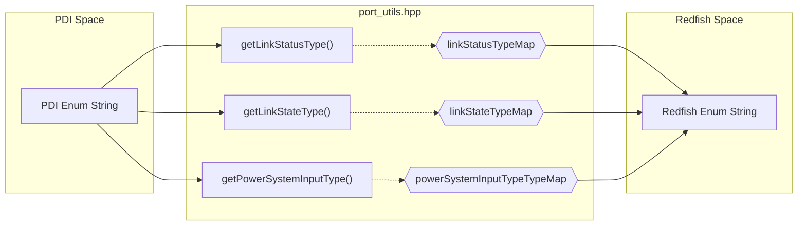

<!-- source: DeepWiki mcp.deepwiki.com · repo NVIDIA/nv-bmc-shmem · page 5.3 Port and Time Utilities · fetched 2026-10-26 -->

# Port and Time Utilities

<details>
<summary>Relevant source files</summary>

The following files were used as context for generating this wiki page:

- [configurations/shm_mapping.json](configurations/shm_mapping.json)
- [configurations/shm_namespace_config.json](configurations/shm_namespace_config.json)
- [lib/utils/port_utils.hpp](lib/utils/port_utils.hpp)
- [lib/utils/time_utils.hpp](lib/utils/time_utils.hpp)

</details>


The `nv-bmc-shmem` library provides a set of utility functions to handle specialized data translations required for Redfish compliance. These utilities focus on converting hardware-specific port states and time durations from D-Bus Phosphor Data Interface (PDI) formats into ISO 8601 strings and Redfish-defined enumerations.

## Port Utilities

The port utilities, defined in `port_utils.hpp`, provide mapping logic between D-Bus interface enumerations and Redfish-compliant strings for network and fabric ports.

### Implementation Details
The utility uses static `std::unordered_map` structures to perform O(1) lookups for PDI strings. If a lookup fails, the functions return an empty string, allowing the caller to handle the missing mapping.

| Function | PDI Interface Prefix | Redfish Target |
| :--- | :--- | :--- |
| `getLinkStatusType` | `xyz.openbmc_project.Inventory.Decorator.PortState.LinkStatusType` | `LinkUp`, `LinkDown`, `Training`, etc. |
| `getLinkStateType` | `xyz.openbmc_project.Inventory.Decorator.PortState.LinkStates` | `Enabled`, `Disabled`, `Absent`, etc. |
| `getPowerSystemInputType` | `xyz.openbmc_project.State.Decorator.PowerSystemInputs.Status` | `Normal`, `Fault`, `OutOfRange`, `Unknown` |

### Port Utility Data Flow
The following diagram illustrates how raw PDI strings are transformed into Redfish-compliant values via the utility maps.

**Port State Translation Flow**


Sources: [lib/utils/port_utils.hpp:32-64](), [lib/utils/port_utils.hpp:72-111]()

---

## Time Utilities

The `time_utils.hpp` header contains logic for handling ISO 8601 durations and high-precision timestamps. This is critical for Redfish metrics like `UpTime` or `ThrottleDuration`.

### ISO 8601 Duration Formatting
Redfish requires durations in the format `P[n]DT[n]H[n]M[n]S` (e.g., `P12DT1M5.5S`). The library provides bidirectional conversion between `std::chrono::milliseconds` and these strings.

#### Key Functions
*   **`toDurationString(chrono::milliseconds ms)`**: Converts a numeric millisecond value into a formatted ISO 8601 string [lib/utils/time_utils.hpp:232-258]().
*   **`fromDurationString(const string& str)`**: Parses an ISO 8601 string back into `std::chrono::milliseconds`. It uses a internal helper `fromDurationItem` to extract specific units (Days, Hours, Minutes, Seconds) [lib/utils/time_utils.hpp:155-223]().
*   **`padZeros(int64_t value, size_t pad)`**: An optimized, locale-independent integer-to-string converter that adds leading zeros [lib/utils/time_utils.hpp:62-71]().

### DateTime and Timestamps
*   **`getDateTimeUintMs(uint64_t msecSinceEpoch)`**: Formats a millisecond-precision epoch timestamp into a Redfish-compliant `YYYY-MM-DDTHH:MM:SS.mmmmmm+HH:MM` string.
*   **`civilFromDays(Days d)`**: An implementation of the Howard Hinnant algorithm to convert a count of days since the epoch into a year/month/day tuple without using heavy standard library calendar functions.

### Duration Parsing Logic
The parsing logic utilizes `std::from_chars` for performance and avoids exceptions.

**Duration Parsing State Machine**
```mermaid
stateDiagram-v2
    [*] --> Start: fromDurationString()
    Start --> CheckP: Validate prefix 'P'
    CheckP --> Days: details::fromDurationItem<'Days'>('D')
    Days --> CheckT: Validate prefix 'T'
    CheckT --> Hours: fromDurationItem<'hours'>('H')
    Hours --> Minutes: fromDurationItem<'minutes'>('M')
    Minutes --> Seconds: fromDurationItem<'seconds'>('S' or '.')
    Seconds --> End: Return optional milliseconds
    
    CheckP --> Error: Missing 'P'
    CheckT --> Error: Missing 'T' if time units exist
    Error --> [*]: Return nullopt + LOG_ERROR
```

Sources: [lib/utils/time_utils.hpp:50-51](), [lib/utils/time_utils.hpp:84-145](), [lib/utils/time_utils.hpp:155-223]()

### Precision and Limits
*   **Maximum Range**: The conversion logic checks against `chrono::milliseconds::max()` to prevent overflow during string parsing [lib/utils/time_utils.hpp:131-136]().
*   **Millisecond Precision**: When parsing the seconds component, if a decimal point `.` is found, the utility specifically handles the sub-second portion to maintain millisecond accuracy [lib/utils/time_utils.hpp:199-208]().

Sources: [lib/utils/time_utils.hpp:121-125](), [lib/utils/time_utils.hpp:199-215]()

---

