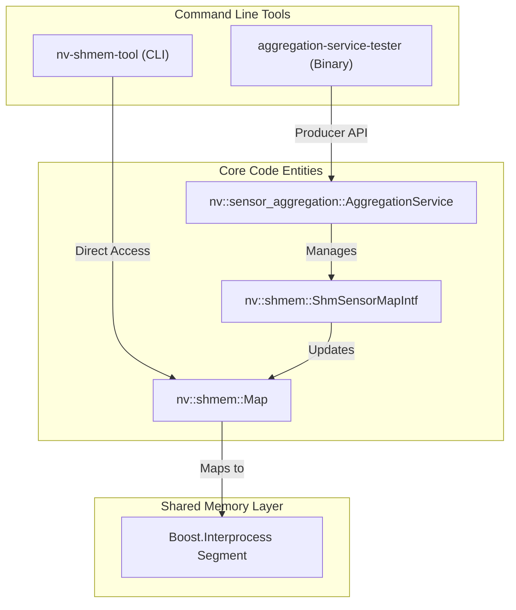

<!-- source: DeepWiki mcp.deepwiki.com · repo NVIDIA/nv-bmc-shmem · page 6 Developer Tools · fetched 2026-10-26 -->

# Developer Tools

Relevant source files

The following files were used as context for generating this wiki page:

- [.gitignore](.gitignore)
- [lib/impl/shmem_map.hpp](lib/impl/shmem_map.hpp)
- [lib/include/meson.build](lib/include/meson.build)
- [tools/aggregation_service_tester.cpp](tools/aggregation_service_tester.cpp)
- [tools/meson.build](tools/meson.build)
- [tools/nv_shmem_tool.cpp](tools/nv_shmem_tool.cpp)

The `nv-bmc-shmem` repository includes a set of command-line utilities and testing binaries designed to facilitate the development, debugging, and validation of the shared memory telemetry system. These tools allow developers to inspect the state of shared memory segments, simulate producer activity, and verify the integration of new telemetry sources without requiring a full OpenBMC environment or a running `bmcweb` instance.

### System Overview: Tools and Code Entities

The following diagram illustrates how the developer tools interact with the core library classes to exercise the shared memory system.

**Tool-to-Entity Mapping**

**Sources:** [tools/nv_shmem_tool.cpp:49-52](), [tools/aggregation_service_tester.cpp:30-31](), [lib/impl/shmem_map.hpp:51-53]()

---

### 6.1 nv_shmem_tool: CLI for Shared Memory Inspection

The `nv-shmem-tool` is a versatile debugging utility that provides direct access to the `nv::shmem::Map` layer [tools/nv_shmem_tool.cpp:51-52](). It bypasses the `AggregationService` and `ConfigReader` logic, allowing developers to target specific shared memory namespaces by name and perform CRUD operations or performance benchmarks.

#### Key Functionalities
*   **Inspection**: Read all sensors or raw key-value pairs stored in a namespace [tools/nv_shmem_tool.cpp:49-75]().
*   **Maintenance**: Erase/clear an entire shared memory segment [tools/nv_shmem_tool.cpp:76-83]().
*   **Benchmarking**: The `perf` command simulates high-frequency updates (5,000 objects) to measure latency and search performance [tools/nv_shmem_tool.cpp:100-142]().
*   **Creation**: Manually initialize a segment with dummy data to test consumer (e.g., `bmcweb`) behavior [tools/nv_shmem_tool.cpp:143-170]().

For detailed command syntax and debugging workflows, see **[nv_shmem_tool: CLI for Shared Memory Inspection](#6.1)**.

**Sources:** [tools/nv_shmem_tool.cpp:36-44](), [lib/impl/shmem_map.hpp:94-110]()

---

### 6.2 aggregation_service_tester: Producer Integration Smoke Test

The `aggregation-service-tester` is a standalone binary used to validate the `AggregationService` producer API. Unlike the `nv_shmem_tool`, which interacts with the raw map, this tool exercises the full path resolution and caching logic used by actual producer daemons like `gpumgrd` or `pldmd` [tools/aggregation_service_tester.cpp:30-53]().

#### Validation Scenarios
*   **Namespace Initialization**: Verifies that a producer can successfully claim a namespace (e.g., `gpumgrd`) [tools/aggregation_service_tester.cpp:30-37]().
*   **Telemetry Lifecycle**: Tests the transition from "New Object Creation" to "Value and Timestamp Update" [tools/aggregation_service_tester.cpp:50-102]().
*   **Error Handling**: Validates how the system handles `NaN` (Not a Number) values and non-applicable keys [tools/aggregation_service_tester.cpp:121-173]().
*   **Performance Metrics**: Outputs the time spent (in microseconds) for various operations to ensure they meet the low-latency requirements of the shared memory system [tools/aggregation_service_tester.cpp:69-70]().

For instructions on running integration tests and interpreting output, see **[aggregation_service_tester: Producer Integration Smoke Test](#6.2)**.

**Sources:** [tools/aggregation_service_tester.cpp:18-26](), [tools/aggregation_service_tester.cpp:150-168]()

---

### Tool Compilation and Installation

Both tools are defined in the `tools/meson.build` file and are compiled as part of the standard build process if the environment is configured to include them. They depend on the main `nv_shmem` library [tools/meson.build:2-14]().

| Binary Name | Source File | Primary Dependency |
| :--- | :--- | :--- |
| `nv-shmem-tool` | `nv_shmem_tool.cpp` | `nv_shmem_dep` |
| `aggregation-service-tester` | `aggregation_service_tester.cpp` | `nv_shmem_dep` |

**Sources:** [tools/meson.build:1-16](), [lib/include/meson.build:1-6]()

---

