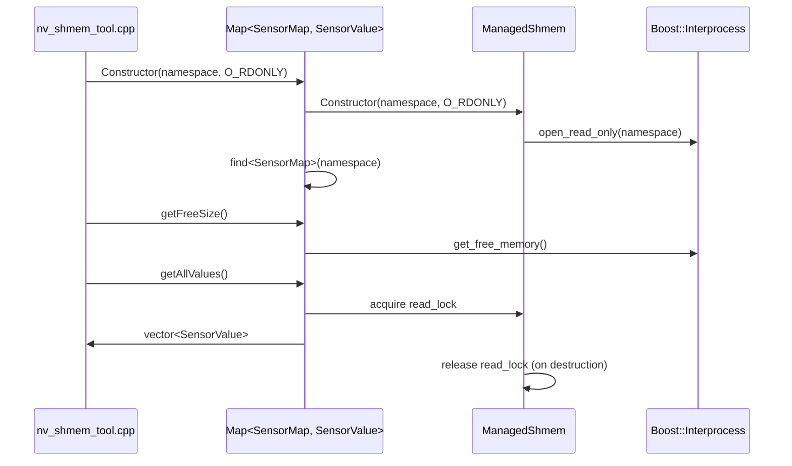

<!-- source: DeepWiki mcp.deepwiki.com · repo NVIDIA/nv-bmc-shmem · page 6.1 nv_shmem_tool: CLI for Shared Memory Inspection · fetched 2026-10-26 -->

# nv_shmem_tool: CLI for Shared Memory Inspection

<details>
<summary>Relevant source files</summary>

The following files were used as context for generating this wiki page:

- [.gitignore](.gitignore)
- [lib/impl/shmem_map.hpp](lib/impl/shmem_map.hpp)
- [lib/include/meson.build](lib/include/meson.build)
- [tools/meson.build](tools/meson.build)
- [tools/nv_shmem_tool.cpp](tools/nv_shmem_tool.cpp)

</details>


The `nv-shmem-tool` is a standalone command-line utility designed for developers and system administrators to inspect, debug, and manipulate the shared memory segments used by the `nv-bmc-shmem` library. It provides direct access to the underlying `nv::shmem::Map` structures, bypassing the high-level `AggregationService` or `telemetry_mrd_client` abstractions to allow for raw data verification and performance testing.

### Purpose and Scope
*   **Inspection**: View the current state of telemetry data stored in specific shared memory namespaces.
*   **Lifecycle Management**: Manually create or erase shared memory segments for testing purposes.
*   **Performance Benchmarking**: Simulate high-frequency updates and reads to validate the library's behavior under load.
*   **Debugging**: Verify that producers are correctly writing data and that the shared memory allocation is healthy.

Sources: [tools/nv_shmem_tool.cpp:1-44](), [tools/meson.build:2-7]()

---

### Implementation Details

The tool is implemented as a thin wrapper around the `nv::shmem::Map` template class. It specifically instantiates the map using `nv::shmem::SensorMap` (the internal Boost-based container) and `nv::shmem::SensorValue` (the data structure containing telemetry) [tools/nv_shmem_tool.cpp:51-52]().

#### Data Flow: CLI to Shared Memory
The following diagram illustrates how the `nv_shmem_tool` interacts with the core library entities to access the shared memory segment.

**CLI to Code Entity Mapping**
```mermaid
graph TD
    subgraph "CLI Layer"
        A["nv-shmem-tool (binary)"]
    end

    subgraph "nv::shmem Namespace"
        B["Map<SensorMap, SensorValue>"]
        C["ManagedShmem"]
        D["SensorValue"]
    end

    subgraph "Shared Memory Segment"
        E[("Boost Managed Segment")]
        F["named_upgradable_mutex"]
    end

    A -->|Instantiates| B
    B --|>|Inherits| C
    B -->|Contains| D
    C -->|Maps| E
    C -->|Acquires| F
```
Sources: [tools/nv_shmem_tool.cpp:51-52](), [lib/impl/shmem_map.hpp:51-60](), [lib/impl/shmem_map.hpp:186-187]()

---

### Supported Commands

The tool follows a standard syntax: `nv-shmem-tool [command] [namespace]`.

| Command | Permission | Description |
| :--- | :--- | :--- |
| `read` | `O_RDONLY` | Lists all sensors in the namespace with their values and timestamps. |
| `readraw` | `O_RDONLY` | Lists all objects using their internal shared memory keys (D-Bus paths). |
| `erase` | `O_CREAT` | Clears all entries from the specified namespace. |
| `stat` | `O_RDONLY` | Continuously polls and prints the namespace content every second. |
| `perf` | `O_CREAT` | Performs 5000 random insertions and enters a high-speed update loop. |
| `create` | `O_CREAT` | Populates a namespace with 1000 dummy sensor entries for testing. |

Sources: [tools/nv_shmem_tool.cpp:38-44](), [tools/nv_shmem_tool.cpp:49-170]()

---

### Command Workflows

#### 1. Inspection (`read` and `readraw`)
The `read` command calls `mShmem.getAllValues()` [tools/nv_shmem_tool.cpp:56](), which returns a vector of `SensorValue` objects. It then iterates through them to print the `metricProperty`, `timestampStr`, `timestamp`, and `sensorValue` [tools/nv_shmem_tool.cpp:57-61](). 

The `readraw` command uses `mShmem.getAllKeyValuePair()` [tools/nv_shmem_tool.cpp:70](). This is useful for debugging the exact D-Bus paths being used as keys in the shared memory map [tools/nv_shmem_tool.cpp:71-74]().

#### 2. Resource Management (`create` and `erase`)
When using `create` or `erase`, the tool opens the segment with `O_CREAT` and a fixed size of 1,000,000 bytes [tools/nv_shmem_tool.cpp:79]().
*   **Erase**: Calls `mShmem.clear()`, which acquires a `shmem_write_lock_t` and clears the underlying Boost map [lib/impl/shmem_map.hpp:114-125]().
*   **Create**: Generates 1000 sensors with names like `HGX_Chassis_0_My_Sensor_X` and populates them with current steady_clock timestamps [tools/nv_shmem_tool.cpp:148-163]().

#### 3. Performance Testing (`perf`)
The `perf` command is used to stress the `ManagedShmem` locking mechanism. It performs a loop of `mShmem.getValue()` followed by `mShmem.insert()` with a 10ms delay [tools/nv_shmem_tool.cpp:120-141](). This helps identify potential deadlocks or contention issues between producers and consumers.

---

### Internal Execution Logic

The tool utilizes the `ManagedShmem` lifecycle to handle segment attachment.

**Execution Flow for 'read' Command**

Sources: [tools/nv_shmem_tool.cpp:51-61](), [lib/impl/shmem_map.hpp:65-73](), [lib/impl/shmem_map.hpp:168-172]()

### Debugging Workflows

**Checking for Memory Leaks/Exhaustion:**
Run `nv-shmem-tool read <namespace>`. The tool outputs the "Shmem FreeSize" in bytes [tools/nv_shmem_tool.cpp:54-55](). Comparing this value over time during producer activity helps identify if the shared memory segment size is sufficient for the number of sensors being tracked.

**Verifying Producer Path Resolution:**
If a Redfish URI is missing data, use `nv-shmem-tool readraw <namespace>`. This allows the developer to see the exact D-Bus path keys stored in SHM [tools/nv_shmem_tool.cpp:70-74](). If the key is missing or formatted incorrectly, the issue lies in the `SHMSensorAggregator` path parsing logic rather than the client-side translation.

**Manual Cleanup:**
If a shared memory segment becomes corrupted or needs a reset without restarting the entire BMC, `nv-shmem-tool erase <namespace>` can be used to wipe the segment while maintaining the allocated memory block [tools/nv_shmem_tool.cpp:76-83]().

Sources: [tools/nv_shmem_tool.cpp:49-183](), [lib/impl/shmem_map.hpp:114-125]()

---

