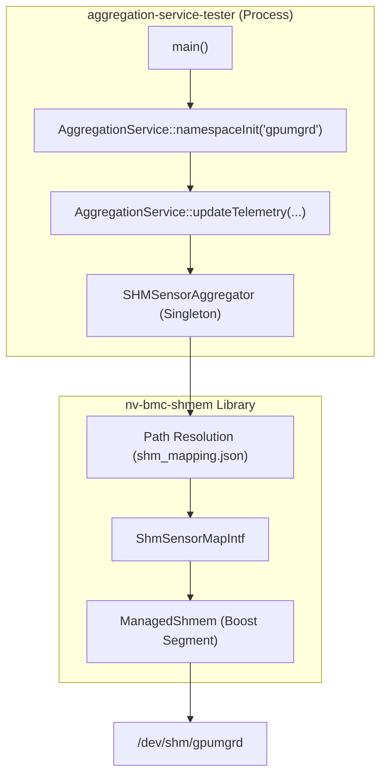

<!-- source: DeepWiki mcp.deepwiki.com · repo NVIDIA/nv-bmc-shmem · page 6.2 aggregation_service_tester: Producer Integration Smoke Test · fetched 2026-10-26 -->

# aggregation_service_tester: Producer Integration Smoke Test

<details>
<summary>Relevant source files</summary>

The following files were used as context for generating this wiki page:

- [.gitignore](.gitignore)
- [lib/include/meson.build](lib/include/meson.build)
- [tools/aggregation_service_tester.cpp](tools/aggregation_service_tester.cpp)
- [tools/meson.build](tools/meson.build)

</details>


The `aggregation-service-tester` is a standalone binary designed to validate the integration between a producer daemon and the `AggregationService` API. It serves as a manual smoke test to ensure that shared memory (SHM) segments are correctly initialized, that telemetry data is being persisted accurately, and that the internal path resolution and NaN handling logic function as expected in a live environment.

## Overview and Purpose

The tester exercises the primary producer-side interface defined in `telemetry_mrd_producer.hpp`. It simulates the behavior of a daemon like `gpumgrd` or `pldmd` by calling the static methods of `AggregationService` to create and update sensor data.

Key objectives of this tool include:
* **Validation of `namespaceInit`**: Ensuring the SHM segment for a specific producer is correctly mapped [tools/aggregation_service_tester.cpp:30-37]().
* **Performance Measurement**: Measuring the latency of new object creation versus subsequent updates [tools/aggregation_service_tester.cpp:69-70]().
* **Feature Verification**: Testing edge cases such as NaN (Not a Number) propagation, array-based metrics, and D-Bus path filtering [tools/aggregation_service_tester.cpp:150-168]().

**Sources:**
* [tools/aggregation_service_tester.cpp:28-37]()
* [tools/meson.build:9-14]()

## System Integration Flow

The following diagram illustrates how the `aggregation-service-tester` interacts with the core library components to simulate a producer.

### Producer Simulation Flow

**Sources:**
* [tools/aggregation_service_tester.cpp:30-53]()
* [tools/meson.build:12]()

## Test Scenarios

The binary executes several hardcoded test cases to verify the robustness of the `AggregationService` implementation.

### 1. New Object Creation
The tester attempts to create a new sensor entry using a full D-Bus path and a parent device path. This validates the library's ability to allocate new `SensorMap` entries within the SHM segment [tools/aggregation_service_tester.cpp:51-53]().

### 2. Value and Timestamp Updates
A loop performs 10 consecutive updates to an existing sensor. This is used to measure the overhead of the `scoped_lock` and the `updateValueAndTimeStamp` logic [tools/aggregation_service_tester.cpp:73-102]().

### 3. NaN and Error Handling
The tester validates how the system handles invalid readings by passing an error code (`rc`) to the `updateTelemetry` function.
* **Simple Type NaN**: Verifies that non-sensor properties (e.g., PCIe counters) correctly handle error states [tools/aggregation_service_tester.cpp:156-164]().
* **Sensor Resource NaN**: Specifically tests properties using the `xyz.openbmc_project.Sensor.Value` interface [tools/aggregation_service_tester.cpp:182-187]().

### 4. Path Resolution Filtering
The tester provides paths that should not match any configuration in `shm_mapping.json` to verify the "not applicable key" caching mechanism, which prevents repeated expensive regex lookups for invalid paths [tools/aggregation_service_tester.cpp:126-130]().

**Sources:**
* [tools/aggregation_service_tester.cpp:51-187]()

## Code Entity Mapping

This diagram maps the high-level test actions to the specific C++ entities and methods defined in the producer API.

### Entity Relationship Diagram
```mermaid
classDiagram
    class "aggregation_service_tester" {
        +main()
    }
    class "AggregationService" {
        <<Static Facade>>
        +namespaceInit(producerName)
        +updateTelemetry(path, interface, property, value, ...)
    }
    class "SHMSensorAggregator" {
        <<Singleton>>
        -nameSpaceMap
        -notApplicableKeys
        +updateTelemetry()
    }
    class "ShmSensorMapIntf" {
        +updateValueAndTimeStamp()
        +insert()
    }

    "aggregation_service_tester" ..> "AggregationService" : Calls
    "AggregationService" --> "SHMSensorAggregator" : Delegates to
    "SHMSensorAggregator" --> "ShmSensorMapIntf" : Manages
```
**Sources:**
* [tools/aggregation_service_tester.cpp:20]()
* [lib/include/telemetry_mrd_producer.hpp]()

## Usage and Execution

The binary is compiled as part of the standard Meson build and installed to the system path [tools/meson.build:9-14]().

### Running the Test
To execute the smoke test on a BMC:
```bash
# Ensure the necessary SHM configuration files are present in /usr/share/nv-bmc-shmem/
aggregation-service-tester
```

### Expected Output
The tool provides verbose console output indicating the success or failure of each stage, along with timing information in microseconds:
```text
AggregationService::namespaceInit success
AggregationService::updateTelemetry success for new object
AggregationService: Time spent for new object creation -> 450
AggregationService::updateTelemetry value and timestamp update success
AggregationService: Time for value and timestamp update 1 -> 85
...
```

**Sources:**
* [tools/aggregation_service_tester.cpp:32-101]()
* [tools/meson.build:13]()

---

