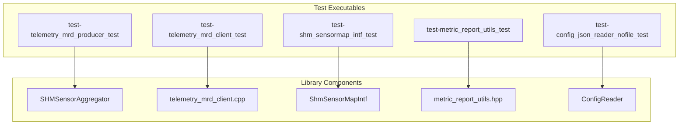
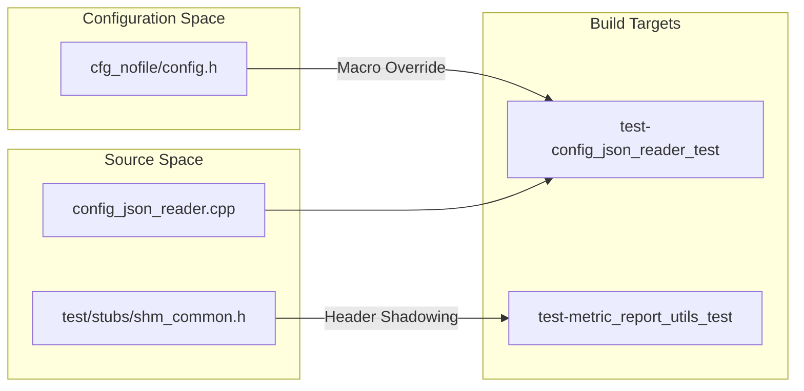

<!-- source: DeepWiki mcp.deepwiki.com · repo NVIDIA/nv-bmc-shmem · page 7 Testing · fetched 2026-10-26 -->

# Testing

Relevant source files

The following files were used as context for generating this wiki page:

- [gcovr.cfg](gcovr.cfg)
- [test/BRANCH_COVERAGE_NOTES.md](test/BRANCH_COVERAGE_NOTES.md)
- [test/meson.build](test/meson.build)

The `nv-bmc-shmem` test suite is designed to validate the integrity of shared memory operations, the accuracy of telemetry aggregation, and the correctness of Redfish URI generation. It utilizes **GoogleTest** and **GoogleMock** for unit testing and incorporates a specialized strategy for testing configuration-dependent logic through header shadowing and custom build targets.

## Test Infrastructure

The testing framework is integrated into the Meson build system. Tests are defined in the `test/` directory and are automatically linked against the `nv_shmem` library.

### Framework and Dependencies
- **GoogleTest (gtest)**: Used for test assertions and test suite structure [test/meson.build:1-12]().
- **GoogleMock (gmock)**: Used for mocking dependencies where necessary [test/meson.build:13]().
- **Meson Integration**: Tests are executed via `meson test`. The build script iterates through a list of test names and creates individual executables for each [test/meson.build:23-46]().

### Code Coverage
The project uses `gcovr` for coverage analysis. While line coverage is high, branch coverage is noted as structurally more complex due to template instantiations and OS-level failure paths (e.g., `mmap` or `shm_open` failures) [test/BRANCH_COVERAGE_NOTES.md:5-24]().

| Coverage Metric | Configuration |
| :--- | :--- |
| **Exclusions** | `test/` files and `subprojects/` are excluded from coverage [gcovr.cfg:5-8](). |
| **Branch Handling** | `exclude-throw-branches` and `exclude-unreachable-branches` are enabled [gcovr.cfg:11-12](). |
| **Decisions** | Decision coverage is tracked [gcovr.cfg:13](). |

Sources: [test/meson.build:1-46](), [gcovr.cfg:1-13](), [test/BRANCH_COVERAGE_NOTES.md:1-24]()

## Test Categories

The test suite is divided into three primary categories based on the component being exercised and the testing strategy employed.

### 1. Core Unit Tests
These tests cover the fundamental building blocks of the shared memory system, including the producer/client APIs and the underlying map structures.
- **Producer Logic**: Validates `SHMSensorAggregator` path resolution, array handling, and NaN value updates [test/meson.build:32-33]().
- **Client Logic**: Validates `telemetry_mrd_client` functions like `getAllMRDValues` and exception handling for missing namespaces [test/meson.build:34]().
- **Map Internals**: Exercises `ShmSensorMapIntf` and the core `Map` template [test/meson.build:24-31]().

For details, see [Unit Tests: Producer, Client, and SHM Map](#7.1).

### 2. Utility and Metric Tests
These tests focus on the stateless translation logic and helper utilities.
- **Metric Report Utils**: Validates Redfish URI generation and PDI-to-Redfish value translation [test/meson.build:51-62]().
- **Port and Time Utils**: Validates link status mapping and ISO 8601 duration/datetime formatting [test/meson.build:26-28]().
- **Stubbing Mechanism**: Uses a specialized `stubs/` directory to shadow headers like `sdbusplus/bus.hpp` to resolve symbol conflicts during testing [test/meson.build:48-60]().

For details, see [Unit Tests: Utilities (Metric, Port, Time)](#7.2).

### 3. Configuration and Branch Coverage
The `ConfigReader` component is tested using a unique multi-binary approach to exercise different failure modes (e.g., malformed JSON, missing files).
- **Custom `config.h`**: Each test variant is compiled with a specific `config.h` that overrides the `SHM_MAPPING_JSON` macro [test/meson.build:64-75]().
- **Failure Scenarios**: Specific tests exist for `nofile`, `malformed`, `no_ns`, and `no_producers` conditions [test/meson.build:84-95]().

For details, see [Configuration Reader Tests and Branch Coverage](#7.3).

## Test Entity Mapping

The following diagram illustrates how the test executables relate to the core library components they exercise.

### Test-to-Component Relationship

Sources: [test/meson.build:23-35](), [test/meson.build:51-62](), [test/meson.build:84-95]()

### Test Build Pipeline

Sources: [test/meson.build:48-60](), [test/meson.build:64-70](), [test/meson.build:91]()

---

