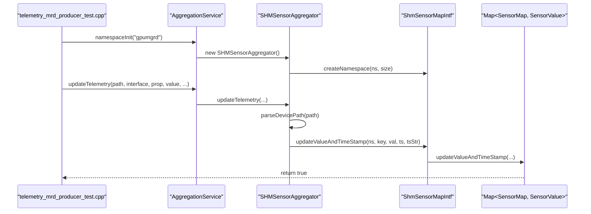
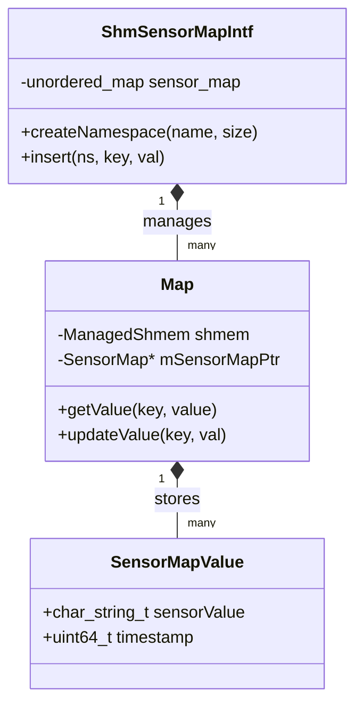

<!-- source: DeepWiki mcp.deepwiki.com · repo NVIDIA/nv-bmc-shmem · page 7.1 Unit Tests: Producer, Client, and SHM Map · fetched 2026-10-26 -->

# Unit Tests: Producer, Client, and SHM Map

Relevant source files

The following files were used as context for generating this wiki page:

- [test/sensor_map_test.cpp](test/sensor_map_test.cpp)
- [test/shm_sensormap_intf_test.cpp](test/shm_sensormap_intf_test.cpp)
- [test/shmem_map_extra_test.cpp](test/shmem_map_extra_test.cpp)
- [test/stubs/phosphor-logging/lg2.hpp](test/stubs/phosphor-logging/lg2.hpp)
- [test/stubs/shm_common.h](test/stubs/shm_common.h)
- [test/telemetry_mrd_client_test.cpp](test/telemetry_mrd_client_test.cpp)
- [test/telemetry_mrd_producer_null_test.cpp](test/telemetry_mrd_producer_null_test.cpp)
- [test/telemetry_mrd_producer_test.cpp](test/telemetry_mrd_producer_test.cpp)

This section covers the core unit test suite for the `nv-bmc-shmem` library. These tests validate the end-to-end telemetry pipeline, from the producer's path resolution and shared memory (SHM) insertion to the client's aggregation and retrieval logic. The suite also includes deep verification of the underlying `Map` template and the `ShmSensorMapIntf` management layer.

## Producer and Aggregation Tests

The producer tests focus on the `AggregationService` and its internal `SHMSensorAggregator`. They verify how D-Bus telemetry updates are parsed, matched against configuration namespaces, and persisted in shared memory.

### Telemetry MRD Producer Logic
The `telemetry_mrd_producer_test.cpp` file exercises various scenarios for the `updateTelemetry` API:
*   **Path Resolution**: Validates that `parseDevicePath` correctly identifies namespaces for GPU processors and ports [test/telemetry_mrd_producer_test.cpp:71-81]().
*   **Data Types**: Tests scalar updates (uint64, double) and complex array handling using `std::vector<std::string>` [test/telemetry_mrd_producer_test.cpp:107-117]().
*   **NaN Handling**: Verifies that when a producer reports an error (non-zero return code), the system correctly marks values as "NaN" in SHM [test/telemetry_mrd_producer_test.cpp:95-105]().
*   **Dynamic Arrays**: Exercises the `handleArrayUpdates` logic by providing vectors of increasing sizes to ensure the SHM object grows accordingly [test/telemetry_mrd_producer_test.cpp:119-129]().

### Null Aggregator Guard
A specialized test, `telemetry_mrd_producer_null_test.cpp`, ensures the library handles uninitialized states gracefully. If `updateTelemetry` is called before `namespaceInit`, the function must return `false` without crashing [test/telemetry_mrd_producer_null_test.cpp:34-42]().

### Data Flow: Producer to SHM
The following diagram illustrates how the `AggregationService` processes a telemetry update during unit testing.

**Producer Update Sequence**

Sources: [test/telemetry_mrd_producer_test.cpp:64-81](), [test/telemetry_mrd_producer_null_test.cpp:34-42]()

---

## Client and Aggregation Retrieval Tests

The client tests validate the `telemetry_mrd_client.hpp` functions used by consumers like `bmcweb`.

### Retrieval Scenarios
*   **getAllMRDValues**: Tests the aggregation of metrics across multiple physical SHM segments based on a Redfish MRD (Metric Report Definition) namespace [test/telemetry_mrd_client_test.cpp:81-91]().
*   **Exception Handling**:
    *   Throws `NameSpaceNotFoundException` if a requested namespace is missing from `shm_mapping.json` [test/telemetry_mrd_client_test.cpp:34-40]().
    *   Throws `NoElementsException` if a namespace exists but contains no data [test/telemetry_mrd_client_test.cpp:70-79]().
*   **Static Caching**: Verifies that the client maintains a internal `sensor_map` to avoid re-opening SHM segments on every call [test/telemetry_mrd_client_test.cpp:105-114]().

**Client Entity Mapping**
| Code Entity | Test File | Responsibility |
| :--- | :--- | :--- |
| `getAllMRDValues` | `telemetry_mrd_client_test.cpp` | Aggregates data from multiple producers for one MRD. |
| `getAllKeyValuePair` | `telemetry_mrd_client_test.cpp` | Returns raw key-value pairs for a specific SHM segment. |
| `getMrdNamespacesValues` | `telemetry_mrd_client_test.cpp` | Lists all MRD namespaces defined in config. |

Sources: [test/telemetry_mrd_client_test.cpp:34-114]()

---

## Shared Memory Map Implementation Tests

The lowest layers of the library are tested in `sensor_map_test.cpp`, `shmem_map_extra_test.cpp`, and `shm_sensormap_intf_test.cpp`.

### Map Template (`shmem_map.hpp`)
These tests exercise the `Map<SensorMap, SensorValue>` class, which interacts directly with Boost.Interprocess:
*   **CRUD Operations**: Insertion, retrieval, updates, and erasure of `SensorValue` objects [test/sensor_map_test.cpp:45-153]().
*   **Concurrency & Permissions**: Validates that opening a map with `O_RDONLY` correctly throws exceptions when write operations (like `insert` or `clear`) are attempted [test/sensor_map_test.cpp:199-209](), [test/shmem_map_extra_test.cpp:78-84]().
*   **Memory Management**: Verifies `getFreeSize()` and ensures the allocator correctly handles `char_string_t` within the segment [test/shmem_map_extra_test.cpp:124-127]().

### Interface Layer (`shm_sensormap_intf.hpp`)
The `ShmSensorMapIntf` class manages a collection of `Map` instances. Tests verify:
*   **Namespace Lifecycle**: Creating and checking the presence of named namespaces [test/shm_sensormap_intf_test.cpp:48-69]().
*   **Delegation**: Ensuring calls to `updateValueAndTimeStamp` are correctly routed to the appropriate underlying `Map` instance [test/shm_sensormap_intf_test.cpp:111-120]().

**SHM Internal Structure**

Sources: [test/sensor_map_test.cpp:29-43](), [test/shm_sensormap_intf_test.cpp:38-42](), [test/stubs/shm_common.h:78-89]()

---

## Test Stubs and Infrastructure

To enable compilation in environments where full OpenBMC D-Bus dependencies might conflict, the suite uses stubs.

### D-Bus and Logging Stubs
*   **`shm_common.h`**: Replaces the full `sdbusplus/bus.hpp` with `native_types.hpp` to define `DbusVariantType` without bringing in conflicting log converters [test/stubs/shm_common.h:18-26]().
*   **`lg2.hpp`**: Provides a no-op implementation of the `lg2` logging framework. It uses variadic templates to accept and discard any log arguments, preventing ambiguity errors during testing [test/stubs/phosphor-logging/lg2.hpp:31-53]().

### Compilation Strategy
The stubs are placed in `test/stubs/`, which is prioritized in the include path during the Meson build. This allows the tests to "shadow" system headers like `phosphor-logging/lg2.hpp` [test/stubs/phosphor-logging/lg2.hpp:26-27]().

Sources: [test/stubs/shm_common.h:1-61](), [test/stubs/phosphor-logging/lg2.hpp:1-58]()

---

