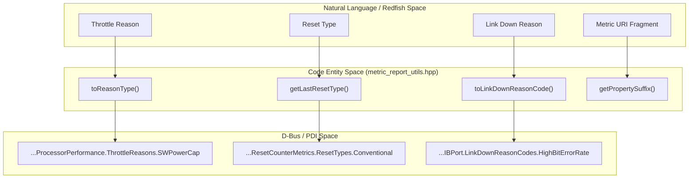
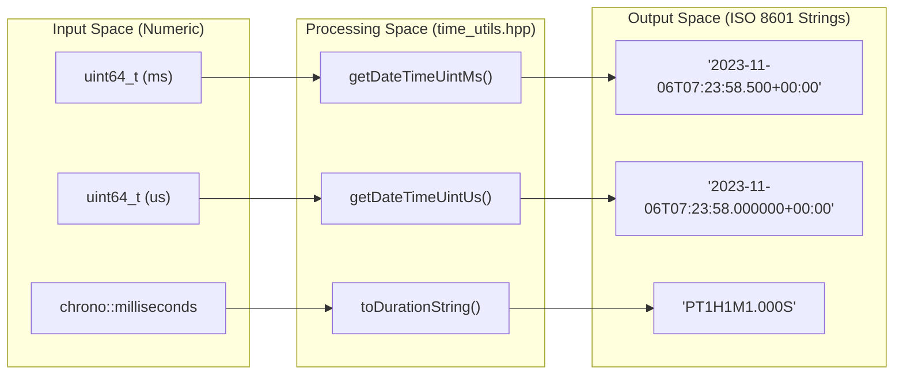

<!-- source: DeepWiki mcp.deepwiki.com · repo NVIDIA/nv-bmc-shmem · page 7.2 Unit Tests: Utilities (Metric, Port, Time) · fetched 2026-10-26 -->

# Unit Tests: Utilities (Metric, Port, Time)

Relevant source files

The following files were used as context for generating this wiki page:

- [test/meson.build](test/meson.build)
- [test/metric_report_utils_test.cpp](test/metric_report_utils_test.cpp)
- [test/port_utils_test.cpp](test/port_utils_test.cpp)
- [test/time_utils_test.cpp](test/time_utils_test.cpp)

This page details the unit testing suite for the utility layers of the `nv-bmc-shmem` library. These tests validate the translation of D-Bus Phosphor-D-Bus-Interfaces (PDI) into Redfish-compliant formats, including URI generation, port state mapping, and ISO 8601 time formatting. Additionally, it covers the build-system mechanisms used to resolve dependency conflicts during testing.

## Overview of Utility Testing

The utility tests ensure that data extracted from shared memory is correctly transformed for Northbound interfaces (like Redfish). The suite is divided into three primary functional areas:
1.  **Metric Report Utilities**: Validates Redfish URI construction and enum-to-string translation.
2.  **Port Utilities**: Validates link status and hardware state mapping.
3.  **Time Utilities**: Validates bidirectional conversion between raw numeric timestamps (ms/ns) and ISO 8601 duration/datetime strings.

### Test Executables and Dependencies
The tests are defined in `test/meson.build` and linked against `gtest` and `gmock`.

| Test Name | Source File | Focus |
| :--- | :--- | :--- |
| `test_metric_report_utils_test` | `metric_report_utils_test.cpp` | URI generation, PDI enum translation |
| `test_port_utils_test` | `port_utils_test.cpp` | Port LinkStatus, LinkState, PowerInput mapping |
| `test_time_utils_test` | `time_utils_test.cpp` | ISO 8601 Durations and Datetimes |

**Sources:** [test/meson.build:23-46](), [test/meson.build:51-62]()

---

## Metric Report Utilities Test

The `MetricReportUtilsTest` validates the logic in `utils/metric_report_utils.hpp`. It focuses on the translation of complex PDI strings into Redfish-standard values and the parsing of hardware-specific strings.

### Key Validations
*   **Enum Translation**: Tests `toReasonType`, `getLastResetType`, `toPCIeType`, and `toLinkDownReasonCode` to ensure specific D-Bus paths map to correct Redfish strings [test/metric_report_utils_test.cpp:33-97]().
*   **Property Suffixes**: Validates that D-Bus interfaces (e.g., `xyz.openbmc_project.Metrics.IBPort`) generate the correct Redfish property fragments (e.g., `/Metrics#/RXErrors`) [test/metric_report_utils_test.cpp:119-139]().
*   **Path Parsing**: The `getProcessorAndCpuNum` function is tested for its ability to extract module and CPU indices from string identifiers like `ProcessorModule_1_CPU_0_CoreUtil_64` [test/metric_report_utils_test.cpp:144-163]().
*   **Generic Translation Dispatcher**: Tests `translateReading`, which acts as the central router for converting PDI values based on their interface and property name [test/metric_report_utils_test.cpp:168-212]().

### Natural Language to Code Entity Mapping: Metrics
This diagram maps the Redfish concepts tested to the specific utility functions and PDI strings.

**Sources:** [test/metric_report_utils_test.cpp:33-140](), [test/metric_report_utils_test.cpp:168-212]()

---

## Port Utilities Test

The `PortUtilsTest` focuses on hardware-level status mappings defined in `utils/port_utils.hpp`. These functions are critical for reporting the health and connectivity of NVLink and PCIe ports.

### Mapping Functions
*   **Link Status**: Maps `xyz.openbmc_project.Inventory.Decorator.PortState.LinkStatusType.LinkDown` to `LinkDown` [test/port_utils_test.cpp:30-50]().
*   **Link State**: Maps `xyz.openbmc_project.Inventory.Decorator.PortState.LinkStates.Enabled` to `Enabled` [test/port_utils_test.cpp:56-76]().
*   **Power Inputs**: Maps internal power status strings (e.g., `Status.Good`, `Status.Fault`) to Redfish-compliant `Normal` or `Fault` strings [test/port_utils_test.cpp:82-100]().

**Sources:** [test/port_utils_test.cpp:1-101]()

---

## Time Utilities Test

The `TimeUtilsTest` validates the robust parsing and formatting of ISO 8601 strings, which are used for telemetry timestamps and duration metrics (e.g., uptime, accumulation intervals).

### Duration Formatting (ISO 8601)
Tests validate `toDurationString` and `fromDurationString` across various scales:
*   **Sub-second**: `500ms` translates to `PT0.500S` [test/time_utils_test.cpp:153-158]().
*   **Compound Units**: `PT1H1M1S` is verified for both parsing and generation [test/time_utils_test.cpp:62-67](), [test/time_utils_test.cpp:133-138]().
*   **Day Handling**: Validates the `P1DT` (1 day) format used in long-running telemetry [test/time_utils_test.cpp:69-74]().

### Datetime Formatting
Validates the conversion of Epoch integers (seconds, milliseconds, and microseconds) into full ISO 8601 strings:
*   **Epoch Zero**: `0` maps to `1970-01-01T00:00:00+00:00` [test/time_utils_test.cpp:190-194]().
*   **Precision**: Validates that `getDateTimeUintMs` and `getDateTimeUintUs` correctly append millisecond/microsecond fractions [test/time_utils_test.cpp:207-226]().

### Natural Language to Code Entity Mapping: Time
This diagram illustrates the flow of time data from raw numeric types to formatted strings.

**Sources:** [test/time_utils_test.cpp:109-158](), [test/time_utils_test.cpp:207-226]()

---

## Stub/Shadowing Mechanism

A specific challenge in testing `metric_report_utils.hpp` is a symbol conflict between `sdbusplus` and `lg2` (logging) during compilation, specifically regarding `log_convert` ambiguity.

### Implementation
To resolve this, the test suite uses a "shadowing" technique:
1.  **Stub Header**: A minimal `shm_common.h` is provided in `test/stubs/`.
2.  **Include Ordering**: In `test/meson.build`, the `stubs` directory is placed first in the `include_directories` list for the `test-metric_report_utils_test` target [test/meson.build:57-60]().
3.  **Conflict Resolution**: This ensures that the compiler uses the stubbed versions of D-Bus types rather than pulling in the full `<sdbusplus/bus.hpp>`, which triggers the conflict with `lg2` [test/meson.build:48-50]().

**Sources:** [test/meson.build:48-62]()

---

