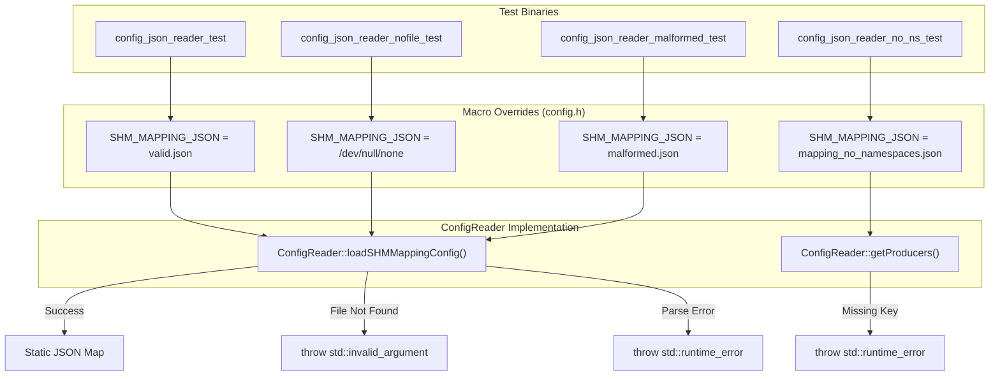
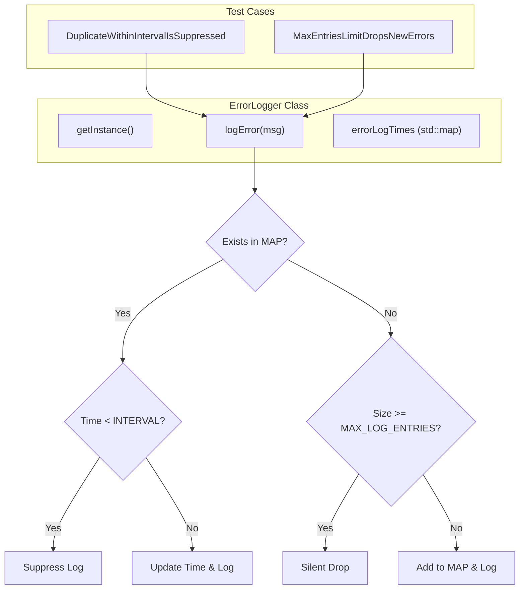

<!-- source: DeepWiki mcp.deepwiki.com · repo NVIDIA/nv-bmc-shmem · page 7.3 Configuration Reader Tests and Branch Coverage · fetched 2026-10-26 -->

# Configuration Reader Tests and Branch Coverage

Relevant source files

The following files were used as context for generating this wiki page:

- [test/BRANCH_COVERAGE_NOTES.md](test/BRANCH_COVERAGE_NOTES.md)
- [test/config_json_reader_malformed_test.cpp](test/config_json_reader_malformed_test.cpp)
- [test/config_json_reader_no_ns_test.cpp](test/config_json_reader_no_ns_test.cpp)
- [test/config_json_reader_no_producers_test.cpp](test/config_json_reader_no_producers_test.cpp)
- [test/config_json_reader_nofile_test.cpp](test/config_json_reader_nofile_test.cpp)
- [test/config_json_reader_null_test.cpp](test/config_json_reader_null_test.cpp)
- [test/config_json_reader_test.cpp](test/config_json_reader_test.cpp)
- [test/error_logger_test.cpp](test/error_logger_test.cpp)
- [test/fixtures/malformed.json](test/fixtures/malformed.json)
- [test/fixtures/mapping_no_namespaces.json](test/fixtures/mapping_no_namespaces.json)
- [test/fixtures/mapping_no_producers.json](test/fixtures/mapping_no_producers.json)
- [test/fixtures/namespace_invalid_entry.json](test/fixtures/namespace_invalid_entry.json)

This page documents the testing strategy and implementation for the `ConfigReader` component and the `ErrorLogger` utility. Because `ConfigReader` relies on static state and global configuration macros (defining file paths), the test suite uses a multi-binary approach to exercise failure branches that are otherwise unreachable during normal execution.

## Testing Strategy: Multi-Binary Branch Coverage

The `ConfigReader` class uses static members to cache JSON configuration data once loaded [test/config_json_reader_test.cpp:32-33](). To achieve high branch coverage, the test suite is split into multiple binaries, each targeting specific failure modes by overriding the `SHM_MAPPING_JSON` and `SHM_NAMESPACE_CFG_JSON` macros via a custom `config.h` or specific test fixtures.

### Failure Scenarios and Test Files

| Test File | Scenario Targeted | Coverage Focus |
| :--- | :--- | :--- |
| `config_json_reader_nofile_test.cpp` | Missing configuration files | `invalid_argument` throws when files are not found [test/config_json_reader_nofile_test.cpp:29-36](). |
| `config_json_reader_malformed_test.cpp` | Corrupted JSON syntax | `runtime_error` throws during `JSON::parse` [test/config_json_reader_malformed_test.cpp:29-31](). |
| `config_json_reader_no_ns_test.cpp` | Missing "Namespaces" keys | Logic for handling valid JSON that lacks required schema keys [test/config_json_reader_no_ns_test.cpp:29-38](). |
| `config_json_reader_no_producers_test.cpp` | Namespace without Producers | Logic for handling entries that omit the "Producers" key [test/config_json_reader_no_producers_test.cpp:29-33](). |
| `config_json_reader_null_test.cpp` | Access before load | Throws when getters are called before `load` functions [test/config_json_reader_null_test.cpp:29-32](). |

### Configuration Flow and Test Injection

The following diagram illustrates how the test suite injects different JSON fixtures to trigger specific code paths within the `ConfigReader`.

**Diagram: ConfigReader Test Injection Flow**

**Sources:** [test/config_json_reader_nofile_test.cpp:29-37](), [test/config_json_reader_malformed_test.cpp:29-36](), [test/config_json_reader_no_ns_test.cpp:29-39]()

## JSON Fixtures and Expected Behaviors

The test suite uses specific JSON files in `test/fixtures/` to simulate edge cases in the configuration schema.

### Malformed JSON
File: `test/fixtures/malformed.json`
Contains raw text that is not valid JSON [test/fixtures/malformed.json:1](). This triggers the `EXPECT_THROW` conditions in `ConfigJsonReaderMalformedTest` for both namespace and mapping loads [test/config_json_reader_malformed_test.cpp:38-48]().

### Missing Schema Keys
File: `test/fixtures/mapping_no_namespaces.json`
A valid JSON object that lacks the `"Namespaces"` key [test/fixtures/mapping_no_namespaces.json:1-3](). This exercises:
* `getProducers()`: Throws `runtime_error` [test/config_json_reader_no_ns_test.cpp:54-59]().
* `getSHMSize()`: Throws `runtime_error` [test/config_json_reader_no_ns_test.cpp:70-76]().
* `getMRDNamespaceLookup()`: Catches the internal throw and returns an empty map [test/config_json_reader_no_ns_test.cpp:78-85]().

### Invalid Namespace Entries
File: `test/fixtures/namespace_invalid_entry.json`
Contains a list where some entries are missing required fields like `"Namespace"` or `"PropertyList"` [test/fixtures/namespace_invalid_entry.json:1-16]().
* **Behavior:** `getNameSpaceConfiguration()` skips the invalid entries, logs an error via `LOG_ERROR`, and returns only the valid entry (`"ValidNamespace"`) [test/config_json_reader_no_ns_test.cpp:61-68]().

## Error Logger Suppression Tests

The `ErrorLogger` is tested to ensure it correctly suppresses high-frequency logs and respects capacity limits.

**Diagram: ErrorLogger Logic and Test Hooks**

**Sources:** [test/error_logger_test.cpp:43-71]()

### Key Test Scenarios
* **Singleton Integrity:** Ensures `getInstance()` always returns the same memory address [test/error_logger_test.cpp:30-35]().
* **Suppression:** Verifies that calling `logError()` with the same string twice in rapid succession does not result in multiple processing actions (simulated via `EXPECT_NO_THROW` on the suppression branch) [test/error_logger_test.cpp:43-49]().
* **Capacity Exhaustion:** The test fills the internal map to `MAX_LOG_ENTRIES`. Once the limit is reached, subsequent unique error strings are silently dropped to prevent memory exhaustion [test/error_logger_test.cpp:62-71]().

## Branch Coverage Analysis

As of the current implementation, the library achieves approximately **35.3% branch coverage** [test/BRANCH_COVERAGE_NOTES.md:3](). Several factors limit higher coverage:

1.  **OS Failures:** Branches guarding `mmap`, `shm_open`, and `ftruncate` failures are difficult to trigger without kernel fault injection [test/BRANCH_COVERAGE_NOTES.md:20-24]().
2.  **Template Inflation:** Functions like `toISO8061ExtendedStr` are instantiated for multiple types (e.g., `uint64_t`, `time_t`). A single unreachable branch in the template is counted against every instantiation [test/BRANCH_COVERAGE_NOTES.md:26-33]().
3.  **Build-Time Constants:** Certain `if` statements involving `PLATFORMDEVICEPREFIX` are optimized into dead code when the prefix is an empty string [test/BRANCH_COVERAGE_NOTES.md:14-15]().

**Sources:**
* `test/config_json_reader_test.cpp`
* `test/config_json_reader_nofile_test.cpp`
* `test/config_json_reader_malformed_test.cpp`
* `test/config_json_reader_no_ns_test.cpp`
* `test/config_json_reader_no_producers_test.cpp`
* `test/config_json_reader_null_test.cpp`
* `test/error_logger_test.cpp`
* `test/BRANCH_COVERAGE_NOTES.md`

---

