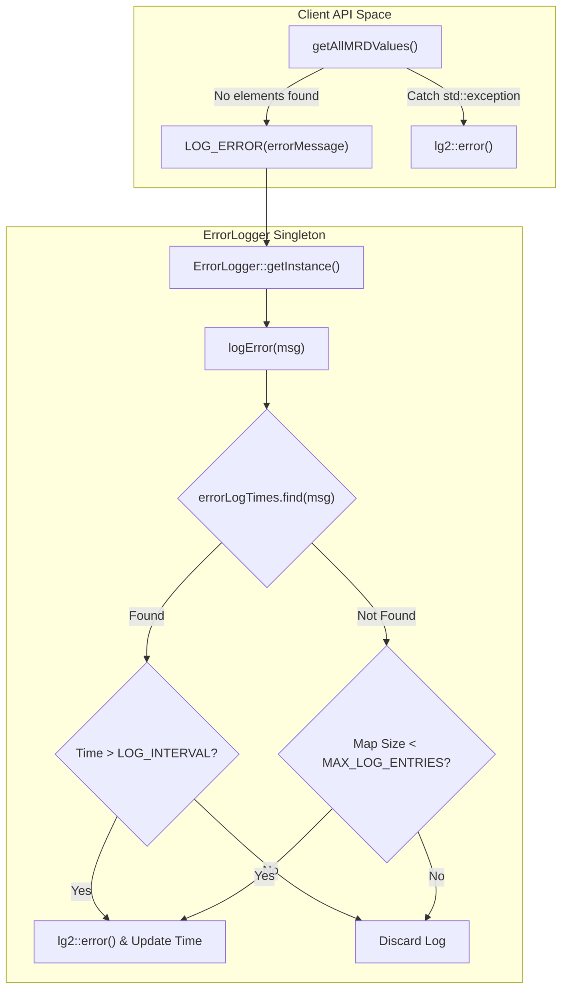
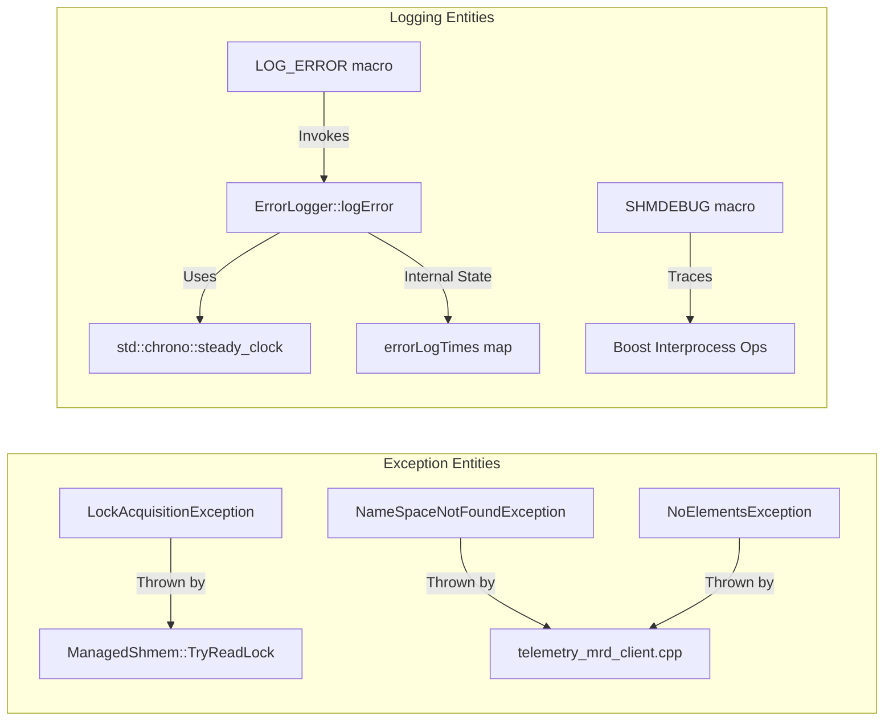

<!-- source: DeepWiki mcp.deepwiki.com · repo NVIDIA/nv-bmc-shmem · page 8 Error Handling and Logging · fetched 2026-10-26 -->

# Error Handling and Logging

Relevant source files

The following files were used as context for generating this wiki page:

- [lib/error_logger.cpp](lib/error_logger.cpp)
- [lib/impl/error_logger.hpp](lib/impl/error_logger.hpp)
- [lib/managed_shmem.cpp](lib/managed_shmem.cpp)
- [lib/telemetry_mrd_client.cpp](lib/telemetry_mrd_client.cpp)

The `nv-bmc-shmem` library implements a multi-tiered error handling and logging strategy designed for high-frequency telemetry environments. Because shared memory operations can occur thousands of times per second, the system prioritizes log suppression to prevent journal exhaustion while providing detailed diagnostic information via custom exceptions and conditional debug tracing.

### Error Logging and Suppression

The library uses a singleton `ErrorLogger` to manage log frequency. Instead of writing directly to the system journal for every failure, the `LOG_ERROR` macro routes messages through a suppression engine that tracks unique error strings and their last occurrence.

*   **Suppression Logic**: Errors are only logged if they haven't been seen within the `LOG_INTERVAL_SECONDS` window [lib/impl/error_logger.hpp:31-37]().
*   **Memory Safety**: The logger maintains a maximum of `MAX_LOG_ENTRIES` to prevent the internal tracking map from growing indefinitely in the event of unique error string generation [lib/error_logger.cpp:55-58]().
*   **Integration**: High-level logging is performed via `phosphor-logging` (`lg2`) [lib/error_logger.cpp:64-64]().

For details, see [ErrorLogger: Suppression and Rate Limiting](#8.1).

### Exception Hierarchy and Safety

The library defines a set of custom exceptions to handle common shared memory and concurrency failures. These are used to signal issues like timeout during lock acquisition or configuration mismatches.

| Exception | Triggering Condition |
| :--- | :--- |
| `LockAcquisitionException` | Failed to acquire a timed mutex within the 1-second timeout [lib/managed_shmem.cpp:79-82](). |
| `NameSpaceNotFoundException` | Requested MRD namespace is missing from the lookup configuration [lib/telemetry_mrd_client.cpp:117-117](). |
| `NoElementsException` | A valid namespace was found but it contains no sensor data [lib/telemetry_mrd_client.cpp:109-109](). |
| `BadMapException` | The `SensorMap` object cannot be found within the shared memory segment. |
| `PermissionErrorException` | Attempted write operation on a segment opened in `O_RDONLY` mode. |

For details, see [Exception Types and Lock Safety](#8.2).

### Debug Tracing (SHMDEBUG)

In addition to standard error logging, the library provides a `SHMDEBUG` macro. This macro is conditionally compiled and used for low-level tracing of shared memory lifecycle events, such as segment removal and creation [lib/managed_shmem.cpp:37-41]().

**Logging Flow Overview**

The following diagram illustrates how an error condition (e.g., an empty namespace) flows from the client API through the suppression logic to the system log.

Title: Error Suppression and Logging Flow

Sources: [lib/telemetry_mrd_client.cpp:63-119](), [lib/error_logger.cpp:31-65](), [lib/impl/error_logger.hpp:54-54]()

### Code Entity Mapping

This diagram maps the high-level error concepts to the specific C++ entities responsible for enforcing them.

Title: Error Handling Entity Mapping

Sources: [lib/managed_shmem.cpp:73-85](), [lib/telemetry_mrd_client.cpp:58-60](), [lib/impl/error_logger.hpp:24-54](), [lib/error_logger.cpp:25-51]()

***

### Child Pages
- [ErrorLogger: Suppression and Rate Limiting](#8.1)
- [Exception Types and Lock Safety](#8.2)

---

