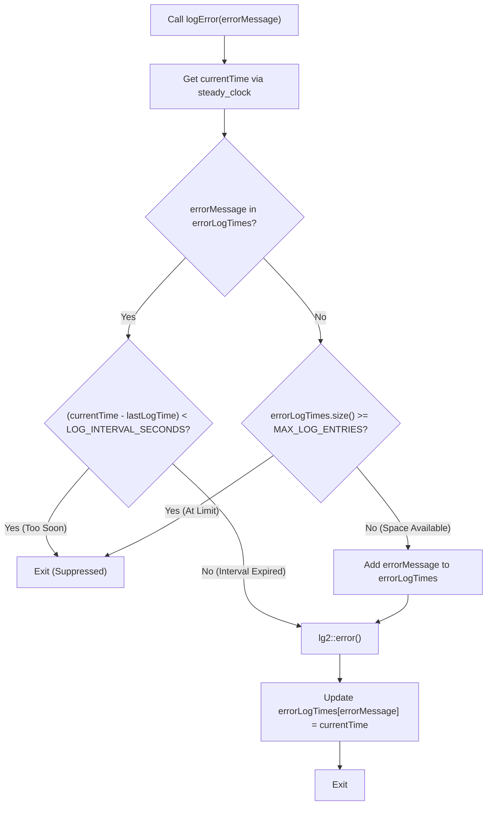
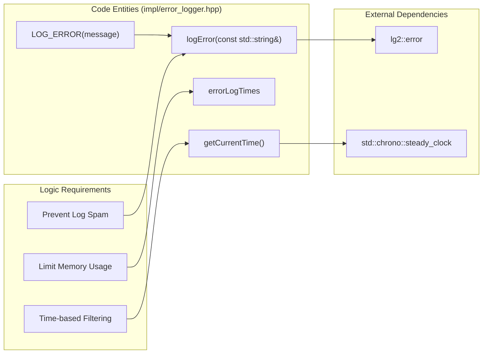

<!-- source: DeepWiki mcp.deepwiki.com · repo NVIDIA/nv-bmc-shmem · page 8.1 ErrorLogger: Suppression and Rate Limiting · fetched 2026-10-26 -->

# ErrorLogger: Suppression and Rate Limiting

Relevant source files

The following files were used as context for generating this wiki page:

- [lib/error_logger.cpp](lib/error_logger.cpp)
- [lib/impl/error_logger.hpp](lib/impl/error_logger.hpp)
- [test/error_logger_test.cpp](test/error_logger_test.cpp)

The `ErrorLogger` is a singleton utility designed to manage logging behavior within the `nv-bmc-shmem` library. In high-frequency telemetry environments, a single failure (such as a permission error or a missing shared memory segment) can result in thousands of log entries per second as producers and consumers attempt to access the data. The `ErrorLogger` prevents journal exhaustion and performance degradation by implementing time-based suppression and memory-bound capacity limits.

### Core Components and Configuration

The logger operates using a set of fixed constraints defined during the build process to balance visibility with system stability.

| Parameter | Default Value | Description |
| :--- | :--- | :--- |
| `LOG_INTERVAL_SECONDS` | `2700` (45 min) | The minimum duration that must elapse before the same error string is logged again. |
| `MAX_LOG_ENTRIES` | `10000` | The maximum number of unique error strings tracked in memory to prevent unbounded heap growth. |

**Sources:** [lib/error_logger.cpp:48-49](), [lib/error_logger.cpp:55-58](), [test/error_logger_test.cpp:65-68]()

---

### Implementation Details

The `ErrorLogger` is implemented as a thread-safe singleton that maintains an internal state of error occurrences.

#### The Singleton Pattern
The class uses a static local variable within `getInstance()` to ensure a single instance exists for the lifetime of the process [lib/error_logger.cpp:25-29](). Copy constructors and assignment operators are explicitly deleted to enforce this pattern [lib/impl/error_logger.hpp:42-43]().

#### Data Structures
The primary state is held in `errorLogTimes`, an `std::unordered_map` that associates a unique error string with a `std::chrono::steady_clock::time_point` [lib/impl/error_logger.hpp:46-47](). Using `steady_clock` ensures that rate limiting is immune to system time jumps (e.g., NTP updates) [lib/error_logger.cpp:68-71]().

#### The LOG_ERROR Macro
To simplify integration throughout the codebase, a macro is provided that abstracts the singleton access:
`#define LOG_ERROR(message) ErrorLogger::getInstance().logError(message)` [lib/impl/error_logger.hpp:54-54]().

**Sources:** [lib/impl/error_logger.hpp:24-54](), [lib/error_logger.cpp:25-30]()

---

### Logic Flow: logError()

The `logError()` method follows a strict decision tree to determine if a message should be passed to the underlying `lg2` logging framework.

**Error Logging Decision Logic**

**Sources:** [lib/error_logger.cpp:31-65](), [lib/impl/error_logger.hpp:31-37]()

---

### Entity Mapping: Code to Logic

The following diagram maps the natural language requirements of the suppression system to the specific code entities in the `ErrorLogger` implementation.

**Natural Language to Code Entity Space**

**Sources:** [lib/impl/error_logger.hpp:24-54](), [lib/error_logger.cpp:31-71]()

---

### Operational Constraints and Edge Cases

The implementation includes specific behaviors for boundary conditions:

1.  **Map Saturation**: If the `errorLogTimes` map reaches `MAX_LOG_ENTRIES` (10,000), any **new** unique error messages are silently dropped [lib/error_logger.cpp:55-58](). This protects the BMC from Out-Of-Memory (OOM) conditions if a process generates an infinite variety of error strings.
2.  **Duplicate Suppression**: If the same error occurs multiple times within the `LOG_INTERVAL_SECONDS` window, the logic returns early after the map lookup, avoiding the overhead of string formatting and journal writes [lib/error_logger.cpp:48-51]().
3.  **Persistence**: The suppression state is volatile and stored in the heap of the process using the library. If a daemon (e.g., `bmcweb`) restarts, the `errorLogTimes` map is cleared, and the suppression timers reset [test/error_logger_test.cpp:27-29]().
4.  **Testing**: The singleton nature means that unit tests must use unique error strings to avoid cross-test interference, as the state persists across `TEST()` blocks in the same execution process [test/error_logger_test.cpp:27-35]().

**Sources:** [lib/error_logger.cpp:31-65](), [test/error_logger_test.cpp:27-71]()

---

