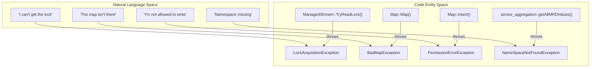
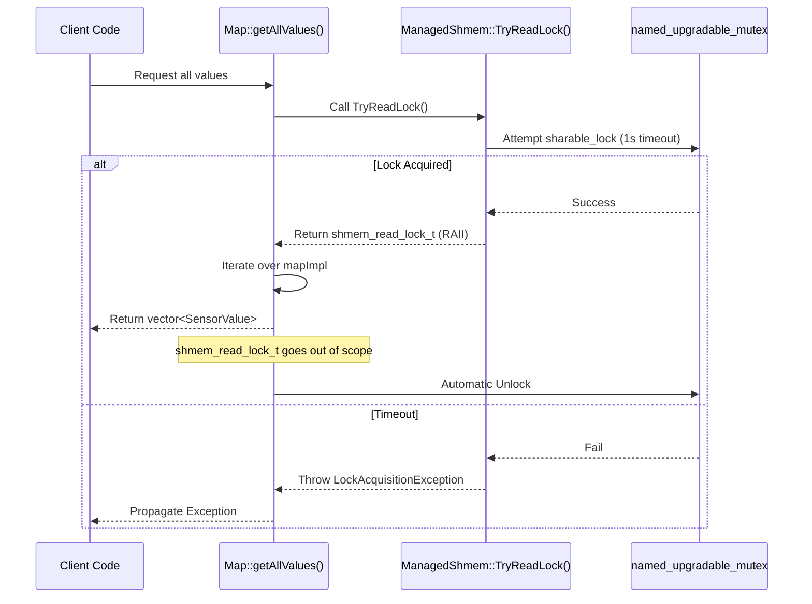

<!-- source: DeepWiki mcp.deepwiki.com · repo NVIDIA/nv-bmc-shmem · page 8.2 Exception Types and Lock Safety · fetched 2026-10-26 -->

# Exception Types and Lock Safety

Relevant source files

The following files were used as context for generating this wiki page:

- [lib/impl/managed_shmem.hpp](lib/impl/managed_shmem.hpp)
- [lib/include/telemetry_mrd_producer.hpp](lib/include/telemetry_mrd_producer.hpp)
- [lib/managed_shmem.cpp](lib/managed_shmem.cpp)
- [lib/shmem_map.cpp](lib/shmem_map.cpp)
- [lib/telemetry_mrd_client.cpp](lib/telemetry_mrd_client.cpp)

This page documents the error handling mechanisms and synchronization strategies used in the `nv-bmc-shmem` library. It details the custom exception hierarchy and the Resource Acquisition Is Initialization (RAII) locking pattern used to ensure data consistency across multiple processes.

## Custom Exception Types

The library defines several specialized exception types to handle failures in shared memory mapping, permission violations, and synchronization timeouts. These are primarily defined in [lib/impl/managed_shmem.hpp:70-85]().

### Exception Hierarchy Reference

| Exception Type | Base Class | Description | Typical Cause |
| :--- | :--- | :--- | :--- |
| `LockAcquisitionException` | `std::runtime_error` | Failed to acquire a mutex within the hardcoded timeout. | Deadlock or extreme system contention (1s timeout). |
| `BadMapException` | `std::runtime_error` | The `SensorMap` object could not be found or constructed in the segment. | Segment corruption or initialization failure. |
| `PermissionErrorException` | `std::runtime_error` | Attempted a write operation on a segment opened with `O_RDONLY`. | Client (e.g., `bmcweb`) trying to modify telemetry. |
| `NameSpaceNotFoundException` | `std::runtime_error` | The requested MRD namespace is not present in the configuration. | Missing entry in `shm_mapping.json`. |
| `NoElementsException` | `std::runtime_error` | The namespace exists but contains no sensor data. | Producer has not yet written any values. |

### Logic and Code Entities Mapping

The following diagram shows how high-level error states map to specific code entities and exceptions.

**Exception Propagation Map**

Sources: [lib/impl/managed_shmem.hpp:70-85](), [lib/managed_shmem.cpp:73-85](), [lib/shmem_map.cpp:24-38](), [lib/telemetry_mrd_client.cpp:112-118]()

---

## Lock Safety and Synchronization

The library utilizes `boost::interprocess::named_upgradable_mutex` to synchronize access between producer daemons and consumer clients.

### RAII Locking Pattern

To prevent deadlocks and ensure locks are released even when exceptions occur, the library uses RAII lock types:
- **`shmem_write_lock_t`**: An alias for `boost::interprocess::scoped_lock`. Used for exclusive write access [lib/impl/managed_shmem.hpp:37-38]().
- **`shmem_read_lock_t`**: An alias for `boost::interprocess::sharable_lock`. Used for shared read access [lib/impl/managed_shmem.hpp:39-40]().

### Deadlock Prevention (Timed Mutex)

To prevent a crashed or hung process from permanently blocking other system components, the `TryReadLock()` method implements a 1-second timeout.

1.  **Time Calculation**: It calculates an absolute time 1 second in the future using `boost::posix_time::microsec_clock::universal_time()` [lib/managed_shmem.cpp:75-77]().
2.  **Timed Attempt**: It attempts to acquire the `sharable_lock` using this timeout [lib/managed_shmem.cpp:78]().
3.  **Exception Trigger**: If the lock cannot be acquired within 1 second, it throws `LockAcquisitionException` [lib/managed_shmem.cpp:79-82]().

### Lock Flow and Data Access

The following diagram illustrates the lifecycle of a lock during a read operation in `Map<SensorMap, SensorValue>::getAllValues()`.

**Read Operation Lock Lifecycle**

Sources: [lib/managed_shmem.cpp:73-85](), [lib/shmem_map.cpp:70-82]()

---

## Implementation Details by Function

### Write Operations and Permissions
Write operations (insert, updateValue, updateTimestamp) strictly enforce the `O_CREAT` flag. If a process attempts to write to a segment opened in read-only mode, a `PermissionErrorException` is thrown immediately [lib/shmem_map.cpp:131-132](), [lib/shmem_map.cpp:155-156]().

### Client-Side Exception Handling
The client API (`telemetry_mrd_client.cpp`) wraps lower-level exceptions to provide higher-level context:
- **`getAllKeyValuePair`**: Catches any exception during map initialization or reading and translates it to `NameSpaceNotFoundException` or `NoElementsException` [lib/telemetry_mrd_client.cpp:53-60]().
- **`getAllMRDValues`**: Iterates through multiple producers. If a specific producer's namespace fails, it logs the error via `lg2` but continues to the next producer to ensure partial data availability [lib/telemetry_mrd_client.cpp:92-98]().

Sources: [lib/telemetry_mrd_client.cpp:40-61](), [lib/telemetry_mrd_client.cpp:63-119](), [lib/shmem_map.cpp:110-205]()

---

