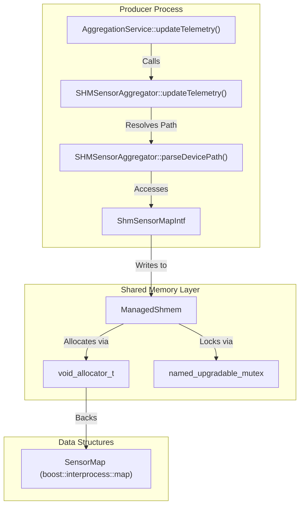
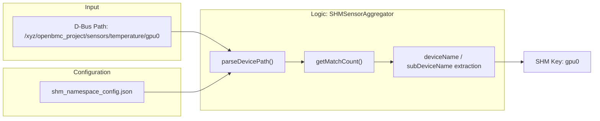

<!-- source: DeepWiki mcp.deepwiki.com · repo NVIDIA/nv-bmc-shmem · page 9 Glossary · fetched 2026-10-26 -->

# Glossary

Relevant source files

The following files were used as context for generating this wiki page:

- [README.md](README.md)
- [configurations/shm_mapping.json](configurations/shm_mapping.json)
- [configurations/shm_namespace_config.json](configurations/shm_namespace_config.json)
- [lib/managed_shmem.cpp](lib/managed_shmem.cpp)
- [lib/shm_sensor_aggregator.cpp](lib/shm_sensor_aggregator.cpp)
- [lib/utils/metric_report_utils.hpp](lib/utils/metric_report_utils.hpp)
- [lib/utils/port_utils.hpp](lib/utils/port_utils.hpp)
- [lib/utils/time_utils.hpp](lib/utils/time_utils.hpp)
- [meson.build](meson.build)
- [meson_options.txt](meson_options.txt)

This page provides a comprehensive reference for the terminology, D-Bus paths, and hardware-specific concepts used within the `nv-bmc-shmem` codebase. It serves to bridge the gap between high-level Redfish requirements and the low-level shared memory implementation.

## 1. System Concepts and Terminology

### Metric Report Definition (MRD)
In the Redfish Telemetry service, an MRD defines the contents and schedule of a metric report. In this codebase, "MRD Values" refer to the aggregated telemetry data stored in shared memory that `bmcweb` consumes to populate these reports [README.md:16-22]().

### Producer
A daemon (e.g., `gpumgrd`, `pldmd`, `hwmontemp`) that collects telemetry from hardware and writes it into shared memory using the `AggregationService` [lib/shm_sensor_aggregator.cpp:162-167]().

### Consumer / Client
A process that reads from shared memory. The primary consumer is `bmcweb`, which uses the `telemetry_mrd_client` functions to fetch data for Redfish responses [README.md:90-98]().

### Namespace
A logical grouping of telemetry data. There are two types:
1.  **MRD Namespace**: High-level Redfish categories (e.g., `PlatformEnvironmentMetrics`, `ProcessorMetrics`) [configurations/shm_namespace_config.json:4-10]().
2.  **SHM Namespace**: The actual shared memory segment name on the filesystem, typically formatted as `{ProducerName}_{PlatformDevicePrefix}{MRDNamespace}_0` [lib/shm_sensor_aggregator.cpp:169-171]().

## 2. Shared Memory Implementation Terms

### ManagedShmem
A wrapper around `boost::interprocess::managed_shared_memory`. It handles the lifecycle of the segment and its associated `named_upgradable_mutex` [lib/managed_shmem.cpp:31-56]().

### void_allocator_t
A Boost Interprocess allocator type used to allocate memory for containers (like maps and strings) directly within the shared memory segment [lib/managed_shmem.cpp:58-60]().

### SensorMap
The primary data structure stored in SHM. It is a `boost::interprocess::map` where the key is a `char_string_t` (object path) and the value is a `SensorValue` [lib/shm_sensor_aggregator.cpp:311-315]().

### Upgradable Mutex
A synchronization primitive (`boost::interprocess::named_upgradable_mutex`) that allows multiple concurrent readers (via `TryReadLock`) but requires an exclusive lock for writers [lib/managed_shmem.cpp:67-85]().

### Code Entity Mapping: Data Flow
The following diagram illustrates how high-level producer calls translate into low-level shared memory operations.

**Producer to SHM Mapping**

**Sources:** [lib/shm_sensor_aggregator.cpp:159-185](), [lib/managed_shmem.cpp:31-60]()

## 3. Configuration and Pathing

### ObjectpathKeywords
Keywords used in `shm_namespace_config.json` to route D-Bus objects to specific MRD Namespaces. For example, any path containing `sensors/temperature` is routed to `PlatformEnvironmentMetrics` [configurations/shm_namespace_config.json:4-7]().

### DevicePath Heuristics
The `SHMSensorAggregator` uses `getMatchCount` and `parseDevicePath` to determine which SHM segment a D-Bus object belongs to by comparing the D-Bus path against the `ObjectpathKeywords` [lib/shm_sensor_aggregator.cpp:31-61](), [lib/shm_sensor_aggregator.cpp:63-157]().

### Code Entity Mapping: Path Resolution
This diagram shows how a D-Bus object path is processed into an internal SHM key.

**D-Bus Path to SHM Key Resolution**

**Sources:** [lib/shm_sensor_aggregator.cpp:31-157](), [configurations/shm_namespace_config.json:1-10]()

## 4. Hardware and Redfish Mappings

The codebase contains numerous translation maps to convert OpenBMC Property Data Interface (PDI) enums into Redfish-compliant strings.

| Term | Code Entity | Description |
| :--- | :--- | :--- |
| **Link Status** | `linkStatusTypeMap` | Maps PDI `LinkStatusType` (e.g., `LinkUp`) to Redfish strings [lib/utils/port_utils.hpp:32-42](). |
| **PCIe Type** | `pcieTypeMap` | Maps PDI `PCIeTypes` (e.g., `Gen5`) to Redfish strings [lib/utils/metric_report_utils.hpp:96-108](). |
| **Throttle Reason** | `reasonTypeMap` | Maps PDI `ThrottleReasons` (e.g., `SWPowerCap`) to Redfish descriptions [lib/utils/metric_report_utils.hpp:63-93](). |
| **Power Input** | `powerSystemInputTypeTypeMap` | Maps PDI power status to `Normal`, `Fault`, etc [lib/utils/port_utils.hpp:56-64](). |

## 5. Utility Definitions

### ISO 8601 Duration
Redfish requires time durations in ISO 8601 format (e.g., `P0DT0H0M5.500S`).
*   `toDurationString`: Formats `chrono::milliseconds` to string [lib/utils/time_utils.hpp:232-261]().
*   `fromDurationString`: Parses an ISO 8601 string back to `chrono::milliseconds` [lib/utils/time_utils.hpp:155-223]().

### ErrorLogger
A singleton used to prevent log spam. It uses `LOG_INTERVAL_SECONDS` (default 2700s) to suppress duplicate error messages within a specific window [meson_options.txt:23-27]().

### Build Macros
*   `PLATFORMSYSTEMID`: The ID of the computer system in Redfish URIs (default: `system`) [meson_options.txt:5-9]().
*   `PLATFORMDEVICEPREFIX`: A prefix added to SHM segment names to distinguish between multiple physical devices [meson_options.txt:10-15]().
*   `SHMDEBUG`: A macro that provides detailed trace logging when `enable-shm-debug` is enabled [meson_options.txt:16-21]().

**Sources:**
- [lib/utils/metric_report_utils.hpp:63-108]()
- [lib/utils/port_utils.hpp:32-64]()
- [lib/utils/time_utils.hpp:155-261]()
- [lib/shm_sensor_aggregator.cpp:31-157]()
- [lib/managed_shmem.cpp:31-85]()
- [meson_options.txt:5-33]()
- [README.md:16-98]()