# Page: Overview

# Overview

<details>
<summary>Relevant source files</summary>

The following files were used as context for generating this wiki page:

- [README.md](README.md)
- [lib/include/shm_common.h](lib/include/shm_common.h)
- [meson.build](meson.build)
- [meson_options.txt](meson_options.txt)

</details>


The `nv-bmc-shmem` repository provides a high-performance shared memory (SHM) framework designed to aggregate sensor data and telemetry for the OpenBMC ecosystem. It serves as a low-latency cache between data producers (e.g., sensor daemons) and consumers (e.g., `bmcweb` for Redfish Metric Reports), significantly reducing the overhead associated with traditional D-Bus object management [README.md:1-22]().

## Purpose and Problem Statement

In standard OpenBMC architectures, `bmcweb` fulfills Redfish Metric Report Definition (MRD) requests by making multiple D-Bus calls via `ObjectManager`. This approach often leads to performance bottlenecks, such as PID loop outliers and failure to meet Service Level Agreements (SLAs) for telemetry turnaround time (TAT) [README.md:9-13]().

`nv-bmc-shmem` addresses these issues by:
*   **Caching Telemetry:** Storing sensor values in shared memory segments for near-instantaneous access [README.md:16-18]().
*   **Decoupling Producers and Consumers:** Allowing producers like `gpumgrd`, `pldmd`, or `hwmontemp` to push data into SHM independently of consumer read requests [README.md:18-21]().
*   **Optimizing Redfish Responses:** Providing a specialized API that aggregates data across namespaces to prepare Redfish-compliant responses efficiently [README.md:92-97]().

## High-Level Architecture

The system follows a producer-consumer model where multiple data sources write to specific SHM namespaces, and clients read from them using a unified API.

### System Interaction Diagram

This diagram bridges the natural language concepts of "Producers" and "Clients" to the core code entities used to facilitate communication.

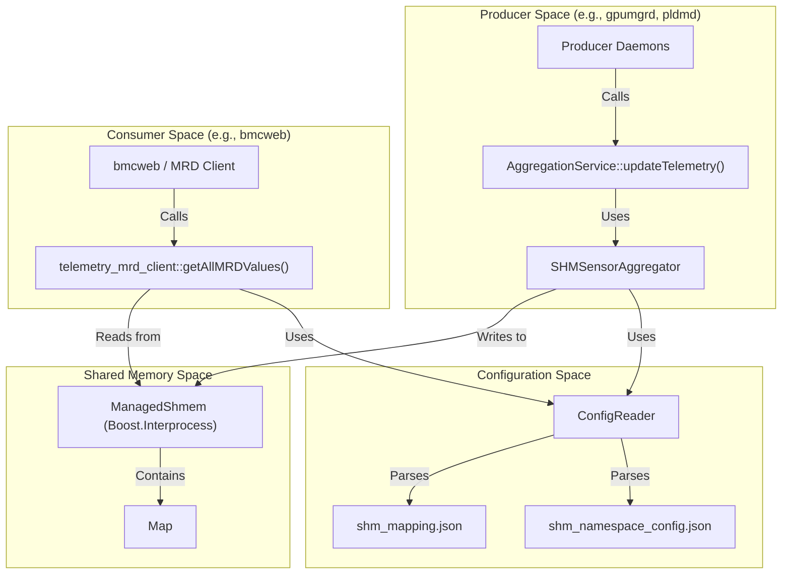
**Sources:** [README.md:56-80](), [lib/include/aggregation_service.hpp:24-40](), [lib/include/telemetry_mrd_client.hpp:24-45]()

## Core Components

### 1. Shared Memory Management
The library abstracts raw memory management using `Boost.Interprocess`. Data is organized into namespaces (e.g., `MemoryMetrics`, `ProcessorMetrics`), each backed by a `ManagedShmem` segment [lib/include/shmem_managed_segment.hpp:33-45](). Within these segments, data is stored in a specialized `Map` structure that supports concurrent access via named upgradable mutexes [lib/include/shmem_map.hpp:45-60]().

### 2. Producer API (Writing Data)
Producers use the `AggregationService` to push telemetry. The system handles D-Bus path resolution and automatically maps sensor objects to the correct SHM namespace based on configuration files [README.md:82-89]().
*   For details on integrating a producer, see **[Producer API](#3)**.

### 3. Client API (Reading Data)
The client API, primarily used by `bmcweb`, provides functions like `getAllMRDValues()`. This function performs a "lookup and aggregate" operation: it identifies which SHM segments contain the requested metrics and returns a consolidated view of the data [README.md:90-97]().
*   For details on reading data, see **[Client API](#4)**.

### 4. Configuration and Mapping
The behavior of the library is driven by two primary JSON files:
*   `shm_mapping.json`: Defines the size of SHM segments and the producers authorized to write to them [README.md:151-159]().
*   `shm_namespace_config.json`: Maps Redfish Metric namespaces to specific D-Bus object path keywords and property lists [README.md:126-149]().

| Feature | Description |
| :--- | :--- |
| **Namespaces** | Logical groupings of metrics (e.g., `PlatformEnvironmentMetrics`) [README.md:129](). |
| **Producers** | List of processes allowed to update a namespace [README.md:156](). |
| **SizeInBytes** | Pre-allocated size for each SHM segment [README.md:158](). |

*   For details on configuration, see **[Configuration Files Reference](#1.2)**.

## Integration with OpenBMC

The library is integrated into the OpenBMC build system via Meson. It provides several build-time options to customize platform-specific behavior, such as `platform-system-id` for Redfish URI generation [meson_options.txt:4-9]().

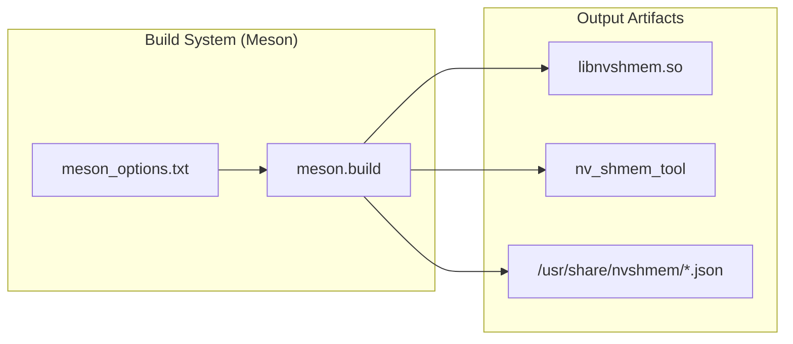
**Sources:** [meson.build:1-31](), [meson_options.txt:1-21]()

*   To learn how to build and install the library, see **[Getting Started: Build and Configuration](#1.1)**.

## Developer Tools
The repository includes `nv_shmem_tool`, a CLI utility for inspecting, creating, and erasing SHM segments manually, which is essential for field debugging [README.md:51-53]().
*   For tool usage, see **[Developer Tools](#6)**.

---
**Sources:**
* [README.md:1-170]()
* [meson.build:1-40]()
* [meson_options.txt:1-34]()
* [lib/include/shm_common.h:32-114]()

---

# Page: Getting Started: Build and Configuration

# Getting Started: Build and Configuration

<details>
<summary>Relevant source files</summary>

The following files were used as context for generating this wiki page:

- [.gitignore](.gitignore)
- [README.md](README.md)
- [lib/include/meson.build](lib/include/meson.build)
- [lib/meson.build](lib/meson.build)
- [meson.build](meson.build)
- [meson_options.txt](meson_options.txt)
- [tools/meson.build](tools/meson.build)

</details>


This page provides technical details on building the `nv-bmc-shmem` library, configuring its platform-specific parameters, and integrating it into the OpenBMC ecosystem. The library uses the Meson build system and relies on JSON configuration files to define shared memory (SHM) segments and sensor mappings.

## Build System Overview

The project is built using Meson (version >= 1.3.0) and requires a C++23 compliant compiler [meson.build:4-7](). It generates a static library named `libnvshmem` [lib/meson.build:35-48]() and a set of CLI tools for debugging and testing [tools/meson.build:2-14]().

### Build Options

Key build parameters are defined in `meson_options.txt` and processed in `lib/meson.build` to generate a `config.h` header used throughout the source code [lib/meson.build:30-33]().

| Option | Type | Default | Description |
| :--- | :--- | :--- | :--- |
| `platform-system-id` | `string` | `"system"` | Sets the `PLATFORMSYSTEMID` macro used for Redfish URI generation [meson_options.txt:4-9](). |
| `platform-device-prefix`| `string` | `""` | Sets the `PLATFORMDEVICEPREFIX` macro for platform-specific metric naming [meson_options.txt:10-15](). |
| `enable-shm-debug` | `feature`| `disabled` | Enables the `ENABLE_SHM_DEBUG` macro for verbose tracing [meson_options.txt:16-21](). |
| `libonly` | `boolean`| `false` | If true, skips building tools and tests [meson_options.txt:1](). |
| `log_interval_seconds` | `integer`| `2700` | Suppression window for duplicate error logs [meson_options.txt:22-27](). |
| `max_log_entries` | `integer`| `10000` | Capacity of the internal error tracking map [meson_options.txt:28-33](). |

**Sources:** [meson_options.txt:1-34](), [lib/meson.build:10-33]()

---

## Installation and Integration

### Installation Paths
When the library is installed, the following files are deployed to the system:
- **Headers:** `shm_common.h`, `telemetry_mrd_producer.hpp`, and `telemetry_mrd_client.hpp` [lib/include/meson.build:2-6]().
- **Library:** `libnvshmem.a` [lib/meson.build:35-48]().
- **Configurations:** `shm_mapping.json` and `shm_namespace_config.json` are installed to the package data directory (e.g., `/usr/share/nvshmem/`) [meson.build:17-31]().
- **Tools:** `nv-shmem-tool` and `aggregation-service-tester` [tools/meson.build:2-14]().

### Integration Requirements
To utilize the shared memory system, both producers and consumers must link against `libnvshmem`.

1.  **Producers (e.g., gpumgrd, pldmd):** Must call `AggregationService::namespaceInit()` to initialize their namespace and use `AggregationService::updateTelemetry()` to push data [README.md:82-89]().
2.  **Consumers (bmcweb):** Use `getAllMRDValues()` to read and aggregate telemetry across namespaces [README.md:90-97]().
3.  **D-Bus Policy:** Since the library uses `Boost.Interprocess`, the user running the producer/consumer processes must have appropriate permissions to create/access files in `/dev/shm`.

**Sources:** [README.md:82-97](), [lib/meson.build:17-24](), [lib/include/meson.build:2-6]()

---

## Configuration Architecture

The library behavior is governed by two primary JSON files. These files can be overridden via Bitbake appends in platform-specific recipes to adjust SHM sizes or sensor mappings [README.md:106-108]().

### 1. Shared Memory Mapping (`shm_mapping.json`)
Defines the physical characteristics of the SHM segments.
- **Producers:** A list of process names authorized to write to the namespace [README.md:153-157]().
- **SizeInBytes:** The total size allocated for the segment. This is typically calculated as a power of 2 based on expected sensor count [README.md:158-170]().

### 2. Namespace Configuration (`shm_namespace_config.json`)
Maps Redfish Metric Report Definition (MRD) namespaces to D-Bus object paths and properties.
- **Namespace:** The logical grouping (e.g., `MemoryMetrics`) [README.md:129]().
- **ObjectpathKeywords:** Keywords used to filter D-Bus paths for inclusion in this namespace [README.md:130]().
- **PropertyList:** The specific D-Bus properties to be cached in SHM [README.md:131]().

**Sources:** [README.md:99-170]()

---

## Data Flow and Build Entities

The following diagram illustrates how build-time options and configuration files flow into the code entities of the library.

### Configuration to Code Mapping
"Natural Language Space" refers to the JSON configurations and Meson options, while "Code Entity Space" refers to the classes and macros that consume them.

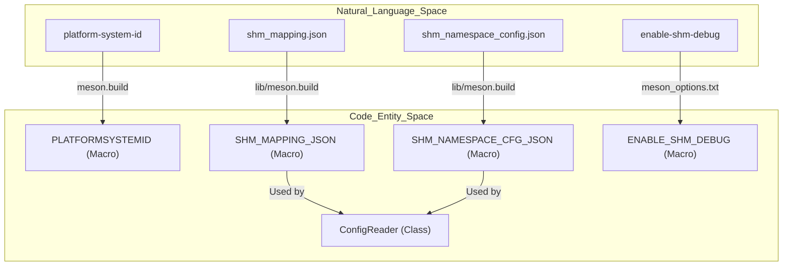
**Sources:** [lib/meson.build:10-29](), [meson_options.txt:4-21]()

### Build and Execution Pipeline
This diagram shows the relationship between the source files, the generated library, and the resulting binaries.

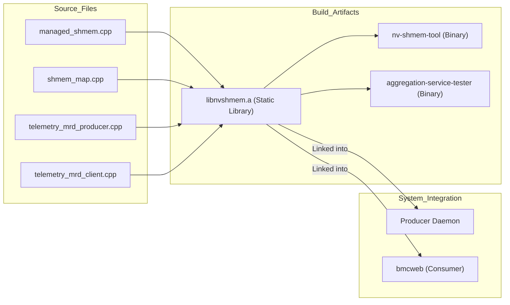
**Sources:** [lib/meson.build:35-48](), [tools/meson.build:2-14]()

---

# Page: Configuration Files Reference

# Configuration Files Reference

<details>
<summary>Relevant source files</summary>

The following files were used as context for generating this wiki page:

- [configurations/shm_mapping.json](configurations/shm_mapping.json)
- [configurations/shm_namespace_config.json](configurations/shm_namespace_config.json)
- [lib/config_json_reader.cpp](lib/config_json_reader.cpp)
- [lib/impl/config_json_reader.hpp](lib/impl/config_json_reader.hpp)
- [lib/utils/port_utils.hpp](lib/utils/port_utils.hpp)

</details>


The `nv-bmc-shmem` library relies on two primary JSON configuration files to define how telemetry data is organized, which daemons (producers) are authorized to write to specific segments, and how D-Bus object paths map to shared memory namespaces. These configurations allow the system to be platform-agnostic while supporting specific hardware overrides via Bitbake.

## Configuration Architecture

The configuration is handled by the `ConfigReader` class, which lazily loads and parses the JSON files using `nlohmann::json` [lib/config_json_reader.cpp:26-27]().

### Configuration Data Flow
The following diagram illustrates how `ConfigReader` translates JSON files into the internal `NameSpaceConfiguration` used by the `SHMSensorAggregator`.

**Configuration Parsing Logic**
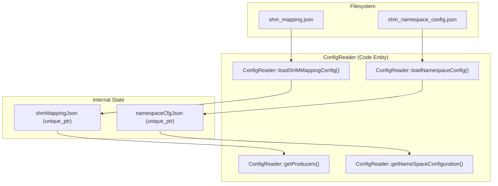
**Sources:** [lib/impl/config_json_reader.hpp:43-108](), [lib/config_json_reader.cpp:29-83]()

---

## 1. shm_mapping.json

This file defines the physical properties of the shared memory segments. It maps a `Namespace` to the specific system daemons allowed to produce data for it and defines the memory allocation size.

### Schema Reference
| Key | Type | Description |
| :--- | :--- | :--- |
| `Namespaces` | Object | Root object containing all namespace definitions. |
| `[NamespaceName]` | Object | A unique string identifier (e.g., `ProcessorMetrics`). |
| `Producers` | Array | List of binary names (e.g., `gpumgrd`) allowed to initialize this SHM segment. |
| `SizeInBytes` | Integer | The maximum size of the Boost.Interprocess segment. |

### Example
[configurations/shm_mapping.json:1-36]()
```json
{
    "Namespaces": {
        "PlatformEnvironmentMetrics": {
            "Producers": ["gpumgrd", "hwmontemp"],
            "SizeInBytes": 131072
        },
        "ProcessorPortMetrics": {
            "Producers": ["gpumgrd"],
            "SizeInBytes": 1024000
        }
    }
}
```

**Implementation Details:**
- **Validation:** The `ConfigReader::getSHMSize` function verifies that the calling `producerName` exists in the `Producers` array before returning the segment size [lib/config_json_reader.cpp:163-186]().
- **Default Sizes:** Sizes typically range from 128KB for environment metrics to 1MB for high-density port telemetry [configurations/shm_mapping.json:5-17]().

**Sources:** [configurations/shm_mapping.json:1-36](), [lib/config_json_reader.cpp:163-195]()

---

## 2. shm_namespace_config.json

This file defines the logical mapping between D-Bus telemetry and shared memory. It determines which D-Bus properties are captured based on keywords in the object path.

### Schema Reference
| Key | Type | Description |
| :--- | :--- | :--- |
| `SensorNamespaces` | Array | List of mapping rules. |
| `Namespace` | String | The target namespace defined in `shm_mapping.json`. |
| `ObjectpathKeywords` | String | A substring used to match D-Bus object paths (e.g., `sensors/temperature`). |
| `PropertyList` | Array | List of D-Bus property names to be aggregated into SHM. |

### Path Resolution Logic
When a producer calls `updateTelemetry(path, properties)`, the `SHMSensorAggregator` iterates through these rules. If the `path` contains the `ObjectpathKeywords`, the properties specified in `PropertyList` are extracted and written to the segment associated with `Namespace` [lib/config_json_reader.cpp:114-150]().

**Mapping Entity Relationship**
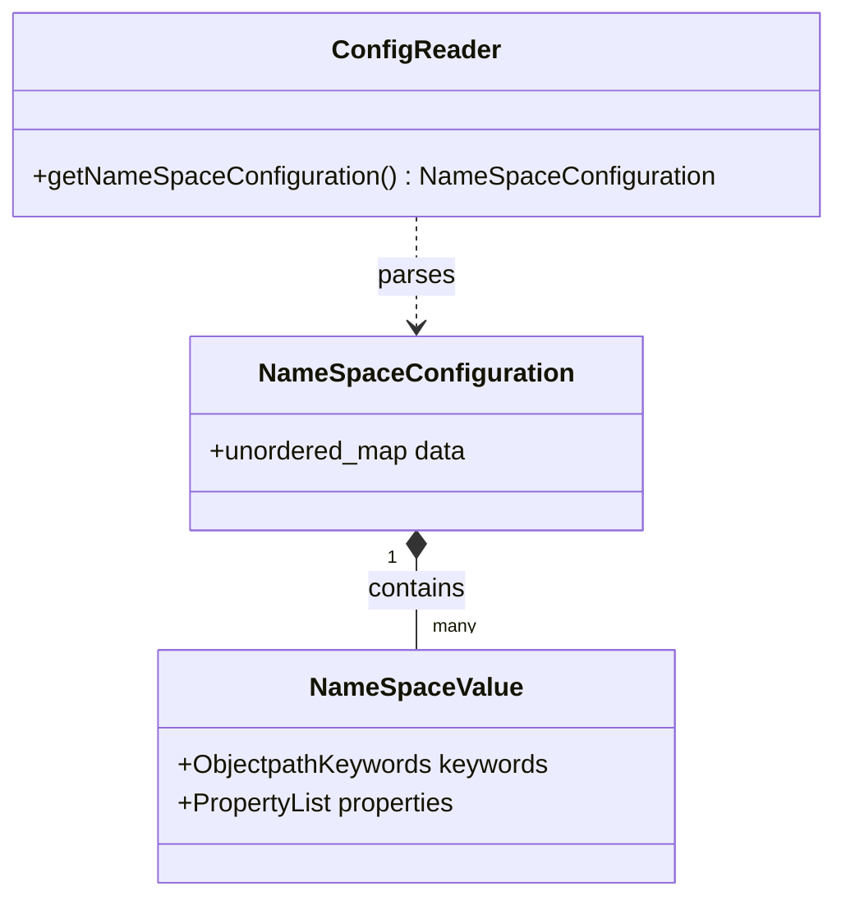
**Sources:** [lib/impl/config_json_reader.hpp:36-41](), [lib/config_json_reader.cpp:114-161]()

### Example
[configurations/shm_namespace_config.json:2-17]()
```json
{
    "SensorNamespaces": [
        {
            "Namespace": "PlatformEnvironmentMetrics",
            "ObjectpathKeywords": "sensors/temperature",
            "PropertyList": ["Value"]
        }
    ]
}
```

---

## Adding New Namespaces or Properties

To extend the telemetry coverage, follow these steps:

1.  **Define the Segment:** Add a new entry to `shm_mapping.json`. Ensure `SizeInBytes` is sufficient for the expected number of sensors (approx. 512 bytes per sensor entry is a safe buffer).
2.  **Define the Filter:** Add a new entry to `shm_namespace_config.json`.
    *   Choose `ObjectpathKeywords` that uniquely identify the sensor group.
    *   List all properties (e.g., `Value`, `Status`, `OperatingSpeed`) that the producer daemon will update.
3.  **Update Producer:** Ensure the producer daemon passes the correct binary name to `AggregationService::namespaceInit(producerName)` so it matches the `Producers` list in the mapping file.

---

## Platform-Specific Overrides

The library supports platform-specific configurations via the Yocto/Bitbake build system. This allows different NVIDIA platforms (e.g., HGX vs. MGX) to have different memory limits or property mappings.

### Bitbake Implementation
Platform recipes should use `FILESEXTRAPATHS` and `.bbappend` files to override the default JSON files installed by the `nv-bmc-shmem` recipe.

**Installation Paths:**
- Default: `/usr/share/nv-bmc-shmem/`
- Overrides are placed in the same directory, replacing the base files during the image construction phase.

### Compile-Time Constants
The `ConfigReader` uses macros defined in `config.h` (generated by Meson) to locate these files.
- `SHM_MAPPING_JSON`: Defaults to `/usr/share/nv-bmc-shmem/shm_mapping.json` [lib/config_json_reader.cpp:63-65]().
- `SHM_NAMESPACE_CFG_JSON`: Defaults to `/usr/share/nv-bmc-shmem/shm_namespace_config.json` [lib/config_json_reader.cpp:35-37]().

**Sources:** [lib/config_json_reader.cpp:18-83]()

---

## Metric Translation Reference

The `PropertyList` in `shm_namespace_config.json` often contains D-Bus strings that require translation to Redfish enums. The following static maps in `port_utils.hpp` are used by the client to interpret these values:

| PDI Value Substring | Redfish Output | Map Name |
| :--- | :--- | :--- |
| `PortState.LinkStatusType.LinkUp` | `LinkUp` | `linkStatusTypeMap` |
| `PortState.LinkStates.Disabled` | `Disabled` | `linkStateTypeMap` |
| `PowerSystemInputs.Status.Good` | `Normal` | `powerSystemInputTypeTypeMap` |

**Sources:** [lib/utils/port_utils.hpp:32-64]()

---

# Page: Core Architecture

# Core Architecture

<details>
<summary>Relevant source files</summary>

The following files were used as context for generating this wiki page:

- [lib/impl/managed_shmem.hpp](lib/impl/managed_shmem.hpp)
- [lib/impl/shmem_map.hpp](lib/impl/shmem_map.hpp)
- [lib/include/telemetry_mrd_producer.hpp](lib/include/telemetry_mrd_producer.hpp)
- [lib/managed_shmem.cpp](lib/managed_shmem.cpp)
- [lib/shmem_map.cpp](lib/shmem_map.cpp)
- [tools/nv_shmem_tool.cpp](tools/nv_shmem_tool.cpp)

</details>


The `nv-bmc-shmem` library implements a high-performance, layered architecture designed to move telemetry data from producer daemons to consumer services (like `bmcweb`) via Linux shared memory. This design bypasses the overhead of the D-Bus system bus for high-frequency telemetry while maintaining a structured, type-safe data model.

### Architectural Layers

The system is organized into four distinct layers, moving from raw memory management to high-level application interfaces:

1.  **Shared Memory Segment Layer**: Manages raw `boost::interprocess` segments and synchronization primitives.
2.  **Map Abstraction Layer**: Provides a templated, key-value store interface (`Map`) that resides entirely within the shared memory segment.
3.  **Namespace Management Layer**: Orchestrates multiple `Map` instances (namespaces) to organize data by producer or device type.
4.  **Service Facade Layer**: Provides the public `AggregationService` and `telemetry_mrd_client` APIs used by external daemons.

#### System Component Diagram

The following diagram illustrates how code entities bridge the gap between high-level concepts and the underlying shared memory implementation.

**Diagram: System Entity Mapping**
```mermaid
graph TD
    subgraph "Application Space"
        [Producer] -- "updateTelemetry()" --> [AggregationService]
        [Consumer] -- "getAllMRDValues()" --> [ClientAPI]
    end

    subgraph "Logic Layer (ShmSensorMapIntf)"
        [AggregationService] --> [SHMSensorAggregator]
        [SHMSensorAggregator] --> [ShmSensorMapIntf]
    end

    subgraph "Data Layer (lib/impl)"
        [ShmSensorMapIntf] --> [Map_SensorMap_SensorValue]
        [Map_SensorMap_SensorValue] -- "inherits" --> [ManagedShmem]
    end

    subgraph "OS/Shared Memory"
        [ManagedShmem] --> [boost_managed_shared_memory]
        [ManagedShmem] --> [boost_named_upgradable_mutex]
    end

    style [AggregationService] stroke-dasharray: 5 5
    style [Map_SensorMap_SensorValue] stroke-dasharray: 5 5
```
**Sources:** [lib/include/telemetry_mrd_producer.hpp:120-159](), [lib/impl/shmem_map.hpp:52-68](), [lib/impl/managed_shmem.hpp:47-68]()

---

### Core Components

#### ManagedShmem and Map
At the base of the stack, `ManagedShmem` wraps `boost::interprocess::managed_shared_memory` [lib/impl/managed_shmem.hpp:63](). It handles the lifecycle of the segment and a `named_upgradable_mutex` [lib/impl/managed_shmem.hpp:65]() used for multi-process synchronization.

The `Map` class template extends `ManagedShmem` to provide a structured container for `SensorValue` objects [lib/impl/shmem_map.hpp:52](). It uses a custom `void_allocator_t` to ensure that all map nodes and strings are allocated within the shared memory segment itself, rather than the process heap [lib/managed_shmem.cpp:58-60]().

For details, see [Shared Memory Segments: ManagedShmem and Map](#2.1).

#### ShmSensorMapIntf
The `ShmSensorMapIntf` (referenced in higher-level logic) acts as a manager for these `Map` instances. It abstracts the complexities of segment initialization and provides a simplified interface for inserting and updating telemetry [lib/shmem_map.cpp:160-178](). It ensures that producers can write to specific namespaces (e.g., `gpumgrd_shm`) without managing raw pointers.

For details, see [ShmSensorMapIntf: Namespace Management Layer](#2.2).

#### Data Structures and Type System
The system relies on a specialized type system to ensure compatibility across process boundaries. This includes `char_string_t` (a Boost-compatible string) and `SensorMapValue`, which aggregates the metric value, a Redfish-style timestamp string, and a Unix timestamp [lib/shmem_map.cpp:166-170]().

For details, see [Data Structures and Type System](#2.3).

---

### Data Flow and Synchronization

The architecture employs a single-writer, multi-reader synchronization model using an upgradable mutex.

**Diagram: Thread Synchronization and Data Flow**
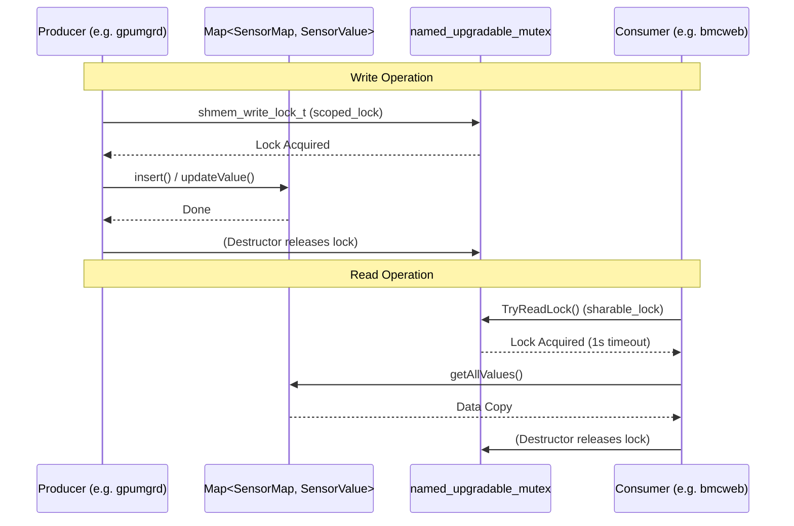

| Component | Synchronization Type | Timeout / Behavior |
| :--- | :--- | :--- |
| **Write Lock** | `scoped_lock` | Exclusive access; blocks until acquired [lib/impl/managed_shmem.hpp:37-38](). |
| **Read Lock** | `sharable_lock` | Concurrent access; 1-second timeout before throwing `LockAcquisitionException` [lib/managed_shmem.cpp:73-85](). |
| **Memory Access** | `offset_ptr` | Ensures pointers are valid across different process base addresses [lib/impl/shmem_map.hpp:186](). |

**Sources:** [lib/impl/managed_shmem.hpp:37-41](), [lib/managed_shmem.cpp:73-85](), [lib/shmem_map.cpp:116-121](), [lib/shmem_map.cpp:181-183]()

---

# Page: Shared Memory Segments: ManagedShmem and Map

# Shared Memory Segments: ManagedShmem and Map

<details>
<summary>Relevant source files</summary>

The following files were used as context for generating this wiki page:

- [lib/impl/managed_shmem.hpp](lib/impl/managed_shmem.hpp)
- [lib/impl/shmem_map.hpp](lib/impl/shmem_map.hpp)
- [lib/include/telemetry_mrd_producer.hpp](lib/include/telemetry_mrd_producer.hpp)
- [lib/managed_shmem.cpp](lib/managed_shmem.cpp)
- [lib/shmem_map.cpp](lib/shmem_map.cpp)
- [tools/nv_shmem_tool.cpp](tools/nv_shmem_tool.cpp)

</details>


This page provides a deep dive into the low-level shared memory layer of the `nv-bmc-shmem` library. It covers the management of raw Boost.Interprocess segments via `ManagedShmem`, the templated `Map` abstraction for sensor data, and the synchronization strategies employed to ensure data integrity between producers and consumers.

## ManagedShmem: Lifecycle and Mutex Management

`ManagedShmem` serves as the foundational wrapper for `boost::interprocess::managed_shared_memory` [lib/impl/managed_shmem.hpp:63](). It abstracts the complexity of segment initialization, cleanup, and inter-process synchronization.

### Lifecycle Management
The class supports two primary modes of operation based on the `opts` flag:
1.  **Creation Mode (`O_CREAT`)**: Used by producers. It attempts to remove any existing segment and lock with the same name before creating a new one to ensure a clean state [lib/managed_shmem.cpp:34-55]().
2.  **Open-Only Mode**: Used by consumers (e.g., `bmcweb`). It opens existing segments and locks in a read-only or shared capacity [lib/managed_shmem.cpp:65-71]().

### Synchronization: named_upgradable_mutex
Synchronization is handled via `boost::interprocess::named_upgradable_mutex` [lib/impl/managed_shmem.hpp:22](). This allows for multiple concurrent readers or a single exclusive writer. 
*   **Read Locks**: Implemented as `shmem_read_lock_t` (a `sharable_lock`) [lib/impl/managed_shmem.hpp:39-40]().
*   **Write Locks**: Implemented as `shmem_write_lock_t` (a `scoped_lock`) [lib/impl/shmem_map.hpp:103]().

The library uses a timed acquisition strategy for read locks. The `TryReadLock()` function attempts to acquire a sharable lock within a 1-second timeout; failure to do so results in a `LockAcquisitionException` [lib/managed_shmem.cpp:73-85]().

**Sources:** [lib/impl/managed_shmem.hpp:47-85](), [lib/managed_shmem.cpp:31-85]()

## The Map Template

The `Map<MapType, ValueType>` class is a templated abstraction that manages a specific data structure within the shared memory segment [lib/impl/shmem_map.hpp:51-53](). In the context of this library, it is almost exclusively instantiated as `Map<SensorMap, SensorValue>` [lib/shmem_map.cpp:23-24]().

### Internal Layout
The `Map` class holds a reference to the internal Boost map via an `offset_ptr` [lib/impl/shmem_map.hpp:186](). This pointer is valid across different process address spaces because it stores the offset from the start of the shared memory segment rather than an absolute address.

### Key Operations
| Function | Lock Type | Description |
| :--- | :--- | :--- |
| `insert` | Write | Inserts or updates a `SensorMapValue`. Requires `O_CREAT` [lib/shmem_map.cpp:160-178](). |
| `getValue` | Read | Retrieves a single `SensorValue` by key [lib/shmem_map.cpp:94-107](). |
| `getAllValues` | Read | Returns a `std::vector` of all values in the map [lib/shmem_map.cpp:70-82](). |
| `updateValue` | Write | Updates only the sensor string value for an existing key [lib/shmem_map.cpp:136-157](). |
| `erase` | Write | Removes a specific key from the map [lib/impl/shmem_map.hpp:99-110](). |

**Sources:** [lib/impl/shmem_map.hpp:51-187](), [lib/shmem_map.cpp:23-205]()

## Memory Allocation and void_allocator_t

Because standard C++ containers (like `std::map` or `std::string`) allocate memory on the heap of the local process, they cannot be used directly in shared memory. Instead, the library uses Boost.Interprocess containers with a custom allocator.

### The void_allocator_t Pattern
The `void_allocator_t` is initialized from the segment manager of the managed shared memory [lib/managed_shmem.cpp:58-59](). This allocator is passed to the constructors of shared memory objects to ensure their internal nodes and dynamic data are allocated within the shared segment boundaries.

### Data Flow: From String to char_string_t
When a standard `std::string` key is passed to the map, it must be converted to a `char_string_t` (a Boost-compatible string using the segment allocator) before it can be used for lookups or insertions [lib/impl/shmem_map.hpp:178-183]().

**Sources:** [lib/impl/managed_shmem.hpp:64](), [lib/managed_shmem.cpp:58-60](), [lib/impl/shmem_map.hpp:178-183]()

## Entity Mapping Diagrams

### Code Entity to Shared Memory Mapping
This diagram shows how the C++ classes relate to the underlying Boost Interprocess entities.

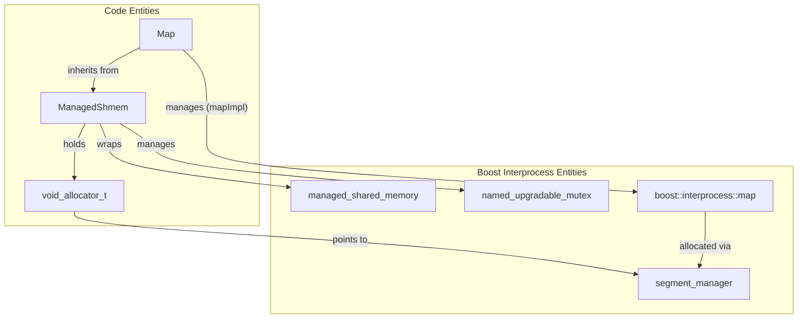
**Sources:** [lib/impl/managed_shmem.hpp:47-68](), [lib/impl/shmem_map.hpp:51-53](), [lib/shmem_map.cpp:28-33]()

### Producer-Consumer Synchronization Flow
This diagram illustrates the locking mechanism used when a Producer (e.g., `nv_shmem_tool` in create mode) and a Consumer (e.g., `nv_shmem_tool` in read mode) access the same segment.

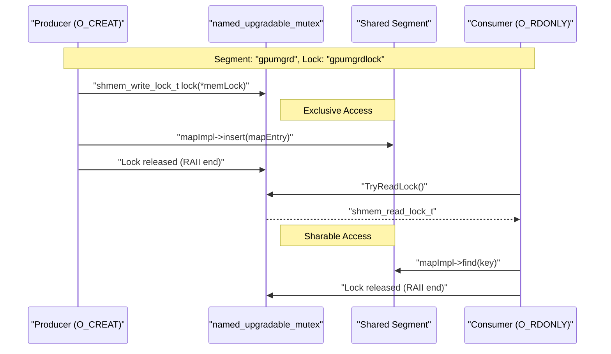
**Sources:** [lib/managed_shmem.cpp:73-85](), [lib/shmem_map.cpp:160-178](), [tools/nv_shmem_tool.cpp:51-62](), [tools/nv_shmem_tool.cpp:145-163]()

---

# Page: ShmSensorMapIntf: Namespace Management Layer

# ShmSensorMapIntf: Namespace Management Layer

<details>
<summary>Relevant source files</summary>

The following files were used as context for generating this wiki page:

- [lib/impl/shm_sensormap_intf.hpp](lib/impl/shm_sensormap_intf.hpp)
- [lib/include/shm_common.h](lib/include/shm_common.h)

</details>


The `ShmSensorMapIntf` class serves as the management and orchestration layer for shared memory namespaces. It acts as a bridge between high-level producer services (like `AggregationService`) and the low-level `Map` instances that reside within raw shared memory segments. Its primary responsibility is maintaining a collection of named `Map` objects and routing telemetry updates to the correct memory segment based on the provided namespace.

## Class Architecture

`ShmSensorMapIntf` manages a local `unordered_map` that associates a namespace string (e.g., "GPU", "Switch") with a unique pointer to a `sensor_map_type`. This `sensor_map_type` is a template instantiation of `nv::shmem::Map` using `SensorMap` as the key type and `SensorValue` as the value type [lib/impl/shm_sensormap_intf.hpp:32-33]().

### Code Entity Relationship
The following diagram illustrates how `ShmSensorMapIntf` bridges the logical MRD (Metric Report Definition) namespaces to the physical shared memory `Map` objects.

**Diagram: Namespace Routing Logic**
```mermaid
graph TD
    subgraph "Producer Layer"
        "AggregationService" --> "ShmSensorMapIntf"
    end

    subgraph "Management Layer (ShmSensorMapIntf)"
        "ShmSensorMapIntf" -- "contains" --> "sensor_map[std::unordered_map]"
        "sensor_map[std::unordered_map]" -- "mrdNamespace" --> "MapInstance[nv::shmem::Map]"
    end

    subgraph "Physical SHM Layer"
        "MapInstance[nv::shmem::Map]" -- "interacts" --> "ManagedShmem"
        "ManagedShmem" -- "allocates" --> "Boost.Interprocess.Segment"
    end
```
**Sources:** [lib/impl/shm_sensormap_intf.hpp:39-43](), [lib/impl/shm_sensormap_intf.hpp:240-241]()

## Key Operations

The class provides a set of CRUD-like operations for managing telemetry data within specific namespaces.

### Namespace Lifecycle
*   **`createNamespace(nameSpace, shmSize)`**: Initializes a new shared memory segment. It attempts to create a new `sensor_map_type` with `O_CREAT` flags and the specified size in bytes [lib/impl/shm_sensormap_intf.hpp:68-84]().
*   **`isNameSpacePresent(nameSpace)`**: Checks the internal `sensor_map` registry to verify if a namespace has been initialized [lib/impl/shm_sensormap_intf.hpp:52-59]().

### Data Manipulation
All data operations follow a pattern: resolve the namespace to a `Map` pointer, then delegate the operation to that `Map`.

| Function | Purpose | Logic |
| :--- | :--- | :--- |
| `insert` | Adds a new key-value pair to a namespace. | Finds namespace in `sensor_map`, calls `itr->second->insert(key, value)` [lib/impl/shm_sensormap_intf.hpp:95-122](). |
| `updateValueAndTimeStamp` | Updates telemetry and its associated timing data. | Atomic-style update of value, epoch timestamp, and ISO string [lib/impl/shm_sensormap_intf.hpp:225-238](). |
| `updateTimeStamp` | Updates only the timing metadata for a key. | Used when a sensor is polled but the value hasn't changed [lib/impl/shm_sensormap_intf.hpp:134-168](). |
| `erase` | Removes a specific key from a namespace. | Calls `itr->second->erase(key)` [lib/impl/shm_sensormap_intf.hpp:250-273](). |

**Sources:** [lib/impl/shm_sensormap_intf.hpp:52-273]()

## Data Flow: Telemetry Update

When a producer daemon updates a sensor, the data flows through `ShmSensorMapIntf` as shown below.

**Diagram: Telemetry Update Sequence**
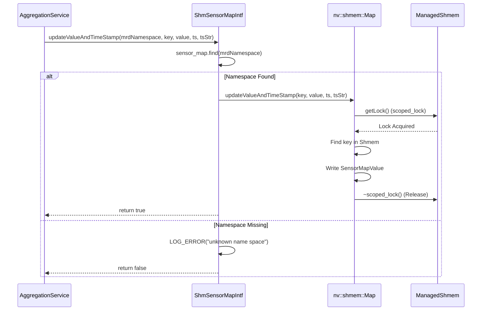
**Sources:** [lib/impl/shm_sensormap_intf.hpp:225-247](), [lib/impl/shm_sensormap_intf.hpp:108-112]()

## Error Handling and Logging

`ShmSensorMapIntf` uses a combination of `phosphor-logging` (lg2) for critical failures and a custom `ErrorLogger` for rate-limited error reporting.

1.  **Exception Safety**: Every public method is wrapped in a `try-catch` block to prevent shared memory corruption or crashes from propagating to the producer daemon [lib/impl/shm_sensormap_intf.hpp:115-121]().
2.  **Rate-Limited Logging**: If a namespace is missing or a key is invalid, the class uses the `LOG_ERROR` macro [lib/impl/shm_sensormap_intf.hpp:111](). This routes through `ErrorLogger` to ensure the system logs are not flooded during high-frequency telemetry cycles.
3.  **Return Values**: Most methods return a `bool` indicating success or failure, allowing the `AggregationService` to take corrective action (such as attempting to re-initialize a namespace) [lib/impl/shm_sensormap_intf.hpp:83-105]().

**Sources:** [lib/impl/shm_sensormap_intf.hpp:19](), [lib/impl/shm_sensormap_intf.hpp:108-113](), [lib/impl/shm_sensormap_intf.hpp:163-167]()

---

# Page: Data Structures and Type System

# Data Structures and Type System

<details>
<summary>Relevant source files</summary>

The following files were used as context for generating this wiki page:

- [lib/impl/managed_shmem.hpp](lib/impl/managed_shmem.hpp)
- [lib/include/shm_common.h](lib/include/shm_common.h)
- [lib/include/telemetry_mrd_producer.hpp](lib/include/telemetry_mrd_producer.hpp)
- [lib/shmem_map.cpp](lib/shmem_map.cpp)

</details>


The `nv-bmc-shmem` library employs a specialized type system designed to facilitate the storage of complex D-Bus telemetry data within POSIX shared memory segments. Because standard C++ containers (like `std::string` or `std::map`) typically allocate memory on the process heap, they cannot be directly shared across different process address spaces. This system utilizes **Boost.Interprocess** and **Boost.Container** to provide memory-segment-aware alternatives that allow producers and consumers to interact with a unified data model.

## Core Data Types

The type system is divided into two primary categories: **D-Bus Interface Types**, used for interacting with the OpenBMC D-Bus ecosystem, and **Shared Memory Types**, which are optimized for persistence in shared memory segments.

### D-Bus Interface Types

The `DbusVariantType` is a comprehensive `std::variant` that encompasses all possible data types emitted by OpenBMC sensor producers.

| Type Name | Definition | Role |
| :--- | :--- | :--- |
| `DbusVariantType` | `std::variant<...>` | A union of all supported D-Bus property types including scalars, strings, object paths, and complex nested tuples/vectors. |

**Implementation Details:**
- Defined in `[lib/include/shm_common.h:37-53]()`.
- Includes support for specialized `sdbusplus` types like `unix_fd` and `object_path` `[lib/include/shm_common.h:41-42]()`.
- Handles complex telemetry structures such as GPU metric arrays and nested sensor associations `[lib/include/shm_common.h:43-51]()`.

### Shared Memory Types

These structures are designed to reside within a `boost::interprocess::managed_shared_memory` segment.

| Type Name | Definition | Role |
| :--- | :--- | :--- |
| `char_string_t` | `boost::container::basic_string<char, ...>` | A shared-memory-compatible string using a segment-specific allocator. |
| `SensorMapValue` | `struct` | The raw storage format for a sensor entry within the SHM segment. |
| `SensorValue` | `struct` | A "mirrored" version of `SensorMapValue` using `std::string` for use in process-local memory. |
| `ShmemKeyValuePairs` | `std::unordered_map<std::string, std::string>` | A standard map used by clients to retrieve bulk snapshots of SHM data. |

**Implementation Details:**
- `char_string_t` is used instead of `std::string` because standard library implementations are often not flexible enough to support Boost's segment managers `[lib/include/shm_common.h:67-72]()`.
- `SensorMapValue` requires a `void_allocator_t` during construction to ensure its internal strings are allocated within the shared segment `[lib/include/shm_common.h:80-83]()`.

### Data Entity Mapping

The following diagram illustrates how D-Bus telemetry data is transformed from transient D-Bus types into persistent shared memory structures.

**Telemetry Data Flow and Type Mapping**
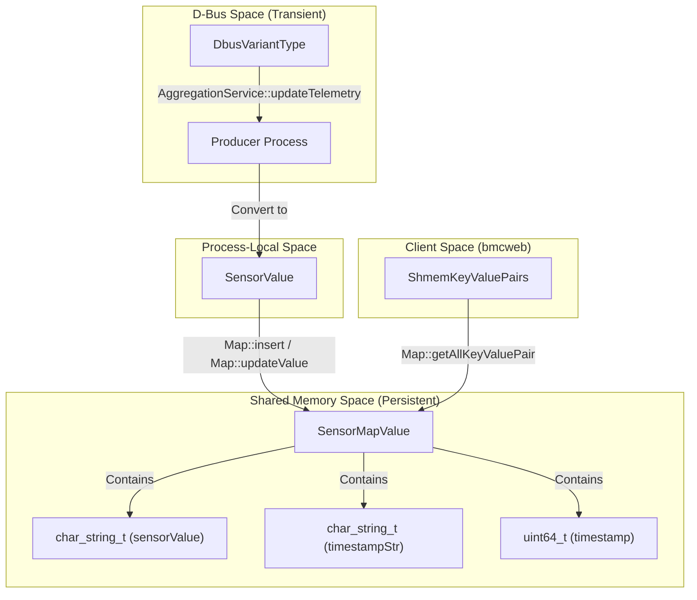
**Sources:** `[lib/include/shm_common.h:37-112]()`, `[lib/shmem_map.cpp:160-178]()`, `[lib/include/telemetry_mrd_producer.hpp:153-158]()`.

---

## The Shared Memory Allocator System

To manage memory within a segment, the library defines several allocator types tied to the Boost `segment_manager`.

| Allocator Type | Definition | Usage |
| :--- | :--- | :--- |
| `segment_manager_t` | `managed_shared_memory::segment_manager` | The underlying manager for the SHM segment. |
| `void_allocator_t` | `allocator<void, segment_manager_t>` | A generic allocator used to initialize complex structures like `SensorMap`. |
| `char_allocator_t` | `allocator<char, segment_manager_t>` | Specifically for allocating `char` buffers for `char_string_t`. |

**Implementation Details:**
- These types are defined in `[lib/include/shm_common.h:61-66]()`.
- The `void_allocator_t` is passed into the `SensorMap` constructor to allow the map to allocate its internal nodes within the shared memory region `[lib/shmem_map.cpp:31-33]()`.

---

## Container Architecture: Boost vs. Std

The library explicitly avoids `std` containers for data stored inside the SHM segment.

### Why Boost?
1. **Pointer Compatibility:** `std::string` and `std::map` use raw pointers. In shared memory, the base address of the segment may differ between processes. Boost containers use **offset pointers** (relative addresses) which remain valid regardless of the process's mapping address.
2. **Allocator Injection:** Boost containers allow passing a custom allocator (like `void_allocator_t`) to every internal allocation call `[lib/shmem_map.cpp:33]()`.
3. **Inter-Process Mutexes:** The system uses `boost::interprocess::named_upgradable_mutex` to synchronize access between the producer (writer) and consumer (reader) `[lib/impl/managed_shmem.hpp:37-40]()`.

### Type Mirroring Pattern
To simplify the API for developers, the library uses a mirroring pattern:
- **Storage:** `SensorMapValue` (Boost-based) `[lib/include/shm_common.h:73-84]()`.
- **Interface:** `SensorValue` (Std-based) `[lib/include/shm_common.h:86-100]()`.

The `SensorValue` class provides an assignment operator that automatically converts Boost `char_string_t` into `std::string` when reading data out of the segment:
```cpp
SensorValue& operator=(const SensorMapValue& mapValue)
{
    metricProperty = mapValue.metricProperty;
    timestampStr = mapValue.timestampStr;
    sensorValue = mapValue.sensorValue;
    timestamp = mapValue.timestamp;
    return *this;
}
```
**Sources:** `[lib/include/shm_common.h:102-110]()`.

---

## Class Relationship Diagram

This diagram shows the relationship between the low-level memory management and the high-level data types used by the `Map` class.

**Shared Memory Type Hierarchy**
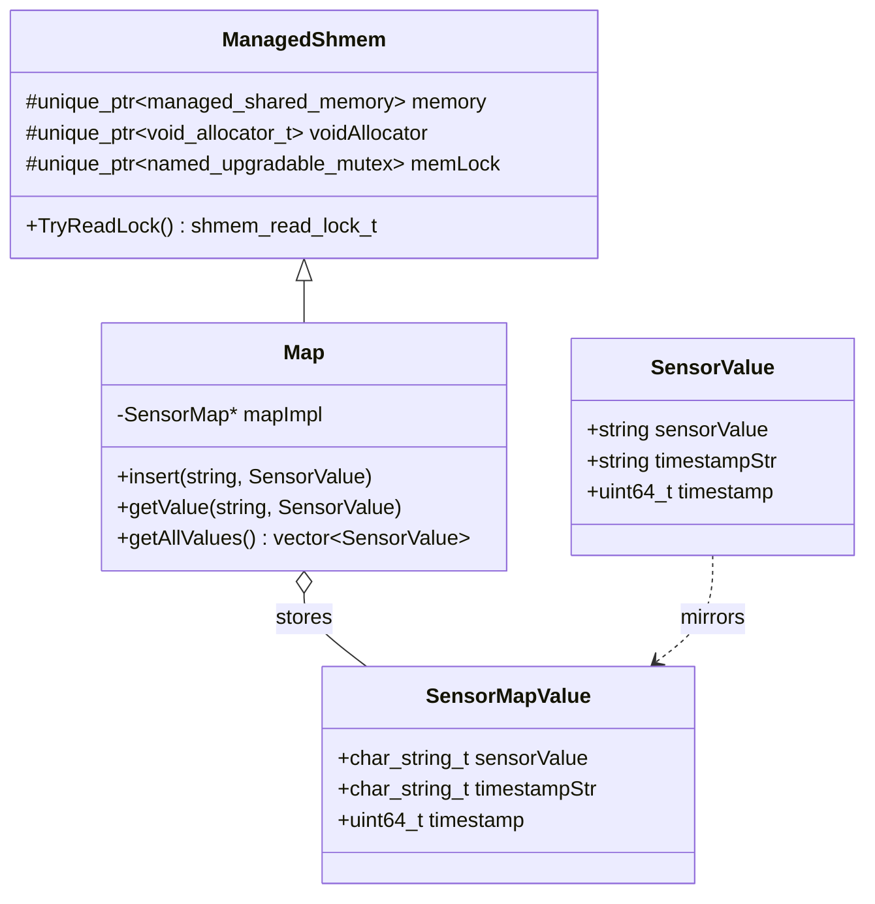
**Sources:** `[lib/impl/managed_shmem.hpp:47-68]()`, `[lib/shmem_map.cpp:23-41]()`, `[lib/include/shm_common.h:73-110]()`.

---

# Page: Producer API

# Producer API

<details>
<summary>Relevant source files</summary>

The following files were used as context for generating this wiki page:

- [lib/shm_sensor_aggregator.cpp](lib/shm_sensor_aggregator.cpp)
- [lib/telemetry_mrd_producer.cpp](lib/telemetry_mrd_producer.cpp)

</details>


The Producer API provides a high-level interface for sensor producer daemons (such as `gpumgrd`, `pldmd`, and `hwmontemp`) to write telemetry data into shared memory segments. By using this API, producers abstract away the complexities of shared memory management, synchronization, and D-Bus path-to-SHM mapping.

The architecture relies on two primary components:
1.  **`AggregationService`**: The public-facing static interface used by producers.
2.  **`SHMSensorAggregator`**: The internal engine that handles path resolution, lifecycle management, and data updates.

### Producer Workflow Overview

The following diagram illustrates the flow from a producer daemon into the shared memory system via the Producer API.

**Producer Data Flow**
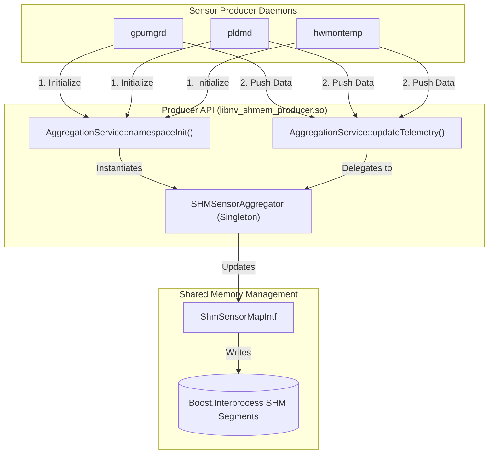
**Sources:** [lib/telemetry_mrd_producer.cpp:26-113](), [lib/shm_sensor_aggregator.cpp:159-181]()

---

### AggregationService: Public Producer Interface

The `AggregationService` class acts as the primary facade for the library. It is designed to be used as a static service, holding a singleton instance of the internal aggregator.

Key responsibilities include:
*   **Initialization**: `namespaceInit(processName)` loads the required JSON configurations and prepares the shared memory segments for the specific producer [lib/telemetry_mrd_producer.cpp:28-81]().
*   **Telemetry Updates**: `updateTelemetry()` accepts standard D-Bus parameters (path, interface, property, value) and routes them to the correct memory location [lib/telemetry_mrd_producer.cpp:83-113]().
*   **Error Handling**: It handles error return codes (`rc`) from producers by automatically converting failed sensor reads into `NaN` values in shared memory [lib/telemetry_mrd_producer.cpp:94-102]().

For details on the API signature and usage examples, see **[AggregationService: Public Producer Interface](#3.1)**.

**Sources:** [lib/telemetry_mrd_producer.cpp:26-113]()

---

### SHMSensorAggregator: Path Resolution and Lifecycle

While `AggregationService` provides the interface, `SHMSensorAggregator` performs the heavy lifting. It manages the lifecycle of the shared memory segments and resolves D-Bus object paths into specific shared memory namespaces.

Key internal mechanisms include:
*   **Path Parsing**: Uses `parseDevicePath` and `getMatchCount` to determine which SHM namespace a specific D-Bus object belongs to based on `shm_namespace_config.json` [lib/shm_sensor_aggregator.cpp:31-157]().
*   **Cache Management**: Maintains a `nameSpaceMap` to cache resolved paths and a `notApplicableKeys` list to skip properties that do not require aggregation, optimizing performance for high-frequency updates.
*   **Timestamp Synchronization**: Ensures that telemetry timestamps are correctly synchronized between the producer's clock and the system clock used in shared memory.
*   **Thread Safety**: Utilizes `std::scoped_lock` and internal mutexes to ensure that concurrent updates from different threads within a producer daemon do not corrupt the shared memory segment.

For details on path heuristics and array handling, see **[SHMSensorAggregator: Path Resolution and SHM Lifecycle](#3.2)**.

**Sources:** [lib/shm_sensor_aggregator.cpp:31-157](), [lib/shm_sensor_aggregator.cpp:159-181]()

---

### Component Relationship

The relationship between the static interface and the internal aggregator is established during the initialization phase.

**Class Relationship and Initialization**
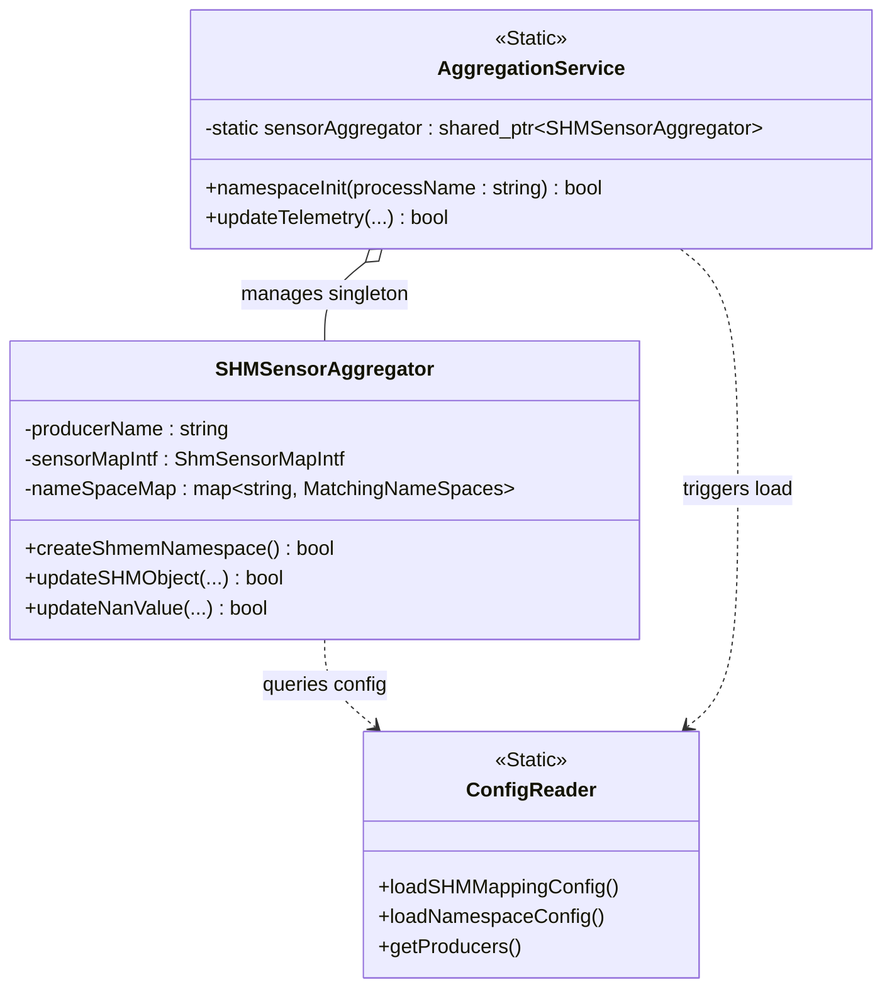
**Sources:** [lib/telemetry_mrd_producer.cpp:26-52](), [lib/shm_sensor_aggregator.cpp:162-176]()

---

# Page: AggregationService: Public Producer Interface

# AggregationService: Public Producer Interface

<details>
<summary>Relevant source files</summary>

The following files were used as context for generating this wiki page:

- [lib/impl/managed_shmem.hpp](lib/impl/managed_shmem.hpp)
- [lib/include/telemetry_mrd_client.hpp](lib/include/telemetry_mrd_client.hpp)
- [lib/include/telemetry_mrd_producer.hpp](lib/include/telemetry_mrd_producer.hpp)
- [lib/shmem_map.cpp](lib/shmem_map.cpp)
- [lib/telemetry_mrd_producer.cpp](lib/telemetry_mrd_producer.cpp)

</details>


The `AggregationService` serves as the primary facade for producer daemons (such as `gpumgrd` or `pldmd`) to write telemetry data into shared memory. It abstracts the complexities of path resolution, shared memory segment management, and concurrency control behind a simplified static API.

## Core Singleton Pattern

The `AggregationService` operates using a static singleton pattern, holding a shared pointer to an internal `SHMSensorAggregator` instance. This aggregator is responsible for the actual mapping of D-Bus paths to shared memory namespaces.

### Data Flow: Producer to Shared Memory

The following diagram illustrates how a producer call to `updateTelemetry` propagates through the system layers into the physical shared memory segment.

**Producer Data Flow Architecture**
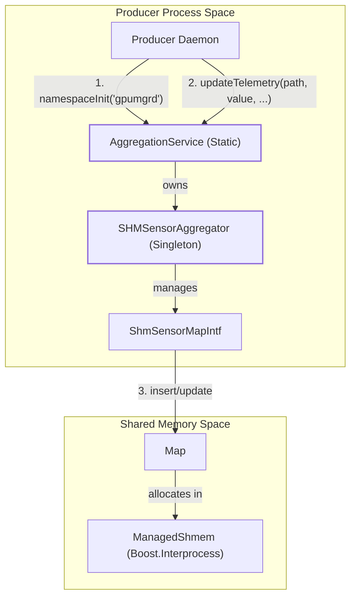
Sources: [lib/telemetry_mrd_producer.hpp:120-161](), [lib/telemetry_mrd_producer.cpp:26-26]()

---

## API Reference

### namespaceInit()

This function must be called exactly once by a producer before any telemetry updates are attempted. It initializes the configuration readers and instantiates the internal aggregator.

**Signature:**
`static bool namespaceInit(std::string processName);` [lib/include/telemetry_mrd_producer.hpp:136-136]()

**Parameters:**
* `processName`: The name of the producer service (e.g., "gpumgrd"). This string is used as a suffix for identifying relevant shared memory namespaces in the configuration. [lib/include/telemetry_mrd_producer.hpp:132-132]()

**Implementation Details:**
1. Calls `ConfigReader::loadSHMMappingConfig()` to parse the global SHM mapping. [lib/telemetry_mrd_producer.cpp:34-34]()
2. Calls `ConfigReader::loadNamespaceConfig()` to parse the specific namespace definitions. [lib/telemetry_mrd_producer.cpp:45-45]()
3. Instantiates the `SHMSensorAggregator` singleton. [lib/telemetry_mrd_producer.cpp:50-52]()
4. Triggers `createShmemNamespace()` to ensure the physical segments exist and are mapped. [lib/telemetry_mrd_producer.cpp:73-73]()

Sources: [lib/telemetry_mrd_producer.cpp:28-81]()

### updateTelemetry()

The primary entry point for writing telemetry. It handles both initial creation of sensor objects and subsequent value/timestamp updates.

**Signature:**
```cpp
static bool updateTelemetry(const std::string& devicePath,
                            const std::string& interface,
                            const std::string& propName,
                            DbusVariantType& value,
                            const uint64_t timestamp, 
                            int rc,
                            const std::string associatedEntityPath = {});
```
[lib/include/telemetry_mrd_producer.hpp:153-158]()

**Parameters:**
| Parameter | Description |
| :--- | :--- |
| `devicePath` | The full D-Bus object path (e.g., `/xyz/openbmc_project/sensors/temperature/GPU_0`). |
| `interface` | The D-Bus interface name (e.g., `xyz.openbmc_project.Sensor.Value`). |
| `propName` | The specific property being updated (e.g., `Value`). |
| `value` | A `DbusVariantType` containing the data (double, int64, string, etc.). |
| `timestamp` | The sample time (milliseconds since epoch). |
| `rc` | Return Code. If non-zero, triggers NaN/Error handling. |
| `associatedEntityPath` | Optional. Required for `PlatformEnvironmentMetrics` to resolve parent/child relationships. |

Sources: [lib/include/telemetry_mrd_producer.hpp:141-158]()

---

## NaN and Error Handling

The `rc` (Return Code) parameter determines how the system treats the incoming `value`. This allows producers to signal that a sensor is in an error state or currently unavailable without needing to change the `DbusVariantType` contents.

**Logic Flow:**
* **If `rc != 0` and `timestamp != 0`**: The system ignores the `value` parameter and calls `sensorAggregator->updateNanValue()`. This sets the internal state for that sensor to "NaN" (Not a Number) in shared memory, signaling to consumers that the reading is invalid. [lib/telemetry_mrd_producer.cpp:94-102]()
* **If `rc == 0`**: The system calls `sensorAggregator->updateSHMObject()`, which persists the actual `value` and `timestamp`. [lib/telemetry_mrd_producer.cpp:109-111]()

**NaN Update Sequence**
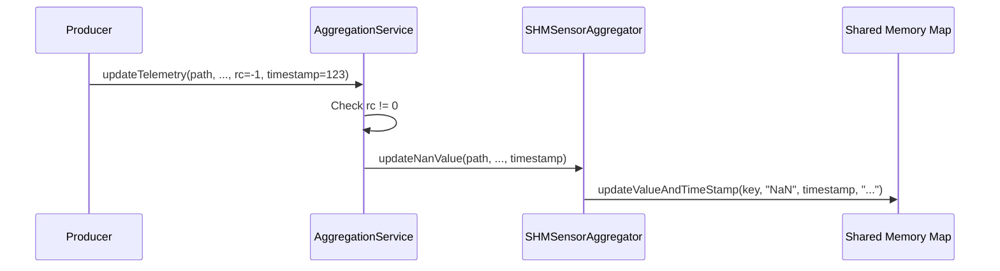
Sources: [lib/telemetry_mrd_producer.cpp:94-112](), [lib/shmem_map.cpp:181-205]()

---

## Usage Examples

### Initializing a Producer
```cpp
std::string producerName = "gpumgrd";
if (!nv::shmem::AggregationService::namespaceInit(producerName)) {
    // Handle initialization failure (e.g., config file missing)
}
```
Sources: [lib/include/telemetry_mrd_producer.hpp:38-39]()

### Updating a Numeric Sensor
```cpp
std::string path = "/xyz/openbmc_project/sensors/temperature/HSC_Temp";
std::string interface = "xyz.openbmc_project.Sensor.Value";
nv::shmem::DbusVariantType value = 45.5;
uint64_t ts = 1712345678000;

nv::shmem::AggregationService::updateTelemetry(path, interface, "Value", value, ts, 0, "Chassis_0");
```
Sources: [lib/include/telemetry_mrd_producer.hpp:54-70]()

### Reporting a Sensor Error (NaN)
```cpp
// Pass a non-zero rc to signal error/NaN
nv::shmem::AggregationService::updateTelemetry(path, interface, "Value", value, ts, -1);
```
Sources: [lib/include/telemetry_mrd_producer.hpp:90-91]()

---

## Thread Safety and Concurrency

The `AggregationService` delegates thread safety to the underlying layers:
1. **Singleton Protection**: The `sensorAggregator` is initialized during `namespaceInit`. [lib/telemetry_mrd_producer.cpp:50-52]()
2. **Write Locking**: Every call to `updateTelemetry` eventually invokes `Map::updateValueAndTimeStamp` or `Map::insert`. These functions utilize `shmem_write_lock_t`, which wraps a `boost::interprocess::named_upgradable_mutex`. [lib/shmem_map.cpp:165-165](), [lib/shmem_map.cpp:187-187]()
3. **Timed Locks**: Locks are typically acquired with a timeout to prevent a hung producer from deadlocking the entire telemetry subsystem. [lib/impl/managed_shmem.hpp:70-75]()

Sources: [lib/impl/managed_shmem.hpp:37-40](), [lib/shmem_map.cpp:181-205]()

---

# Page: SHMSensorAggregator: Path Resolution and SHM Lifecycle

# SHMSensorAggregator: Path Resolution and SHM Lifecycle

<details>
<summary>Relevant source files</summary>

The following files were used as context for generating this wiki page:

- [lib/impl/shm_sensor_aggregator.hpp](lib/impl/shm_sensor_aggregator.hpp)
- [lib/shm_sensor_aggregator.cpp](lib/shm_sensor_aggregator.cpp)

</details>


The `SHMSensorAggregator` class is the internal engine responsible for mapping D-Bus telemetry data to shared memory (SHM) structures. It handles the complexity of parsing D-Bus object paths to determine the correct SHM namespace, manages the lifecycle of SHM segments for producers, and ensures thread-safe updates to telemetry values, including complex array-based metrics.

### Path Resolution Heuristics

When a producer submits telemetry, the aggregator must resolve the D-Bus object path into a specific SHM namespace, device name, and sub-device name. This is performed by `parseDevicePath` and `getMatchCount`.

#### Path Parsing Logic
The aggregator compares the incoming D-Bus path against patterns defined in the `nameSpaceConfig` [lib/impl/shm_sensor_aggregator.hpp:77-78]().

1.  **Tokenization**: The input path and the configuration keywords are split by the `/` delimiter [lib/shm_sensor_aggregator.cpp:35-36]().
2.  **Match Counting**: `getMatchCount` iterates through the tokens to find the longest prefix match between the object path and the configured keywords [lib/shm_sensor_aggregator.cpp:31-61]().
3.  **Heuristic Mapping**: Based on the match count and the prefix of the path (e.g., `xyz/openbmc_project/sensors`), the aggregator extracts `deviceName` and `subDeviceName` [lib/shm_sensor_aggregator.cpp:93-142]().
    *   Paths starting with `xyz/openbmc_project/state` typically map the filename to `subDeviceName` [lib/shm_sensor_aggregator.cpp:95]().
    *   Paths containing `ResetStatistics` extract the parent path's filename as the `deviceName` [lib/shm_sensor_aggregator.cpp:127-128]().

#### Entity Relationship Diagram: Path Resolution
This diagram illustrates how D-Bus path strings are transformed into code entities used for SHM addressing.

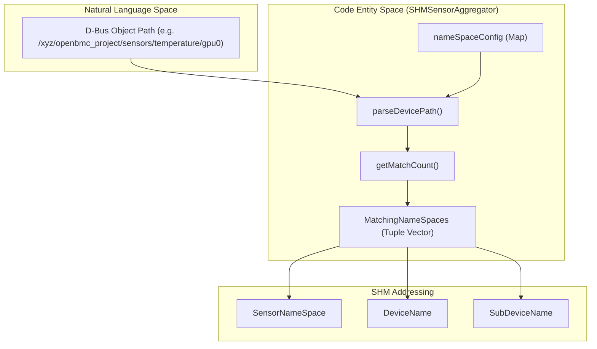
Sources: [lib/shm_sensor_aggregator.cpp:31-61](), [lib/shm_sensor_aggregator.cpp:63-157](), [lib/impl/shm_sensor_aggregator.hpp:53-54]()

### SHM Lifecycle and Namespace Management

The aggregator manages the creation and initialization of SHM segments based on the producer's configuration.

*   **Namespace Creation**: `createShmemNamespace()` identifies the namespaces owned by the current producer via `ConfigReader::getProducers()` [lib/shm_sensor_aggregator.cpp:162-164](). It constructs a unique SHM name using the pattern: `{producerName}_{PLATFORMDEVICEPREFIX}{namespace}_{index}` [lib/shm_sensor_aggregator.cpp:169-170]().
*   **Size Determination**: The size of the SHM segment is retrieved from the configuration using `ConfigReader::getSHMSize()` [lib/shm_sensor_aggregator.cpp:175-176]().
*   **Initialization**: The `shmem::ShmSensorMapIntf` is used to physically create the segment if it does not already exist [lib/shm_sensor_aggregator.cpp:171-177]().

Sources: [lib/shm_sensor_aggregator.cpp:159-195](), [lib/impl/shm_sensor_aggregator.hpp:131]()

### Caching and Thread Safety

To minimize the overhead of path parsing and configuration lookups, `SHMSensorAggregator` maintains internal caches.

*   **nameSpaceMap**: A cache of type `NameSpaceMap` (mapping a string key to `NameSpaceFields`) that stores previously resolved path-to-namespace mappings [lib/impl/shm_sensor_aggregator.hpp:51,132]().
*   **notApplicableKeys**: A cache used to quickly skip D-Bus paths that do not match any configured SHM namespace [lib/impl/shm_sensor_aggregator.hpp:133]().
*   **Thread Safety**: Access to these caches is protected by `std::mutex` using `std::scoped_lock` to prevent race conditions during concurrent telemetry updates from the same producer [lib/impl/shm_sensor_aggregator.hpp:128-129]().

Sources: [lib/impl/shm_sensor_aggregator.hpp:128-133]()

### Array Handling and Value Updates

The `handleArrayUpdates` function manages metrics that are represented as lists or arrays in D-Bus.

*   **Index-Based Storage**: Array elements are stored in SHM with indexed keys (e.g., `MetricName_0`, `MetricName_1`) [lib/shm_sensor_aggregator.cpp:1910-1915]().
*   **Dynamic Resizing**: If the incoming array size differs from the existing size in SHM, the aggregator performs a "diff":
    *   If the new array is smaller, trailing elements are removed from SHM [lib/shm_sensor_aggregator.cpp:1930-1945]().
    *   If the new array is larger, new entries are inserted [lib/shm_sensor_aggregator.cpp:1910-1915]().
*   **NaN Handling**: When a producer reports an error (non-zero return code), `updateNanValue` is called. For arrays, this results in the array being truncated to a single element with the value `nan` [lib/impl/shm_sensor_aggregator.hpp:116-117]().

Sources: [lib/shm_sensor_aggregator.cpp:1900-1950](), [lib/impl/shm_sensor_aggregator.hpp:181-195]()

### Timestamp Synchronization

The aggregator ensures that telemetry is associated with both a high-resolution monotonic timestamp and a wall-clock timestamp.

*   **Clock Sync**: It uses `steady_clock` for internal duration tracking and `system_clock` for Redfish-compliant ISO 8601 strings.
*   **Redfish Formatting**: The `getDateTimeUintMs` utility converts the epoch timestamp provided by the producer into the formatted string required for the `Timestamp` field in SHM [lib/shm_sensor_aggregator.cpp:1880-1885]().

### Internal Data Flow Diagram
This diagram shows the lifecycle of a telemetry update from the `updateSHMObject` call to the final SHM write.

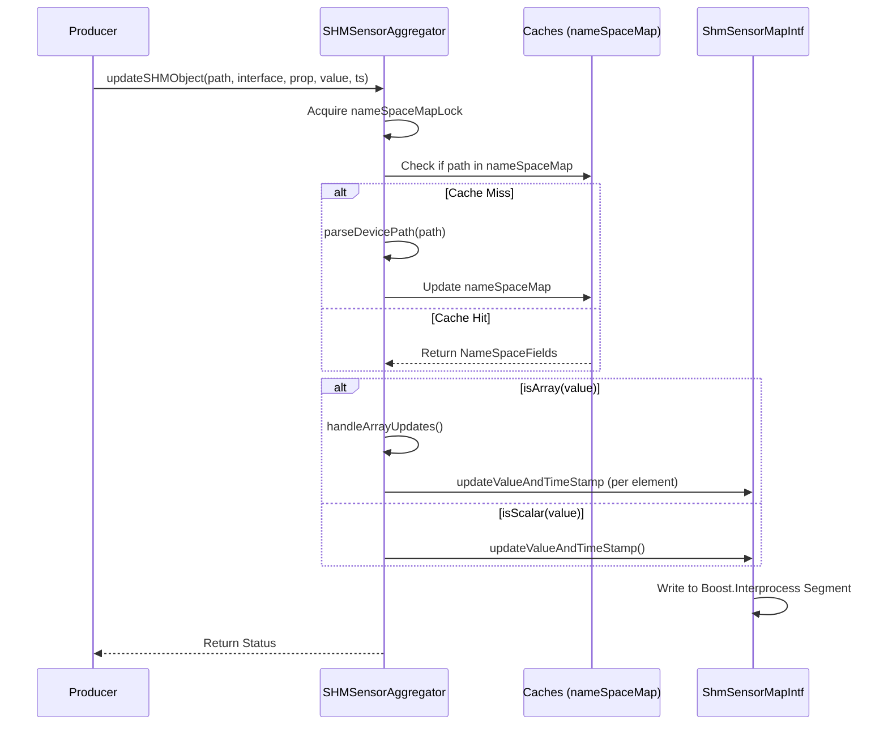
Sources: [lib/shm_sensor_aggregator.cpp:1780-1850](), [lib/shm_sensor_aggregator.cpp:1900-1950](), [lib/impl/shm_sensor_aggregator.hpp:98-101]()

---

# Page: Client API

# Client API

<details>
<summary>Relevant source files</summary>

The following files were used as context for generating this wiki page:

- [lib/include/telemetry_mrd_client.hpp](lib/include/telemetry_mrd_client.hpp)
- [lib/telemetry_mrd_client.cpp](lib/telemetry_mrd_client.cpp)

</details>


The Client API provides a high-level interface for consumers, such as `bmcweb`, to retrieve aggregated telemetry data from shared memory segments. Instead of interacting with raw shared memory primitives, clients use the `telemetry_mrd_client` functions to query data by Metric Report Definition (MRD) namespaces. The library handles the complexity of mapping these high-level namespaces to specific producer segments and aggregating the results.

### Overview of Client Interaction

The client-side logic is designed for read-only access (`O_RDONLY`). When a client requests data for a namespace like `PlatformEnvironmentMetrics`, the library performs a lookup to identify all producers (e.g., `gpumgrd`, `pldmd`) that contribute to that specific metric type. It then iterates through the corresponding shared memory segments, collects the telemetry records, and returns them as a unified collection.

#### Data Retrieval Flow
The following diagram illustrates how a client request for an MRD namespace is resolved into physical shared memory access.

**Client Request Resolution**
```mermaid
graph TD
    subgraph "Client Space"
        B["bmcweb / Client"] -- "getAllMRDValues('Namespace')" --> API["telemetry_mrd_client"]
    end

    subgraph "Logic Layer"
        API -- "Lookup Producers" --> CR["ConfigReader::getMRDNamespaceLookup()"]
        CR -- "Parse" --> JSON["shm_mapping.json"]
    end

    subgraph "Shared Memory Space"
        API -- "Open (O_RDONLY)" --> SHM1["ProducerA_Namespace"]
        API -- "Open (O_RDONLY)" --> SHM2["ProducerB_Namespace"]
        SHM1 -- "Read" --> V["SensorValue Collection"]
        SHM2 -- "Read" --> V
    end

    V --> B
```
**Sources:** [lib/telemetry_mrd_client.cpp:63-119](), [lib/include/telemetry_mrd_client.hpp:19-23]()

### Key Code Entities

The Client API is primarily defined in `telemetry_mrd_client.hpp` and implemented in `telemetry_mrd_client.cpp`. It relies on `ConfigReader` to understand the system topology.

| Entity | Role |
| :--- | :--- |
| `getAllMRDValues` | Aggregates `SensorValue` objects across all producers for a given MRD namespace. |
| `getAllKeyValuePair` | Returns raw key-value pairs from a specific shared memory namespace. |
| `getMrdNamespacesValues` | Returns a list of all valid MRD namespaces defined in the configuration. |
| `ConfigReader` | Internal utility that parses JSON configuration to map MRDs to producers. |
| `NameSpaceNotFoundException` | Thrown when a requested namespace is missing from the configuration or SHM. |
| `NoElementsException` | Thrown when a namespace exists but contains no telemetry data. |

**Sources:** [lib/include/telemetry_mrd_client.hpp:53-100](), [lib/telemetry_mrd_client.cpp:40-131]()

### Functional Components

The client functionality is split into two main areas: the data retrieval functions and the configuration resolution logic.

#### [Client Functions: getAllMRDValues and getAllKeyValuePair](#4.1)
This component provides the primary entry points for reading telemetry. `getAllMRDValues()` is the standard tool for Redfish-style aggregation, while `getAllKeyValuePair()` provides access to raw data. The implementation uses lazy initialization to open shared memory segments and ensures that segments are accessed in read-only mode to prevent accidental corruption of producer data.

For details, see [Client Functions: getAllMRDValues and getAllKeyValuePair](#4.1).

**Sources:** [lib/telemetry_mrd_client.cpp:40-61](), [lib/telemetry_mrd_client.cpp:63-119]()

#### [ConfigReader: Namespace Lookup and JSON Parsing](#4.2)
`ConfigReader` is the backbone of the client API. It parses `shm_mapping.json` and `shm_namespace_config.json` to determine which producers are responsible for which metrics. This allows the client API to abstract away the physical naming of SHM segments (which are usually prefixed by the producer name) from the high-level MRD names used in Redfish.

For details, see [ConfigReader: Namespace Lookup and JSON Parsing](#4.2).

**Sources:** [lib/telemetry_mrd_client.cpp:65-66](), [lib/telemetry_mrd_client.cpp:123-124]()

### System Integration Diagram

This diagram shows the relationship between the high-level API functions and the underlying `sensor_map_type` (the shared memory map abstraction).

**API to Code Entity Mapping**
```mermaid
graph LR
    subgraph "Public API"
        GMRD["getAllMRDValues()"]
        GKVP["getAllKeyValuePair()"]
    end

    subgraph "Internal Implementation"
        GMRD --> SM1["sensor_map_type (Local Stack)"]
        GKVP --> SMC["sensor_map (Static Cache)"]
        SM1 --> SHM["Shared Memory Segment"]
        SMC --> SHM
    end

    subgraph "Configuration"
        CR["ConfigReader"] --> GMRD
    end
```
**Sources:** [lib/telemetry_mrd_client.cpp:42-51](), [lib/telemetry_mrd_client.cpp:75-76]()

---

# Page: Client Functions: getAllMRDValues and getAllKeyValuePair

# Client Functions: getAllMRDValues and getAllKeyValuePair

<details>
<summary>Relevant source files</summary>

The following files were used as context for generating this wiki page:

- [lib/include/telemetry_mrd_client.hpp](lib/include/telemetry_mrd_client.hpp)
- [lib/telemetry_mrd_client.cpp](lib/telemetry_mrd_client.cpp)

</details>


This page provides a detailed technical reference for the client-side API of the `nv-bmc-shmem` library. These functions are primarily utilized by consumers like `bmcweb` to retrieve aggregated telemetry data from shared memory segments produced by various BMC daemons.

## Overview

The client API provides a high-level abstraction for reading telemetry data without requiring the consumer to manage shared memory segments or synchronization directly. It handles the resolution of Metric Report Definition (MRD) namespaces to physical shared memory segments, performs lazy initialization of segment connections in read-only mode, and aggregates data across multiple producers.

### Data Flow and Code Entity Mapping

The following diagram illustrates how the client functions bridge the gap between a Redfish-style MRD namespace and the underlying shared memory infrastructure.

**Client-Side Data Resolution**
```mermaid
graph TD
    subgraph "Natural Language Space"
        A["Redfish Request"]
        B["Metric Report Definition"]
    end

    subgraph "Code Entity Space (telemetry_mrd_client.cpp)"
        C["getAllMRDValues(mrdNamespace)"]
        D["getAllKeyValuePair(mrdNamespace)"]
        E["sensor_map_type (ShmSensorMapIntf)"]
    end

    subgraph "Configuration Space"
        F["ConfigReader::getMRDNamespaceLookup()"]
        G["shm_mapping.json"]
    end

    A -->|Refers to| B
    B -->|Passed as string| C
    B -->|Passed as string| D
    C -->|Queries| F
    F -->|Parses| G
    C -->|Instantiates| E
    D -->|Instantiates| E
    E -->|Opens| H["/dev/shm/ (O_RDONLY)"]
```
Sources: [lib/telemetry_mrd_client.cpp:40-119](), [lib/include/telemetry_mrd_client.hpp:18-39]()

---

## Core Client Functions

### getAllMRDValues()

The `getAllMRDValues` function is the primary entry point for bmcweb to fetch all metrics belonging to a specific MRD category (e.g., `PlatformEnvironmentMetrics`).

**Implementation Details:**
1.  **Namespace Lookup**: It retrieves the mapping between MRD namespaces and producers using `ConfigReader::getMRDNamespaceLookup()` [lib/telemetry_mrd_client.cpp:65-66]().
2.  **Aggregation Loop**: It iterates through every producer associated with the requested `mrdNamespace`. For each producer, it constructs a specific SHM namespace string: `producerName + "_" + mrdNamespace` [lib/telemetry_mrd_client.cpp:70-74]().
3.  **Lazy Segment Access**: It creates a local instance of `sensor_map_type` (which is an alias for `ShmSensorMapIntf`) in `O_RDONLY` mode for that specific segment [lib/telemetry_mrd_client.cpp:75]().
4.  **Data Collection**: It calls `getAllValues()` on the segment and appends the results to a master vector of `SensorValue` objects [lib/telemetry_mrd_client.cpp:76-83]().
5.  **Error Handling**: If a specific producer's segment is missing or empty, it logs the error but continues to the next producer to ensure partial data availability [lib/telemetry_mrd_client.cpp:85-98]().

Sources: [lib/telemetry_mrd_client.cpp:63-119](), [lib/include/telemetry_mrd_client.hpp:53-62]()

### getAllKeyValuePair()

This function provides raw access to the key-value pairs stored in a specific shared memory namespace. Unlike `getAllMRDValues`, it maintains a static cache of open segments to improve performance for repeated lookups.

**Implementation Details:**
1.  **Static Cache**: It uses a `static unordered_map<string, unique_ptr<sensor_map_type>> sensor_map` to persist connections to shared memory segments across function calls [lib/telemetry_mrd_client.cpp:42]().
2.  **Lazy Initialization**: If the requested namespace is not in the cache, it instantiates a new `sensor_map_type` in `O_RDONLY` mode and stores it [lib/telemetry_mrd_client.cpp:45-50]().
3.  **Data Retrieval**: It returns a `ShmemKeyValuePairs` object containing the raw keys and their associated `SensorValue` structures [lib/telemetry_mrd_client.cpp:51]().

Sources: [lib/telemetry_mrd_client.cpp:40-61](), [lib/include/telemetry_mrd_client.hpp:66-76]()

### getMrdNamespacesValues()

A utility function that returns a list of all valid MRD namespaces currently defined in the system configuration.

**Implementation Details:**
1.  It queries `ConfigReader::getMRDNamespaceLookup()` [lib/telemetry_mrd_client.cpp:123-124]().
2.  It extracts and returns all keys from the lookup map [lib/telemetry_mrd_client.cpp:126-130]().

Sources: [lib/telemetry_mrd_client.cpp:121-131]()

---

## Internal Mechanisms

### Lazy SHM Segment Opening
Both primary functions open shared memory segments using the `O_RDONLY` flag. This ensures that the client cannot inadvertently modify telemetry data or interfere with the producer's write operations. The segments are accessed via the `ShmSensorMapIntf` class (aliased as `sensor_map_type`).

### Exception Handling
The library defines specific exceptions to signal state issues to the caller:

| Exception | Trigger Condition |
| :--- | :--- |
| `NameSpaceNotFoundException` | Thrown when a requested MRD namespace does not exist in the configuration lookup or the physical SHM file cannot be found [lib/include/telemetry_mrd_client.hpp:82-87](). |
| `NoElementsException` | Thrown when the namespace exists but contains no telemetry data [lib/include/telemetry_mrd_client.hpp:94-99](). |

In `getAllMRDValues`, the function will only throw `NoElementsException` if *all* associated producers return no data [lib/telemetry_mrd_client.cpp:100-110]().

Sources: [lib/telemetry_mrd_client.cpp:58-60](), [lib/telemetry_mrd_client.cpp:109-117](), [lib/include/telemetry_mrd_client.hpp:82-99]()

---

## Implementation Diagram

The following diagram details the internal logic flow within `telemetry_mrd_client.cpp`.

**Internal Logic Flow**
```mermaid
sequenceDiagram
    participant C as Client (bmcweb)
    participant API as telemetry_mrd_client
    participant CR as ConfigReader
    participant SHM as ShmSensorMapIntf (O_RDONLY)

    C->>API: getAllMRDValues("PlatformMetrics")
    API->>CR: getMRDNamespaceLookup()
    CR-->>API: Map: {"PlatformMetrics": ["gpumgrd", "pldmd"]}
    
    loop For each Producer
        API->>SHM: Initialize("gpumgrd_PlatformMetrics")
        SHM-->>API: Segment Handle
        API->>SHM: getAllValues()
        SHM-->>API: vector<SensorValue>
    end
    
    API-->>C: aggregated vector<SensorValue>
```
Sources: [lib/telemetry_mrd_client.cpp:63-119](), [lib/include/telemetry_mrd_client.hpp:18-39]()

---

# Page: ConfigReader: Namespace Lookup and JSON Parsing

# ConfigReader: Namespace Lookup and JSON Parsing

<details>
<summary>Relevant source files</summary>

The following files were used as context for generating this wiki page:

- [configurations/shm_mapping.json](configurations/shm_mapping.json)
- [configurations/shm_namespace_config.json](configurations/shm_namespace_config.json)
- [lib/config_json_reader.cpp](lib/config_json_reader.cpp)
- [lib/impl/config_json_reader.hpp](lib/impl/config_json_reader.hpp)
- [lib/utils/port_utils.hpp](lib/utils/port_utils.hpp)

</details>


The `ConfigReader` struct is a static utility class responsible for loading, parsing, and providing access to the JSON configuration files that define the shared memory ecosystem. It acts as the source of truth for both producers (to determine which D-Bus properties to aggregate) and clients (to determine which physical shared memory segments correspond to a Redfish Metric Report Definition namespace).

## Configuration Files and Loading

`ConfigReader` manages two primary configuration files:
1.  **shm_namespace_config.json**: Defines the mapping between Redfish namespaces, D-Bus object path keywords, and the specific property lists to be collected. [configurations/shm_namespace_config.json:1-194]()
2.  **shm_mapping.json**: Defines the relationship between namespaces, the producer daemons authorized to write to them, and the allocated size for each shared memory segment. [configurations/shm_mapping.json:1-36]()

### Initialization Logic
The class uses a lazy-loading pattern with static `std::unique_ptr<Json>` members to ensure files are parsed only once.

*   `loadNamespaceConfig()`: Checks for the existence of `SHM_NAMESPACE_CFG_JSON`, parses it using `nlohmann::json`, and handles errors via `LOG_ERROR` and exceptions. [lib/config_json_reader.cpp:29-55]()
*   `loadSHMMappingConfig()`: Performs similar operations for `SHM_MAPPING_JSON`. [lib/config_json_reader.cpp:57-83]()

### Configuration Data Flow
The following diagram illustrates how `ConfigReader` transforms raw JSON files into structured data for the system.

**Diagram: ConfigReader Data Transformation**
```mermaid
graph TD
    subgraph "Filesystem"
        A["shm_namespace_config.json"]
        B["shm_mapping.json"]
    end

    subgraph "ConfigReader (lib/config_json_reader.cpp)"
        C["loadNamespaceConfig()"]
        D["loadSHMMappingConfig()"]
        E["namespaceCfgJson (Static)"]
        F["shmMappingJson (Static)"]
        
        G["getNameSpaceConfiguration()"]
        H["getProducers()"]
        I["getMRDNamespaceLookup()"]
        J["getSHMSize()"]
    end

    A --> C
    C --> E
    B --> D
    D --> F

    E --> G
    F --> H
    F --> I
    F --> J

    G --> K["NameSpaceConfiguration (Map)"]
    H --> L["Producer Map"]
    I --> M["MRD Namespace Map"]
```
Sources: [lib/impl/config_json_reader.hpp:43-108](), [lib/config_json_reader.cpp:26-112]()

## Core Methods and Data Structures

### Namespace Configuration
The `getNameSpaceConfiguration()` method returns a `NameSpaceConfiguration` object, which is an `unordered_map` where the key is the `SensorNameSpace` (e.g., "ProcessorMetrics") and the value is a vector of pairs containing path keywords and property lists. [lib/impl/config_json_reader.hpp:41-41]()

| Method | Return Type | Purpose |
| :--- | :--- | :--- |
| `getNameSpaceConfiguration()` | `NameSpaceConfiguration` | Maps namespaces to D-Bus keywords and properties. [lib/config_json_reader.cpp:114-161]() |
| `getProducers()` | `unordered_map<string, vector<string>>` | Returns which daemons (e.g., `gpumgrd`) produce data for which namespace. [lib/config_json_reader.cpp:85-112]() |
| `getSHMSize()` | `size_t` | Retrieves the `SizeInBytes` for a specific namespace/producer pair. [lib/config_json_reader.cpp:163-195]() |
| `getMRDNamespaceLookup()` | `unordered_map<string, vector<string>>` | Resolves MRD namespaces to their constituent producer segments. [lib/impl/config_json_reader.hpp:107-107]() |

### Producer Resolution
The `getProducers()` method parses the `Namespaces` object in `shm_mapping.json`. It iterates through each entry to extract the `Producers` array, allowing the `AggregationService` to identify which shared memory segments need to be initialized. [lib/config_json_reader.cpp:94-103]()

Sources: [lib/config_json_reader.cpp:85-161](), [lib/impl/config_json_reader.hpp:35-41]()

## Client-Side Namespace Resolution

The client (typically `bmcweb`) uses `getMRDNamespaceLookup()` to resolve a Redfish Metric Report Definition (MRD) namespace to the physical shared memory segments on the system.

**Diagram: Client-Side Namespace to SHM Resolution**
```mermaid
sequenceDiagram
    participant C as Client (telemetry_mrd_client)
    participant R as ConfigReader
    participant J as shm_mapping.json

    C->>R: getMRDNamespaceLookup()
    R->>R: loadSHMMappingConfig()
    R->>J: Parse "Namespaces" key
    loop For each Namespace in JSON
        R->>R: Extract "Producers" list
        R->>R: Map Namespace -> Producers
    end
    R-->>C: unordered_map<string, vector<string>>
    Note over C: Client uses this to open<br/>/dev/shm/&lt;Producer&gt;_&lt;Namespace&gt;
```
Sources: [lib/config_json_reader.cpp:85-112](), [lib/impl/config_json_reader.hpp:107-107]()

## Implementation Details

### Error Handling
`ConfigReader` is designed to be fail-fast during initialization but resilient during parsing:
*   **File Missing**: Throws `std::invalid_argument` if the JSON files are not found at the paths defined by `SHM_NAMESPACE_CFG_JSON` or `SHM_MAPPING_JSON`. [lib/config_json_reader.cpp:35-41]()
*   **Malformed JSON**: Throws `std::runtime_error` if `Json::parse` returns a discarded value. [lib/config_json_reader.cpp:44-51]()
*   **Missing Keys**: If a specific entry in `shm_namespace_config.json` is missing required keys like `Namespace` or `PropertyList`, the reader logs an error via `LOG_ERROR` but continues parsing subsequent entries to maximize available telemetry. [lib/config_json_reader.cpp:151-157]()

### Static Storage
The use of static `unique_ptr` for `namespaceCfgJson` and `shmMappingJson` ensures that the memory consumed by the JSON DOM is managed for the lifetime of the process and shared across all calls within the same library instance. [lib/impl/config_json_reader.hpp:46-47]()

Sources: [lib/config_json_reader.cpp:26-55](), [lib/config_json_reader.cpp:151-157]()

---

# Page: Metric Translation and Redfish URI Generation

# Metric Translation and Redfish URI Generation

<details>
<summary>Relevant source files</summary>

The following files were used as context for generating this wiki page:

- [configurations/shm_mapping.json](configurations/shm_mapping.json)
- [configurations/shm_namespace_config.json](configurations/shm_namespace_config.json)
- [lib/utils/metric_report_utils.hpp](lib/utils/metric_report_utils.hpp)
- [lib/utils/port_utils.hpp](lib/utils/port_utils.hpp)

</details>


The Metric Translation and Redfish URI Generation layer serves as the semantic bridge between the internal D-Bus/Phosphor-D-Bus-Interface (PDI) representations stored in shared memory and the external Redfish-compliant data structures required by `bmcweb`. This utility layer ensures that raw telemetry data is correctly contextualized with URIs and that PDI enums/values are translated into standard Redfish strings.

### High-Level Architecture

The utility layer is primarily consumed by the client API (e.g., `bmcweb` integration) to transform the flat key-value pairs retrieved from shared memory into structured Redfish Metric Reports.

Metric Translation and URI Logic Overview:
```mermaid
graph TD
    subgraph "Natural Language Space"
        A["Sensor Reading"]
        B["Device Port"]
        C["Status Enum"]
    end

    subgraph "Code Entity Space"
        direction TB
        D["getMetricValues()"]
        E["generateURI()"]
        F["translateReading()"]
        G["linkStatusTypeMap"]
        H["pdiNameMap"]
    end

    A --> D
    D --> F
    F --> H
    B --> E
    C --> G
    
    style D stroke-width:2px
    style E stroke-width:2px
    style F stroke-width:2px
```
**Sources:** [lib/utils/metric_report_utils.hpp:42-50](), [lib/utils/port_utils.hpp:32-42]()

---

### Redfish URI Construction

The `generateURI` function is responsible for creating the `MetricProperty` field (the Redfish URI) for each metric. It utilizes platform-specific macros and device-specific logic to derive the correct path.

Key features include:
*   **Device Contextualization**: Supports various namespaces such as `PlatformEnvironmentMetrics`, `CpuProcessorMetrics`, and `NVSwitchPortMetrics` [configurations/shm_namespace_config.json:4-192]().
*   **Macro Integration**: Uses `PLATFORMSYSTEMID` and `PLATFORMDEVICEPREFIX` to ensure URIs match the specific system topology.
*   **Port Derivation**: Special logic in `getCpuPortMetricNames` handles the mapping of CLink and NVLink port IDs for processors [lib/utils/metric_report_utils.hpp:47-50]().

For a deep dive into URI formatting and supported device types, see **[generateURI: Redfish URI Construction](#5.1)**.

---

### PDI-to-Redfish Value Translation

Raw data in shared memory often uses D-Bus PDI paths for enums (e.g., `xyz.openbmc_project.State.ProcessorPerformance.PerformanceStates.Normal`). The translation layer converts these into human-readable Redfish strings (e.g., `"Normal"`).

| Component | Logic Entity | Description |
| :--- | :--- | :--- |
| **Dispatcher** | `translateReading` | The central entry point for value conversion based on property type. |
| **Metric Mapping** | `pdiNameMap` | Static lookup for general metric names. |
| **Enum Maps** | `reasonTypeMap`, `pcieTypeMap` | Specific maps for throttling reasons, PCIe generations, and reset types. |
| **Pipeline** | `getMetricValues` | Orchestrates the extraction of multiple metrics from a SHM segment. |

For detailed mapping tables and the translation pipeline, see **[Value Translation: PDI-to-Redfish Mapping Tables](#5.2)**.

**Sources:** [lib/utils/metric_report_utils.hpp:53-136]()

---

### Port and Time Utilities

The library provides specialized headers for handling hardware-specific states and standardized time formatting.

*   **Port Utilities**: Defined in `port_utils.hpp`, these functions translate link statuses (Up, Down, Training) and link states (Enabled, Disabled) using maps like `linkStatusTypeMap` and `linkStateTypeMap` [lib/utils/port_utils.hpp:32-53]().
*   **Time Utilities**: Defined in `time_utils.hpp`, these handle the conversion of raw nanosecond timestamps or millisecond counters into ISO 8601 duration strings (e.g., `P0DT0H0M1S`) required by Redfish.

For details on status mapping and ISO 8601 formatting, see **[Port and Time Utilities](#5.3)**.

---

### Functional Flow

The following diagram illustrates how the utility layer processes a single data point from Shared Memory to a Redfish-ready tuple.

Metric Processing Pipeline:
```mermaid
sequenceDiagram
    participant C as Client (bmcweb)
    participant M as metric_report_utils
    participant P as port_utils
    participant T as time_utils

    C->>M: getMetricValue(shmValue)
    M->>M: translateReading(pdiValue)
    opt Is Enum?
        M->>P: getLinkStatusType()
    end
    opt Is Duration?
        M->>T: toDurationStringFromNano()
    end
    M->>M: generateURI(objectPath)
    M-->>C: return tuple<URI, Value>
```
**Sources:** [lib/utils/metric_report_utils.hpp:46-48](), [lib/utils/port_utils.hpp:72-79](), [lib/utils/time_utils.hpp]()

---

# Page: generateURI: Redfish URI Construction

# generateURI: Redfish URI Construction

<details>
<summary>Relevant source files</summary>

The following files were used as context for generating this wiki page:

- [lib/utils/metric_report_utils.hpp](lib/utils/metric_report_utils.hpp)

</details>


The `generateURI` utility is a core component of the `nv-bmc-shmem` library responsible for translating internal device identifiers and D-Bus object paths into standardized Redfish URI strings. This function ensures that telemetry data stored in shared memory can be correctly mapped to the Redfish resource tree (e.g., `/redfish/v1/Chassis/HGX_Resources_0/Sensors/GPU_0_Core_Temp`).

## Overview and Purpose

The URI generation logic is centralized in `lib/utils/metric_report_utils.hpp`. It relies on build-time configuration macros and runtime path parsing to determine the correct Redfish collection and resource ID for various hardware components including CPUs, GPUs, NVSwitches, and their respective ports.

### Key Configuration Macros
The URI structure is influenced by two primary macros defined during the build process:
*   `PLATFORMSYSTEMID`: The identifier for the system (e.g., "HGX_System_0"). [lib/utils/metric_report_utils.hpp:245-247]()
*   `PLATFORMDEVICEPREFIX`: The prefix used for chassis or resource containers (e.g., "HGX_"). [lib/utils/metric_report_utils.hpp:249-251]()

Sources: [lib/utils/metric_report_utils.hpp:19-22](), [lib/utils/metric_report_utils.hpp:245-251]()

## Supported Device Types

The `generateURI` function uses a `deviceType` parameter to determine the URI template. The following table maps the supported types to their Redfish URI patterns:

| Device Type | URI Pattern |
| :--- | :--- |
| `PlatformEnvironmentMetrics` | `/redfish/v1/Chassis/<PLATFORMDEVICEPREFIX>Resources_0/Sensors/<MetricName>` |
| `CpuProcessorMetrics` | `/redfish/v1/Systems/<PLATFORMSYSTEMID>/Processors/<DeviceID>` |
| `ProcessorPortMetrics` | `/redfish/v1/Systems/<PLATFORMSYSTEMID>/Processors/<DeviceID>/Ports/<PortID>` |
| `NVSwitchProcessorMetrics` | `/redfish/v1/Chassis/<PLATFORMDEVICEPREFIX>NVSwitch_<DeviceID>/Processors/<DeviceID>` |
| `NVSwitchPortMetrics` | `/redfish/v1/Chassis/<PLATFORMDEVICEPREFIX>NVSwitch_<DeviceID>/Ports/<PortID>` |
| `MemoryMetrics` | `/redfish/v1/Systems/<PLATFORMSYSTEMID>/Processors/<DeviceID>/Memory/<MemoryID>` |

Sources: [lib/utils/metric_report_utils.hpp:253-335]()

## Logic Flow: From D-Bus Path to Redfish URI

The following diagram illustrates how `generateURI` processes an input D-Bus path and device type to produce a Redfish URI.

### URI Generation Pipeline
```mermaid
graph TD
    subgraph "Natural Language Space"
        A["D-Bus Object Path"]
        B["Device Type"]
    end

    subgraph "Code Entity Space"
        C["generateURI()"]
        D["getCpuPortMetricNames()"]
        E["PLATFORMSYSTEMID"]
        F["PLATFORMDEVICEPREFIX"]
        G["CpuPortOemMetricMapping"]
    end

    A --> C
    B --> C
    E -.-> C
    F -.-> C
    C --> D
    D --> G
    C --> H["Final Redfish URI"]
```
Sources: [lib/utils/metric_report_utils.hpp:245-335](), [lib/utils/metric_report_utils.hpp:345-360]()

## Port Metric Derivation

For `ProcessorPortMetrics` and `NVSwitchPortMetrics`, the library must derive specific port identifiers (like CLink or NVLink IDs) from the D-Bus path.

### getCpuPortMetricNames
This function parses the D-Bus object path to extract the Processor ID and Port ID. It specifically handles CLink (Compute Link) and NVLink identifiers.
*   **CLink Identification**: If the path contains `clink`, it extracts the numeric index following the string. [lib/utils/metric_report_utils.hpp:345-360]()
*   **NVLink Identification**: It uses regex or string splitting to isolate the port number from the object path. [lib/utils/metric_report_utils.hpp:345-360]()

### CpuPortOemMetricMapping
This structure is used to map specific OEM-defined metrics to their respective Redfish properties within the port resource. It ensures that vendor-specific telemetry (like NVIDIA-specific link error counts) is placed under the correct `Oem` extension in the Redfish JSON response.

### Component Association Diagram
```mermaid
classDiagram
    class metricUtils {
        +generateURI(deviceType, path, metricName)
        +getCpuPortMetricNames(path)
    }
    class CpuPortOemMetricMapping {
        +string metricName
        +string redfishProperty
    }
    metricUtils ..> CpuPortOemMetricMapping : uses
```
Sources: [lib/utils/metric_report_utils.hpp:345-360](), [lib/utils/metric_report_utils.hpp:42-50]()

## Implementation Details

### String Sanitization
The `generateURI` function performs string manipulation to ensure Redfish compliance:
1.  **Regex Matching**: It uses `std::regex` to extract IDs from D-Bus paths (e.g., extracting `0` from `/xyz/openbmc_project/inventory/system/chassis/HGX_Resources_0`). [lib/utils/metric_report_utils.hpp:253-270]()
2.  **Case Transformation**: While D-Bus paths are often lowercase, the function ensures the resulting URI segments match the expected Redfish casing (e.g., `NVSwitch` vs `nvswitch`). [lib/utils/metric_report_utils.hpp:300-315]()

### Handling NVSwitch Ports
For NVSwitch ports, the URI requires both the Switch ID and the Port ID. The function splits the D-Bus path (typically delimited by `/`) and identifies the indices for the switch instance and the port instance to construct the path: `/redfish/v1/Chassis/<PREFIX>NVSwitch_<ID>/Ports/<PortID>`. [lib/utils/metric_report_utils.hpp:315-330]()

Sources: [lib/utils/metric_report_utils.hpp:253-335](), [lib/utils/metric_report_utils.hpp:345-360]()

---

# Page: Value Translation: PDI-to-Redfish Mapping Tables

# Value Translation: PDI-to-Redfish Mapping Tables

<details>
<summary>Relevant source files</summary>

The following files were used as context for generating this wiki page:

- [configurations/shm_mapping.json](configurations/shm_mapping.json)
- [configurations/shm_namespace_config.json](configurations/shm_namespace_config.json)
- [lib/utils/metric_report_utils.hpp](lib/utils/metric_report_utils.hpp)
- [lib/utils/port_utils.hpp](lib/utils/port_utils.hpp)

</details>


The `nv-bmc-shmem` library provides a translation layer that converts internal D-Bus Phantom Data Interface (PDI) representations into Redfish-compliant strings and formatted values. This ensures that telemetry data stored in shared memory by various producers (e.g., `gpumgrd`, `hwmontemp`) can be directly consumed by `bmcweb` and presented in the Redfish API without further logic in the webserver.

## Translation Pipeline

The translation process is primarily handled by the `getMetricValues` and `getMetricValue` functions. These functions act as a pipeline, taking raw shared memory data and applying formatting based on the metric type (boolean, duration, or enum).

### Data Flow: getMetricValues Pipeline

The following diagram illustrates how a raw value from the `SensorMap` is processed into a Redfish-ready string.

**Metric Translation Flow**
```mermaid
graph TD
    subgraph "Shared Memory"
        A["SensorMapValue (Variant)"]
    end

    subgraph "metric_report_utils.hpp"
        B["getMetricValues()"]
        C["getMetricValue()"]
        D{"Type Check"}
        E["toDurationStringFromNano()"]
        F["translateReading()"]
        G["Boolean Mapping"]
    end

    A --> B
    B --> C
    C --> D
    D -- "is_duration" --> E
    D -- "is_enum/string" --> F
    D -- "is_bool" --> G
    E --> H["Redfish JSON Output"]
    F --> H
    G --> H
```
**Sources:** [lib/utils/metric_report_utils.hpp:672-736](), [lib/utils/time_utils.hpp:95-107]()

## Static Mapping Tables

The library utilizes several static lookup tables to map PDI property names and values to their Redfish equivalents.

### PDI Name Mapping (`pdiNameMap`)
This table maps PDI interface property names to Redfish Metric names, organized by the PDI interface string. It is used to resolve how a specific D-Bus property should appear in a Redfish Metric Report.

| PDI Interface | Property | Redfish Metric Name |
| :--- | :--- | :--- |
| `xyz.openbmc_project.Inventory.Item.PCIeDevice` | `LanesInUse` | `PCIeLanesInUse` |
| `xyz.openbmc_project.Inventory.Item.PCIeDevice` | `MaxLanes` | `PCIeMaxLanes` |
| `xyz.openbmc_project.Metric.IBPort` | `DataCRCCount` | `DataCRCCount` |

**Sources:** [lib/utils/metric_report_utils.hpp:183-350]()

### GPM Metrics Mapping (`gpmMetricsMap`)
Specifically for GPU Performance Monitoring (GPM), this map handles the translation of high-fidelity telemetry metrics.

**Sources:** [lib/utils/metric_report_utils.hpp:378-430]()

### Processor Performance Mapping (`processorPerfMap`)
Maps throttle reasons and performance states for processors.

**Sources:** [lib/utils/metric_report_utils.hpp:432-463]()

## Enum Translation Maps

For properties that use D-Bus enums (represented as strings), the library provides specific maps to convert the full PDI path into a short Redfish string.

### Core Translation Maps
| Map Name | Purpose | Example Input (PDI) | Example Output (Redfish) |
| :--- | :--- | :--- | :--- |
| `lastResetTypeMap` | Reset counter types | `...ResetTypes.PFFLR` | `PFFLR` |
| `reasonTypeMap` | Throttle reasons | `...ThrottleReasons.SWPowerCap` | `SWPowerCap` |
| `pcieTypeMap` | PCIe Generations | `...PCIeTypes.Gen5` | `Gen5` |
| `linkDownReasonCodeMap` | IB Port errors | `...LinkDownReasonCodes.Unknown` | `Unknown` |
| `linkStatusTypeMap` | Port Link Status | `...LinkStatusType.LinkUp` | `LinkUp` |
| `linkStateTypeMap` | Port Link State | `...LinkStates.Disabled` | `Disabled` |

**Sources:** [lib/utils/metric_report_utils.hpp:53-176](), [lib/utils/port_utils.hpp:32-53]()

## Implementation Detail: `translateReading`

The `translateReading` function serves as the central dispatcher for enum-based translations. It identifies the PDI string and routes it to the appropriate static map.

**Code Entity Association**
```mermaid
graph LR
    subgraph "Natural Language Space"
        Input["PDI Enum String"]
        Output["Redfish String"]
    end

    subgraph "Code Entity Space (metric_report_utils.hpp)"
        TR["translateReading()"]
        LRM["lastResetTypeMap"]
        RTM["reasonTypeMap"]
        PTM["pcieTypeMap"]
        LDM["linkDownReasonCodeMap"]
    end

    Input --> TR
    TR --> LRM
    TR --> RTM
    TR --> PTM
    TR --> LDM
    LRM --> Output
    RTM --> Output
    PTM --> Output
    LDM --> Output
```
**Sources:** [lib/utils/metric_report_utils.hpp:544-633]()

### Key Logic in `translateReading`:
1. **Reset Type:** If the string contains `ResetCounterMetrics`, it uses `lastResetTypeMap` [lib/utils/metric_report_utils.hpp:546-554]().
2. **Throttle/Performance:** If the string contains `ProcessorPerformance`, it uses `reasonTypeMap` [lib/utils/metric_report_utils.hpp:556-564]().
3. **PCIe Type:** If the string contains `PCIeDevice` or `PCIeECC`, it uses `pcieTypeMap` [lib/utils/metric_report_utils.hpp:566-574]().
4. **Port Status:** Uses `getLinkStatusType` and `getLinkStateType` from `port_utils.hpp` for port-related enums [lib/utils/metric_report_utils.hpp:596-614]().

## Special Handling

### Boolean Values
Boolean values are converted to "1" (true) or "0" (false) strings to maintain consistency in the metric report output [lib/utils/metric_report_utils.hpp:714-722]().

### Duration Values
Metrics representing time intervals (e.g., `ThrottleDuration`) are stored as nanoseconds (uint64_t) in shared memory. The translation pipeline uses `toDurationStringFromNano` to convert these into ISO 8601 duration strings (e.g., `PT0.001S`) [lib/utils/metric_report_utils.hpp:689-695]().

**Sources:** [lib/utils/time_utils.hpp:95-107]()

---

# Page: Port and Time Utilities

# Port and Time Utilities

<details>
<summary>Relevant source files</summary>

The following files were used as context for generating this wiki page:

- [configurations/shm_mapping.json](configurations/shm_mapping.json)
- [configurations/shm_namespace_config.json](configurations/shm_namespace_config.json)
- [lib/utils/port_utils.hpp](lib/utils/port_utils.hpp)
- [lib/utils/time_utils.hpp](lib/utils/time_utils.hpp)

</details>


The `nv-bmc-shmem` library provides a set of utility functions to handle specialized data translations required for Redfish compliance. These utilities focus on converting hardware-specific port states and time durations from D-Bus Phosphor Data Interface (PDI) formats into ISO 8601 strings and Redfish-defined enumerations.

## Port Utilities

The port utilities, defined in `port_utils.hpp`, provide mapping logic between D-Bus interface enumerations and Redfish-compliant strings for network and fabric ports.

### Implementation Details
The utility uses static `std::unordered_map` structures to perform O(1) lookups for PDI strings. If a lookup fails, the functions return an empty string, allowing the caller to handle the missing mapping.

| Function | PDI Interface Prefix | Redfish Target |
| :--- | :--- | :--- |
| `getLinkStatusType` | `xyz.openbmc_project.Inventory.Decorator.PortState.LinkStatusType` | `LinkUp`, `LinkDown`, `Training`, etc. |
| `getLinkStateType` | `xyz.openbmc_project.Inventory.Decorator.PortState.LinkStates` | `Enabled`, `Disabled`, `Absent`, etc. |
| `getPowerSystemInputType` | `xyz.openbmc_project.State.Decorator.PowerSystemInputs.Status` | `Normal`, `Fault`, `OutOfRange`, `Unknown` |

### Port Utility Data Flow
The following diagram illustrates how raw PDI strings are transformed into Redfish-compliant values via the utility maps.

**Port State Translation Flow**
```mermaid
graph LR
    subgraph "PDI Space"
        A["PDI Enum String"]
    end

    subgraph "port_utils.hpp"
        B{{"linkStatusTypeMap"}}
        C{{"linkStateTypeMap"}}
        D{{"powerSystemInputTypeTypeMap"}}
        
        E["getLinkStatusType()"]
        F["getLinkStateType()"]
        G["getPowerSystemInputType()"]
    end

    subgraph "Redfish Space"
        H["Redfish Enum String"]
    end

    A --> E
    A --> F
    A --> G
    
    E -.-> B
    F -.-> C
    G -.-> D
    
    B --> H
    C --> H
    D --> H
```

Sources: [lib/utils/port_utils.hpp:32-64](), [lib/utils/port_utils.hpp:72-111]()

---

## Time Utilities

The `time_utils.hpp` header contains logic for handling ISO 8601 durations and high-precision timestamps. This is critical for Redfish metrics like `UpTime` or `ThrottleDuration`.

### ISO 8601 Duration Formatting
Redfish requires durations in the format `P[n]DT[n]H[n]M[n]S` (e.g., `P12DT1M5.5S`). The library provides bidirectional conversion between `std::chrono::milliseconds` and these strings.

#### Key Functions
*   **`toDurationString(chrono::milliseconds ms)`**: Converts a numeric millisecond value into a formatted ISO 8601 string [lib/utils/time_utils.hpp:232-258]().
*   **`fromDurationString(const string& str)`**: Parses an ISO 8601 string back into `std::chrono::milliseconds`. It uses a internal helper `fromDurationItem` to extract specific units (Days, Hours, Minutes, Seconds) [lib/utils/time_utils.hpp:155-223]().
*   **`padZeros(int64_t value, size_t pad)`**: An optimized, locale-independent integer-to-string converter that adds leading zeros [lib/utils/time_utils.hpp:62-71]().

### DateTime and Timestamps
*   **`getDateTimeUintMs(uint64_t msecSinceEpoch)`**: Formats a millisecond-precision epoch timestamp into a Redfish-compliant `YYYY-MM-DDTHH:MM:SS.mmmmmm+HH:MM` string.
*   **`civilFromDays(Days d)`**: An implementation of the Howard Hinnant algorithm to convert a count of days since the epoch into a year/month/day tuple without using heavy standard library calendar functions.

### Duration Parsing Logic
The parsing logic utilizes `std::from_chars` for performance and avoids exceptions.

**Duration Parsing State Machine**
```mermaid
stateDiagram-v2
    [*] --> Start: fromDurationString()
    Start --> CheckP: Validate prefix 'P'
    CheckP --> Days: details::fromDurationItem<'Days'>('D')
    Days --> CheckT: Validate prefix 'T'
    CheckT --> Hours: fromDurationItem<'hours'>('H')
    Hours --> Minutes: fromDurationItem<'minutes'>('M')
    Minutes --> Seconds: fromDurationItem<'seconds'>('S' or '.')
    Seconds --> End: Return optional milliseconds
    
    CheckP --> Error: Missing 'P'
    CheckT --> Error: Missing 'T' if time units exist
    Error --> [*]: Return nullopt + LOG_ERROR
```

Sources: [lib/utils/time_utils.hpp:50-51](), [lib/utils/time_utils.hpp:84-145](), [lib/utils/time_utils.hpp:155-223]()

### Precision and Limits
*   **Maximum Range**: The conversion logic checks against `chrono::milliseconds::max()` to prevent overflow during string parsing [lib/utils/time_utils.hpp:131-136]().
*   **Millisecond Precision**: When parsing the seconds component, if a decimal point `.` is found, the utility specifically handles the sub-second portion to maintain millisecond accuracy [lib/utils/time_utils.hpp:199-208]().

Sources: [lib/utils/time_utils.hpp:121-125](), [lib/utils/time_utils.hpp:199-215]()

---

# Page: Developer Tools

# Developer Tools

<details>
<summary>Relevant source files</summary>

The following files were used as context for generating this wiki page:

- [.gitignore](.gitignore)
- [lib/impl/shmem_map.hpp](lib/impl/shmem_map.hpp)
- [lib/include/meson.build](lib/include/meson.build)
- [tools/aggregation_service_tester.cpp](tools/aggregation_service_tester.cpp)
- [tools/meson.build](tools/meson.build)
- [tools/nv_shmem_tool.cpp](tools/nv_shmem_tool.cpp)

</details>


The `nv-bmc-shmem` repository includes a set of command-line utilities and testing binaries designed to facilitate the development, debugging, and validation of the shared memory telemetry system. These tools allow developers to inspect the state of shared memory segments, simulate producer activity, and verify the integration of new telemetry sources without requiring a full OpenBMC environment or a running `bmcweb` instance.

### System Overview: Tools and Code Entities

The following diagram illustrates how the developer tools interact with the core library classes to exercise the shared memory system.

**Tool-to-Entity Mapping**
```mermaid
graph TD
    subgraph "Command Line Tools"
        NV_SHMEM_TOOL["nv-shmem-tool (CLI)"]
        AGG_TESTER["aggregation-service-tester (Binary)"]
    end

    subgraph "Core Code Entities"
        MAP_CLASS["nv::shmem::Map<SensorMap, SensorValue>"]
        AGG_SERVICE["nv::sensor_aggregation::AggregationService"]
        SHM_SENS_INTF["nv::shmem::ShmSensorMapIntf"]
    end

    subgraph "Shared Memory Layer"
        SHM_SEG["Boost.Interprocess Segment"]
    end

    NV_SHMEM_TOOL -- "Direct Access" --> MAP_CLASS
    AGG_TESTER -- "Producer API" --> AGG_SERVICE
    AGG_SERVICE -- "Manages" --> SHM_SENS_INTF
    SHM_SENS_INTF -- "Updates" --> MAP_CLASS
    MAP_CLASS -- "Maps to" --> SHM_SEG
```
**Sources:** [tools/nv_shmem_tool.cpp:49-52](), [tools/aggregation_service_tester.cpp:30-31](), [lib/impl/shmem_map.hpp:51-53]()

---

### 6.1 nv_shmem_tool: CLI for Shared Memory Inspection

The `nv-shmem-tool` is a versatile debugging utility that provides direct access to the `nv::shmem::Map` layer [tools/nv_shmem_tool.cpp:51-52](). It bypasses the `AggregationService` and `ConfigReader` logic, allowing developers to target specific shared memory namespaces by name and perform CRUD operations or performance benchmarks.

#### Key Functionalities
*   **Inspection**: Read all sensors or raw key-value pairs stored in a namespace [tools/nv_shmem_tool.cpp:49-75]().
*   **Maintenance**: Erase/clear an entire shared memory segment [tools/nv_shmem_tool.cpp:76-83]().
*   **Benchmarking**: The `perf` command simulates high-frequency updates (5,000 objects) to measure latency and search performance [tools/nv_shmem_tool.cpp:100-142]().
*   **Creation**: Manually initialize a segment with dummy data to test consumer (e.g., `bmcweb`) behavior [tools/nv_shmem_tool.cpp:143-170]().

For detailed command syntax and debugging workflows, see **[nv_shmem_tool: CLI for Shared Memory Inspection](#6.1)**.

**Sources:** [tools/nv_shmem_tool.cpp:36-44](), [lib/impl/shmem_map.hpp:94-110]()

---

### 6.2 aggregation_service_tester: Producer Integration Smoke Test

The `aggregation-service-tester` is a standalone binary used to validate the `AggregationService` producer API. Unlike the `nv_shmem_tool`, which interacts with the raw map, this tool exercises the full path resolution and caching logic used by actual producer daemons like `gpumgrd` or `pldmd` [tools/aggregation_service_tester.cpp:30-53]().

#### Validation Scenarios
*   **Namespace Initialization**: Verifies that a producer can successfully claim a namespace (e.g., `gpumgrd`) [tools/aggregation_service_tester.cpp:30-37]().
*   **Telemetry Lifecycle**: Tests the transition from "New Object Creation" to "Value and Timestamp Update" [tools/aggregation_service_tester.cpp:50-102]().
*   **Error Handling**: Validates how the system handles `NaN` (Not a Number) values and non-applicable keys [tools/aggregation_service_tester.cpp:121-173]().
*   **Performance Metrics**: Outputs the time spent (in microseconds) for various operations to ensure they meet the low-latency requirements of the shared memory system [tools/aggregation_service_tester.cpp:69-70]().

For instructions on running integration tests and interpreting output, see **[aggregation_service_tester: Producer Integration Smoke Test](#6.2)**.

**Sources:** [tools/aggregation_service_tester.cpp:18-26](), [tools/aggregation_service_tester.cpp:150-168]()

---

### Tool Compilation and Installation

Both tools are defined in the `tools/meson.build` file and are compiled as part of the standard build process if the environment is configured to include them. They depend on the main `nv_shmem` library [tools/meson.build:2-14]().

| Binary Name | Source File | Primary Dependency |
| :--- | :--- | :--- |
| `nv-shmem-tool` | `nv_shmem_tool.cpp` | `nv_shmem_dep` |
| `aggregation-service-tester` | `aggregation_service_tester.cpp` | `nv_shmem_dep` |

**Sources:** [tools/meson.build:1-16](), [lib/include/meson.build:1-6]()

---

# Page: nv_shmem_tool: CLI for Shared Memory Inspection

# nv_shmem_tool: CLI for Shared Memory Inspection

<details>
<summary>Relevant source files</summary>

The following files were used as context for generating this wiki page:

- [.gitignore](.gitignore)
- [lib/impl/shmem_map.hpp](lib/impl/shmem_map.hpp)
- [lib/include/meson.build](lib/include/meson.build)
- [tools/meson.build](tools/meson.build)
- [tools/nv_shmem_tool.cpp](tools/nv_shmem_tool.cpp)

</details>


The `nv-shmem-tool` is a standalone command-line utility designed for developers and system administrators to inspect, debug, and manipulate the shared memory segments used by the `nv-bmc-shmem` library. It provides direct access to the underlying `nv::shmem::Map` structures, bypassing the high-level `AggregationService` or `telemetry_mrd_client` abstractions to allow for raw data verification and performance testing.

### Purpose and Scope
*   **Inspection**: View the current state of telemetry data stored in specific shared memory namespaces.
*   **Lifecycle Management**: Manually create or erase shared memory segments for testing purposes.
*   **Performance Benchmarking**: Simulate high-frequency updates and reads to validate the library's behavior under load.
*   **Debugging**: Verify that producers are correctly writing data and that the shared memory allocation is healthy.

Sources: [tools/nv_shmem_tool.cpp:1-44](), [tools/meson.build:2-7]()

---

### Implementation Details

The tool is implemented as a thin wrapper around the `nv::shmem::Map` template class. It specifically instantiates the map using `nv::shmem::SensorMap` (the internal Boost-based container) and `nv::shmem::SensorValue` (the data structure containing telemetry) [tools/nv_shmem_tool.cpp:51-52]().

#### Data Flow: CLI to Shared Memory
The following diagram illustrates how the `nv_shmem_tool` interacts with the core library entities to access the shared memory segment.

**CLI to Code Entity Mapping**
```mermaid
graph TD
    subgraph "CLI Layer"
        A["nv-shmem-tool (binary)"]
    end

    subgraph "nv::shmem Namespace"
        B["Map<SensorMap, SensorValue>"]
        C["ManagedShmem"]
        D["SensorValue"]
    end

    subgraph "Shared Memory Segment"
        E[("Boost Managed Segment")]
        F["named_upgradable_mutex"]
    end

    A -->|Instantiates| B
    B --|>|Inherits| C
    B -->|Contains| D
    C -->|Maps| E
    C -->|Acquires| F
```
Sources: [tools/nv_shmem_tool.cpp:51-52](), [lib/impl/shmem_map.hpp:51-60](), [lib/impl/shmem_map.hpp:186-187]()

---

### Supported Commands

The tool follows a standard syntax: `nv-shmem-tool [command] [namespace]`.

| Command | Permission | Description |
| :--- | :--- | :--- |
| `read` | `O_RDONLY` | Lists all sensors in the namespace with their values and timestamps. |
| `readraw` | `O_RDONLY` | Lists all objects using their internal shared memory keys (D-Bus paths). |
| `erase` | `O_CREAT` | Clears all entries from the specified namespace. |
| `stat` | `O_RDONLY` | Continuously polls and prints the namespace content every second. |
| `perf` | `O_CREAT` | Performs 5000 random insertions and enters a high-speed update loop. |
| `create` | `O_CREAT` | Populates a namespace with 1000 dummy sensor entries for testing. |

Sources: [tools/nv_shmem_tool.cpp:38-44](), [tools/nv_shmem_tool.cpp:49-170]()

---

### Command Workflows

#### 1. Inspection (`read` and `readraw`)
The `read` command calls `mShmem.getAllValues()` [tools/nv_shmem_tool.cpp:56](), which returns a vector of `SensorValue` objects. It then iterates through them to print the `metricProperty`, `timestampStr`, `timestamp`, and `sensorValue` [tools/nv_shmem_tool.cpp:57-61](). 

The `readraw` command uses `mShmem.getAllKeyValuePair()` [tools/nv_shmem_tool.cpp:70](). This is useful for debugging the exact D-Bus paths being used as keys in the shared memory map [tools/nv_shmem_tool.cpp:71-74]().

#### 2. Resource Management (`create` and `erase`)
When using `create` or `erase`, the tool opens the segment with `O_CREAT` and a fixed size of 1,000,000 bytes [tools/nv_shmem_tool.cpp:79]().
*   **Erase**: Calls `mShmem.clear()`, which acquires a `shmem_write_lock_t` and clears the underlying Boost map [lib/impl/shmem_map.hpp:114-125]().
*   **Create**: Generates 1000 sensors with names like `HGX_Chassis_0_My_Sensor_X` and populates them with current steady_clock timestamps [tools/nv_shmem_tool.cpp:148-163]().

#### 3. Performance Testing (`perf`)
The `perf` command is used to stress the `ManagedShmem` locking mechanism. It performs a loop of `mShmem.getValue()` followed by `mShmem.insert()` with a 10ms delay [tools/nv_shmem_tool.cpp:120-141](). This helps identify potential deadlocks or contention issues between producers and consumers.

---

### Internal Execution Logic

The tool utilizes the `ManagedShmem` lifecycle to handle segment attachment.

**Execution Flow for 'read' Command**
```mermaid
sequenceDiagram
    participant CLI as nv_shmem_tool.cpp
    participant Map as Map<SensorMap, SensorValue>
    participant MShm as ManagedShmem
    participant Boost as Boost::Interprocess

    CLI->>Map: Constructor(namespace, O_RDONLY)
    Map->>MShm: Constructor(namespace, O_RDONLY)
    MShm->>Boost: open_read_only(namespace)
    Map->>Map: find<SensorMap>(namespace)
    CLI->>Map: getFreeSize()
    Map->>Boost: get_free_memory()
    CLI->>Map: getAllValues()
    Map->>MShm: acquire read_lock
    Map->>CLI: vector<SensorValue>
    MShm->>MShm: release read_lock (on destruction)
```
Sources: [tools/nv_shmem_tool.cpp:51-61](), [lib/impl/shmem_map.hpp:65-73](), [lib/impl/shmem_map.hpp:168-172]()

### Debugging Workflows

**Checking for Memory Leaks/Exhaustion:**
Run `nv-shmem-tool read <namespace>`. The tool outputs the "Shmem FreeSize" in bytes [tools/nv_shmem_tool.cpp:54-55](). Comparing this value over time during producer activity helps identify if the shared memory segment size is sufficient for the number of sensors being tracked.

**Verifying Producer Path Resolution:**
If a Redfish URI is missing data, use `nv-shmem-tool readraw <namespace>`. This allows the developer to see the exact D-Bus path keys stored in SHM [tools/nv_shmem_tool.cpp:70-74](). If the key is missing or formatted incorrectly, the issue lies in the `SHMSensorAggregator` path parsing logic rather than the client-side translation.

**Manual Cleanup:**
If a shared memory segment becomes corrupted or needs a reset without restarting the entire BMC, `nv-shmem-tool erase <namespace>` can be used to wipe the segment while maintaining the allocated memory block [tools/nv_shmem_tool.cpp:76-83]().

Sources: [tools/nv_shmem_tool.cpp:49-183](), [lib/impl/shmem_map.hpp:114-125]()

---

# Page: aggregation_service_tester: Producer Integration Smoke Test

# aggregation_service_tester: Producer Integration Smoke Test

<details>
<summary>Relevant source files</summary>

The following files were used as context for generating this wiki page:

- [.gitignore](.gitignore)
- [lib/include/meson.build](lib/include/meson.build)
- [tools/aggregation_service_tester.cpp](tools/aggregation_service_tester.cpp)
- [tools/meson.build](tools/meson.build)

</details>


The `aggregation-service-tester` is a standalone binary designed to validate the integration between a producer daemon and the `AggregationService` API. It serves as a manual smoke test to ensure that shared memory (SHM) segments are correctly initialized, that telemetry data is being persisted accurately, and that the internal path resolution and NaN handling logic function as expected in a live environment.

## Overview and Purpose

The tester exercises the primary producer-side interface defined in `telemetry_mrd_producer.hpp`. It simulates the behavior of a daemon like `gpumgrd` or `pldmd` by calling the static methods of `AggregationService` to create and update sensor data.

Key objectives of this tool include:
* **Validation of `namespaceInit`**: Ensuring the SHM segment for a specific producer is correctly mapped [tools/aggregation_service_tester.cpp:30-37]().
* **Performance Measurement**: Measuring the latency of new object creation versus subsequent updates [tools/aggregation_service_tester.cpp:69-70]().
* **Feature Verification**: Testing edge cases such as NaN (Not a Number) propagation, array-based metrics, and D-Bus path filtering [tools/aggregation_service_tester.cpp:150-168]().

**Sources:**
* [tools/aggregation_service_tester.cpp:28-37]()
* [tools/meson.build:9-14]()

## System Integration Flow

The following diagram illustrates how the `aggregation-service-tester` interacts with the core library components to simulate a producer.

### Producer Simulation Flow
```mermaid
graph TD
    subgraph "aggregation-service-tester (Process)"
        START["main()"] --> INIT["AggregationService::namespaceInit('gpumgrd')"]
        INIT --> UPDATE["AggregationService::updateTelemetry(...)"]
        UPDATE --> SHM_AGG["SHMSensorAggregator (Singleton)"]
    end

    subgraph "nv-bmc-shmem Library"
        SHM_AGG --> RESOLVE["Path Resolution (shm_mapping.json)"]
        RESOLVE --> MAP_INTF["ShmSensorMapIntf"]
        MAP_INTF --> SHM_SEG["ManagedShmem (Boost Segment)"]
    end

    SHM_SEG --> DISK["/dev/shm/gpumgrd"]
```
**Sources:**
* [tools/aggregation_service_tester.cpp:30-53]()
* [tools/meson.build:12]()

## Test Scenarios

The binary executes several hardcoded test cases to verify the robustness of the `AggregationService` implementation.

### 1. New Object Creation
The tester attempts to create a new sensor entry using a full D-Bus path and a parent device path. This validates the library's ability to allocate new `SensorMap` entries within the SHM segment [tools/aggregation_service_tester.cpp:51-53]().

### 2. Value and Timestamp Updates
A loop performs 10 consecutive updates to an existing sensor. This is used to measure the overhead of the `scoped_lock` and the `updateValueAndTimeStamp` logic [tools/aggregation_service_tester.cpp:73-102]().

### 3. NaN and Error Handling
The tester validates how the system handles invalid readings by passing an error code (`rc`) to the `updateTelemetry` function.
* **Simple Type NaN**: Verifies that non-sensor properties (e.g., PCIe counters) correctly handle error states [tools/aggregation_service_tester.cpp:156-164]().
* **Sensor Resource NaN**: Specifically tests properties using the `xyz.openbmc_project.Sensor.Value` interface [tools/aggregation_service_tester.cpp:182-187]().

### 4. Path Resolution Filtering
The tester provides paths that should not match any configuration in `shm_mapping.json` to verify the "not applicable key" caching mechanism, which prevents repeated expensive regex lookups for invalid paths [tools/aggregation_service_tester.cpp:126-130]().

**Sources:**
* [tools/aggregation_service_tester.cpp:51-187]()

## Code Entity Mapping

This diagram maps the high-level test actions to the specific C++ entities and methods defined in the producer API.

### Entity Relationship Diagram
```mermaid
classDiagram
    class "aggregation_service_tester" {
        +main()
    }
    class "AggregationService" {
        <<Static Facade>>
        +namespaceInit(producerName)
        +updateTelemetry(path, interface, property, value, ...)
    }
    class "SHMSensorAggregator" {
        <<Singleton>>
        -nameSpaceMap
        -notApplicableKeys
        +updateTelemetry()
    }
    class "ShmSensorMapIntf" {
        +updateValueAndTimeStamp()
        +insert()
    }

    "aggregation_service_tester" ..> "AggregationService" : Calls
    "AggregationService" --> "SHMSensorAggregator" : Delegates to
    "SHMSensorAggregator" --> "ShmSensorMapIntf" : Manages
```
**Sources:**
* [tools/aggregation_service_tester.cpp:20]()
* [lib/include/telemetry_mrd_producer.hpp]()

## Usage and Execution

The binary is compiled as part of the standard Meson build and installed to the system path [tools/meson.build:9-14]().

### Running the Test
To execute the smoke test on a BMC:
```bash
# Ensure the necessary SHM configuration files are present in /usr/share/nv-bmc-shmem/
aggregation-service-tester
```

### Expected Output
The tool provides verbose console output indicating the success or failure of each stage, along with timing information in microseconds:
```text
AggregationService::namespaceInit success
AggregationService::updateTelemetry success for new object
AggregationService: Time spent for new object creation -> 450
AggregationService::updateTelemetry value and timestamp update success
AggregationService: Time for value and timestamp update 1 -> 85
...
```

**Sources:**
* [tools/aggregation_service_tester.cpp:32-101]()
* [tools/meson.build:13]()

---

# Page: Testing

# Testing

<details>
<summary>Relevant source files</summary>

The following files were used as context for generating this wiki page:

- [gcovr.cfg](gcovr.cfg)
- [test/BRANCH_COVERAGE_NOTES.md](test/BRANCH_COVERAGE_NOTES.md)
- [test/meson.build](test/meson.build)

</details>


The `nv-bmc-shmem` test suite is designed to validate the integrity of shared memory operations, the accuracy of telemetry aggregation, and the correctness of Redfish URI generation. It utilizes **GoogleTest** and **GoogleMock** for unit testing and incorporates a specialized strategy for testing configuration-dependent logic through header shadowing and custom build targets.

## Test Infrastructure

The testing framework is integrated into the Meson build system. Tests are defined in the `test/` directory and are automatically linked against the `nv_shmem` library.

### Framework and Dependencies
- **GoogleTest (gtest)**: Used for test assertions and test suite structure [test/meson.build:1-12]().
- **GoogleMock (gmock)**: Used for mocking dependencies where necessary [test/meson.build:13]().
- **Meson Integration**: Tests are executed via `meson test`. The build script iterates through a list of test names and creates individual executables for each [test/meson.build:23-46]().

### Code Coverage
The project uses `gcovr` for coverage analysis. While line coverage is high, branch coverage is noted as structurally more complex due to template instantiations and OS-level failure paths (e.g., `mmap` or `shm_open` failures) [test/BRANCH_COVERAGE_NOTES.md:5-24]().

| Coverage Metric | Configuration |
| :--- | :--- |
| **Exclusions** | `test/` files and `subprojects/` are excluded from coverage [gcovr.cfg:5-8](). |
| **Branch Handling** | `exclude-throw-branches` and `exclude-unreachable-branches` are enabled [gcovr.cfg:11-12](). |
| **Decisions** | Decision coverage is tracked [gcovr.cfg:13](). |

Sources: [test/meson.build:1-46](), [gcovr.cfg:1-13](), [test/BRANCH_COVERAGE_NOTES.md:1-24]()

## Test Categories

The test suite is divided into three primary categories based on the component being exercised and the testing strategy employed.

### 1. Core Unit Tests
These tests cover the fundamental building blocks of the shared memory system, including the producer/client APIs and the underlying map structures.
- **Producer Logic**: Validates `SHMSensorAggregator` path resolution, array handling, and NaN value updates [test/meson.build:32-33]().
- **Client Logic**: Validates `telemetry_mrd_client` functions like `getAllMRDValues` and exception handling for missing namespaces [test/meson.build:34]().
- **Map Internals**: Exercises `ShmSensorMapIntf` and the core `Map` template [test/meson.build:24-31]().

For details, see [Unit Tests: Producer, Client, and SHM Map](#7.1).

### 2. Utility and Metric Tests
These tests focus on the stateless translation logic and helper utilities.
- **Metric Report Utils**: Validates Redfish URI generation and PDI-to-Redfish value translation [test/meson.build:51-62]().
- **Port and Time Utils**: Validates link status mapping and ISO 8601 duration/datetime formatting [test/meson.build:26-28]().
- **Stubbing Mechanism**: Uses a specialized `stubs/` directory to shadow headers like `sdbusplus/bus.hpp` to resolve symbol conflicts during testing [test/meson.build:48-60]().

For details, see [Unit Tests: Utilities (Metric, Port, Time)](#7.2).

### 3. Configuration and Branch Coverage
The `ConfigReader` component is tested using a unique multi-binary approach to exercise different failure modes (e.g., malformed JSON, missing files).
- **Custom `config.h`**: Each test variant is compiled with a specific `config.h` that overrides the `SHM_MAPPING_JSON` macro [test/meson.build:64-75]().
- **Failure Scenarios**: Specific tests exist for `nofile`, `malformed`, `no_ns`, and `no_producers` conditions [test/meson.build:84-95]().

For details, see [Configuration Reader Tests and Branch Coverage](#7.3).

## Test Entity Mapping

The following diagram illustrates how the test executables relate to the core library components they exercise.

### Test-to-Component Relationship
```mermaid
graph TD
    subgraph "Test Executables"
        T_PROD["test-telemetry_mrd_producer_test"]
        T_CLI["test-telemetry_mrd_client_test"]
        T_MAP["test-shm_sensormap_intf_test"]
        T_UTIL["test-metric_report_utils_test"]
        T_CFG["test-config_json_reader_nofile_test"]
    end

    subgraph "Library Components"
        L_PROD["SHMSensorAggregator"]
        L_CLI["telemetry_mrd_client.cpp"]
        L_MAP["ShmSensorMapIntf"]
        L_UTIL["metric_report_utils.hpp"]
        L_CFG["ConfigReader"]
    end

    T_PROD --> L_PROD
    T_CLI --> L_CLI
    T_MAP --> L_MAP
    T_UTIL --> L_UTIL
    T_CFG --> L_CFG
```
Sources: [test/meson.build:23-35](), [test/meson.build:51-62](), [test/meson.build:84-95]()

### Test Build Pipeline
```mermaid
graph LR
    subgraph "Source Space"
        SRC["config_json_reader.cpp"]
        STUB["test/stubs/shm_common.h"]
    end

    subgraph "Build Targets"
        EXE_NORMAL["test-config_json_reader_test"]
        EXE_STUB["test-metric_report_utils_test"]
    end

    subgraph "Configuration Space"
        CFG_H["cfg_nofile/config.h"]
    end

    SRC --> EXE_NORMAL
    CFG_H -- "Macro Override" --> EXE_NORMAL
    STUB -- "Header Shadowing" --> EXE_STUB
```
Sources: [test/meson.build:48-60](), [test/meson.build:64-70](), [test/meson.build:91]()

---

# Page: Unit Tests: Producer, Client, and SHM Map

# Unit Tests: Producer, Client, and SHM Map

<details>
<summary>Relevant source files</summary>

The following files were used as context for generating this wiki page:

- [test/sensor_map_test.cpp](test/sensor_map_test.cpp)
- [test/shm_sensormap_intf_test.cpp](test/shm_sensormap_intf_test.cpp)
- [test/shmem_map_extra_test.cpp](test/shmem_map_extra_test.cpp)
- [test/stubs/phosphor-logging/lg2.hpp](test/stubs/phosphor-logging/lg2.hpp)
- [test/stubs/shm_common.h](test/stubs/shm_common.h)
- [test/telemetry_mrd_client_test.cpp](test/telemetry_mrd_client_test.cpp)
- [test/telemetry_mrd_producer_null_test.cpp](test/telemetry_mrd_producer_null_test.cpp)
- [test/telemetry_mrd_producer_test.cpp](test/telemetry_mrd_producer_test.cpp)

</details>


This section covers the core unit test suite for the `nv-bmc-shmem` library. These tests validate the end-to-end telemetry pipeline, from the producer's path resolution and shared memory (SHM) insertion to the client's aggregation and retrieval logic. The suite also includes deep verification of the underlying `Map` template and the `ShmSensorMapIntf` management layer.

## Producer and Aggregation Tests

The producer tests focus on the `AggregationService` and its internal `SHMSensorAggregator`. They verify how D-Bus telemetry updates are parsed, matched against configuration namespaces, and persisted in shared memory.

### Telemetry MRD Producer Logic
The `telemetry_mrd_producer_test.cpp` file exercises various scenarios for the `updateTelemetry` API:
*   **Path Resolution**: Validates that `parseDevicePath` correctly identifies namespaces for GPU processors and ports [test/telemetry_mrd_producer_test.cpp:71-81]().
*   **Data Types**: Tests scalar updates (uint64, double) and complex array handling using `std::vector<std::string>` [test/telemetry_mrd_producer_test.cpp:107-117]().
*   **NaN Handling**: Verifies that when a producer reports an error (non-zero return code), the system correctly marks values as "NaN" in SHM [test/telemetry_mrd_producer_test.cpp:95-105]().
*   **Dynamic Arrays**: Exercises the `handleArrayUpdates` logic by providing vectors of increasing sizes to ensure the SHM object grows accordingly [test/telemetry_mrd_producer_test.cpp:119-129]().

### Null Aggregator Guard
A specialized test, `telemetry_mrd_producer_null_test.cpp`, ensures the library handles uninitialized states gracefully. If `updateTelemetry` is called before `namespaceInit`, the function must return `false` without crashing [test/telemetry_mrd_producer_null_test.cpp:34-42]().

### Data Flow: Producer to SHM
The following diagram illustrates how the `AggregationService` processes a telemetry update during unit testing.

**Producer Update Sequence**
```mermaid
sequenceDiagram
    participant T as "telemetry_mrd_producer_test.cpp"
    participant AS as "AggregationService"
    participant SA as "SHMSensorAggregator"
    participant SMI as "ShmSensorMapIntf"
    participant M as "Map<SensorMap, SensorValue>"

    T->>AS: namespaceInit("gpumgrd")
    AS->>SA: new SHMSensorAggregator()
    SA->>SMI: createNamespace(ns, size)
    
    T->>AS: updateTelemetry(path, interface, prop, value, ...)
    AS->>SA: updateTelemetry(...)
    SA->>SA: parseDevicePath(path)
    SA->>SMI: updateValueAndTimeStamp(ns, key, val, ts, tsStr)
    SMI->>M: updateValueAndTimeStamp(...)
    M-->>T: return true
```
Sources: [test/telemetry_mrd_producer_test.cpp:64-81](), [test/telemetry_mrd_producer_null_test.cpp:34-42]()

---

## Client and Aggregation Retrieval Tests

The client tests validate the `telemetry_mrd_client.hpp` functions used by consumers like `bmcweb`.

### Retrieval Scenarios
*   **getAllMRDValues**: Tests the aggregation of metrics across multiple physical SHM segments based on a Redfish MRD (Metric Report Definition) namespace [test/telemetry_mrd_client_test.cpp:81-91]().
*   **Exception Handling**:
    *   Throws `NameSpaceNotFoundException` if a requested namespace is missing from `shm_mapping.json` [test/telemetry_mrd_client_test.cpp:34-40]().
    *   Throws `NoElementsException` if a namespace exists but contains no data [test/telemetry_mrd_client_test.cpp:70-79]().
*   **Static Caching**: Verifies that the client maintains a internal `sensor_map` to avoid re-opening SHM segments on every call [test/telemetry_mrd_client_test.cpp:105-114]().

**Client Entity Mapping**
| Code Entity | Test File | Responsibility |
| :--- | :--- | :--- |
| `getAllMRDValues` | `telemetry_mrd_client_test.cpp` | Aggregates data from multiple producers for one MRD. |
| `getAllKeyValuePair` | `telemetry_mrd_client_test.cpp` | Returns raw key-value pairs for a specific SHM segment. |
| `getMrdNamespacesValues` | `telemetry_mrd_client_test.cpp` | Lists all MRD namespaces defined in config. |

Sources: [test/telemetry_mrd_client_test.cpp:34-114]()

---

## Shared Memory Map Implementation Tests

The lowest layers of the library are tested in `sensor_map_test.cpp`, `shmem_map_extra_test.cpp`, and `shm_sensormap_intf_test.cpp`.

### Map Template (`shmem_map.hpp`)
These tests exercise the `Map<SensorMap, SensorValue>` class, which interacts directly with Boost.Interprocess:
*   **CRUD Operations**: Insertion, retrieval, updates, and erasure of `SensorValue` objects [test/sensor_map_test.cpp:45-153]().
*   **Concurrency & Permissions**: Validates that opening a map with `O_RDONLY` correctly throws exceptions when write operations (like `insert` or `clear`) are attempted [test/sensor_map_test.cpp:199-209](), [test/shmem_map_extra_test.cpp:78-84]().
*   **Memory Management**: Verifies `getFreeSize()` and ensures the allocator correctly handles `char_string_t` within the segment [test/shmem_map_extra_test.cpp:124-127]().

### Interface Layer (`shm_sensormap_intf.hpp`)
The `ShmSensorMapIntf` class manages a collection of `Map` instances. Tests verify:
*   **Namespace Lifecycle**: Creating and checking the presence of named namespaces [test/shm_sensormap_intf_test.cpp:48-69]().
*   **Delegation**: Ensuring calls to `updateValueAndTimeStamp` are correctly routed to the appropriate underlying `Map` instance [test/shm_sensormap_intf_test.cpp:111-120]().

**SHM Internal Structure**
```mermaid
classDiagram
    class ShmSensorMapIntf {
        -unordered_map sensor_map
        +createNamespace(name, size)
        +insert(ns, key, val)
    }
    class Map {
        -ManagedShmem shmem
        -SensorMap* mSensorMapPtr
        +getValue(key, value)
        +updateValue(key, val)
    }
    class SensorMapValue {
        +char_string_t sensorValue
        +uint64_t timestamp
    }
    ShmSensorMapIntf "1" *-- "many" Map : manages
    Map "1" *-- "many" SensorMapValue : stores
```
Sources: [test/sensor_map_test.cpp:29-43](), [test/shm_sensormap_intf_test.cpp:38-42](), [test/stubs/shm_common.h:78-89]()

---

## Test Stubs and Infrastructure

To enable compilation in environments where full OpenBMC D-Bus dependencies might conflict, the suite uses stubs.

### D-Bus and Logging Stubs
*   **`shm_common.h`**: Replaces the full `sdbusplus/bus.hpp` with `native_types.hpp` to define `DbusVariantType` without bringing in conflicting log converters [test/stubs/shm_common.h:18-26]().
*   **`lg2.hpp`**: Provides a no-op implementation of the `lg2` logging framework. It uses variadic templates to accept and discard any log arguments, preventing ambiguity errors during testing [test/stubs/phosphor-logging/lg2.hpp:31-53]().

### Compilation Strategy
The stubs are placed in `test/stubs/`, which is prioritized in the include path during the Meson build. This allows the tests to "shadow" system headers like `phosphor-logging/lg2.hpp` [test/stubs/phosphor-logging/lg2.hpp:26-27]().

Sources: [test/stubs/shm_common.h:1-61](), [test/stubs/phosphor-logging/lg2.hpp:1-58]()

---

# Page: Unit Tests: Utilities (Metric, Port, Time)

# Unit Tests: Utilities (Metric, Port, Time)

<details>
<summary>Relevant source files</summary>

The following files were used as context for generating this wiki page:

- [test/meson.build](test/meson.build)
- [test/metric_report_utils_test.cpp](test/metric_report_utils_test.cpp)
- [test/port_utils_test.cpp](test/port_utils_test.cpp)
- [test/time_utils_test.cpp](test/time_utils_test.cpp)

</details>


This page details the unit testing suite for the utility layers of the `nv-bmc-shmem` library. These tests validate the translation of D-Bus Phosphor-D-Bus-Interfaces (PDI) into Redfish-compliant formats, including URI generation, port state mapping, and ISO 8601 time formatting. Additionally, it covers the build-system mechanisms used to resolve dependency conflicts during testing.

## Overview of Utility Testing

The utility tests ensure that data extracted from shared memory is correctly transformed for Northbound interfaces (like Redfish). The suite is divided into three primary functional areas:
1.  **Metric Report Utilities**: Validates Redfish URI construction and enum-to-string translation.
2.  **Port Utilities**: Validates link status and hardware state mapping.
3.  **Time Utilities**: Validates bidirectional conversion between raw numeric timestamps (ms/ns) and ISO 8601 duration/datetime strings.

### Test Executables and Dependencies
The tests are defined in `test/meson.build` and linked against `gtest` and `gmock`.

| Test Name | Source File | Focus |
| :--- | :--- | :--- |
| `test_metric_report_utils_test` | `metric_report_utils_test.cpp` | URI generation, PDI enum translation |
| `test_port_utils_test` | `port_utils_test.cpp` | Port LinkStatus, LinkState, PowerInput mapping |
| `test_time_utils_test` | `time_utils_test.cpp` | ISO 8601 Durations and Datetimes |

**Sources:** [test/meson.build:23-46](), [test/meson.build:51-62]()

---

## Metric Report Utilities Test

The `MetricReportUtilsTest` validates the logic in `utils/metric_report_utils.hpp`. It focuses on the translation of complex PDI strings into Redfish-standard values and the parsing of hardware-specific strings.

### Key Validations
*   **Enum Translation**: Tests `toReasonType`, `getLastResetType`, `toPCIeType`, and `toLinkDownReasonCode` to ensure specific D-Bus paths map to correct Redfish strings [test/metric_report_utils_test.cpp:33-97]().
*   **Property Suffixes**: Validates that D-Bus interfaces (e.g., `xyz.openbmc_project.Metrics.IBPort`) generate the correct Redfish property fragments (e.g., `/Metrics#/RXErrors`) [test/metric_report_utils_test.cpp:119-139]().
*   **Path Parsing**: The `getProcessorAndCpuNum` function is tested for its ability to extract module and CPU indices from string identifiers like `ProcessorModule_1_CPU_0_CoreUtil_64` [test/metric_report_utils_test.cpp:144-163]().
*   **Generic Translation Dispatcher**: Tests `translateReading`, which acts as the central router for converting PDI values based on their interface and property name [test/metric_report_utils_test.cpp:168-212]().

### Natural Language to Code Entity Mapping: Metrics
This diagram maps the Redfish concepts tested to the specific utility functions and PDI strings.

```mermaid
graph TD
    subgraph "Natural Language / Redfish Space"
        R1["Throttle Reason"]
        R2["Reset Type"]
        R3["Link Down Reason"]
        R4["Metric URI Fragment"]
    end

    subgraph "Code Entity Space (metric_report_utils.hpp)"
        F1["toReasonType()"]
        F2["getLastResetType()"]
        F3["toLinkDownReasonCode()"]
        F4["getPropertySuffix()"]
    end

    subgraph "D-Bus / PDI Space"
        D1["...ProcessorPerformance.ThrottleReasons.SWPowerCap"]
        D2["...ResetCounterMetrics.ResetTypes.Conventional"]
        D3["...IBPort.LinkDownReasonCodes.HighBitErrorRate"]
    end

    R1 --> F1
    F1 --> D1
    R2 --> F2
    F2 --> D2
    R3 --> F3
    F3 --> D3
    R4 --> F4
```
**Sources:** [test/metric_report_utils_test.cpp:33-140](), [test/metric_report_utils_test.cpp:168-212]()

---

## Port Utilities Test

The `PortUtilsTest` focuses on hardware-level status mappings defined in `utils/port_utils.hpp`. These functions are critical for reporting the health and connectivity of NVLink and PCIe ports.

### Mapping Functions
*   **Link Status**: Maps `xyz.openbmc_project.Inventory.Decorator.PortState.LinkStatusType.LinkDown` to `LinkDown` [test/port_utils_test.cpp:30-50]().
*   **Link State**: Maps `xyz.openbmc_project.Inventory.Decorator.PortState.LinkStates.Enabled` to `Enabled` [test/port_utils_test.cpp:56-76]().
*   **Power Inputs**: Maps internal power status strings (e.g., `Status.Good`, `Status.Fault`) to Redfish-compliant `Normal` or `Fault` strings [test/port_utils_test.cpp:82-100]().

**Sources:** [test/port_utils_test.cpp:1-101]()

---

## Time Utilities Test

The `TimeUtilsTest` validates the robust parsing and formatting of ISO 8601 strings, which are used for telemetry timestamps and duration metrics (e.g., uptime, accumulation intervals).

### Duration Formatting (ISO 8601)
Tests validate `toDurationString` and `fromDurationString` across various scales:
*   **Sub-second**: `500ms` translates to `PT0.500S` [test/time_utils_test.cpp:153-158]().
*   **Compound Units**: `PT1H1M1S` is verified for both parsing and generation [test/time_utils_test.cpp:62-67](), [test/time_utils_test.cpp:133-138]().
*   **Day Handling**: Validates the `P1DT` (1 day) format used in long-running telemetry [test/time_utils_test.cpp:69-74]().

### Datetime Formatting
Validates the conversion of Epoch integers (seconds, milliseconds, and microseconds) into full ISO 8601 strings:
*   **Epoch Zero**: `0` maps to `1970-01-01T00:00:00+00:00` [test/time_utils_test.cpp:190-194]().
*   **Precision**: Validates that `getDateTimeUintMs` and `getDateTimeUintUs` correctly append millisecond/microsecond fractions [test/time_utils_test.cpp:207-226]().

### Natural Language to Code Entity Mapping: Time
This diagram illustrates the flow of time data from raw numeric types to formatted strings.

```mermaid
graph LR
    subgraph "Input Space (Numeric)"
        N1["uint64_t (ms)"]
        N2["uint64_t (us)"]
        N3["chrono::milliseconds"]
    end

    subgraph "Processing Space (time_utils.hpp)"
        P1["getDateTimeUintMs()"]
        P2["getDateTimeUintUs()"]
        P3["toDurationString()"]
    end

    subgraph "Output Space (ISO 8601 Strings)"
        S1["'2023-11-06T07:23:58.500+00:00'"]
        S2["'2023-11-06T07:23:58.000000+00:00'"]
        S3["'PT1H1M1.000S'"]
    end

    N1 --> P1
    P1 --> S1
    N2 --> P2
    P2 --> S2
    N3 --> P3
    P3 --> S3
```
**Sources:** [test/time_utils_test.cpp:109-158](), [test/time_utils_test.cpp:207-226]()

---

## Stub/Shadowing Mechanism

A specific challenge in testing `metric_report_utils.hpp` is a symbol conflict between `sdbusplus` and `lg2` (logging) during compilation, specifically regarding `log_convert` ambiguity.

### Implementation
To resolve this, the test suite uses a "shadowing" technique:
1.  **Stub Header**: A minimal `shm_common.h` is provided in `test/stubs/`.
2.  **Include Ordering**: In `test/meson.build`, the `stubs` directory is placed first in the `include_directories` list for the `test-metric_report_utils_test` target [test/meson.build:57-60]().
3.  **Conflict Resolution**: This ensures that the compiler uses the stubbed versions of D-Bus types rather than pulling in the full `<sdbusplus/bus.hpp>`, which triggers the conflict with `lg2` [test/meson.build:48-50]().

**Sources:** [test/meson.build:48-62]()

---

# Page: Configuration Reader Tests and Branch Coverage

# Configuration Reader Tests and Branch Coverage

<details>
<summary>Relevant source files</summary>

The following files were used as context for generating this wiki page:

- [test/BRANCH_COVERAGE_NOTES.md](test/BRANCH_COVERAGE_NOTES.md)
- [test/config_json_reader_malformed_test.cpp](test/config_json_reader_malformed_test.cpp)
- [test/config_json_reader_no_ns_test.cpp](test/config_json_reader_no_ns_test.cpp)
- [test/config_json_reader_no_producers_test.cpp](test/config_json_reader_no_producers_test.cpp)
- [test/config_json_reader_nofile_test.cpp](test/config_json_reader_nofile_test.cpp)
- [test/config_json_reader_null_test.cpp](test/config_json_reader_null_test.cpp)
- [test/config_json_reader_test.cpp](test/config_json_reader_test.cpp)
- [test/error_logger_test.cpp](test/error_logger_test.cpp)
- [test/fixtures/malformed.json](test/fixtures/malformed.json)
- [test/fixtures/mapping_no_namespaces.json](test/fixtures/mapping_no_namespaces.json)
- [test/fixtures/mapping_no_producers.json](test/fixtures/mapping_no_producers.json)
- [test/fixtures/namespace_invalid_entry.json](test/fixtures/namespace_invalid_entry.json)

</details>


This page documents the testing strategy and implementation for the `ConfigReader` component and the `ErrorLogger` utility. Because `ConfigReader` relies on static state and global configuration macros (defining file paths), the test suite uses a multi-binary approach to exercise failure branches that are otherwise unreachable during normal execution.

## Testing Strategy: Multi-Binary Branch Coverage

The `ConfigReader` class uses static members to cache JSON configuration data once loaded [test/config_json_reader_test.cpp:32-33](). To achieve high branch coverage, the test suite is split into multiple binaries, each targeting specific failure modes by overriding the `SHM_MAPPING_JSON` and `SHM_NAMESPACE_CFG_JSON` macros via a custom `config.h` or specific test fixtures.

### Failure Scenarios and Test Files

| Test File | Scenario Targeted | Coverage Focus |
| :--- | :--- | :--- |
| `config_json_reader_nofile_test.cpp` | Missing configuration files | `invalid_argument` throws when files are not found [test/config_json_reader_nofile_test.cpp:29-36](). |
| `config_json_reader_malformed_test.cpp` | Corrupted JSON syntax | `runtime_error` throws during `JSON::parse` [test/config_json_reader_malformed_test.cpp:29-31](). |
| `config_json_reader_no_ns_test.cpp` | Missing "Namespaces" keys | Logic for handling valid JSON that lacks required schema keys [test/config_json_reader_no_ns_test.cpp:29-38](). |
| `config_json_reader_no_producers_test.cpp` | Namespace without Producers | Logic for handling entries that omit the "Producers" key [test/config_json_reader_no_producers_test.cpp:29-33](). |
| `config_json_reader_null_test.cpp` | Access before load | Throws when getters are called before `load` functions [test/config_json_reader_null_test.cpp:29-32](). |

### Configuration Flow and Test Injection

The following diagram illustrates how the test suite injects different JSON fixtures to trigger specific code paths within the `ConfigReader`.

**Diagram: ConfigReader Test Injection Flow**
```mermaid
graph TD
    subgraph "Test Binaries"
        A["config_json_reader_test"]
        B["config_json_reader_nofile_test"]
        C["config_json_reader_malformed_test"]
        D["config_json_reader_no_ns_test"]
    end

    subgraph "Macro Overrides (config.h)"
        M1["SHM_MAPPING_JSON = valid.json"]
        M2["SHM_MAPPING_JSON = /dev/null/none"]
        M3["SHM_MAPPING_JSON = malformed.json"]
        M4["SHM_MAPPING_JSON = mapping_no_namespaces.json"]
    end

    subgraph "ConfigReader Implementation"
        CR["ConfigReader::loadSHMMappingConfig()"]
        PROD["ConfigReader::getProducers()"]
    end

    A --> M1 --> CR
    B --> M2 --> CR
    C --> M3 --> CR
    D --> M4 --> PROD

    CR -- "Success" --> OK["Static JSON Map"]
    CR -- "File Not Found" --> E1["throw std::invalid_argument"]
    CR -- "Parse Error" --> E2["throw std::runtime_error"]
    PROD -- "Missing Key" --> E3["throw std::runtime_error"]
```
**Sources:** [test/config_json_reader_nofile_test.cpp:29-37](), [test/config_json_reader_malformed_test.cpp:29-36](), [test/config_json_reader_no_ns_test.cpp:29-39]()

## JSON Fixtures and Expected Behaviors

The test suite uses specific JSON files in `test/fixtures/` to simulate edge cases in the configuration schema.

### Malformed JSON
File: `test/fixtures/malformed.json`
Contains raw text that is not valid JSON [test/fixtures/malformed.json:1](). This triggers the `EXPECT_THROW` conditions in `ConfigJsonReaderMalformedTest` for both namespace and mapping loads [test/config_json_reader_malformed_test.cpp:38-48]().

### Missing Schema Keys
File: `test/fixtures/mapping_no_namespaces.json`
A valid JSON object that lacks the `"Namespaces"` key [test/fixtures/mapping_no_namespaces.json:1-3](). This exercises:
* `getProducers()`: Throws `runtime_error` [test/config_json_reader_no_ns_test.cpp:54-59]().
* `getSHMSize()`: Throws `runtime_error` [test/config_json_reader_no_ns_test.cpp:70-76]().
* `getMRDNamespaceLookup()`: Catches the internal throw and returns an empty map [test/config_json_reader_no_ns_test.cpp:78-85]().

### Invalid Namespace Entries
File: `test/fixtures/namespace_invalid_entry.json`
Contains a list where some entries are missing required fields like `"Namespace"` or `"PropertyList"` [test/fixtures/namespace_invalid_entry.json:1-16]().
* **Behavior:** `getNameSpaceConfiguration()` skips the invalid entries, logs an error via `LOG_ERROR`, and returns only the valid entry (`"ValidNamespace"`) [test/config_json_reader_no_ns_test.cpp:61-68]().

## Error Logger Suppression Tests

The `ErrorLogger` is tested to ensure it correctly suppresses high-frequency logs and respects capacity limits.

**Diagram: ErrorLogger Logic and Test Hooks**
```mermaid
graph TD
    subgraph "ErrorLogger Class"
        INST["getInstance()"]
        LOG["logError(msg)"]
        MAP["errorLogTimes (std::map)"]
    end

    subgraph "Test Cases"
        T1["DuplicateWithinIntervalIsSuppressed"]
        T2["MaxEntriesLimitDropsNewErrors"]
    end

    T1 --> LOG
    T2 --> LOG

    LOG --> C1{"Exists in MAP?"}
    C1 -- "Yes" --> C2{"Time < INTERVAL?"}
    C2 -- "Yes" --> SUP["Suppress Log"]
    C2 -- "No" --> UPD["Update Time & Log"]

    C1 -- "No" --> C3{"Size >= MAX_LOG_ENTRIES?"}
    C3 -- "Yes" --> DROP["Silent Drop"]
    C3 -- "No" --> ADD["Add to MAP & Log"]
```
**Sources:** [test/error_logger_test.cpp:43-71]()

### Key Test Scenarios
* **Singleton Integrity:** Ensures `getInstance()` always returns the same memory address [test/error_logger_test.cpp:30-35]().
* **Suppression:** Verifies that calling `logError()` with the same string twice in rapid succession does not result in multiple processing actions (simulated via `EXPECT_NO_THROW` on the suppression branch) [test/error_logger_test.cpp:43-49]().
* **Capacity Exhaustion:** The test fills the internal map to `MAX_LOG_ENTRIES`. Once the limit is reached, subsequent unique error strings are silently dropped to prevent memory exhaustion [test/error_logger_test.cpp:62-71]().

## Branch Coverage Analysis

As of the current implementation, the library achieves approximately **35.3% branch coverage** [test/BRANCH_COVERAGE_NOTES.md:3](). Several factors limit higher coverage:

1.  **OS Failures:** Branches guarding `mmap`, `shm_open`, and `ftruncate` failures are difficult to trigger without kernel fault injection [test/BRANCH_COVERAGE_NOTES.md:20-24]().
2.  **Template Inflation:** Functions like `toISO8061ExtendedStr` are instantiated for multiple types (e.g., `uint64_t`, `time_t`). A single unreachable branch in the template is counted against every instantiation [test/BRANCH_COVERAGE_NOTES.md:26-33]().
3.  **Build-Time Constants:** Certain `if` statements involving `PLATFORMDEVICEPREFIX` are optimized into dead code when the prefix is an empty string [test/BRANCH_COVERAGE_NOTES.md:14-15]().

**Sources:**
* `test/config_json_reader_test.cpp`
* `test/config_json_reader_nofile_test.cpp`
* `test/config_json_reader_malformed_test.cpp`
* `test/config_json_reader_no_ns_test.cpp`
* `test/config_json_reader_no_producers_test.cpp`
* `test/config_json_reader_null_test.cpp`
* `test/error_logger_test.cpp`
* `test/BRANCH_COVERAGE_NOTES.md`

---

# Page: Error Handling and Logging

# Error Handling and Logging

<details>
<summary>Relevant source files</summary>

The following files were used as context for generating this wiki page:

- [lib/error_logger.cpp](lib/error_logger.cpp)
- [lib/impl/error_logger.hpp](lib/impl/error_logger.hpp)
- [lib/managed_shmem.cpp](lib/managed_shmem.cpp)
- [lib/telemetry_mrd_client.cpp](lib/telemetry_mrd_client.cpp)

</details>


The `nv-bmc-shmem` library implements a multi-tiered error handling and logging strategy designed for high-frequency telemetry environments. Because shared memory operations can occur thousands of times per second, the system prioritizes log suppression to prevent journal exhaustion while providing detailed diagnostic information via custom exceptions and conditional debug tracing.

### Error Logging and Suppression

The library uses a singleton `ErrorLogger` to manage log frequency. Instead of writing directly to the system journal for every failure, the `LOG_ERROR` macro routes messages through a suppression engine that tracks unique error strings and their last occurrence.

*   **Suppression Logic**: Errors are only logged if they haven't been seen within the `LOG_INTERVAL_SECONDS` window [lib/impl/error_logger.hpp:31-37]().
*   **Memory Safety**: The logger maintains a maximum of `MAX_LOG_ENTRIES` to prevent the internal tracking map from growing indefinitely in the event of unique error string generation [lib/error_logger.cpp:55-58]().
*   **Integration**: High-level logging is performed via `phosphor-logging` (`lg2`) [lib/error_logger.cpp:64-64]().

For details, see [ErrorLogger: Suppression and Rate Limiting](#8.1).

### Exception Hierarchy and Safety

The library defines a set of custom exceptions to handle common shared memory and concurrency failures. These are used to signal issues like timeout during lock acquisition or configuration mismatches.

| Exception | Triggering Condition |
| :--- | :--- |
| `LockAcquisitionException` | Failed to acquire a timed mutex within the 1-second timeout [lib/managed_shmem.cpp:79-82](). |
| `NameSpaceNotFoundException` | Requested MRD namespace is missing from the lookup configuration [lib/telemetry_mrd_client.cpp:117-117](). |
| `NoElementsException` | A valid namespace was found but it contains no sensor data [lib/telemetry_mrd_client.cpp:109-109](). |
| `BadMapException` | The `SensorMap` object cannot be found within the shared memory segment. |
| `PermissionErrorException` | Attempted write operation on a segment opened in `O_RDONLY` mode. |

For details, see [Exception Types and Lock Safety](#8.2).

### Debug Tracing (SHMDEBUG)

In addition to standard error logging, the library provides a `SHMDEBUG` macro. This macro is conditionally compiled and used for low-level tracing of shared memory lifecycle events, such as segment removal and creation [lib/managed_shmem.cpp:37-41]().

**Logging Flow Overview**

The following diagram illustrates how an error condition (e.g., an empty namespace) flows from the client API through the suppression logic to the system log.

Title: Error Suppression and Logging Flow
```mermaid
graph TD
    subgraph "Client API Space"
        A["getAllMRDValues()"] -- "No elements found" --> B["LOG_ERROR(errorMessage)"]
        A -- "Catch std::exception" --> C["lg2::error()"]
    end

    subgraph "ErrorLogger Singleton"
        B --> D["ErrorLogger::getInstance()"]
        D --> E["logError(msg)"]
        E --> F{"errorLogTimes.find(msg)"}
        F -- "Found" --> G{"Time > LOG_INTERVAL?"}
        F -- "Not Found" --> H{"Map Size < MAX_LOG_ENTRIES?"}
        G -- "Yes" --> I["lg2::error() & Update Time"]
        G -- "No" --> J["Discard Log"]
        H -- "Yes" --> I
        H -- "No" --> J
    end
```
Sources: [lib/telemetry_mrd_client.cpp:63-119](), [lib/error_logger.cpp:31-65](), [lib/impl/error_logger.hpp:54-54]()

### Code Entity Mapping

This diagram maps the high-level error concepts to the specific C++ entities responsible for enforcing them.

Title: Error Handling Entity Mapping
```mermaid
graph LR
    subgraph "Exception Entities"
        EX1["LockAcquisitionException"] -- "Thrown by" --> M1["ManagedShmem::TryReadLock"]
        EX2["NameSpaceNotFoundException"] -- "Thrown by" --> C1["telemetry_mrd_client.cpp"]
        EX3["NoElementsException"] -- "Thrown by" --> C1
    end

    subgraph "Logging Entities"
        L1["LOG_ERROR macro"] -- "Invokes" --> S1["ErrorLogger::logError"]
        S1 -- "Uses" --> T1["std::chrono::steady_clock"]
        S1 -- "Internal State" --> M2["errorLogTimes map"]
        D1["SHMDEBUG macro"] -- "Traces" --> B1["Boost Interprocess Ops"]
    end
```
Sources: [lib/managed_shmem.cpp:73-85](), [lib/telemetry_mrd_client.cpp:58-60](), [lib/impl/error_logger.hpp:24-54](), [lib/error_logger.cpp:25-51]()

***

### Child Pages
- [ErrorLogger: Suppression and Rate Limiting](#8.1)
- [Exception Types and Lock Safety](#8.2)

---

# Page: ErrorLogger: Suppression and Rate Limiting

# ErrorLogger: Suppression and Rate Limiting

<details>
<summary>Relevant source files</summary>

The following files were used as context for generating this wiki page:

- [lib/error_logger.cpp](lib/error_logger.cpp)
- [lib/impl/error_logger.hpp](lib/impl/error_logger.hpp)
- [test/error_logger_test.cpp](test/error_logger_test.cpp)

</details>


The `ErrorLogger` is a singleton utility designed to manage logging behavior within the `nv-bmc-shmem` library. In high-frequency telemetry environments, a single failure (such as a permission error or a missing shared memory segment) can result in thousands of log entries per second as producers and consumers attempt to access the data. The `ErrorLogger` prevents journal exhaustion and performance degradation by implementing time-based suppression and memory-bound capacity limits.

### Core Components and Configuration

The logger operates using a set of fixed constraints defined during the build process to balance visibility with system stability.

| Parameter | Default Value | Description |
| :--- | :--- | :--- |
| `LOG_INTERVAL_SECONDS` | `2700` (45 min) | The minimum duration that must elapse before the same error string is logged again. |
| `MAX_LOG_ENTRIES` | `10000` | The maximum number of unique error strings tracked in memory to prevent unbounded heap growth. |

**Sources:** [lib/error_logger.cpp:48-49](), [lib/error_logger.cpp:55-58](), [test/error_logger_test.cpp:65-68]()

---

### Implementation Details

The `ErrorLogger` is implemented as a thread-safe singleton that maintains an internal state of error occurrences.

#### The Singleton Pattern
The class uses a static local variable within `getInstance()` to ensure a single instance exists for the lifetime of the process [lib/error_logger.cpp:25-29](). Copy constructors and assignment operators are explicitly deleted to enforce this pattern [lib/impl/error_logger.hpp:42-43]().

#### Data Structures
The primary state is held in `errorLogTimes`, an `std::unordered_map` that associates a unique error string with a `std::chrono::steady_clock::time_point` [lib/impl/error_logger.hpp:46-47](). Using `steady_clock` ensures that rate limiting is immune to system time jumps (e.g., NTP updates) [lib/error_logger.cpp:68-71]().

#### The LOG_ERROR Macro
To simplify integration throughout the codebase, a macro is provided that abstracts the singleton access:
`#define LOG_ERROR(message) ErrorLogger::getInstance().logError(message)` [lib/impl/error_logger.hpp:54-54]().

**Sources:** [lib/impl/error_logger.hpp:24-54](), [lib/error_logger.cpp:25-30]()

---

### Logic Flow: logError()

The `logError()` method follows a strict decision tree to determine if a message should be passed to the underlying `lg2` logging framework.

**Error Logging Decision Logic**
```mermaid
graph TD
    START["Call logError(errorMessage)"] --> GET_TIME["Get currentTime via steady_clock"]
    GET_TIME --> FIND_ERR{"errorMessage in errorLogTimes?"}
    
    FIND_ERR -- "Yes" --> CHECK_INTERVAL{"(currentTime - lastLogTime) < LOG_INTERVAL_SECONDS?"}
    CHECK_INTERVAL -- "Yes (Too Soon)" --> SILENT_RETURN["Exit (Suppressed)"]
    CHECK_INTERVAL -- "No (Interval Expired)" --> DO_LOG["lg2::error()"]
    
    FIND_ERR -- "No" --> CHECK_CAPACITY{"errorLogTimes.size() >= MAX_LOG_ENTRIES?"}
    CHECK_CAPACITY -- "Yes (At Limit)" --> SILENT_RETURN
    CHECK_CAPACITY -- "No (Space Available)" --> INSERT_MAP["Add errorMessage to errorLogTimes"]
    
    INSERT_MAP --> DO_LOG
    DO_LOG --> UPDATE_TIME["Update errorLogTimes[errorMessage] = currentTime"]
    UPDATE_TIME --> END["Exit"]
```
**Sources:** [lib/error_logger.cpp:31-65](), [lib/impl/error_logger.hpp:31-37]()

---

### Entity Mapping: Code to Logic

The following diagram maps the natural language requirements of the suppression system to the specific code entities in the `ErrorLogger` implementation.

**Natural Language to Code Entity Space**
```mermaid
graph LR
    subgraph "Logic Requirements"
        R1["Prevent Log Spam"]
        R2["Limit Memory Usage"]
        R3["Time-based Filtering"]
    end

    subgraph "Code Entities (impl/error_logger.hpp)"
        E1["logError(const std::string&)"]
        E2["errorLogTimes"]
        E3["getCurrentTime()"]
        E4["LOG_ERROR(message)"]
    end

    subgraph "External Dependencies"
        D1["lg2::error"]
        D2["std::chrono::steady_clock"]
    end

    R1 --> E1
    R2 --> E2
    R3 --> E3
    E1 --> D1
    E3 --> D2
    E4 --> E1
```
**Sources:** [lib/impl/error_logger.hpp:24-54](), [lib/error_logger.cpp:31-71]()

---

### Operational Constraints and Edge Cases

The implementation includes specific behaviors for boundary conditions:

1.  **Map Saturation**: If the `errorLogTimes` map reaches `MAX_LOG_ENTRIES` (10,000), any **new** unique error messages are silently dropped [lib/error_logger.cpp:55-58](). This protects the BMC from Out-Of-Memory (OOM) conditions if a process generates an infinite variety of error strings.
2.  **Duplicate Suppression**: If the same error occurs multiple times within the `LOG_INTERVAL_SECONDS` window, the logic returns early after the map lookup, avoiding the overhead of string formatting and journal writes [lib/error_logger.cpp:48-51]().
3.  **Persistence**: The suppression state is volatile and stored in the heap of the process using the library. If a daemon (e.g., `bmcweb`) restarts, the `errorLogTimes` map is cleared, and the suppression timers reset [test/error_logger_test.cpp:27-29]().
4.  **Testing**: The singleton nature means that unit tests must use unique error strings to avoid cross-test interference, as the state persists across `TEST()` blocks in the same execution process [test/error_logger_test.cpp:27-35]().

**Sources:** [lib/error_logger.cpp:31-65](), [test/error_logger_test.cpp:27-71]()

---

# Page: Exception Types and Lock Safety

# Exception Types and Lock Safety

<details>
<summary>Relevant source files</summary>

The following files were used as context for generating this wiki page:

- [lib/impl/managed_shmem.hpp](lib/impl/managed_shmem.hpp)
- [lib/include/telemetry_mrd_producer.hpp](lib/include/telemetry_mrd_producer.hpp)
- [lib/managed_shmem.cpp](lib/managed_shmem.cpp)
- [lib/shmem_map.cpp](lib/shmem_map.cpp)
- [lib/telemetry_mrd_client.cpp](lib/telemetry_mrd_client.cpp)

</details>


This page documents the error handling mechanisms and synchronization strategies used in the `nv-bmc-shmem` library. It details the custom exception hierarchy and the Resource Acquisition Is Initialization (RAII) locking pattern used to ensure data consistency across multiple processes.

## Custom Exception Types

The library defines several specialized exception types to handle failures in shared memory mapping, permission violations, and synchronization timeouts. These are primarily defined in [lib/impl/managed_shmem.hpp:70-85]().

### Exception Hierarchy Reference

| Exception Type | Base Class | Description | Typical Cause |
| :--- | :--- | :--- | :--- |
| `LockAcquisitionException` | `std::runtime_error` | Failed to acquire a mutex within the hardcoded timeout. | Deadlock or extreme system contention (1s timeout). |
| `BadMapException` | `std::runtime_error` | The `SensorMap` object could not be found or constructed in the segment. | Segment corruption or initialization failure. |
| `PermissionErrorException` | `std::runtime_error` | Attempted a write operation on a segment opened with `O_RDONLY`. | Client (e.g., `bmcweb`) trying to modify telemetry. |
| `NameSpaceNotFoundException` | `std::runtime_error` | The requested MRD namespace is not present in the configuration. | Missing entry in `shm_mapping.json`. |
| `NoElementsException` | `std::runtime_error` | The namespace exists but contains no sensor data. | Producer has not yet written any values. |

### Logic and Code Entities Mapping

The following diagram shows how high-level error states map to specific code entities and exceptions.

**Exception Propagation Map**
```mermaid
graph TD
    subgraph "Natural Language Space"
        E1["'I can't get the lock'"]
        E2["'The map isn't there'"]
        E3["'I'm not allowed to write'"]
        E4["'Namespace missing'"]
    end

    subgraph "Code Entity Space"
        C1["LockAcquisitionException"]
        C2["BadMapException"]
        C3["PermissionErrorException"]
        C4["NameSpaceNotFoundException"]
        
        M1["ManagedShmem::TryReadLock()"]
        M2["Map<SensorMap, SensorValue>::Map()"]
        M3["Map<SensorMap, SensorValue>::insert()"]
        M4["sensor_aggregation::getAllMRDValues()"]
    end

    E1 --> C1
    E2 --> C2
    E3 --> C3
    E4 --> C4

    M1 -- "throws" --> C1
    M2 -- "throws" --> C2
    M3 -- "throws" --> C3
    M4 -- "throws" --> C4
```
Sources: [lib/impl/managed_shmem.hpp:70-85](), [lib/managed_shmem.cpp:73-85](), [lib/shmem_map.cpp:24-38](), [lib/telemetry_mrd_client.cpp:112-118]()

---

## Lock Safety and Synchronization

The library utilizes `boost::interprocess::named_upgradable_mutex` to synchronize access between producer daemons and consumer clients.

### RAII Locking Pattern

To prevent deadlocks and ensure locks are released even when exceptions occur, the library uses RAII lock types:
- **`shmem_write_lock_t`**: An alias for `boost::interprocess::scoped_lock`. Used for exclusive write access [lib/impl/managed_shmem.hpp:37-38]().
- **`shmem_read_lock_t`**: An alias for `boost::interprocess::sharable_lock`. Used for shared read access [lib/impl/managed_shmem.hpp:39-40]().

### Deadlock Prevention (Timed Mutex)

To prevent a crashed or hung process from permanently blocking other system components, the `TryReadLock()` method implements a 1-second timeout.

1.  **Time Calculation**: It calculates an absolute time 1 second in the future using `boost::posix_time::microsec_clock::universal_time()` [lib/managed_shmem.cpp:75-77]().
2.  **Timed Attempt**: It attempts to acquire the `sharable_lock` using this timeout [lib/managed_shmem.cpp:78]().
3.  **Exception Trigger**: If the lock cannot be acquired within 1 second, it throws `LockAcquisitionException` [lib/managed_shmem.cpp:79-82]().

### Lock Flow and Data Access

The following diagram illustrates the lifecycle of a lock during a read operation in `Map<SensorMap, SensorValue>::getAllValues()`.

**Read Operation Lock Lifecycle**
```mermaid
sequenceDiagram
    participant Client as Client Code
    participant Map as Map::getAllValues()
    participant MS as ManagedShmem::TryReadLock()
    participant Mutex as named_upgradable_mutex

    Client->>Map: Request all values
    Map->>MS: Call TryReadLock()
    MS->>Mutex: Attempt sharable_lock (1s timeout)
    alt Lock Acquired
        Mutex-->>MS: Success
        MS-->>Map: Return shmem_read_lock_t (RAII)
        Map->>Map: Iterate over mapImpl
        Map-->>Client: Return vector<SensorValue>
        Note over Map: shmem_read_lock_t goes out of scope
        Map->>Mutex: Automatic Unlock
    else Timeout
        Mutex-->>MS: Fail
        MS-->>Map: Throw LockAcquisitionException
        Map-->>Client: Propagate Exception
    end
```
Sources: [lib/managed_shmem.cpp:73-85](), [lib/shmem_map.cpp:70-82]()

---

## Implementation Details by Function

### Write Operations and Permissions
Write operations (insert, updateValue, updateTimestamp) strictly enforce the `O_CREAT` flag. If a process attempts to write to a segment opened in read-only mode, a `PermissionErrorException` is thrown immediately [lib/shmem_map.cpp:131-132](), [lib/shmem_map.cpp:155-156]().

### Client-Side Exception Handling
The client API (`telemetry_mrd_client.cpp`) wraps lower-level exceptions to provide higher-level context:
- **`getAllKeyValuePair`**: Catches any exception during map initialization or reading and translates it to `NameSpaceNotFoundException` or `NoElementsException` [lib/telemetry_mrd_client.cpp:53-60]().
- **`getAllMRDValues`**: Iterates through multiple producers. If a specific producer's namespace fails, it logs the error via `lg2` but continues to the next producer to ensure partial data availability [lib/telemetry_mrd_client.cpp:92-98]().

Sources: [lib/telemetry_mrd_client.cpp:40-61](), [lib/telemetry_mrd_client.cpp:63-119](), [lib/shmem_map.cpp:110-205]()

---

# Page: Glossary

# Glossary

<details>
<summary>Relevant source files</summary>

The following files were used as context for generating this wiki page:

- [README.md](README.md)
- [configurations/shm_mapping.json](configurations/shm_mapping.json)
- [configurations/shm_namespace_config.json](configurations/shm_namespace_config.json)
- [lib/managed_shmem.cpp](lib/managed_shmem.cpp)
- [lib/shm_sensor_aggregator.cpp](lib/shm_sensor_aggregator.cpp)
- [lib/utils/metric_report_utils.hpp](lib/utils/metric_report_utils.hpp)
- [lib/utils/port_utils.hpp](lib/utils/port_utils.hpp)
- [lib/utils/time_utils.hpp](lib/utils/time_utils.hpp)
- [meson.build](meson.build)
- [meson_options.txt](meson_options.txt)

</details>


This page provides a comprehensive reference for the terminology, D-Bus paths, and hardware-specific concepts used within the `nv-bmc-shmem` codebase. It serves to bridge the gap between high-level Redfish requirements and the low-level shared memory implementation.

## 1. System Concepts and Terminology

### Metric Report Definition (MRD)
In the Redfish Telemetry service, an MRD defines the contents and schedule of a metric report. In this codebase, "MRD Values" refer to the aggregated telemetry data stored in shared memory that `bmcweb` consumes to populate these reports [README.md:16-22]().

### Producer
A daemon (e.g., `gpumgrd`, `pldmd`, `hwmontemp`) that collects telemetry from hardware and writes it into shared memory using the `AggregationService` [lib/shm_sensor_aggregator.cpp:162-167]().

### Consumer / Client
A process that reads from shared memory. The primary consumer is `bmcweb`, which uses the `telemetry_mrd_client` functions to fetch data for Redfish responses [README.md:90-98]().

### Namespace
A logical grouping of telemetry data. There are two types:
1.  **MRD Namespace**: High-level Redfish categories (e.g., `PlatformEnvironmentMetrics`, `ProcessorMetrics`) [configurations/shm_namespace_config.json:4-10]().
2.  **SHM Namespace**: The actual shared memory segment name on the filesystem, typically formatted as `{ProducerName}_{PlatformDevicePrefix}{MRDNamespace}_0` [lib/shm_sensor_aggregator.cpp:169-171]().

## 2. Shared Memory Implementation Terms

### ManagedShmem
A wrapper around `boost::interprocess::managed_shared_memory`. It handles the lifecycle of the segment and its associated `named_upgradable_mutex` [lib/managed_shmem.cpp:31-56]().

### void_allocator_t
A Boost Interprocess allocator type used to allocate memory for containers (like maps and strings) directly within the shared memory segment [lib/managed_shmem.cpp:58-60]().

### SensorMap
The primary data structure stored in SHM. It is a `boost::interprocess::map` where the key is a `char_string_t` (object path) and the value is a `SensorValue` [lib/shm_sensor_aggregator.cpp:311-315]().

### Upgradable Mutex
A synchronization primitive (`boost::interprocess::named_upgradable_mutex`) that allows multiple concurrent readers (via `TryReadLock`) but requires an exclusive lock for writers [lib/managed_shmem.cpp:67-85]().

### Code Entity Mapping: Data Flow
The following diagram illustrates how high-level producer calls translate into low-level shared memory operations.

**Producer to SHM Mapping**
```mermaid
graph TD
    subgraph "Producer Process"
        A["AggregationService::updateTelemetry()"] -- "Calls" --> B["SHMSensorAggregator::updateTelemetry()"]
        B -- "Resolves Path" --> C["SHMSensorAggregator::parseDevicePath()"]
        C -- "Accesses" --> D["ShmSensorMapIntf"]
    end

    subgraph "Shared Memory Layer"
        D -- "Writes to" --> E["ManagedShmem"]
        E -- "Allocates via" --> F["void_allocator_t"]
        E -- "Locks via" --> G["named_upgradable_mutex"]
    end

    subgraph "Data Structures"
        F -- "Backs" --> H["SensorMap (boost::interprocess::map)"]
    end
```
**Sources:** [lib/shm_sensor_aggregator.cpp:159-185](), [lib/managed_shmem.cpp:31-60]()

## 3. Configuration and Pathing

### ObjectpathKeywords
Keywords used in `shm_namespace_config.json` to route D-Bus objects to specific MRD Namespaces. For example, any path containing `sensors/temperature` is routed to `PlatformEnvironmentMetrics` [configurations/shm_namespace_config.json:4-7]().

### DevicePath Heuristics
The `SHMSensorAggregator` uses `getMatchCount` and `parseDevicePath` to determine which SHM segment a D-Bus object belongs to by comparing the D-Bus path against the `ObjectpathKeywords` [lib/shm_sensor_aggregator.cpp:31-61](), [lib/shm_sensor_aggregator.cpp:63-157]().

### Code Entity Mapping: Path Resolution
This diagram shows how a D-Bus object path is processed into an internal SHM key.

**D-Bus Path to SHM Key Resolution**
```mermaid
graph LR
    subgraph "Input"
        DBUS["D-Bus Path: /xyz/openbmc_project/sensors/temperature/gpu0"]
    end

    subgraph "Logic: SHMSensorAggregator"
        P1["parseDevicePath()"]
        P2["getMatchCount()"]
        P3["deviceName / subDeviceName extraction"]
    end

    subgraph "Configuration"
        JSON["shm_namespace_config.json"]
    end

    DBUS --> P1
    JSON --> P1
    P1 --> P2
    P2 --> P3
    P3 --> KEY["SHM Key: gpu0"]
```
**Sources:** [lib/shm_sensor_aggregator.cpp:31-157](), [configurations/shm_namespace_config.json:1-10]()

## 4. Hardware and Redfish Mappings

The codebase contains numerous translation maps to convert OpenBMC Property Data Interface (PDI) enums into Redfish-compliant strings.

| Term | Code Entity | Description |
| :--- | :--- | :--- |
| **Link Status** | `linkStatusTypeMap` | Maps PDI `LinkStatusType` (e.g., `LinkUp`) to Redfish strings [lib/utils/port_utils.hpp:32-42](). |
| **PCIe Type** | `pcieTypeMap` | Maps PDI `PCIeTypes` (e.g., `Gen5`) to Redfish strings [lib/utils/metric_report_utils.hpp:96-108](). |
| **Throttle Reason** | `reasonTypeMap` | Maps PDI `ThrottleReasons` (e.g., `SWPowerCap`) to Redfish descriptions [lib/utils/metric_report_utils.hpp:63-93](). |
| **Power Input** | `powerSystemInputTypeTypeMap` | Maps PDI power status to `Normal`, `Fault`, etc [lib/utils/port_utils.hpp:56-64](). |

## 5. Utility Definitions

### ISO 8601 Duration
Redfish requires time durations in ISO 8601 format (e.g., `P0DT0H0M5.500S`).
*   `toDurationString`: Formats `chrono::milliseconds` to string [lib/utils/time_utils.hpp:232-261]().
*   `fromDurationString`: Parses an ISO 8601 string back to `chrono::milliseconds` [lib/utils/time_utils.hpp:155-223]().

### ErrorLogger
A singleton used to prevent log spam. It uses `LOG_INTERVAL_SECONDS` (default 2700s) to suppress duplicate error messages within a specific window [meson_options.txt:23-27]().

### Build Macros
*   `PLATFORMSYSTEMID`: The ID of the computer system in Redfish URIs (default: `system`) [meson_options.txt:5-9]().
*   `PLATFORMDEVICEPREFIX`: A prefix added to SHM segment names to distinguish between multiple physical devices [meson_options.txt:10-15]().
*   `SHMDEBUG`: A macro that provides detailed trace logging when `enable-shm-debug` is enabled [meson_options.txt:16-21]().

**Sources:**
- [lib/utils/metric_report_utils.hpp:63-108]()
- [lib/utils/port_utils.hpp:32-64]()
- [lib/utils/time_utils.hpp:155-261]()
- [lib/shm_sensor_aggregator.cpp:31-157]()
- [lib/managed_shmem.cpp:31-85]()
- [meson_options.txt:5-33]()
- [README.md:16-98]()