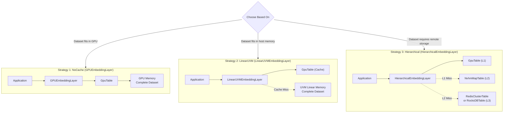
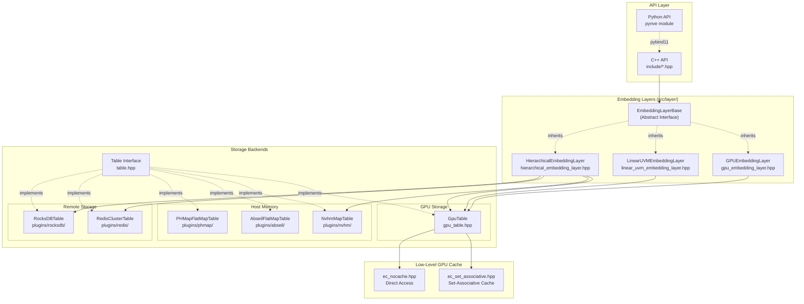
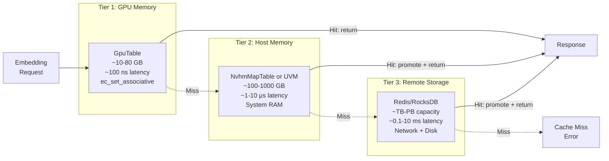

<!-- source: DeepWiki mcp.deepwiki.com · repo NVIDIA/nv-embedding-cache · page 1 Overview · fetched 2026-10-26 -->

# Overview

<details>
<summary>Relevant source files</summary>

The following files were used as context for generating this wiki page:

- [CHANGELOG.md](CHANGELOG.md)
- [README.md](README.md)

</details>


## Purpose and Scope

This document provides a high-level introduction to the **NV Embedding Cache SDK**, a domain-specific software development kit designed for high-performance embedding lookup operations in recommender systems. The SDK addresses the challenge of serving large embedding tables that exceed GPU memory capacity by implementing multi-tier caching strategies with optimized CUDA kernels.

This overview covers the SDK's purpose, core architecture, and main usage patterns. For detailed installation instructions, see [Installation and Setup](#2). For in-depth explanations of caching strategies, see [Cache Configuration Strategies](#1.2). For architectural details, see [System Architecture](#1.3).

**Sources:** [README.md:1-18]()

## The Problem: Embedding Lookup at Scale

Recommender systems typically use embedding tables to represent categorical features (users, items, contexts) as dense vectors. In production systems, these tables can contain billions of entries with embedding dimensions ranging from tens to hundreds of values. For example:

| Scenario | Table Size | Embedding Dim | Total Memory |
|----------|------------|---------------|--------------|
| Small catalog | 1M items | 128 | ~512 MB |
| Medium catalog | 100M items | 128 | ~50 GB |
| Large catalog | 1B items | 256 | ~1 TB |

Modern GPUs typically have 40-80 GB of memory, making it impossible to store large embedding tables entirely on-device. Traditional solutions either:
- Use CPU-only inference (too slow for low-latency serving)
- Partition embeddings across multiple GPUs (increases cost and complexity)
- Use naive host-to-device transfers (introduces significant PCIe bottlenecks)

The NV Embedding Cache SDK solves this by implementing intelligent multi-tier caching that exploits the power-law distribution of embedding access patterns common in recommender workloads.

**Sources:** [README.md:7-17]()

## Solution: Three Caching Strategies

The SDK provides three distinct caching strategies, each optimized for different deployment scenarios:



**Diagram: Three Caching Strategies and Decision Criteria**

### Strategy Comparison

| Strategy | Class | Dataset Size | Latency | Complexity | Use Case |
|----------|-------|--------------|---------|------------|----------|
| NoCache | `GPUEmbeddingLayer` | < GPU RAM | Lowest (~μs) | Simple | Small models, inference |
| LinearUVM | `LinearUVMEmbeddingLayer` | < Host RAM | Medium (~10μs) | Moderate | Single-node deployments |
| Hierarchical | `HierarchicalEmbeddingLayer` | Unlimited | Variable | Complex | Distributed systems |

**Sources:** [README.md:11-15](), [CHANGELOG.md:7-18]()

## Core Components

The SDK architecture consists of three primary layers: the API layer, the embedding layer, and the storage layer.



**Diagram: Core Component Architecture with File References**

### Component Descriptions

**Embedding Layers** (`src/layer/`)
- `EmbeddingLayerBase`: Abstract base class defining the common interface for all embedding layers
- `GPUEmbeddingLayer`: Stores all embeddings in GPU memory with optional caching
- `LinearUVMEmbeddingLayer`: Uses CUDA Unified Virtual Memory (UVM) with GPU-side caching
- `HierarchicalEmbeddingLayer`: Implements multi-tier caching across GPU, host, and remote storage

**Storage Backends**
- `GpuTable` (`src/table/gpu_table.hpp`): GPU-resident hash table using set-associative cache
- Host Tables: System memory implementations using various hash map libraries
- Remote Tables: Distributed storage using Redis clusters or RocksDB

**Low-Level Cache** (`src/ec/`)
- `ec_set_associative.hpp`: Set-associative cache implementation optimized for power-law distributions
- `ec_nocache.hpp`: Direct access implementation bypassing cache logic

**Sources:** [README.md:11-15](), Diagram 1 from provided context, Diagram 4 from provided context

## Key Features

### Performance Optimizations
- **Custom CUDA Kernels**: Specialized kernels for query, update, and gather operations with support for multiple tile sizes
- **Set-Associative Cache**: GPU cache design optimized for power-law access patterns common in recommender systems
- **Zero-Copy UVM**: Leverages CUDA Unified Virtual Memory for transparent host-device memory management
- **Asynchronous Operations**: Non-blocking operations using CUDA streams and execution contexts

### Flexibility
- **Plugin Architecture**: Extensible storage backend system supporting custom table implementations
- **Multiple Eviction Policies**: Configurable cache eviction (LRU, LFU, Random) for different workload characteristics
- **Multi-GPU Support**: Distribute embeddings across multiple GPUs within a node or across nodes
- **Language Bindings**: Native C++ API and Python bindings via `pybind11`

### Production Features
- **Checkpointing**: Save and restore cache state for fault tolerance (see [Checkpointing](#8.5))
- **Thread Safety**: Modify contexts and synchronization primitives for concurrent access
- **Triton Integration**: Deployment samples for NVIDIA Triton Inference Server (see [Triton Integration](#8.6))
- **Performance Metrics**: Built-in instrumentation for cache hit rates, throughput, and latency

**Sources:** [CHANGELOG.md:7-18](), [README.md:7-9]()

## Memory Hierarchy

The SDK implements a three-tier memory hierarchy that balances latency, capacity, and cost:



**Diagram: Three-Tier Memory Hierarchy and Lookup Flow**

Each tier represents a trade-off between capacity and performance:
- **Tier 1 (GPU)**: Highest performance, limited capacity. Typically stores the hottest 1-10% of embeddings.
- **Tier 2 (Host)**: Medium performance, moderate capacity. Stores warm embeddings or serves as overflow for Tier 1.
- **Tier 3 (Remote)**: Lowest performance, unlimited capacity. Stores the complete embedding table.

Not all configurations use all tiers. `GPUEmbeddingLayer` uses only Tier 1, `LinearUVMEmbeddingLayer` uses Tiers 1-2, and `HierarchicalEmbeddingLayer` can use all three tiers.

**Sources:** Diagram 2 from provided context, [README.md:11-17]()

## Use Cases

### When to Use Each Strategy

**GPUEmbeddingLayer (NoCache)**
- Embedding table fits entirely in GPU memory
- Lowest latency requirement (<10 μs)
- Simple deployment without host/remote storage
- Example: Small item catalogs, user embeddings for specific segments

**LinearUVMEmbeddingLayer**
- Embedding table fits in host memory but exceeds GPU capacity
- Single-node deployment
- Moderate latency tolerance (~10-50 μs)
- Example: Medium-sized catalogs on high-memory servers

**HierarchicalEmbeddingLayer**
- Embedding table exceeds single-node capacity
- Distributed deployment across multiple nodes
- Can tolerate variable latency (10 μs - 10 ms)
- Need for centralized parameter server
- Example: Large-scale catalogs with billions of embeddings

### Integration Scenarios

The SDK integrates with existing ML frameworks and infrastructure:

| Integration | Description | Reference |
|-------------|-------------|-----------|
| PyTorch | Direct tensor interop via DLPack | [PyTorch Integration](#5.2) |
| Triton | Production serving with model ensembles | [Triton Integration](#8.6) |
| Redis | Distributed parameter server | [Redis Plugin](#6.2) |
| Custom Training | Import from Dynamic Embedding SDK | [Examples](#9.5) |

**Sources:** [README.md:11-15](), [CHANGELOG.md:10-11]()

## Quick Start

To begin using the NV Embedding Cache SDK:

1. **Installation**: Follow [Installation and Setup](#2) to build from source or use the provided Docker container
2. **Choose Strategy**: Review [Cache Configuration Strategies](#1.2) to select the appropriate caching approach
3. **Basic Usage**: See [Quick Start Guide](#1.1) for a minimal working example
4. **API Reference**: 
   - C++ developers: [C++ API Reference](#4)
   - Python developers: [Python API Reference](#5)
5. **Examples**: Explore [Examples and Samples](#9) for complete code samples

### Minimal Python Example

```python
from nve import NVEmbedding

# Create GPU-only embedding layer
embedding = NVEmbedding(
    num_embeddings=1000000,
    embedding_dim=128,
    cache_type="NoCache"  # All data in GPU
)

# Lookup embeddings
indices = torch.tensor([1, 42, 999], device='cuda')
vectors = embedding(indices)  # Shape: (3, 128)
```

For more examples, see [Basic PyTorch Example](#9.2) and [samples/pytorch/simple_sample/](samples/pytorch/simple_sample/).

**Sources:** [README.md:19-70]()

## Version and Support

**Current Version**: 26.03.0

Recent releases:
- **v26.03**: Multi-GPU support, Triton Inference Server integration, checkpointing, kernel optimizations
- **v26.02.1**: NVHM submodule integration
- **v26.02**: Initial public release

For detailed release notes, see [Release History](#13).

For reporting issues or contributing, see [Contributing](#12).

**Sources:** [README.md:5](), [CHANGELOG.md:7-28]()

---

**Next Steps:**
- Follow the [Quick Start Guide](#1.1) for hands-on usage
- Review [Cache Configuration Strategies](#1.2) to understand when to use each approach
- Explore [System Architecture](#1.3) for architectural deep-dive

---

