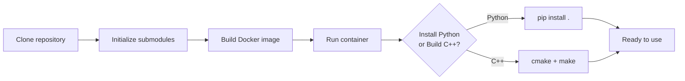
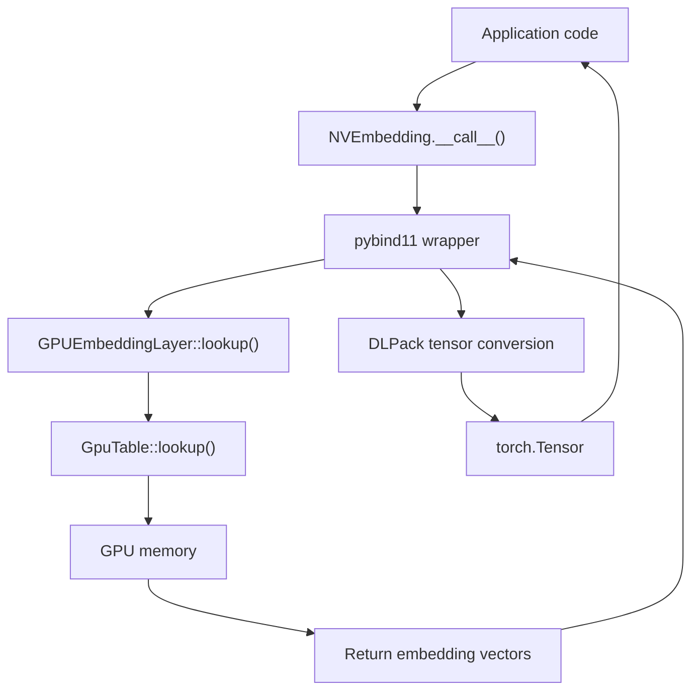
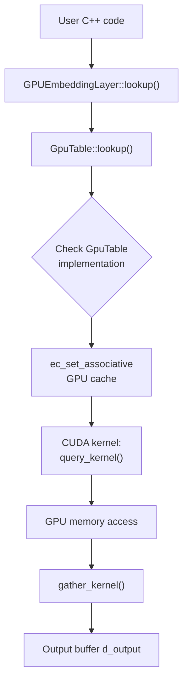
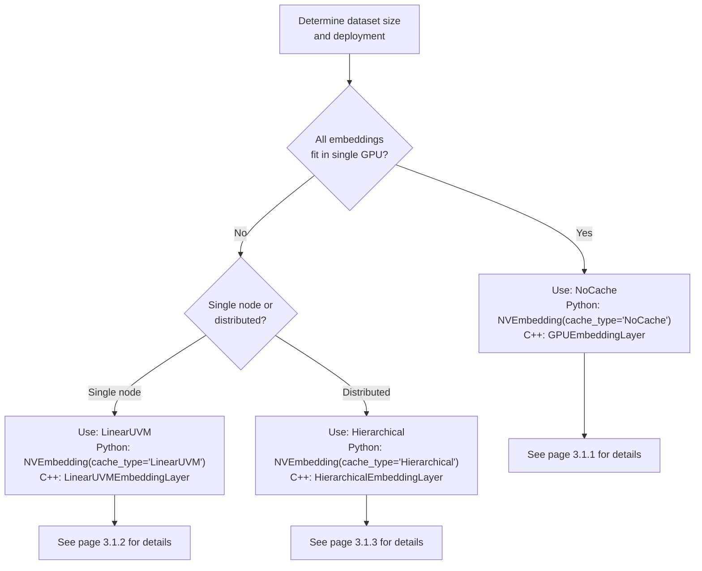

<!-- source: DeepWiki mcp.deepwiki.com · repo NVIDIA/nv-embedding-cache · page 1.1 Quick Start Guide · fetched 2026-10-26 -->

# Quick Start Guide

<details>
<summary>Relevant source files</summary>

The following files were used as context for generating this wiki page:

- [README.md](README.md)
- [docs/samples.md](docs/samples.md)

</details>


**Purpose**: This guide provides step-by-step instructions to install NV Embedding Cache and run your first embedding lookup operation. It covers prerequisites, installation via Docker or source build, and minimal working examples in both C++ and Python.

**Scope**: This guide focuses on getting a working installation and running basic examples. For in-depth understanding of cache configuration strategies, see [Cache Configuration Strategies](#1.2). For architectural details, see [System Architecture](#1.3). For complete API documentation, see [C++ API Reference](#4) or [Python API Reference](#5).

---

## Prerequisites

The following requirements must be satisfied before installation:

| Component | Minimum Version | Notes |
|-----------|----------------|-------|
| C++ Compiler | C++17 capable | Tested with GCC 13.3 and Clang 20.1 |
| CUDA | 12.8+ | Earlier versions work with minor modifications |
| CMake | 3.18+ | Required for building from source |
| Python | 3.10+ | Required for Python bindings |
| PyTorch | Latest stable | Required for Python integration |
| Redis | 7.0.15+ | Optional, used for hierarchical caching tests |

The provided `Dockerfile` satisfies all prerequisites. Using Docker is the recommended installation method.

**Sources**: [README.md:21-27]()

---

## Installation Process

### Method 1: Docker Installation (Recommended)

The Docker-based installation provides a pre-configured environment with all dependencies.



**Step 1**: Clone the repository and initialize submodules

```bash
git clone git@github.com:NVIDIA/nv-embedding-cache.git
cd nv-embedding-cache
git submodule update --init --recursive
```

The submodules contain third-party dependencies (googletest, pybind11, redis-plus-plus, etc.). See [Third-Party Dependencies](#2.4) for details.

**Step 2**: Build the Docker image

```bash
docker build -t nve \
  --build-arg START_DIR=$(pwd) \
  --build-arg UID=$(id -u) \
  --build-arg UNAME=$(id -u -n) \
  --build-arg GID=$(id -g) \
  --build-arg GNAME=$(id -g -n) .
```

This creates an image named `nve` with user permissions matching your host system.

**Step 3**: Launch the container

```bash
docker run --cap-add=ALL --net=host --ipc=host \
  --gpus all -it --rm -v $(pwd):$(pwd) nve
```

The container requires `--gpus all` for GPU access and mounts the repository directory for development.

**Step 4**: Install Python bindings (inside container)

```bash
pip install .
```

This builds `libnve-common.so`, plugin libraries, and the Python `nve` package, installing them to the `build/` directory.

**Sources**: [README.md:33-47]()

---

### Method 2: Building C++ from Source (Advanced)

For users who need to build C++ libraries and samples without Python:

```bash
mkdir build_dir
cd build_dir
cmake ..
make all -j
cd -
```

This produces:
- Core library: `build_dir/lib/libnve-common.so`
- Plugin libraries: `build_dir/lib/libnve-plugin-*.so`
- Sample executables: `build_dir/bin/*`
- Test executables: `build_dir/bin/*_test`

For detailed CMake configuration options, see [CMake Configuration Options](#10.1).

**Sources**: [README.md:48-55]()

---

## Basic Usage Examples

### Understanding the Three Configurations

NV Embedding Cache supports three configurations based on where embeddings are stored:

| Configuration | Python Class | C++ Class | Use Case |
|---------------|-------------|-----------|----------|
| **NoCache** | `NVEmbedding(cache_type="NoCache")` | `GPUEmbeddingLayer` | All embeddings fit in GPU memory |
| **LinearUVM** | `NVEmbedding(cache_type="LinearUVM")` | `LinearUVMEmbeddingLayer` | Embeddings exceed GPU memory, single node |
| **Hierarchical** | `NVEmbedding(cache_type="Hierarchical")` | `HierarchicalEmbeddingLayer` | Distributed deployment with remote parameter server |

For detailed comparison and selection criteria, see [Cache Configuration Strategies](#1.2).

**Sources**: [README.md:11-15]()

---

### Python Quick Start

The simplest way to use NV Embedding Cache is through the Python API with the `NoCache` configuration.

#### Minimal Working Example

```python
import torch
from nve import NVEmbedding

# Create embedding layer (all data in GPU)
num_embeddings = 100000
embedding_dim = 128

embedding = NVEmbedding(
    num_embeddings=num_embeddings,
    embedding_dim=embedding_dim,
    cache_type="NoCache",  # All embeddings in GPU memory
    device="cuda:0"
)

# Initialize with random weights
embedding.weight.uniform_(-1, 1)

# Lookup embeddings
indices = torch.tensor([0, 1, 42, 999], device="cuda:0")
output = embedding(indices)  # Returns: [4, 128] tensor

print(f"Output shape: {output.shape}")
print(f"Output device: {output.device}")
```

This example demonstrates:
1. Creating a `NVEmbedding` instance with `NoCache` configuration
2. Initializing embedding weights
3. Performing a lookup operation with a batch of indices



**Code Entities in Flow**:
- `NVEmbedding`: Python class in Python bindings (pybind11 wrapper)
- `GPUEmbeddingLayer`: C++ class implementing all-GPU storage
- `GpuTable`: C++ class for GPU hash table operations
- `DLPack`: Zero-copy tensor exchange format

For a complete working example, see [samples/pytorch/simple_sample/]().

**Sources**: [README.md:12](), [docs/samples.md:13]()

---

### C++ Quick Start

For applications requiring direct C++ integration, the API provides similar functionality.

#### Minimal Working Example

```cpp
#include "nve/embedding_layer/gpu_embedding_layer.hpp"
#include <cuda_runtime.h>

// Configuration
const size_t num_embeddings = 100000;
const size_t embedding_dim = 128;
const size_t batch_size = 4;

// Create embedding layer
nve::GPUEmbeddingLayer<float> layer(
    num_embeddings,
    embedding_dim,
    0  // GPU device ID
);

// Allocate and initialize embedding data
std::vector<float> embedding_data(num_embeddings * embedding_dim);
// ... initialize embedding_data ...

// Upload to GPU
layer.load(embedding_data.data());

// Prepare lookup indices on GPU
size_t* d_indices;
cudaMalloc(&d_indices, batch_size * sizeof(size_t));
size_t h_indices[] = {0, 1, 42, 999};
cudaMemcpy(d_indices, h_indices, batch_size * sizeof(size_t), 
           cudaMemcpyHostToDevice);

// Prepare output buffer
float* d_output;
cudaMalloc(&d_output, batch_size * embedding_dim * sizeof(float));

// Perform lookup
layer.lookup(d_indices, batch_size, d_output, 0);  // stream 0

// Results are now in d_output
```



**Code Entities in Flow**:
- `GPUEmbeddingLayer<T>`: Template class defined in [include/nve/embedding_layer/gpu_embedding_layer.hpp]()
- `GpuTable`: Implements GPU hash table, defined in [include/nve/table/gpu_table.hpp]()
- `ec_set_associative`: Low-level GPU cache structure
- `query_kernel()`, `gather_kernel()`: CUDA kernels for lookup operations

For a complete working example, see [samples/simple_cpp/]().

**Sources**: [README.md:12](), [docs/samples.md:11]()

---

## Verification

### Running Sample Programs

After installation, verify the setup by running the provided samples:

**Python sample**:
```bash
cd samples/pytorch/simple_sample
python simple_gpu_embedding.py
```

Expected output: Successfully creates embedding layer and performs lookups without errors.

**C++ sample** (if built from source):
```bash
cd build_dir
./bin/simple_cpp
```

Expected output: Embedding lookup results printed to stdout.

**Sources**: [docs/samples.md:6-16]()

---

### Running Tests

To verify the installation more thoroughly:

**Python tests**:
```bash
pytest tests/python/
```

**C++ tests** (if built from source):
```bash
cd build_dir
ctest --output-on-failure
```

For detailed testing documentation, see [Testing](#11).

---

## Quick Configuration Reference

### Selecting the Right Configuration



| Metric | NoCache | LinearUVM | Hierarchical |
|--------|---------|-----------|--------------|
| **Lookup latency** | ~1 μs | ~10 μs (cache hit)<br/>~100 μs (cache miss) | ~1 μs (L1 hit)<br/>~10 μs (L2 hit)<br/>~1-10 ms (L3 fetch) |
| **Capacity** | GPU VRAM only (~24-80 GB) | Host memory (~100s GB) | Unlimited (remote storage) |
| **Setup complexity** | Minimal | Low | High (requires Redis/RocksDB) |
| **Best for** | Small datasets, highest performance | Medium datasets, single node | Large datasets, multi-node |

**Sources**: [README.md:11-17](), High-level system diagrams

---

## Next Steps

After completing this quick start:

1. **Understand configurations**: Read [Cache Configuration Strategies](#1.2) to select the optimal configuration for your workload
2. **Learn architecture**: Review [System Architecture](#1.3) to understand how components interact
3. **Explore advanced features**: See [Advanced Topics](#8) for multi-GPU support, checkpointing, and performance tuning
4. **Study examples**: Review [Examples and Samples](#9) for more complex usage patterns
5. **API reference**: Consult [C++ API Reference](#4) or [Python API Reference](#5) for complete documentation

---

## Common Issues

| Issue | Solution |
|-------|----------|
| `ImportError: cannot import name 'NVEmbedding'` | Ensure `pip install .` completed successfully. Check `build/` directory for artifacts. |
| `CUDA out of memory` | Reduce `num_embeddings` or use `LinearUVM`/`Hierarchical` configuration instead of `NoCache`. |
| `CMake cannot find CUDA` | Set `CUDA_HOME` environment variable or specify `-DCMAKE_CUDA_COMPILER=/path/to/nvcc`. |
| Docker build fails | Verify NVIDIA Container Toolkit is installed: `nvidia-docker --version`. |

For comprehensive troubleshooting, see [Troubleshooting](#15).

**Sources**: [README.md:19-30]()

---

