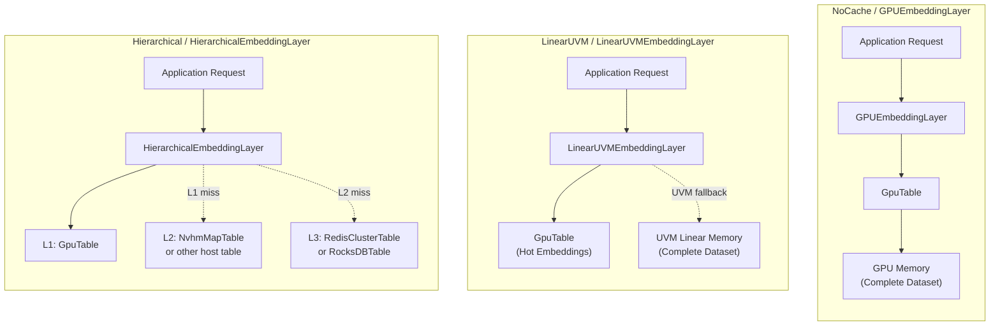
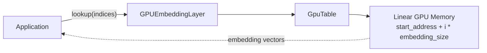
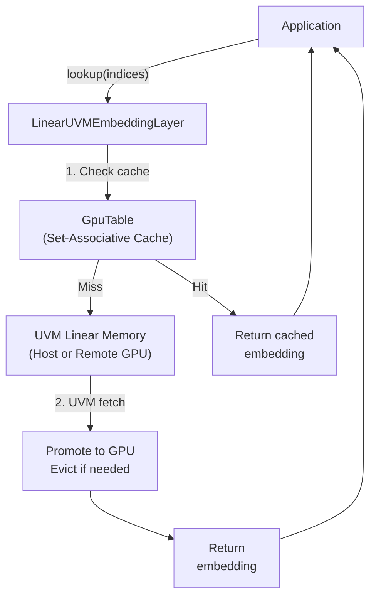
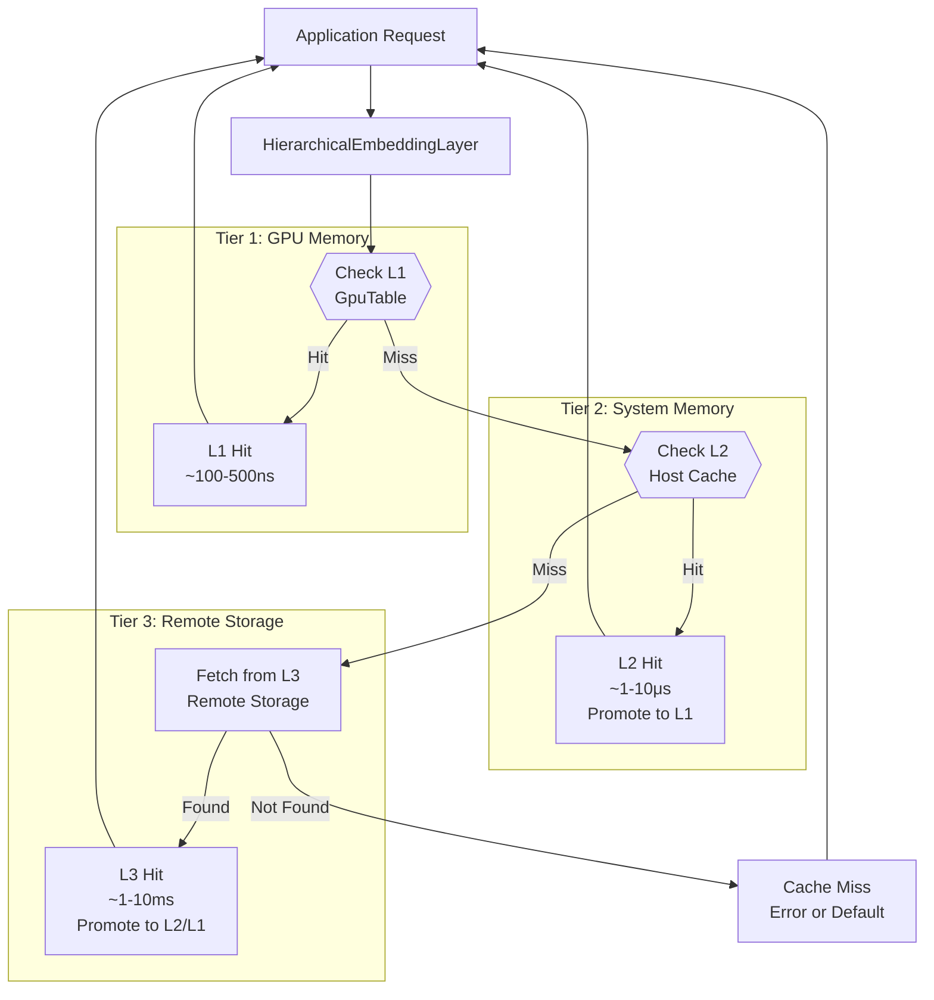
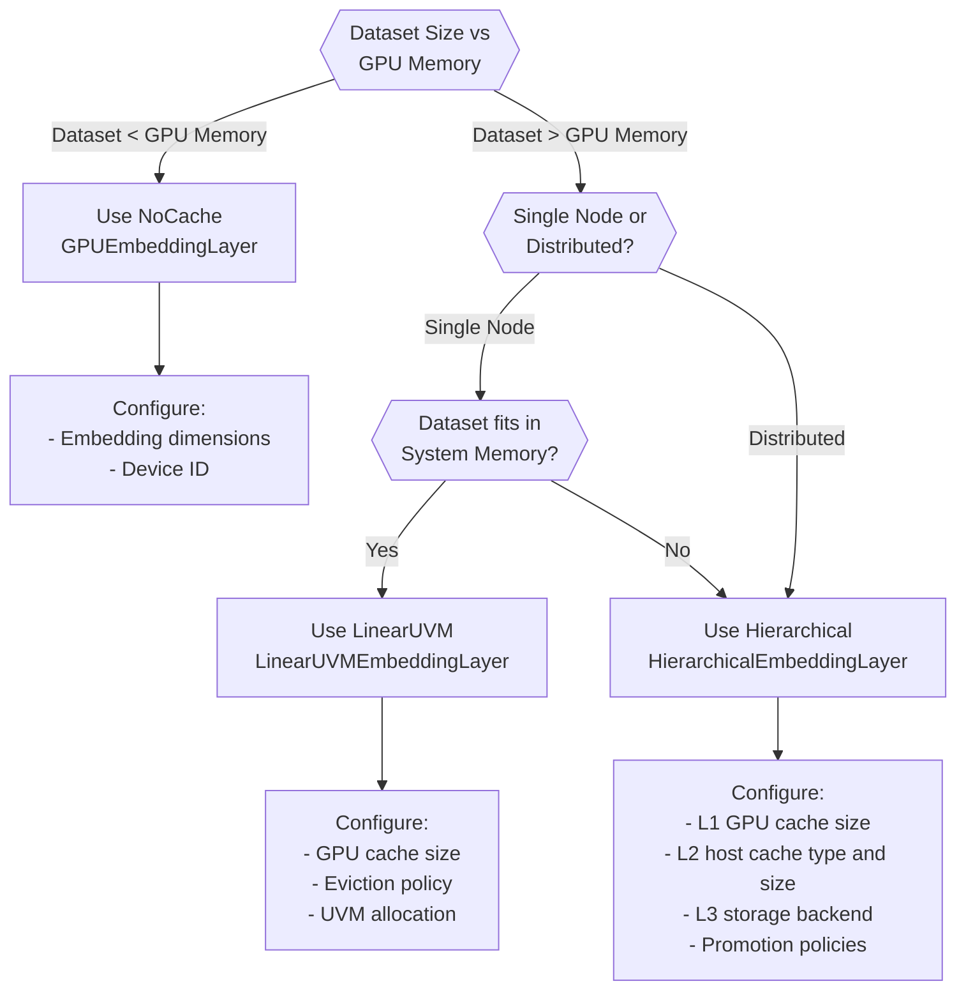

<!-- source: DeepWiki mcp.deepwiki.com · repo NVIDIA/nv-embedding-cache · page 1.2 Cache Configuration Strategies · fetched 2026-10-26 -->

# Cache Configuration Strategies

<details>
<summary>Relevant source files</summary>

The following files were used as context for generating this wiki page:

- [README.md](README.md)
- [docs/advanced.md](docs/advanced.md)

</details>


## Purpose and Scope

This document describes the three primary caching strategies available in NV Embedding Cache SDK and provides guidance on selecting the appropriate strategy for your deployment scenario. Each strategy represents a different trade-off between memory capacity, lookup latency, and architectural complexity.

For implementation details of the individual embedding layers, see [Embedding Layers](#3.1). For memory hierarchy concepts, see [Memory Hierarchy](#3.3). For storage backend options, see [Tables and Storage Backends](#3.2).

Sources: [README.md:11-17]()

---

## Strategy Overview

NV Embedding Cache SDK provides three distinct configuration strategies to accommodate different dataset sizes and deployment architectures:

| Strategy | Python Class | C++ Class | Primary Use Case | Memory Tiers |
|----------|-------------|-----------|------------------|--------------|
| **NoCache** | `NVEmbedding(cache_type="NoCache")` | `GPUEmbeddingLayer` | Dataset fits in GPU memory | GPU only |
| **LinearUVM** | `NVEmbedding(cache_type="LinearUVM")` | `LinearUVMEmbeddingLayer` | Dataset exceeds GPU but fits in system memory | GPU cache + Host linear memory |
| **Hierarchical** | `NVEmbedding(cache_type="Hierarchical")` | `HierarchicalEmbeddingLayer` | Large-scale distributed deployments | GPU cache + Host cache + Remote storage |

Sources: [README.md:11-17]()

---

## Strategy Comparison

### Memory Architecture Comparison



**Memory Hierarchy Across Strategies**

Sources: [README.md:11-17]()

---

### Characteristics Comparison

| Characteristic | NoCache | LinearUVM | Hierarchical |
|----------------|---------|-----------|--------------|
| **Lookup Latency** | ~100-500 ns | ~1-10 μs | ~100 ns - 10 ms (tier-dependent) |
| **Memory Capacity** | Limited to GPU DRAM | Limited to system DRAM | Effectively unlimited |
| **Architectural Complexity** | Minimal | Low | High |
| **Cache Management** | None required | Automatic via UVM | Explicit multi-tier |
| **Distributed Support** | Single GPU | Single node (multi-GPU) | Multi-node clusters |
| **Typical Dataset Size** | < 40 GB (A100 80GB) | < 2 TB (system memory) | > 2 TB |
| **Configuration Complexity** | Simple | Medium | Complex |
| **Failure Modes** | OOM crash | OOM crash or thrashing | Network/storage failures |

Sources: [README.md:11-17](), High-level diagrams from context

---

## NoCache / GPUEmbeddingLayer Strategy

### Architecture

The NoCache strategy stores the complete embedding table in contiguous GPU memory without any caching mechanism. The Python API uses `cache_type="NoCache"` and the C++ implementation is `GPUEmbeddingLayer`.



**NoCache Strategy Data Flow**

### Key Characteristics

- **Memory Layout**: All embeddings stored in linear GPU memory where embedding `i` is at `start_address + i * embedding_size`
- **No Cache Logic**: Direct memory access without cache eviction or promotion
- **Best Performance**: Minimal overhead for datasets that fit entirely in GPU memory
- **Predictable Latency**: Consistent lookup times with no cache miss penalty

### When to Use

Use the NoCache strategy when:
- Complete embedding table fits in available GPU memory
- Predictable, minimal latency is critical
- Simplicity of deployment is preferred
- Single-GPU inference workloads

### Configuration Example

**Python:**
```python
from pynve import NVEmbedding

embedding = NVEmbedding(
    num_embeddings=1000000,      # 1M embeddings
    embedding_dim=128,            # 128-dimensional vectors
    cache_type="NoCache",         # Use GPU-only strategy
    device_id=0
)
```

**C++:**
Reference: `GPUEmbeddingLayer` class and `GpuTable` implementation

Sources: [README.md:12]()

---

## LinearUVM / LinearUVMEmbeddingLayer Strategy

### Architecture

The LinearUVM strategy uses CUDA Unified Virtual Memory (UVM) to transparently manage a GPU cache backed by system memory. The Python API uses `cache_type="LinearUVM"` and the C++ implementation is `LinearUVMEmbeddingLayer`.



**LinearUVM Strategy Cache Lookup Flow**

### Key Characteristics

- **Automatic Caching**: GPU cache automatically managed by the embedding layer
- **UVM Backing Store**: Complete dataset in system memory or distributed across GPUs via UVM
- **Cache Promotion**: Frequently accessed embeddings automatically migrate to GPU cache
- **Transparent Fallback**: Cache misses transparently fetch from backing memory
- **Single Node**: Designed for single-node multi-GPU configurations

### Memory Management

The LinearUVM strategy employs a two-tier hierarchy:

1. **L1 (GPU Cache)**: `GpuTable` implementing set-associative cache with configurable eviction policy
2. **L2 (Linear Memory)**: UVM-allocated memory accessible from GPU but physically in system RAM or remote GPU memory

Linear memory organization ensures that embedding `i` can be computed as:
```
address = start_address + i * embedding_size
```

This property is critical for efficient UVM page fault handling and bulk operations.

### When to Use

Use the LinearUVM strategy when:
- Dataset exceeds single GPU memory capacity
- Dataset fits in aggregate system memory
- Single-node deployment (possibly multi-GPU)
- Access patterns exhibit temporal locality
- Acceptable to trade some latency for capacity

### Configuration Considerations

- **Cache Size**: Configure GPU cache size based on working set characteristics
- **Eviction Policy**: Choose LRU, LFU, or other policies based on access patterns
- **UVM Allocation**: Consider page size and prefetching hints for optimal performance

Sources: [README.md:13](), [README.md:17]()

---

## Hierarchical / HierarchicalEmbeddingLayer Strategy

### Architecture

The Hierarchical strategy implements a three-tier memory hierarchy with explicit cache management at each level. The Python API uses `cache_type="Hierarchical"` and the C++ implementation is `HierarchicalEmbeddingLayer`.



**Hierarchical Strategy Multi-Tier Lookup**

### Tier Configuration

| Tier | Implementation Options | Capacity | Latency | Use Case |
|------|----------------------|----------|---------|----------|
| **L1 (GPU)** | `GpuTable` | GBs | 100-500 ns | Hottest embeddings |
| **L2 (Host)** | `NvhmMapTable`, `AbseilFlatMapTable`, `PHMapFlatMapTable`, `LinearHostTable` | 10-100s GB | 1-10 μs | Warm embeddings |
| **L3 (Remote)** | `RedisClusterTable`, `RocksDBTable` | TBs | 1-10 ms | Complete dataset |

### Key Characteristics

- **Explicit Tier Management**: Application controls which tiers are active and how they're configured
- **Cache Promotion**: Cache misses trigger promotion of embeddings to higher (faster) tiers
- **Distributed Storage**: L3 tier supports distributed parameter servers (Redis, RocksDB)
- **Plugin Architecture**: L2 and L3 tiers use plugin-based table implementations
- **Configurable Eviction**: Each tier can use different eviction policies

### Storage Backend Selection

**L2 Host Memory Options:**

- `NvhmMapTable`: NVIDIA GPU-accelerated hash map using `nvHashMap` library (requires NVHM plugin)
- `AbseilFlatMapTable`: CPU-based hash map using Abseil library
- `PHMapFlatMapTable`: CPU-based parallel hash map
- `LinearHostTable`: Linear memory layout (similar to LinearUVM but CPU-managed)

**L3 Remote Storage Options:**

- `RedisClusterTable`: Distributed Redis cluster for high-throughput scenarios
- `RocksDBTable`: Embedded persistent key-value store for single-node with disk persistence

### When to Use

Use the Hierarchical strategy when:
- Dataset size exceeds system memory capacity
- Multi-node distributed deployment required
- Embeddings stored in external parameter server
- Access patterns follow power-law distribution (few hot embeddings, long tail of cold)
- Willing to manage complexity for maximum capacity

### Configuration Example

**Python:**
```python
from pynve import NVEmbedding

embedding = NVEmbedding(
    num_embeddings=10000000000,   # 10B embeddings
    embedding_dim=128,
    cache_type="Hierarchical",
    gpu_cache_capacity=1000000,   # 1M embeddings in L1
    host_cache_capacity=10000000, # 10M embeddings in L2
    device_id=0,
    # L3 configured via table parameters
)
```

**C++:**
Reference: `HierarchicalEmbeddingLayer` class

Sources: [README.md:14-15]()

---

## Strategy Selection Guide

### Decision Flowchart



**Strategy Selection Decision Tree**

Sources: High-level diagrams from context

---

## Performance Considerations

### Latency Characteristics

The three strategies exhibit different latency profiles:

**NoCache:**
- Constant latency (~100-500 ns)
- No cache miss penalty
- Best for latency-critical applications

**LinearUVM:**
- L1 hit: ~100-500 ns
- L1 miss: ~1-10 μs (UVM page fault)
- Variable latency depending on cache hit rate
- UVM overhead for first access to pages

**Hierarchical:**
- L1 hit: ~100-500 ns
- L2 hit: ~1-10 μs
- L3 hit: ~1-10 ms (network + storage)
- Highly variable latency depending on access patterns
- Promotion overhead on misses

### Memory Overhead

| Component | NoCache | LinearUVM | Hierarchical |
|-----------|---------|-----------|--------------|
| **Embedding Storage** | GPU only | UVM (Host/GPU) | L3 storage |
| **Cache Metadata** | None | GPU cache structures | L1 + L2 cache structures |
| **Lookup Buffers** | Minimal | Per-context buffers | Per-context per-tier buffers |
| **Thread Pools** | None | None | L2/L3 async operations |

### Throughput Characteristics

- **NoCache**: Limited by GPU memory bandwidth (~1-2 TB/s on A100)
- **LinearUVM**: Limited by cache hit rate and UVM transfer bandwidth
- **Hierarchical**: Depends on tier hit rates; L1 hits critical for performance

Sources: High-level diagrams and system architecture context

---

## Code Entity Reference

### Python API

| Cache Strategy | Python Parameter | Class/Function |
|----------------|------------------|----------------|
| NoCache | `cache_type="NoCache"` | `NVEmbedding` constructor parameter |
| LinearUVM | `cache_type="LinearUVM"` | `NVEmbedding` constructor parameter |
| Hierarchical | `cache_type="Hierarchical"` | `NVEmbedding` constructor parameter |

### C++ API

| Cache Strategy | C++ Class | Header File |
|----------------|-----------|-------------|
| NoCache | `GPUEmbeddingLayer` | `include/gpu_embedding_layer.hpp` |
| LinearUVM | `LinearUVMEmbeddingLayer` | `include/linear_uvm_embedding_layer.hpp` |
| Hierarchical | `HierarchicalEmbeddingLayer` | `include/hierarchical_embedding_layer.hpp` |

### Storage Backend Classes

| Backend Type | Class Name | Plugin Library |
|--------------|------------|----------------|
| GPU Cache | `GpuTable` | Core library (always available) |
| NVHM Host Cache | `NvhmMapTable` | `libnve-plugin-nvhm.so` |
| Abseil Host Cache | `AbseilFlatMapTable` | `libnve-plugin-abseil.so` |
| PHMap Host Cache | `PHMapFlatMapTable` | `libnve-plugin-phmap.so` |
| Redis Remote | `RedisClusterTable` | `libnve-plugin-redis.so` |
| RocksDB Remote | `RocksDBTable` | `libnve-plugin-rocksdb.so` |

Sources: [README.md:11-17]()

---

## Summary

NV Embedding Cache SDK provides three complementary caching strategies optimized for different deployment scenarios:

1. **NoCache/GPUEmbeddingLayer**: Maximum performance for datasets that fit in GPU memory
2. **LinearUVM/LinearUVMEmbeddingLayer**: Balanced approach for single-node deployments with datasets exceeding GPU capacity
3. **Hierarchical/HierarchicalEmbeddingLayer**: Maximum flexibility and capacity for distributed large-scale deployments

Selection depends primarily on dataset size relative to available memory resources and whether the deployment is single-node or distributed. The modular architecture allows switching between strategies with minimal code changes.

For detailed configuration parameters and API usage, see [Embedding Layers](#3.1). For multi-GPU and distributed setups, see [Multi-GPU Support](#8.1).

Sources: [README.md:11-17]()

---

