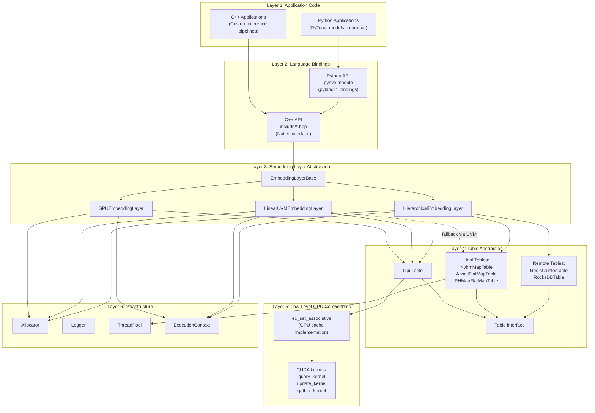
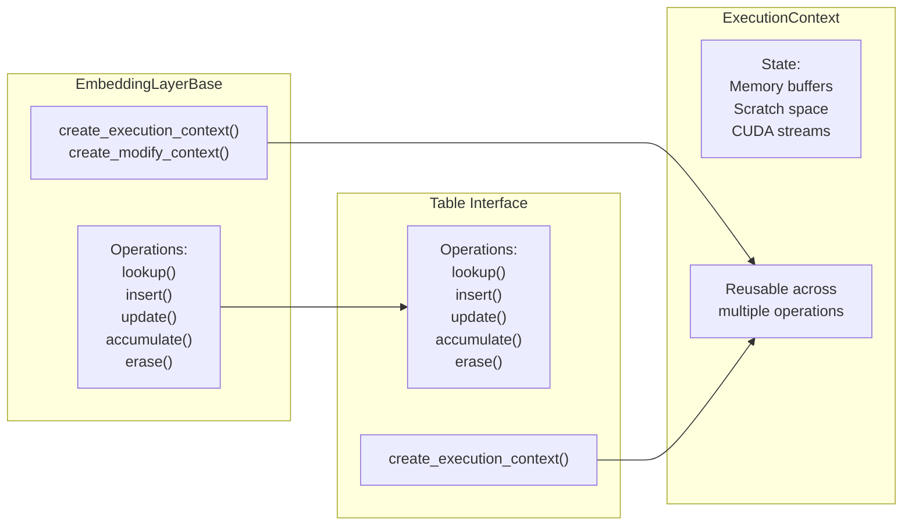
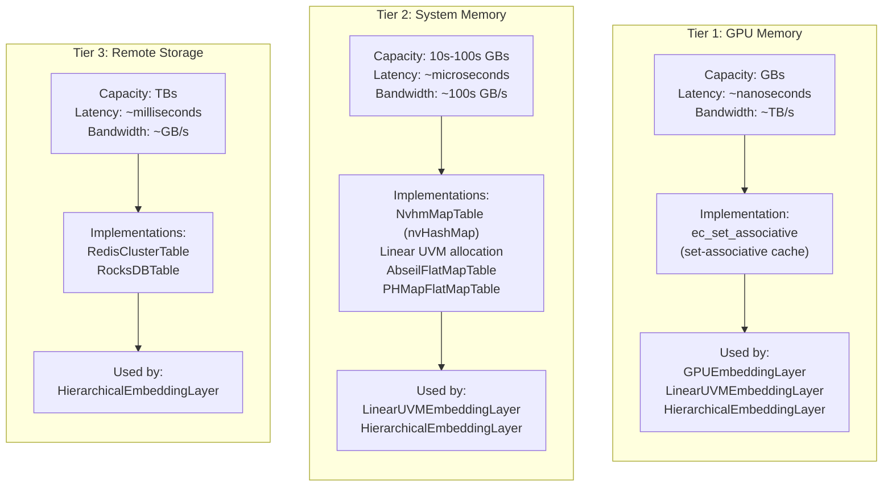
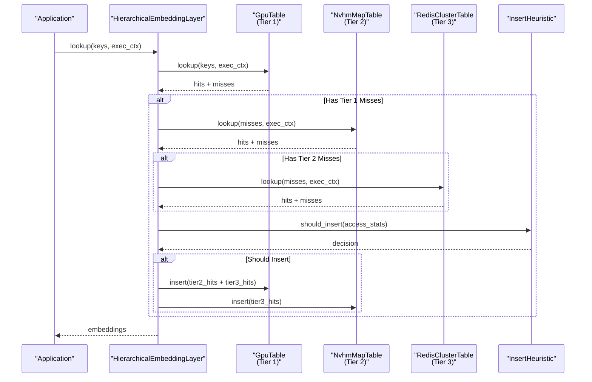
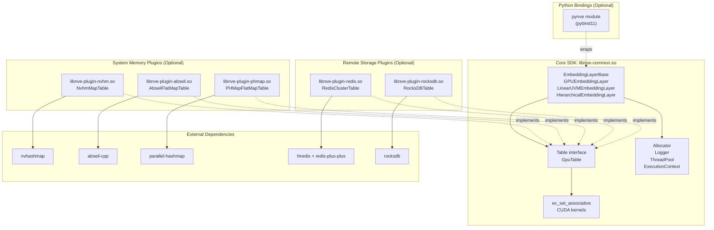
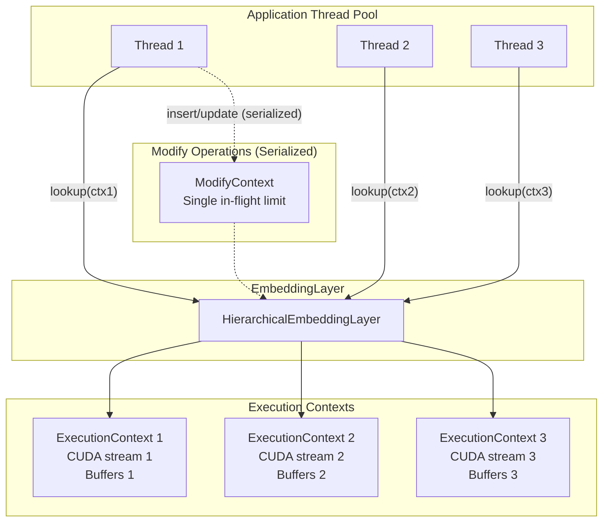
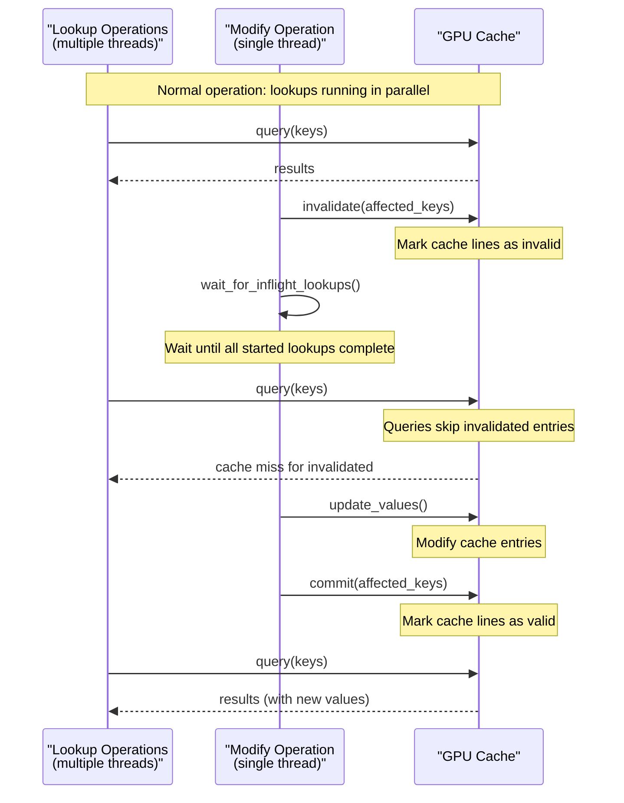
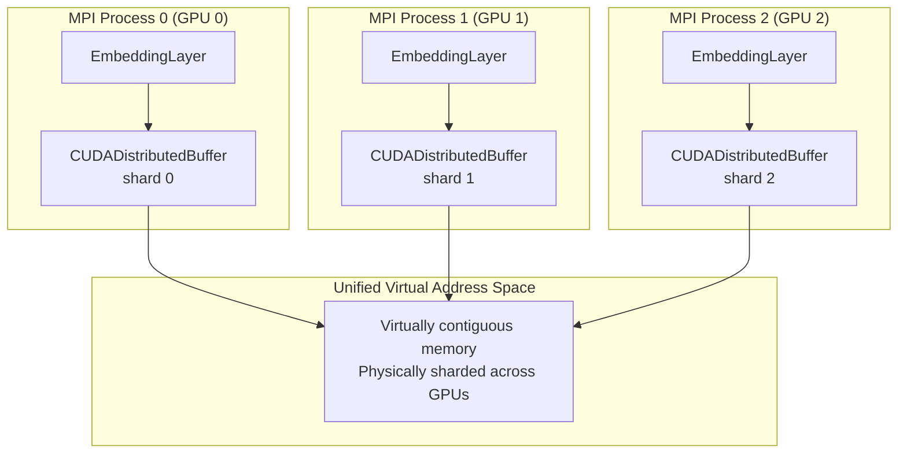
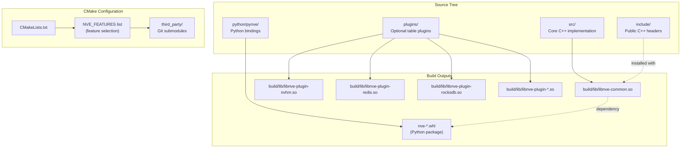

<!-- source: DeepWiki mcp.deepwiki.com · repo NVIDIA/nv-embedding-cache · page 1.3 System Architecture · fetched 2026-10-26 -->

# System Architecture

Relevant source files

The following files were used as context for generating this wiki page:

- [README.md](README.md)
- [docs/advanced.md](docs/advanced.md)
- [docs/cpp_api.md](docs/cpp_api.md)

## Purpose and Scope

This document provides a high-level architectural overview of the NV Embedding Cache SDK, showing how major components are organized into layers, how they interact, and the design patterns that enable extensibility and performance. This page focuses on the structural organization and component relationships rather than detailed usage patterns.

For specific usage instructions, see [Quick Start Guide](#1.1). For choosing the right caching strategy for your use case, see [Cache Configuration Strategies](#1.2). For detailed explanations of individual components, see [Core Concepts](#3).

---

## Architectural Layers

The NV Embedding Cache SDK is organized into distinct architectural layers, each with specific responsibilities. The system follows a modular design where higher layers depend on lower layers but not vice versa.

**Sources:** [include/embedding_layer.hpp](), [include/gpu_embedding_layer.hpp](), [include/linear_embedding_layer.hpp](), [include/hierarchical_embedding_layer.hpp](), [include/table.hpp](), [include/gpu_table.hpp](), [include/ecache/ec_set_associative.h]()

### Layer Descriptions

| Layer | Components | Responsibility |
|-------|-----------|----------------|
| **Application** | User code (Python/C++) | Define embedding lookup workflows and integrate with ML frameworks |
| **Language Bindings** | `pynve` module, C++ headers | Provide language-specific APIs with appropriate idioms |
| **Embedding Layers** | `GPUEmbeddingLayer`, `LinearUVMEmbeddingLayer`, `HierarchicalEmbeddingLayer` | Manage multi-tier caching strategies and coordinate operations across tables |
| **Tables** | `GpuTable`, `NvhmMapTable`, `RedisClusterTable`, etc. | Implement storage backends for specific memory locations |
| **GPU Components** | `ec_set_associative`, CUDA kernels | Provide optimized GPU cache and compute operations |
| **Infrastructure** | `Allocator`, `Logger`, `ExecutionContext`, `ThreadPool` | Supply cross-cutting concerns and execution management |

**Sources:** [docs/cpp_api.md:1-80](), [README.md:11-16]()

---

## Core Abstractions

The SDK is built around three primary abstractions that provide separation of concerns and enable flexible configurations.

**Sources:** [include/embedding_layer.hpp](), [include/table.hpp](), [include/execution_context.hpp](), [docs/cpp_api.md:14-39](), [docs/advanced.md:3-11]()

### EmbeddingLayerBase

The `EmbeddingLayerBase` class defines the interface for all embedding layers. It provides operations for reading and writing embedding data, managing cache residency, and creating execution contexts. Layers coordinate operations across one or more tables based on their caching strategy.

Key characteristics:
- Accepts inputs in either GPU or system memory
- Automatically handles memory transfers as needed
- Implements multi-tier caching logic
- Manages cache coherence across tiers

**Sources:** [include/embedding_layer.hpp](), [docs/cpp_api.md:14-39]()

### Table Interface

The `Table` interface represents a single storage location (GPU memory, system memory, or remote storage). Tables implement the same operations as layers but with stricter memory placement requirements—callers must ensure inputs are in the correct memory space.

Key characteristics:
- Single storage location per table
- Minimal memory copying (caller responsibility)
- Plugin-based extensibility
- Independent lifecycle management

**Sources:** [include/table.hpp](), [docs/cpp_api.md:45-58]()

### ExecutionContext

`ExecutionContext` objects encapsulate the state and resources needed for parallel execution of operations. Each context represents one independent execution unit with its own memory buffers, CUDA streams, and scratch space.

Key characteristics:
- Reusable across multiple operations
- Enables parallel execution (one context per parallel operation)
- Lazy memory allocation
- Must be destroyed before parent layer/table

**Sources:** [include/execution_context.hpp](), [docs/advanced.md:3-11]()

---

## Three-Tier Memory Hierarchy

The SDK implements a three-tier memory hierarchy optimized for the access patterns typical in recommender systems, where key distributions follow power-law distributions with high temporal locality.

**Sources:** [README.md:11-17](), [include/gpu_embedding_layer.hpp](), [include/linear_embedding_layer.hpp](), [include/hierarchical_embedding_layer.hpp]()

### Tier Selection by Layer Type

| Layer Type | Tier 1 (GPU) | Tier 2 (System) | Tier 3 (Remote) | Trade-off |
|------------|-------------|-----------------|-----------------|-----------|
| `GPUEmbeddingLayer` | All data | Not used | Not used | Fastest lookups, limited by GPU capacity |
| `LinearUVMEmbeddingLayer` | Cache | All data (UVM linear) | Not used | Automatic caching, single-node scale |
| `HierarchicalEmbeddingLayer` | Cache (hot) | Cache (warm) | All data | Maximum scale, distributed deployment |

**Sources:** [README.md:11-16](), [docs/cpp_api.md:19-22]()

### Cache Promotion Strategy

When a cache miss occurs at a faster tier, the data is fetched from a slower tier and optionally promoted (cached) in the faster tier for future access. The `InsertHeuristic` class controls when promotion occurs based on access patterns.

**Sources:** [docs/advanced.md:30-32](), [include/insert_heuristic.hpp]()

---

## Component Interaction: Lookup Flow

The following diagram illustrates how components interact during a typical embedding lookup operation through `HierarchicalEmbeddingLayer`.

**Sources:** [include/hierarchical_embedding_layer.hpp](), [docs/cpp_api.md:24-32](), [docs/advanced.md:30-32]()

### Operation Types

The SDK distinguishes between two categories of operations:

**Lookup Operations** (read-only from caller perspective):
- `lookup()`: Retrieve embedding rows for given keys
- May trigger cache insertions internally (controlled by `InsertHeuristic`)
- Can execute in parallel using separate `ExecutionContext` objects

**Modify Operations** (change cache state or values):
- `insert()`: Change cache residency (which keys are cached)
- `update()`: Change embedding values for existing keys
- `accumulate()`: Apply gradients to existing embeddings
- `erase()`: Remove keys from cache
- Require `ModifyContext` for execution
- Must be serialized (only one modify operation in flight)

**Sources:** [docs/cpp_api.md:24-38](), [docs/advanced.md:13-24]()

---

## Plugin Architecture

The SDK uses a plugin architecture to minimize dependencies and enable extensibility. Core functionality is in `libnve-common.so`, while optional storage backends are separate shared libraries.

**Sources:** [docs/cpp_api.md:9-12](), [docs/cpp_api.md:57](), [README.md:77-93]()

### Plugin Loading

Plugins are dynamically loaded at runtime using standard shared library mechanisms. Applications link against `libnve-common.so` and ensure required plugin libraries are in `LD_LIBRARY_PATH`. The plugin architecture allows:

- **Minimal dependencies**: Core SDK doesn't depend on Redis, RocksDB, etc.
- **Flexible deployment**: Load only the plugins you need
- **Extensibility**: Add new storage backends without modifying core
- **Independent versioning**: Plugins can be updated independently

**Sources:** [docs/cpp_api.md:9-12](), [docs/cpp_api.md:57]()

---

## Parallel Execution Model

The SDK is designed for high-throughput inference workloads with multiple concurrent requests. The execution model centers on `ExecutionContext` objects that enable safe parallel operations.

**Sources:** [docs/advanced.md:3-11](), [docs/advanced.md:13-24]()

### Execution Context Usage Pattern

1. **Initialization**: Create a fixed number of `ExecutionContext` objects (e.g., one per inference thread)
2. **Runtime**: Reuse contexts in round-robin or per-thread assignment
3. **Parallelism**: Multiple lookup operations can execute concurrently, each with a different context
4. **Serialization**: Modify operations must be serialized (single in-flight at a time)
5. **Teardown**: Destroy all contexts before destroying the layer/table

**Sources:** [docs/advanced.md:3-11]()

### Thread Safety Considerations

| Operation | Thread Safety | Synchronization Requirement |
|-----------|--------------|----------------------------|
| `lookup()` with different contexts | Safe (parallel) | None |
| `lookup()` with same context | Unsafe | Caller must serialize |
| `insert()`/`update()`/`accumulate()` | Must serialize | Only one modify operation in-flight on GPU |
| Mixing `lookup()` and `modify()` | Handled by invalidate-commit | SDK manages internally |

**Sources:** [docs/advanced.md:13-24]()

---

## Invalidate-Commit Paradigm

To enable concurrent lookup and modify operations, the SDK uses an invalidate-commit pattern that ensures cache coherence without blocking lookups unnecessarily.

**Sources:** [docs/advanced.md:18-24]()

### Custom Flow Atomicity

For applications implementing custom gather flows with multiple CUDA kernels, the SDK provides `start_custom_flow()` and `end_custom_flow()` APIs to maintain atomicity required by the invalidate-commit mechanism.

**Sources:** [docs/advanced.md:23-24]()

---

## Multi-Device Support

The SDK supports embeddings distributed across multiple GPUs through CUDA's unified virtual memory (UVM) and distributed buffer abstractions.

**Sources:** [docs/advanced.md:26-28](), [include/distributed.hpp]()

### Multi-Device Implementation

The `CUDADistributedBuffer` class (C++) and `MPIMemBlock` class (Python) create CUDA allocations that span multiple devices using NVIDIA's virtual memory management capabilities. Each process owns a shard of the total embedding table, but all shards appear as a single contiguous virtual address space.

**Sources:** [docs/advanced.md:26-28](), [include/distributed.hpp]()

---

## Build System Integration

The SDK uses CMake with a feature selection system that allows building only the components needed for a specific deployment.

**Sources:** [README.md:48-55](), [docs/cpp_api.md:9-12]()

### Feature Selection

The `NVE_FEATURES` CMake variable controls which optional components are built. This allows minimizing dependencies and binary size for production deployments.

Example: Building only core + NVHM plugin (no Redis or RocksDB dependencies)

**Sources:** See [CMake Configuration Options](#10.1) for details

---

## Summary

The NV Embedding Cache SDK architecture is characterized by:

1. **Layered Design**: Clear separation between application API, caching strategy, storage backend, and GPU implementation
2. **Three-Tier Memory Hierarchy**: Optimized for power-law distributions in recommender systems
3. **Plugin Architecture**: Extensible storage backends without core dependencies
4. **Execution Contexts**: Safe parallel execution with resource isolation
5. **Invalidate-Commit**: Concurrent lookups and modifications without locks
6. **Multi-Device**: Distributed embeddings across GPUs and nodes

This architecture enables the SDK to support workloads ranging from single-GPU inference with all data in GPU memory to distributed inference with terabyte-scale embeddings in remote parameter servers.

**Sources:** [README.md:1-94](), [docs/cpp_api.md:1-80](), [docs/advanced.md:1-55]()

---

