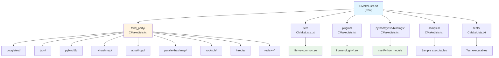
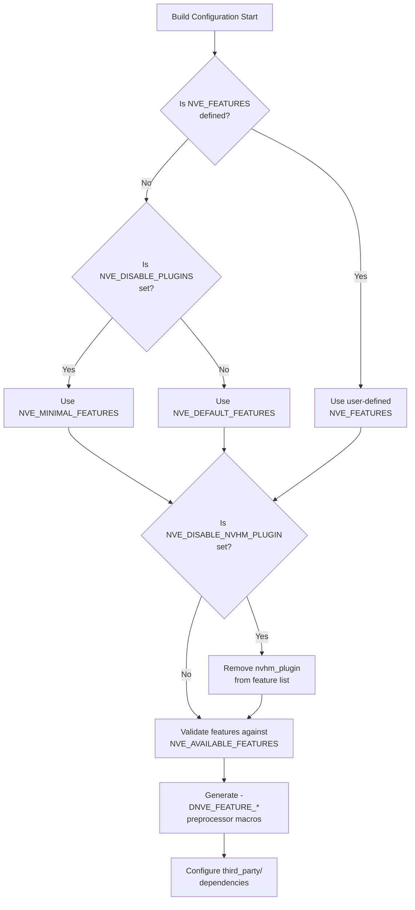
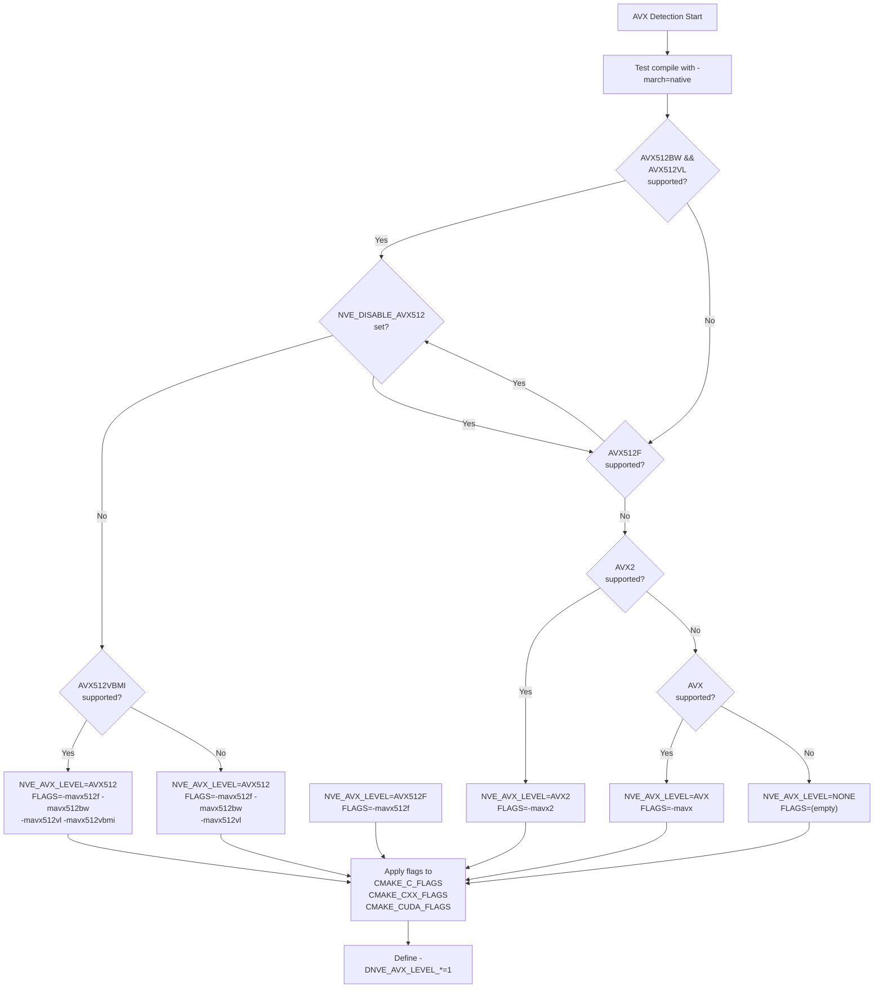
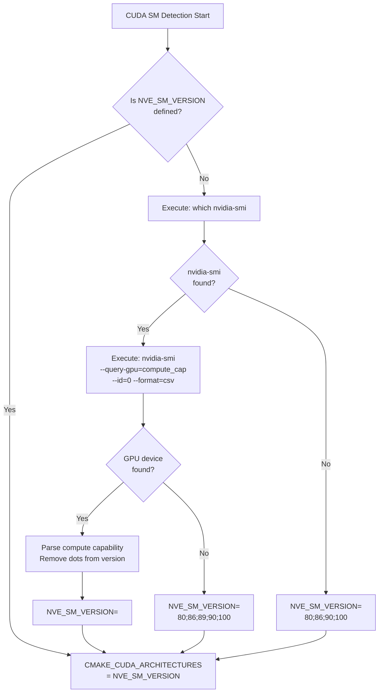
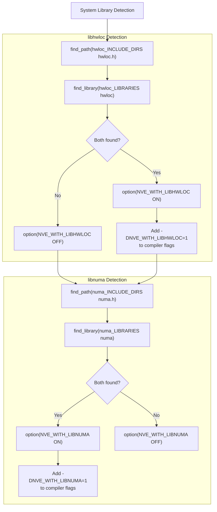
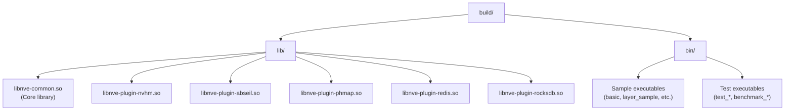

<!-- source: DeepWiki mcp.deepwiki.com · repo NVIDIA/nv-embedding-cache · page 10 Build System Details · fetched 2026-10-26 -->

# Build System Details

<details>
<summary>Relevant source files</summary>

The following files were used as context for generating this wiki page:

- [CMakeLists.txt](CMakeLists.txt)
- [third_party/CMakeLists.txt](third_party/CMakeLists.txt)

</details>


This document provides comprehensive technical documentation of the CMake-based build system for NV Embedding Cache SDK. It covers the project structure, feature selection mechanisms, hardware detection, dependency management, and compiler configuration.

For information about installing pre-built packages or building from source, see [Installation and Setup](#2). For details on individual CMake configuration options, see [CMake Configuration Options](#10.1).

---

## CMake Project Structure

The build system is organized hierarchically with a root [CMakeLists.txt:1-390]() that orchestrates the entire build process. The root CMakeLists.txt configures the project, detects hardware capabilities, manages features, and delegates to subdirectories.

### Build Directory Hierarchy



**Project Configuration**

The root CMakeLists.txt begins by reading the version from `version.txt` [CMakeLists.txt:32-33]() and declaring the project with C, C++, and CUDA languages [CMakeLists.txt:35]():

```
project(NV_Embedding_Cache LANGUAGES C CXX CUDA VERSION ${NVE_VERSION})
```

The build system requires CMake 3.18 minimum [CMakeLists.txt:16]() for NVCC target compute architecture support. C++17 is enforced [CMakeLists.txt:37-39]().

**Sources:** [CMakeLists.txt:16-39]()

---

## Feature Selection System

The build system implements a flexible feature selection mechanism through the `NVE_FEATURES` variable, allowing users to control which components are compiled.

### Feature Categories

```mermaid
graph TB
    subgraph "Plugin Features"
        ABSEIL["abseil_plugin"]
        NVHM["nvhm_plugin"]
        PHMAP["phmap_plugin"]
        REDIS["redis_plugin"]
        ROCKS["rocksdb_plugin"]
    end
    
    subgraph "Hash Table Mask Sizes"
        MASK8["ht_mask_8"]
        MASK16["ht_mask_16"]
        MASK32["ht_mask_32"]
        MASK64["ht_mask_64"]
    end
    
    subgraph "Hash Table Key Sizes"
        KEY8["ht_key_8"]
        KEY16["ht_key_16"]
        KEY32["ht_key_32"]
        KEY64["ht_key_64"]
    end
    
    subgraph "Hash Table Kernel Tile Sizes"
        K8["ht_kernel_8"]
        K16["ht_kernel_16"]
        K32["ht_kernel_32"]
        K64["ht_kernel_64"]
        K128["ht_kernel_128"]
        K256["ht_kernel_256"]
        K512["ht_kernel_512"]
        K1024["ht_kernel_1024"]
    end
    
    subgraph "Partition Hash Functions"
        FNV["ht_part_fnv1a"]
        MUR["ht_part_murmur3"]
        RRX["ht_part_rrxmrrxmsx0"]
        STD["ht_part_std_hash"]
    end
    
    FEATURES["NVE_FEATURES Variable"] --> ABSEIL
    FEATURES --> NVHM
    FEATURES --> PHMAP
    FEATURES --> REDIS
    FEATURES --> ROCKS
    FEATURES --> MASK8
    FEATURES --> MASK16
    FEATURES --> MASK32
    FEATURES --> MASK64
    FEATURES --> KEY8
    FEATURES --> KEY16
    FEATURES --> KEY32
    FEATURES --> KEY64
    FEATURES --> K8
    FEATURES --> K16
    FEATURES --> K32
    FEATURES --> K64
    FEATURES --> K128
    FEATURES --> K256
    FEATURES --> K512
    FEATURES --> K1024
    FEATURES --> FNV
    FEATURES --> MUR
    FEATURES --> RRX
    FEATURES --> STD
```



### Feature Configuration Logic

The available features are defined in [CMakeLists.txt:42-53](). Three preset configurations are provided:

| Configuration | Description | Features Included |
|--------------|-------------|------------------|
| **Minimal** | Fast compile, small binary | `ht_mask_64`, `ht_key_64`, `ht_part_fnv1a`, `ht_kernel_64` |
| **Default** | Standard production build | Minimal + all plugins + `ht_key_32`, `ht_kernel_128` |
| **All Available** | Complete feature set | All 30+ features |

The feature selection process follows this logic:



The feature validation happens in [CMakeLists.txt:96-109](), where each requested feature is checked against `NVE_AVAILABLE_FEATURES`. Invalid features cause a fatal error with a list of available options.

Each enabled feature generates a preprocessor macro [CMakeLists.txt:364-371]():
```
-DNVE_FEATURE_<UPPERCASE_FEATURE_NAME>=1
```

**Sources:** [CMakeLists.txt:42-109](), [CMakeLists.txt:364-371]()

---

## Hardware Detection and Optimization

The build system automatically detects CPU and GPU capabilities to enable optimal performance.

### AVX Detection Flow



The AVX detection uses CMake's `CheckCXXSourceCompiles` to test for specific instruction set extensions [CMakeLists.txt:127-178](). Each test compiles a minimal program that fails if the required preprocessor macro (e.g., `__AVX512BW__`) is not defined.

**AVX Detection Tests:**

| Test Variable | Macro Tested | Extensions |
|--------------|-------------|------------|
| `AVX_SUPPORTED` | `__AVX__` | Basic AVX |
| `AVX2_SUPPORTED` | `__AVX2__` | AVX2 |
| `AVX512F_SUPPORTED` | `__AVX512F__` | AVX-512 Foundation |
| `AVX512BW_SUPPORTED` | `__AVX512BW__` | AVX-512 Byte/Word |
| `AVX512VL_SUPPORTED` | `__AVX512VL__` | AVX-512 Vector Length |
| `AVX512VBMI_SUPPORTED` | `__AVX512VBMI__` | AVX-512 Vector Byte Manipulation |

The flags are applied to all compiler configurations [CMakeLists.txt:209-222]() including Debug and Release builds. A preprocessor macro `NVE_AVX_LEVEL_<LEVEL>=1` is defined [CMakeLists.txt:225-227]() for runtime detection in code.

**Sources:** [CMakeLists.txt:126-233]()

### CUDA Architecture Detection



The CUDA architecture detection [CMakeLists.txt:315-342]() attempts to detect the GPU in the current system using `nvidia-smi`. If no GPU is found or `nvidia-smi` is unavailable, it defaults to a broad set of architectures (SM 80, 86, 89, 90, 100) to ensure compatibility.

The detected or specified architectures are set in `CMAKE_CUDA_ARCHITECTURES` [CMakeLists.txt:341-342](), which controls the PTX code generation for NVCC.

**Sources:** [CMakeLists.txt:315-342]()

---

## Third-Party Dependency Management

Third-party libraries are managed as git submodules in the `third_party/` directory. The [third_party/CMakeLists.txt:1-146]() file conditionally includes dependencies based on enabled features.

### Dependency Resolution Process

```mermaid
flowchart TD
    START["third_party/CMakeLists.txt"]
    DISABLE_WARNINGS["Set CMAKE_COMPILE_WARNING_AS_ERROR=OFF"]
    
    subgraph "Unconditional Dependencies"
        ADD_GTEST["add_subdirectory(googletest)<br/>(if tests enabled)"]
        ADD_JSON["add_subdirectory(json)"]
        ADD_PYBIND["add_subdirectory(pybind11)"]
    end
    
    CHECK_NVHM{"nvhm_plugin in<br/>NVE_FEATURES?"}
    CALL_NVHM["add_nvhashmap()"]
    CONFIGURE_NVHM["Configure NVHM_* variables<br/>Match AVX capabilities<br/>Set NVHM_WANT_CACHE_LINE_SIZE"]
    ADD_NVHM["add_subdirectory(nvhashmap)"]
    
    CHECK_ABSEIL{"abseil_plugin in<br/>NVE_FEATURES?"}
    CALL_ABSEIL["add_abseil()"]
    CONFIGURE_ABSEIL["Set ABSL_BUILD_TESTING=OFF"]
    ADD_ABSEIL["add_subdirectory(abseil-cpp)"]
    
    CHECK_PHMAP{"phmap_plugin in<br/>NVE_FEATURES?"}
    CALL_PHMAP["add_phmap()"]
    CONFIGURE_PHMAP["Set PHMAP_BUILD_TESTS=OFF"]
    ADD_PHMAP["add_subdirectory(parallel-hashmap)"]
    
    CHECK_ROCKS{"rocksdb_plugin in<br/>NVE_FEATURES?"}
    CALL_ROCKS["add_rocksdb()"]
    CONFIGURE_ROCKS["Set WITH_TESTS=OFF<br/>Set WITH_TOOLS=OFF"]
    ADD_ROCKS["add_subdirectory(rocksdb)"]
    
    CHECK_REDIS{"redis_plugin in<br/>NVE_FEATURES?"}
    CALL_HIREDIS["add_hiredis()"]
    CONFIGURE_HIREDIS["Set ENABLE_SSL=ON<br/>Set DISABLE_TESTS=ON"]
    ADD_HIREDIS["add_subdirectory(hiredis)"]
    CALL_REDIS["add_redis_plus_plus()"]
    CONFIGURE_REDIS["Set REDIS_PLUS_PLUS_USE_TLS=ON<br/>Set HIREDIS_HEADER path"]
    ADD_REDIS["add_subdirectory(redis++)"]
    
    START --> DISABLE_WARNINGS
    DISABLE_WARNINGS --> ADD_GTEST
    DISABLE_WARNINGS --> ADD_JSON
    DISABLE_WARNINGS --> ADD_PYBIND
    
    ADD_JSON --> CHECK_NVHM
    CHECK_NVHM -->|Yes| CALL_NVHM
    CALL_NVHM --> CONFIGURE_NVHM
    CONFIGURE_NVHM --> ADD_NVHM
    
    CHECK_NVHM -->|No| CHECK_ABSEIL
    ADD_NVHM --> CHECK_ABSEIL
    CHECK_ABSEIL -->|Yes| CALL_ABSEIL
    CALL_ABSEIL --> CONFIGURE_ABSEIL
    CONFIGURE_ABSEIL --> ADD_ABSEIL
    
    CHECK_ABSEIL -->|No| CHECK_PHMAP
    ADD_ABSEIL --> CHECK_PHMAP
    CHECK_PHMAP -->|Yes| CALL_PHMAP
    CALL_PHMAP --> CONFIGURE_PHMAP
    CONFIGURE_PHMAP --> ADD_PHMAP
    
    CHECK_PHMAP -->|No| CHECK_ROCKS
    ADD_PHMAP --> CHECK_ROCKS
    CHECK_ROCKS -->|Yes| CALL_ROCKS
    CALL_ROCKS --> CONFIGURE_ROCKS
    CONFIGURE_ROCKS --> ADD_ROCKS
    
    CHECK_ROCKS -->|No| CHECK_REDIS
    ADD_ROCKS --> CHECK_REDIS
    CHECK_REDIS -->|Yes| CALL_HIREDIS
    CALL_HIREDIS --> CONFIGURE_HIREDIS
    CONFIGURE_HIREDIS --> ADD_HIREDIS
    ADD_HIREDIS --> CALL_REDIS
    CALL_REDIS --> CONFIGURE_REDIS
    CONFIGURE_REDIS --> ADD_REDIS
```



### Plugin Dependency Configuration Functions

Each plugin dependency has a dedicated configuration function [third_party/CMakeLists.txt:31-112]() that sets appropriate cache variables before invoking `add_subdirectory()`:

**NVHM Configuration** [third_party/CMakeLists.txt:31-67]():
- Disables tests, benchmarks, and tools
- Synchronizes AVX support with parent project detection
- Sets `NVHM_WANT_CACHE_LINE_SIZE` to match `NVE_CACHE_LINE_SIZE`
- Enables/disables AVX-512 extensions based on parent flags

**Abseil Configuration** [third_party/CMakeLists.txt:69-73]():
- Disables testing and test helpers

**PHMap Configuration** [third_party/CMakeLists.txt:75-80]():
- Disables tests and examples
- Sets as non-master project

**RocksDB Configuration** [third_party/CMakeLists.txt:82-92]():
- Builds static library only
- Disables all tools, tests, and JNI

**Redis Configuration** [third_party/CMakeLists.txt:94-112]():
- Configures hiredis with SSL support, no tests
- Configures redis++ with TLS, static build, no tests
- Sets hiredis header path for redis++

**Sources:** [third_party/CMakeLists.txt:16-146]()

---

## Compiler Flags and Build Configuration

The build system applies various compiler flags for warnings, optimizations, and debugging.

### Compiler Flag Categories

```mermaid
graph TB
    subgraph "Warning Flags (Release)"
        WARN_C["-Werror -Wall -Wextra -Wconversion"]
        WARN_CXX["-Werror -Wall -Wextra -Wconversion"]
        WARN_CUDA_NVCC["-Xcompiler -Wall -Xcompiler -Werror<br/>-Xcompiler -Wextra -Xcompiler -Wconversion"]
        WARN_CUDA_CLANG["-Wall -Werror -Wextra -Wconversion"]
    end
    
    subgraph "CUDA Specific"
        CUDA_COMMON["--expt-relaxed-constexpr<br/>--use_fast_math"]
        CUDA_CLANG_EXTRA["-Wno-unknown-cuda-version<br/>-ffast-math<br/>-Wno-nan-infinity-disabled"]
    end
    
    subgraph "Debug Flags"
        DEBUG_FLAGS["-O0 -g<br/>CUDA also adds: -G"]
    end
    
    subgraph "Optimization Flags"
        AVX_FLAGS["From AVX detection"]
        CACHE_LINE["-DNVE_CACHE_LINE_SIZE=64"]
        FEATURE_MACROS["-DNVE_FEATURE_*=1"]
    end
    
    subgraph "Optional System Libraries"
        HWLOC_FLAG["-DNVE_WITH_LIBHWLOC=1"]
        NUMA_FLAG["-DNVE_WITH_LIBNUMA=1"]
    end
    
    CMAKE_C_FLAGS["CMAKE_C_FLAGS"]
    CMAKE_CXX_FLAGS["CMAKE_CXX_FLAGS"]
    CMAKE_CUDA_FLAGS["CMAKE_CUDA_FLAGS"]
    
    WARN_C --> CMAKE_C_FLAGS
    WARN_CXX --> CMAKE_CXX_FLAGS
    WARN_CUDA_NVCC --> CMAKE_CUDA_FLAGS
    WARN_CUDA_CLANG --> CMAKE_CUDA_FLAGS
    
    CUDA_COMMON --> CMAKE_CUDA_FLAGS
    CUDA_CLANG_EXTRA --> CMAKE_CUDA_FLAGS
    
    DEBUG_FLAGS --> CMAKE_C_FLAGS
    DEBUG_FLAGS --> CMAKE_CXX_FLAGS
    DEBUG_FLAGS --> CMAKE_CUDA_FLAGS
    
    AVX_FLAGS --> CMAKE_C_FLAGS
    AVX_FLAGS --> CMAKE_CXX_FLAGS
    AVX_FLAGS --> CMAKE_CUDA_FLAGS
    
    CACHE_LINE --> CMAKE_C_FLAGS
    CACHE_LINE --> CMAKE_CXX_FLAGS
    CACHE_LINE --> CMAKE_CUDA_FLAGS
    
    FEATURE_MACROS --> CMAKE_C_FLAGS
    FEATURE_MACROS --> CMAKE_CXX_FLAGS
    FEATURE_MACROS --> CMAKE_CUDA_FLAGS
    
    HWLOC_FLAG --> CMAKE_C_FLAGS
    HWLOC_FLAG --> CMAKE_CXX_FLAGS
    
    NUMA_FLAG --> CMAKE_C_FLAGS
    NUMA_FLAG --> CMAKE_CXX_FLAGS
```



### Build Type Configuration

The default build type is Release if not specified [CMakeLists.txt:236-238](). The build system exports compile commands for clang-tidy [CMakeLists.txt:242]().

**Release Mode** [CMakeLists.txt:262-263](), [CMakeLists.txt:267-268](), [CMakeLists.txt:270-272]():
- Warnings treated as errors
- Full optimization (default -O3)
- Fast math enabled for CUDA

**Debug Mode** [CMakeLists.txt:274-277]():
- No optimization (-O0)
- Debug symbols (-g)
- CUDA device debug (-G)

### Cache Line Size Detection

The system detects the CPU cache line size [CMakeLists.txt:111-124]() using:
- Windows: Defaults to 64 bytes
- Linux/Unix: Uses `getconf LEVEL1_DCACHE_LINESIZE`

This value is compiled into all code via `-DNVE_CACHE_LINE_SIZE=<size>` [CMakeLists.txt:279-281]() and passed to nvhashmap configuration [third_party/CMakeLists.txt:35]().

**Sources:** [CMakeLists.txt:236-282](), [CMakeLists.txt:262-277]()

---

## Optional System Library Detection

The build system detects and optionally links against NUMA control libraries for performance optimization.

### Library Detection Flow



**libhwloc** [CMakeLists.txt:283-297]():
- Provides hardware locality (NUMA topology) information
- Used for CPU affinity and memory binding
- Detection: Searches for `hwloc.h` and `libhwloc`
- If found: Defines `NVE_WITH_LIBHWLOC=1`

**libnuma** [CMakeLists.txt:299-313]():
- Provides NUMA memory policy control
- Used for NUMA-aware memory allocation
- Detection: Searches for `numa.h` and `libnuma`
- If found: Defines `NVE_WITH_LIBNUMA=1`

Both libraries are optional and will be disabled if not found. The detection results are logged to the build output.

**Sources:** [CMakeLists.txt:283-313]()

---

## Build Outputs and Targets

The build system produces several categories of outputs organized into standardized directories.

### Output Directory Structure



The output directories are configured in [CMakeLists.txt:344-346]():

```
CMAKE_ARCHIVE_OUTPUT_DIRECTORY = ${CMAKE_BINARY_DIR}/lib
CMAKE_LIBRARY_OUTPUT_DIRECTORY = ${CMAKE_BINARY_DIR}/lib
CMAKE_RUNTIME_OUTPUT_DIRECTORY = ${CMAKE_BINARY_DIR}/bin
```

### RPATH Configuration

For Python package installation, the build system supports `NVE_ORIGIN_RPATH` [CMakeLists.txt:350-353]() which sets:
```
CMAKE_INSTALL_RPATH = $ORIGIN:${CMAKE_LIBRARY_OUTPUT_DIRECTORY}
```

This allows relocatable shared libraries to find their dependencies relative to their installation directory.

### Subdirectory Build Targets

The root CMakeLists.txt delegates to subdirectories [CMakeLists.txt:380-389]():

```
add_subdirectory(src)                      # Core library
add_subdirectory(plugins)                  # Plugin libraries
add_subdirectory(python/pynve/bindings)    # Python bindings
add_subdirectory(samples)                  # Sample programs (optional)
add_subdirectory(tests)                    # Test programs (optional)
```

Samples and tests can be disabled with `NVE_DISABLE_TESTS_AND_SAMPLES` [CMakeLists.txt:383-389]().

**Sources:** [CMakeLists.txt:344-389]()

---

## Include Directories

The build system configures include directories for all targets [CMakeLists.txt:355-361]():

| Directory | Purpose |
|-----------|---------|
| `${CUDAToolkit_INCLUDE_DIRS}` | CUDA Toolkit headers |
| `${PROJECT_SOURCE_DIR}` | Root directory for internal includes |
| `${PROJECT_SOURCE_DIR}/include` | Public API headers |
| `${PROJECT_SOURCE_DIR}/third_party` | Third-party library headers |
| `${PROJECT_SOURCE_DIR}/third_party/json/single_include` | nlohmann/json single-header |

**Sources:** [CMakeLists.txt:355-361]()

---

## NVTX Profiling Support

The build system supports optional NVTX (NVIDIA Tools Extension) profiling [CMakeLists.txt:373-378]():

```
if(NVE_ENABLE_NVTX)
  add_compile_definitions(NVE_ENABLE_NVTX)
endif()
```

When enabled, this adds NVTX markers throughout the code for use with NVIDIA Nsight Systems profiler.

**Sources:** [CMakeLists.txt:373-378]()

---

## Build Configuration Summary

At configuration time, the build system logs comprehensive information about the detected environment:

**Logged Information:**
- Enabled features [CMakeLists.txt:96-99]()
- Cache line size [CMakeLists.txt:124]()
- AVX support levels [CMakeLists.txt:172-177]()
- AVX configuration summary [CMakeLists.txt:229-233]()
- Build type [CMakeLists.txt:239]()
- CUDA compiler [CMakeLists.txt:258-259]()
- CUDA architectures [CMakeLists.txt:342]()
- libhwloc status [CMakeLists.txt:287](), [CMakeLists.txt:293]()
- libnuma status [CMakeLists.txt:303](), [CMakeLists.txt:309]()
- NVTX status [CMakeLists.txt:374](), [CMakeLists.txt:377]()
- Test/sample status [CMakeLists.txt:384](), [CMakeLists.txt:388]()

### Debug Utility

A `dump_all_vars()` function [CMakeLists.txt:19-29]() is available for debugging CMake configuration. It writes all CMake variables to a `cmake.vars` file.

**Sources:** [CMakeLists.txt:19-29](), [CMakeLists.txt:96-342]()

---

## Position Independent Code

The build system enforces position-independent code (PIC) for all targets [CMakeLists.txt:251]():

```
set(CMAKE_POSITION_INDEPENDENT_CODE TRUE)
```

This is set before the third-party subdirectory so that all dependencies are also built with `-fPIC`, which is required for shared library linking and Python extension modules.

**Sources:** [CMakeLists.txt:251]()

---

