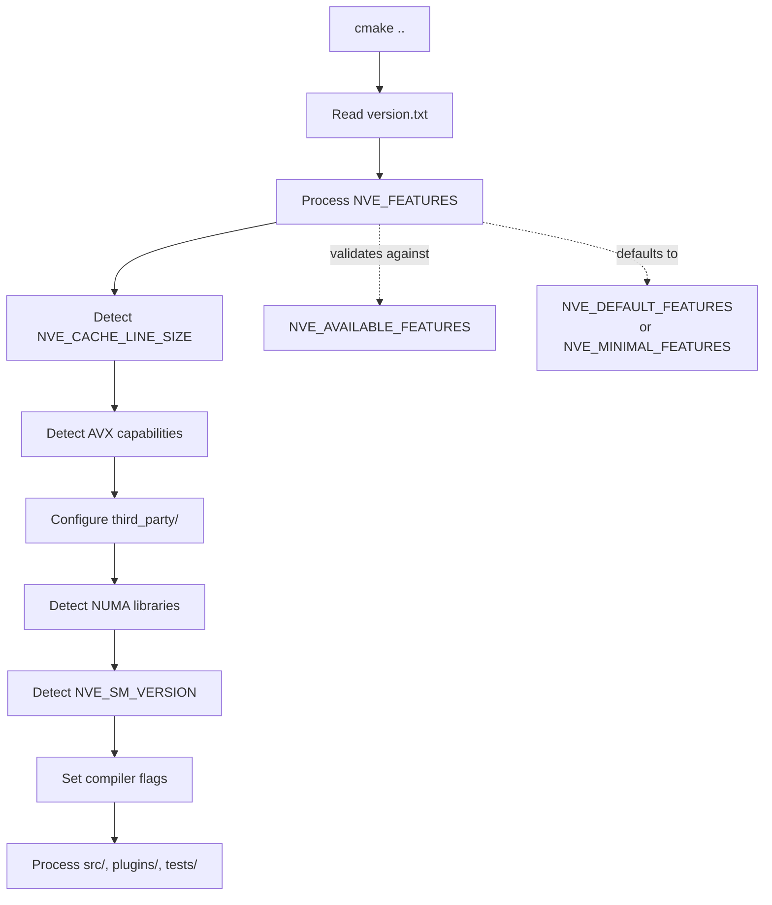
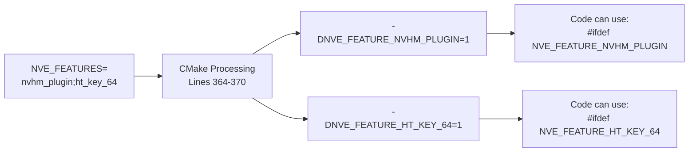
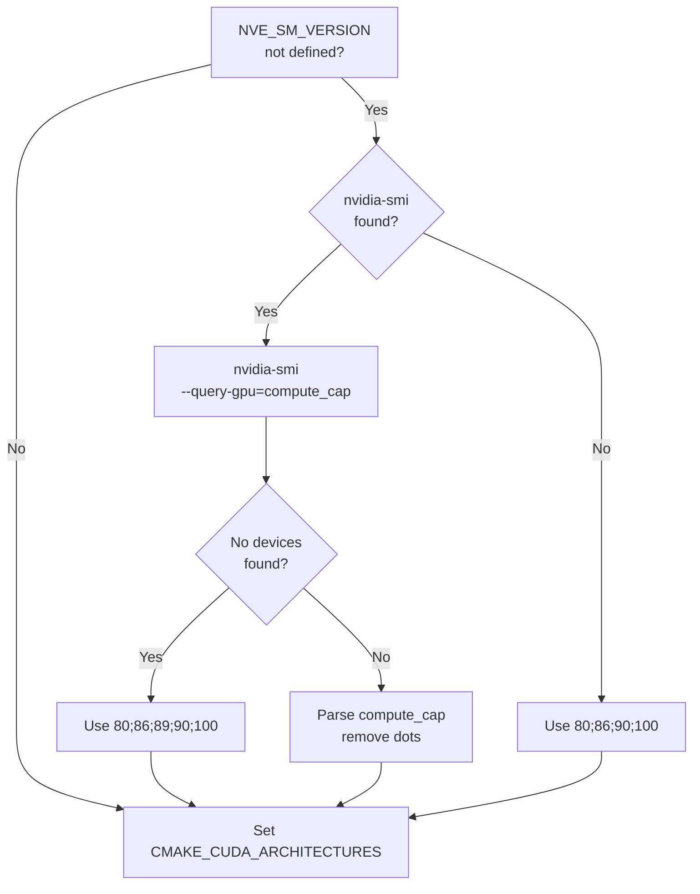

<!-- source: DeepWiki mcp.deepwiki.com · repo NVIDIA/nv-embedding-cache · page 10.1 CMake Configuration Options · fetched 2026-10-26 -->

# CMake Configuration Options

<details>
<summary>Relevant source files</summary>

The following files were used as context for generating this wiki page:

- [CMakeLists.txt](CMakeLists.txt)
- [third_party/CMakeLists.txt](third_party/CMakeLists.txt)

</details>


This document provides a comprehensive reference for all CMake configuration options available when building the NV Embedding Cache SDK. These options control feature selection, compiler optimizations, hardware detection, and build behavior.

For information about the overall build process, see [Building from Source](#2.2). For details on feature management through the `NVE_FEATURES` system, see [Feature Selection](#10.2). For hardware-specific optimizations, see [AVX and CUDA Detection](#10.3).

---

## Configuration System Overview

The CMake build system provides three categories of configuration options:

1. **Feature Selection**: Controls which optional components (plugins, hash table configurations) are compiled
2. **Hardware Detection**: Automatically detects and optimizes for CPU (AVX) and GPU (CUDA SM) capabilities
3. **Build Behavior**: Controls compiler flags, output directories, testing, and NUMA support

The configuration is processed in this order:



**Sources**: [CMakeLists.txt:16-390]()

---

## Feature Selection Variables

### NVE_FEATURES

**Type**: Semicolon-separated list of feature names  
**Default**: `NVE_DEFAULT_FEATURES` (plugins + common hash table configs)  
**Purpose**: Controls which optional components are compiled into the build

The `NVE_FEATURES` variable determines which plugins and hash table template instantiations are included. Features not listed are excluded, reducing compilation time and binary size.

**Usage**:
```bash
# Build with minimal features (fastest compilation)
cmake -DNVE_FEATURES="ht_mask_64;ht_key_64;ht_part_fnv1a;ht_kernel_64" ..

# Build with all available features (slowest compilation, largest binary)
cmake -DNVE_FEATURES="abseil_plugin;nvhm_plugin;phmap_plugin;redis_plugin;rocksdb_plugin;ht_mask_8;ht_mask_16;ht_mask_32;ht_mask_64;..." ..

# Build with default feature set
cmake ..  # NVE_FEATURES not specified
```

**Sources**: [CMakeLists.txt:76-108]()

### NVE_AVAILABLE_FEATURES

**Type**: CMake list (internal)  
**Purpose**: Defines all features that can be enabled

This list contains all valid feature names. The build system validates `NVE_FEATURES` against this list.

| Feature Category | Available Features |
|-----------------|-------------------|
| **Storage Plugins** | `abseil_plugin`, `nvhm_plugin`, `phmap_plugin`, `redis_plugin`, `rocksdb_plugin` |
| **Hash Table Masks** | `ht_mask_8`, `ht_mask_16`, `ht_mask_32`, `ht_mask_64` |
| **Hash Table Keys** | `ht_key_8`, `ht_key_16`, `ht_key_32`, `ht_key_64` |
| **Hash Table Kernels** | `ht_kernel_8`, `ht_kernel_16`, `ht_kernel_32`, `ht_kernel_64`, `ht_kernel_128`, `ht_kernel_256`, `ht_kernel_512`, `ht_kernel_1024` |
| **Hash Partitioning** | `ht_part_fnv1a`, `ht_part_murmur3`, `ht_part_rrxmrrxmsx0`, `ht_part_std_hash` |

**Sources**: [CMakeLists.txt:42-53]()

### NVE_MINIMAL_FEATURES

**Type**: CMake list (internal)  
**Value**: `ht_mask_64;ht_key_64;ht_part_fnv1a;ht_kernel_64`  
**Purpose**: Minimal feature set for fast compilation and small binaries

This represents the absolute minimum configuration needed for basic functionality. Used when `NVE_DISABLE_PLUGINS` is set.

**Sources**: [CMakeLists.txt:55-59]()

### NVE_DEFAULT_FEATURES

**Type**: CMake list (internal)  
**Value**: Minimal features + all plugins + `ht_key_32` + `ht_kernel_128`  
**Purpose**: Default feature set balancing functionality and compilation time

This is used when `NVE_FEATURES` is not specified and `NVE_DISABLE_PLUGINS` is not set.

**Sources**: [CMakeLists.txt:61-73]()

### NVE_DISABLE_PLUGINS

**Type**: Boolean option  
**Default**: `OFF`  
**Purpose**: Disables all plugin features, falling back to `NVE_MINIMAL_FEATURES`

**Usage**:
```bash
cmake -DNVE_DISABLE_PLUGINS=ON ..
```

**Sources**: [CMakeLists.txt:79-83]()

### NVE_DISABLE_NVHM_PLUGIN

**Type**: Boolean option  
**Default**: `OFF`  
**Purpose**: Specifically disables the NVHM plugin while keeping other plugins enabled

**Usage**:
```bash
cmake -DNVE_DISABLE_NVHM_PLUGIN=ON ..
```

**Sources**: [CMakeLists.txt:88-92]()

---

## Feature-to-Preprocessor Mapping

Each enabled feature becomes a preprocessor macro in the format `NVE_FEATURE_<UPPERCASED_FEATURE_NAME>=1`. This allows conditional compilation:



**Sources**: [CMakeLists.txt:364-371]()

---

## Hardware Detection Variables

### NVE_CACHE_LINE_SIZE

**Type**: String (number of bytes)  
**Default**: Auto-detected via `getconf LEVEL1_DCACHE_LINESIZE` (typically 64 on x86_64)  
**Purpose**: Sets the CPU cache line size for memory alignment optimizations

The detected value is embedded as `-DNVE_CACHE_LINE_SIZE=<value>` in compiler flags and passed to nvHashMap.

**Manual Override**:
```bash
cmake -DNVE_CACHE_LINE_SIZE=128 ..
```

**Sources**: [CMakeLists.txt:112-124](), [CMakeLists.txt:279-281]()

### NVE_SM_VERSION

**Type**: Semicolon-separated list of CUDA compute capabilities  
**Default**: Auto-detected via `nvidia-smi --query-gpu=compute_cap` (falls back to `80;86;90;100` if detection fails)  
**Purpose**: Sets CUDA architectures for compilation via `CMAKE_CUDA_ARCHITECTURES`

**Detection Logic**:


**Manual Override**:
```bash
cmake -DNVE_SM_VERSION="80;90" ..  # Only build for Ampere and Hopper
```

**Sources**: [CMakeLists.txt:315-342]()

### AVX Detection Variables

The build system automatically detects and configures AVX support:

| Variable | Type | Purpose |
|----------|------|---------|
| `AVX_SUPPORTED` | Boolean | Set to `1` if AVX is supported |
| `AVX2_SUPPORTED` | Boolean | Set to `1` if AVX2 is supported |
| `AVX512F_SUPPORTED` | Boolean | Set to `1` if AVX-512 Foundation is supported |
| `AVX512BW_SUPPORTED` | Boolean | Set to `1` if AVX-512 Byte and Word is supported |
| `AVX512VL_SUPPORTED` | Boolean | Set to `1` if AVX-512 Vector Length is supported |
| `AVX512VBMI_SUPPORTED` | Boolean | Set to `1` if AVX-512 Vector Byte Manipulation is supported |
| `NVE_AVX_LEVEL` | String | One of: `AVX512`, `AVX512F`, `AVX2`, `AVX`, `NONE` |
| `NVE_AVX_FLAGS` | String | Compiler flags for the selected AVX level |

**Selection Priority** (highest to lowest):
1. AVX-512 with BW, VL, and optionally VBMI extensions → `NVE_AVX_LEVEL=AVX512`
2. AVX-512 Foundation only → `NVE_AVX_LEVEL=AVX512F`
3. AVX2 → `NVE_AVX_LEVEL=AVX2`
4. AVX → `NVE_AVX_LEVEL=AVX`
5. No AVX → `NVE_AVX_LEVEL=NONE`

The selected level defines a preprocessor macro: `-DNVE_AVX_LEVEL_<LEVEL>=1`

**Sources**: [CMakeLists.txt:126-233]()

### NVE_DISABLE_AVX512

**Type**: Boolean option  
**Default**: `OFF`  
**Purpose**: Forces the build to not use AVX-512 instructions (useful for older CI machines)

**Usage**:
```bash
cmake -DNVE_DISABLE_AVX512=ON ..
```

This sets `-mno-avx512f` compiler flag and limits `NVE_AVX_LEVEL` to at most `AVX2`.

**Sources**: [CMakeLists.txt:181-182](), [CMakeLists.txt:245-250]()

---

## NUMA Support Variables

### NVE_WITH_LIBHWLOC

**Type**: Boolean option  
**Default**: `ON` if `libhwloc` is found, `OFF` otherwise  
**Purpose**: Enables NUMA control through the hwloc library

The build system searches for `hwloc.h` and `libhwloc`. If found and this option is enabled, `-DNVE_WITH_LIBHWLOC=1` is added to compiler flags.

**Manual Override**:
```bash
cmake -DNVE_WITH_LIBHWLOC=OFF ..  # Disable even if found
```

**Sources**: [CMakeLists.txt:283-297]()

### NVE_WITH_LIBNUMA

**Type**: Boolean option  
**Default**: `ON` if `libnuma` is found, `OFF` otherwise  
**Purpose**: Enables NUMA control through the numa library

The build system searches for `numa.h` and `libnuma`. If found and this option is enabled, `-DNVE_WITH_LIBNUMA=1` is added to compiler flags.

**Manual Override**:
```bash
cmake -DNVE_WITH_LIBNUMA=OFF ..  # Disable even if found
```

**Sources**: [CMakeLists.txt:299-313]()

---

## Build Behavior Variables

### CMAKE_BUILD_TYPE

**Type**: String  
**Default**: `Release`  
**Values**: `Release`, `Debug`  
**Purpose**: Controls optimization level and debug symbols

| Build Type | C/C++ Flags | CUDA Flags | Effect |
|------------|-------------|------------|--------|
| Release | `-Werror -Wall -Wextra -Wconversion` | `-Xcompiler -Wall -Xcompiler -Werror` + `--use_fast_math` | Optimized, warnings as errors |
| Debug | `-O0 -g` | `-O0 -g -G` | No optimization, debug symbols, device debug |

**Usage**:
```bash
cmake -DCMAKE_BUILD_TYPE=Debug ..
```

**Sources**: [CMakeLists.txt:236-239](), [CMakeLists.txt:262-277]()

### NVE_DISABLE_TESTS_AND_SAMPLES

**Type**: Boolean option (defined/undefined)  
**Default**: Undefined (tests and samples are built)  
**Purpose**: Disables building of tests and samples, useful for deployment builds

**Usage**:
```bash
cmake -DNVE_DISABLE_TESTS_AND_SAMPLES=1 ..
```

When defined, `add_subdirectory(samples)` and `add_subdirectory(tests)` are skipped.

**Sources**: [CMakeLists.txt:383-389]()

### CMAKE_EXPORT_COMPILE_COMMANDS

**Type**: Boolean  
**Value**: Forced to `1`  
**Purpose**: Generates `compile_commands.json` for clang-tidy and IDE support

**Sources**: [CMakeLists.txt:242]()

### NVE_ORIGIN_RPATH

**Type**: Boolean option  
**Default**: `OFF`  
**Purpose**: Sets RPATH to allow relocated shared libraries to find dependencies in local directory

When enabled, sets `CMAKE_INSTALL_RPATH` to `$ORIGIN:<build_lib_dir>`, allowing the Python wheel to work after installation.

**Usage**:
```bash
cmake -DNVE_ORIGIN_RPATH=ON ..
```

**Sources**: [CMakeLists.txt:350-353]()

### NVE_ENABLE_NVTX

**Type**: Boolean option  
**Default**: `OFF`  
**Purpose**: Enables NVIDIA Tools Extension (NVTX) markers for profiling with Nsight Systems

When enabled, adds `NVE_ENABLE_NVTX` preprocessor definition.

**Usage**:
```bash
cmake -DNVE_ENABLE_NVTX=ON ..
```

**Sources**: [CMakeLists.txt:373-378]()

### CMAKE_POSITION_INDEPENDENT_CODE

**Type**: Boolean  
**Value**: Forced to `TRUE`  
**Purpose**: Sets `-fPIC` for all targets (required for shared libraries)

**Sources**: [CMakeLists.txt:251]()

---

## Third-Party Dependency Variables

These variables are processed in [third_party/CMakeLists.txt]() and control third-party library builds:

### NVHM Configuration (nvHashMap)

When `nvhm_plugin` feature is enabled:

| Variable | Default | Purpose |
|----------|---------|---------|
| `NVHM_BUILD_TESTS` | `OFF` | Disable nvHashMap tests |
| `NVHM_BUILD_BENCH` | `OFF` | Disable nvHashMap benchmarks |
| `NVHM_BUILD_TOOLS` | `OFF` | Disable nvHashMap tools |
| `NVHM_WANT_CACHE_LINE_SIZE` | `${NVE_CACHE_LINE_SIZE}` | Pass cache line size |
| `NVHM_WANT_SSE`, `NVHM_WANT_SSE2`, etc. | Varies | Enable/disable SIMD extensions based on AVX detection |

**Sources**: [third_party/CMakeLists.txt:31-67]()

### Abseil Configuration

When `abseil_plugin` feature is enabled:

| Variable | Default | Purpose |
|----------|---------|---------|
| `ABSL_BUILD_TESTING` | `OFF` | Disable Abseil tests |
| `ABSL_BUILD_TEST_HELPERS` | `OFF` | Disable test helpers |

**Sources**: [third_party/CMakeLists.txt:69-73]()

### RocksDB Configuration

When `rocksdb_plugin` feature is enabled:

| Variable | Default | Purpose |
|----------|---------|---------|
| `ROCKSDB_BUILD_SHARED` | `OFF` | Build static library |
| `WITH_BENCHMARK_TOOLS` | `OFF` | Disable benchmarks |
| `WITH_CORE_TOOLS` | `OFF` | Disable tools |
| `WITH_TESTS` | `OFF` | Disable tests |

**Sources**: [third_party/CMakeLists.txt:82-92]()

### Redis++ Configuration

When `redis_plugin` feature is enabled:

| Variable | Default | Purpose |
|----------|---------|---------|
| `REDIS_PLUS_PLUS_USE_TLS` | `ON` | Enable TLS support |
| `REDIS_PLUS_PLUS_BUILD_STATIC` | `ON` | Build static library |
| `REDIS_PLUS_PLUS_BUILD_TEST` | `OFF` | Disable tests |

**Sources**: [third_party/CMakeLists.txt:94-112]()

---

## Output Directory Variables

| Variable | Default Value | Purpose |
|----------|---------------|---------|
| `CMAKE_ARCHIVE_OUTPUT_DIRECTORY` | `${CMAKE_BINARY_DIR}/lib` | Location for static libraries (.a files) |
| `CMAKE_LIBRARY_OUTPUT_DIRECTORY` | `${CMAKE_BINARY_DIR}/lib` | Location for shared libraries (.so files) |
| `CMAKE_RUNTIME_OUTPUT_DIRECTORY` | `${CMAKE_BINARY_DIR}/bin` | Location for executables |

**Sources**: [CMakeLists.txt:344-346]()

---

## Complete Configuration Example

Here's an example showing multiple configuration options working together:

```bash
# Build configuration for production deployment:
# - Minimal features for fast compilation
# - Specific GPU architectures
# - Enable NVTX profiling
# - No tests/samples
cmake \
  -DCMAKE_BUILD_TYPE=Release \
  -DNVE_FEATURES="nvhm_plugin;redis_plugin;ht_mask_64;ht_key_64;ht_part_fnv1a;ht_kernel_128" \
  -DNVE_SM_VERSION="80;90" \
  -DNVE_ENABLE_NVTX=ON \
  -DNVE_DISABLE_TESTS_AND_SAMPLES=1 \
  -DNVE_ORIGIN_RPATH=ON \
  ..

# Build configuration for development:
# - All features enabled
# - Debug symbols
# - Tests included
cmake \
  -DCMAKE_BUILD_TYPE=Debug \
  -DNVE_FEATURES="${NVE_AVAILABLE_FEATURES}" \
  ..
```

---

## Configuration Variable Summary Table

| Variable | Type | Default | Category |
|----------|------|---------|----------|
| `NVE_FEATURES` | List | `NVE_DEFAULT_FEATURES` | Feature Selection |
| `NVE_DISABLE_PLUGINS` | Boolean | `OFF` | Feature Selection |
| `NVE_DISABLE_NVHM_PLUGIN` | Boolean | `OFF` | Feature Selection |
| `NVE_CACHE_LINE_SIZE` | String | Auto-detected | Hardware Detection |
| `NVE_SM_VERSION` | List | Auto-detected | Hardware Detection |
| `NVE_DISABLE_AVX512` | Boolean | `OFF` | Hardware Detection |
| `NVE_WITH_LIBHWLOC` | Boolean | Auto-detected | NUMA Support |
| `NVE_WITH_LIBNUMA` | Boolean | Auto-detected | NUMA Support |
| `CMAKE_BUILD_TYPE` | String | `Release` | Build Behavior |
| `NVE_DISABLE_TESTS_AND_SAMPLES` | Boolean | Undefined | Build Behavior |
| `NVE_ORIGIN_RPATH` | Boolean | `OFF` | Build Behavior |
| `NVE_ENABLE_NVTX` | Boolean | `OFF` | Build Behavior |

**Sources**: [CMakeLists.txt:1-390](), [third_party/CMakeLists.txt:1-146]()

---

