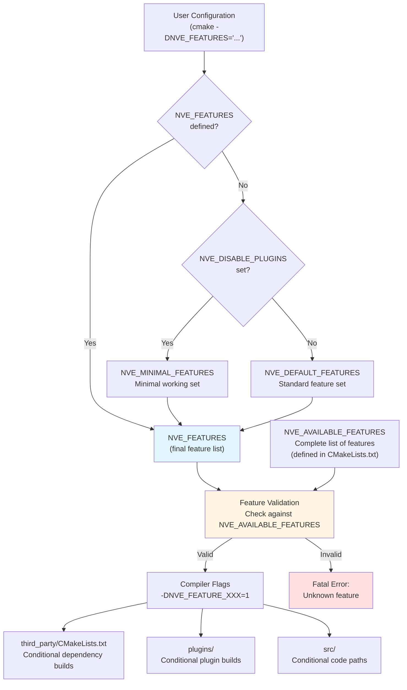
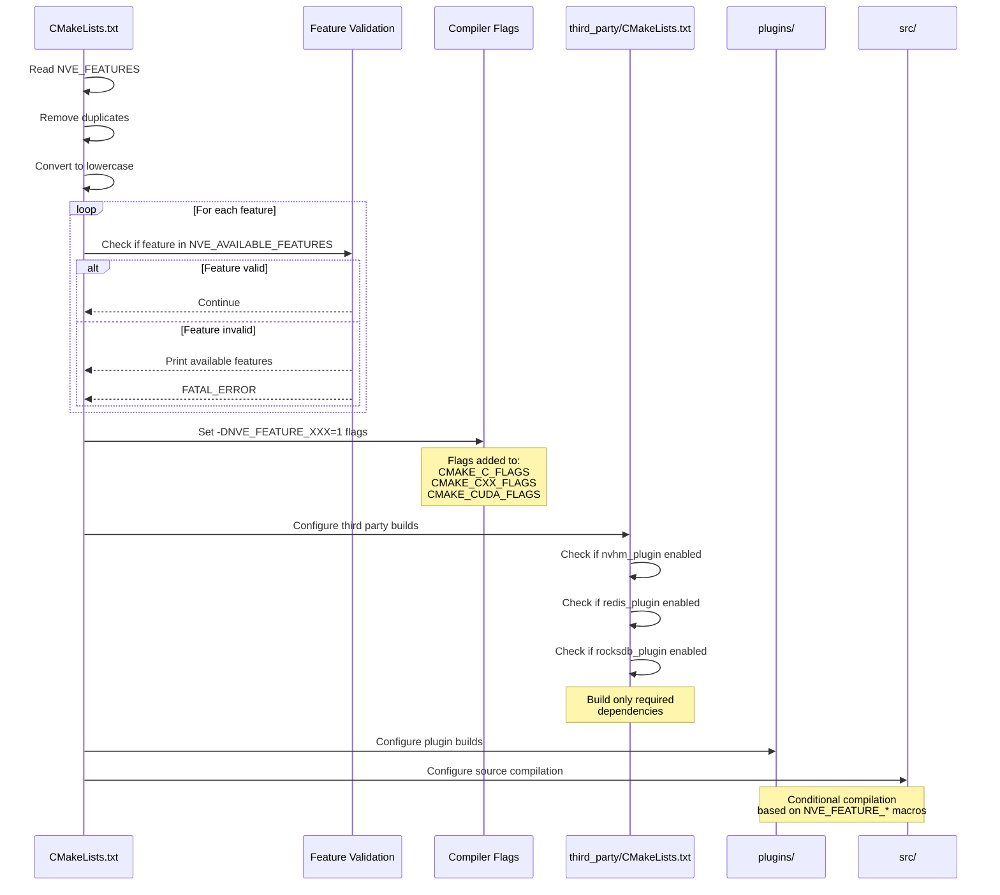
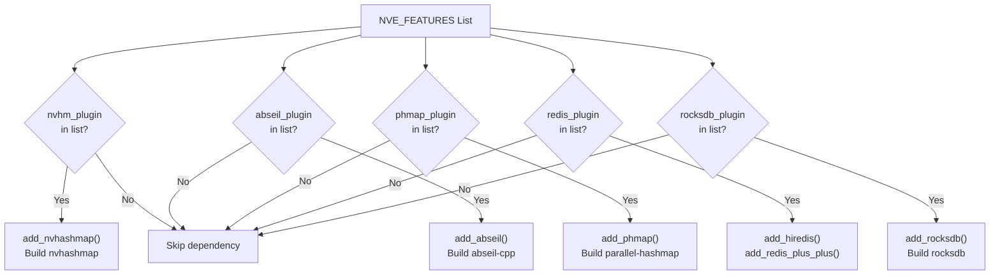

<!-- source: DeepWiki mcp.deepwiki.com · repo NVIDIA/nv-embedding-cache · page 10.2 Feature Selection · fetched 2026-10-26 -->

# Feature Selection

<details>
<summary>Relevant source files</summary>

The following files were used as context for generating this wiki page:

- [CMakeLists.txt](CMakeLists.txt)
- [third_party/CMakeLists.txt](third_party/CMakeLists.txt)

</details>


This document describes the feature selection system used in the NV Embedding Cache SDK build configuration. The feature selection mechanism allows selective compilation of optional components, reducing build time and binary size while providing flexibility for different deployment scenarios.

For information about general CMake configuration options, see [CMake Configuration Options](#10.1). For hardware capability detection, see [AVX and CUDA Detection](#10.3).

## Purpose and Scope

The feature selection system controls which optional components are included in the build through the `NVE_FEATURES` CMake variable. This includes:

- Storage backend plugins (Redis, RocksDB, NVHM, Abseil, PHMap)
- GPU hash table mask sizes
- GPU hash table key sizes
- GPU kernel tile sizes
- Hash partition function implementations

By selectively enabling features, users can optimize compilation time and binary size for their specific use case. For example, a deployment that only needs GPU-based caching can disable all remote storage plugins.

**Sources:** [CMakeLists.txt:41-109]()

## Feature Selection Architecture

The following diagram illustrates how the feature selection system processes user configuration and applies it to the build:



**Sources:** [CMakeLists.txt:41-109](), [third_party/CMakeLists.txt:114-145]()

## Available Features

The feature selection system supports three categories of features: storage plugins, hash table configurations, and kernel optimizations.

### Storage Plugin Features

| Feature Name | Description | Dependencies | Default Enabled |
|--------------|-------------|--------------|-----------------|
| `abseil_plugin` | Abseil flat hash map for system memory | abseil-cpp | Yes |
| `nvhm_plugin` | nvHashMap for system memory (SIMD optimized) | nvhashmap | Yes |
| `phmap_plugin` | Parallel hashmap for system memory | parallel-hashmap | Yes |
| `redis_plugin` | Redis cluster backend for remote storage | hiredis, redis++ | Yes |
| `rocksdb_plugin` | RocksDB backend for remote storage | rocksdb | Yes |

**Sources:** [CMakeLists.txt:43-49]()

### Hash Table Configuration Features

These features control GPU hash table implementation parameters:

| Feature Category | Available Values | Description | Default |
|-----------------|------------------|-------------|---------|
| `ht_mask_*` | 8, 16, 32, 64 | Set associative cache ways (mask size) | 64 |
| `ht_key_*` | 8, 16, 32, 64 | Key size in bits for hash table | 64, 32 |
| `ht_kernel_*` | 8, 16, 32, 64, 128, 256, 512, 1024 | CUDA kernel tile sizes | 64, 128 |

**Sources:** [CMakeLists.txt:50-52]()

### Hash Partition Function Features

| Feature Name | Hash Function | Use Case |
|--------------|---------------|----------|
| `ht_part_fnv1a` | FNV-1a hash | Fast, good distribution (default) |
| `ht_part_murmur3` | MurmurHash3 | High quality hash |
| `ht_part_rrxmrrxmsx0` | RRxMRRxMSx0 hash | Research hash function |
| `ht_part_std_hash` | std::hash | Standard library |

**Sources:** [CMakeLists.txt:53]()

## Predefined Feature Sets

The build system provides three predefined feature sets for common scenarios:

```mermaid
graph LR
    subgraph MINIMAL["NVE_MINIMAL_FEATURES"]
        M1["ht_mask_64"]
        M2["ht_key_64"]
        M3["ht_part_fnv1a"]
        M4["ht_kernel_64"]
    end
    
    subgraph DEFAULT["NVE_DEFAULT_FEATURES"]
        D1["All MINIMAL features"]
        D2["+ All 5 plugins"]
        D3["+ ht_key_32"]
        D4["+ ht_kernel_128"]
    end
    
    subgraph ALL["NVE_AVAILABLE_FEATURES"]
        A1["All possible features"]
        A2["All plugin variants"]
        A3["All hash table sizes"]
        A4["All kernel sizes"]
        A5["All partition functions"]
    end
    
    MINIMAL -->|Extends| DEFAULT
    DEFAULT -->|Subset of| ALL
    
    style MINIMAL fill:#e1ffe1
    style DEFAULT fill:#e1f5ff
    style ALL fill:#ffe1e1
```



### Minimal Feature Set

The minimal set provides the smallest buildable configuration with essential functionality:

```cmake
NVE_MINIMAL_FEATURES:
  - ht_mask_64      # Single mask size
  - ht_key_64       # Single key size
  - ht_part_fnv1a   # Single hash function
  - ht_kernel_64    # Single kernel tile
```

This configuration results in the fastest compilation and smallest binary size but limits runtime flexibility.

**Sources:** [CMakeLists.txt:55-59]()

### Default Feature Set

The default set includes the minimal set plus commonly used plugins and additional kernel sizes:

```cmake
NVE_DEFAULT_FEATURES:
  - ht_mask_64
  - ht_key_64, ht_key_32         # Two key sizes
  - ht_part_fnv1a
  - ht_kernel_64, ht_kernel_128  # Two kernel tiles
  - abseil_plugin
  - nvhm_plugin
  - phmap_plugin
  - redis_plugin
  - rocksdb_plugin
```

This is the recommended configuration for most users, balancing compile time with functionality.

**Sources:** [CMakeLists.txt:61-71]()

### All Available Features

Enabling all features provides maximum runtime flexibility but increases compilation time significantly:

```cmake
# To build with all features:
cmake -DNVE_FEATURES="${NVE_AVAILABLE_FEATURES}"
```

This configuration is useful for development or when deployment requirements are uncertain.

**Sources:** [CMakeLists.txt:42-53]()

## Configuring Features

### Explicit Feature Specification

Users can specify features explicitly via the `NVE_FEATURES` CMake variable:

```bash
# Enable specific features
cmake -DNVE_FEATURES="nvhm_plugin redis_plugin ht_mask_64 ht_key_64 ht_kernel_128"

# Or use semicolon-separated list
cmake -DNVE_FEATURES="nvhm_plugin;redis_plugin;ht_mask_64"

# Or use space-separated (will be converted internally)
cmake -DNVE_FEATURES="nvhm_plugin redis_plugin"
```

**Sources:** [CMakeLists.txt:76-84]()

### Using Predefined Sets

```bash
# Use minimal features (fast build, limited functionality)
cmake -DNVE_DISABLE_PLUGINS=ON

# Use default features (recommended)
cmake .  # Default when NVE_FEATURES not specified

# Use all features (slow build, maximum flexibility)
cmake -DNVE_FEATURES="${NVE_AVAILABLE_FEATURES}"
```

The build system selects the appropriate set based on whether `NVE_FEATURES` is defined and whether `NVE_DISABLE_PLUGINS` is set.

**Sources:** [CMakeLists.txt:76-84]()

### Disabling Specific Features

The NVHM plugin can be explicitly disabled even if included in a feature set:

```bash
# Disable NVHM plugin specifically
cmake -DNVE_DISABLE_NVHM_PLUGIN=ON
```

This is useful when the nvHashMap dependency cannot be satisfied or conflicts with system libraries.

**Sources:** [CMakeLists.txt:87-92]()

## Feature Validation and Processing

The following diagram shows how features are validated and propagated through the build system:



**Sources:** [CMakeLists.txt:94-109](), [CMakeLists.txt:363-371](), [third_party/CMakeLists.txt:114-145]()

### Validation Process

The build system validates each feature against the available features list:

1. **Case normalization**: Features are converted to lowercase
2. **Duplication removal**: Duplicate entries are removed from the list
3. **Availability check**: Each feature is validated against `NVE_AVAILABLE_FEATURES`
4. **Error reporting**: If an unknown feature is found, the build fails with a message listing all valid features

```cpp
// Example validation logic from CMakeLists.txt
foreach(NVE_FEATURE ${NVE_FEATURES})
  list(FIND NVE_AVAILABLE_FEATURES "${NVE_FEATURE}" NVE_FEATURE_ENABLED)
  if(${NVE_FEATURE_ENABLED} EQUAL -1)
    message(FATAL_ERROR "Unsupported feature \"${NVE_FEATURE}\"!")
  endif()
endforeach()
```

**Sources:** [CMakeLists.txt:94-109]()

## Feature Propagation to Build System

Features are propagated to the build through two mechanisms: compiler preprocessor definitions and conditional CMake logic.

### Compiler Preprocessor Definitions

Each enabled feature generates a preprocessor definition:

```cmake
# For each feature in NVE_FEATURES:
# -DNVE_FEATURE_ABSEIL_PLUGIN=1
# -DNVE_FEATURE_NVHM_PLUGIN=1
# -DNVE_FEATURE_HT_MASK_64=1
# etc.
```

These definitions are added to `CMAKE_C_FLAGS`, `CMAKE_CXX_FLAGS`, and `CMAKE_CUDA_FLAGS`, making them available to all compilation units.

**Sources:** [CMakeLists.txt:363-371]()

### Conditional Compilation Example

Source code uses these macros for conditional compilation:

```cpp
// Example usage in source code
#ifdef NVE_FEATURE_NVHM_PLUGIN
  // Include NVHM-specific code
  #include "nvhm_table.hpp"
#endif

#ifdef NVE_FEATURE_HT_KERNEL_128
  // Enable 128-element tile kernels
  template void launch_kernel<128>(...);
#endif
```

### Third-Party Dependency Management

The third-party build configuration conditionally includes dependencies:



Each plugin dependency is only built if its corresponding feature is enabled. This logic is implemented in `third_party/CMakeLists.txt`:

```cmake
# Pattern used for each plugin
list(FIND NVE_FEATURES "nvhm_plugin" NVE_FEATURE_ENABLED)
if(${NVE_FEATURE_ENABLED} GREATER -1)
  add_nvhashmap()
endif()
```

**Sources:** [third_party/CMakeLists.txt:114-145]()

## Build Time and Binary Size Impact

The choice of feature set significantly impacts build performance and output size:

| Feature Set | Approximate Build Time | Binary Size | Use Case |
|-------------|----------------------|-------------|----------|
| Minimal | 1x (fastest) | Smallest | Production with known requirements |
| Default | 1.5-2x | Medium | General purpose, recommended |
| All Features | 3-5x | Largest | Development, unknown requirements |

Hash table kernel instantiations (`ht_kernel_*`) have the most significant impact on compile time and binary size, as each enabled size generates multiple template instantiations.

**Sources:** [CMakeLists.txt:55-73]()

## Example Configurations

### Minimal GPU-Only Configuration

For deployments using only GPU-resident embeddings without plugins:

```bash
cmake \
  -DNVE_FEATURES="ht_mask_64 ht_key_64 ht_kernel_64 ht_part_fnv1a" \
  -DCMAKE_BUILD_TYPE=Release \
  ..
```

### Single-Node with NVHM

For single-node deployments with GPU and system memory tiers:

```bash
cmake \
  -DNVE_FEATURES="nvhm_plugin ht_mask_64 ht_key_64 ht_kernel_128 ht_part_fnv1a" \
  -DCMAKE_BUILD_TYPE=Release \
  ..
```

### Full Distributed Configuration

For distributed deployments with all storage tiers:

```bash
cmake \
  -DNVE_FEATURES="nvhm_plugin redis_plugin ht_mask_64 ht_key_64 ht_key_32 ht_kernel_64 ht_kernel_128 ht_part_fnv1a" \
  -DCMAKE_BUILD_TYPE=Release \
  ..
```

### Development Configuration

For development with maximum flexibility:

```bash
# Use default features (includes all plugins)
cmake -DCMAKE_BUILD_TYPE=Debug ..

# Or explicitly enable all features
cmake -DNVE_FEATURES="$(echo ${NVE_AVAILABLE_FEATURES})" ..
```

**Sources:** [CMakeLists.txt:61-73]()

## Feature Interaction with Other Build Options

The feature selection system interacts with other CMake configuration options:

| CMake Variable | Effect on Features |
|----------------|-------------------|
| `NVE_DISABLE_PLUGINS` | Forces `NVE_FEATURES` to `NVE_MINIMAL_FEATURES` |
| `NVE_DISABLE_NVHM_PLUGIN` | Removes `nvhm_plugin` from feature list |
| `NVE_DISABLE_TESTS_AND_SAMPLES` | No effect on features, but may skip test builds |
| `CMAKE_BUILD_TYPE` | No effect on features, but affects optimization |

**Sources:** [CMakeLists.txt:79-92]()

## Summary

The feature selection system provides granular control over SDK compilation:

1. **Three predefined sets**: Minimal (fast), Default (recommended), All (flexible)
2. **Manual specification**: Use `NVE_FEATURES` CMake variable
3. **Automatic validation**: Unknown features cause build failures with helpful messages
4. **Conditional compilation**: Features generate preprocessor macros
5. **Dependency management**: Only required third-party libraries are built
6. **Performance impact**: Feature selection significantly affects build time and binary size

For most users, the default feature set provides the best balance of functionality and build performance. Use minimal features for production deployments with known requirements, and enable all features during development or when requirements are uncertain.

**Sources:** [CMakeLists.txt:41-109](), [CMakeLists.txt:363-371](), [third_party/CMakeLists.txt:1-145]()

---

