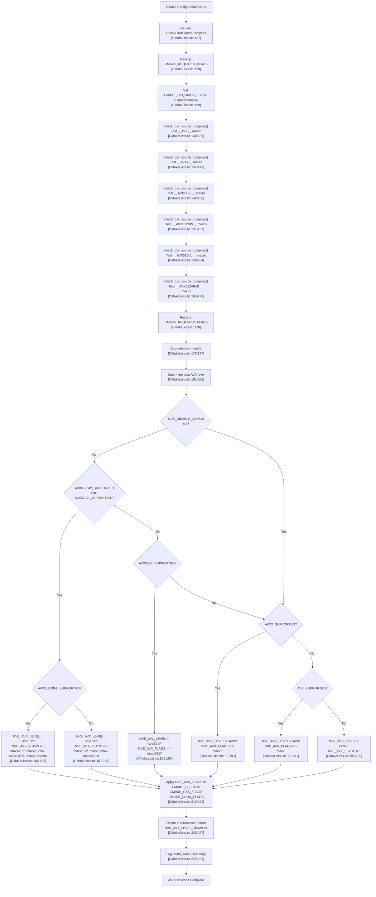
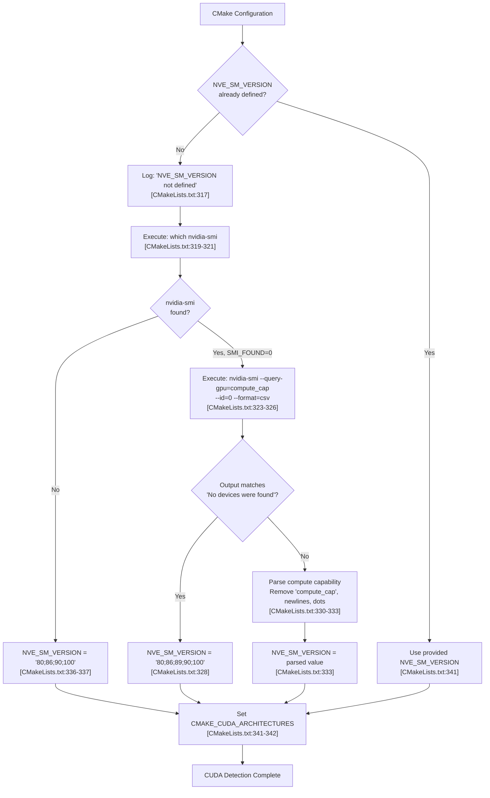

<!-- source: DeepWiki mcp.deepwiki.com · repo NVIDIA/nv-embedding-cache · page 10.3 AVX and CUDA Detection · fetched 2026-10-26 -->

# AVX and CUDA Detection

<details>
<summary>Relevant source files</summary>

The following files were used as context for generating this wiki page:

- [CMakeLists.txt](CMakeLists.txt)
- [README.md](README.md)

</details>


This page documents the hardware capability detection mechanisms used during the CMake configuration phase. The build system automatically detects the CPU's AVX (Advanced Vector Extensions) support level and the GPU's CUDA compute capability to optimize binaries for the target hardware.

For general CMake configuration options, see [CMake Configuration Options](#10.1). For feature selection via `NVE_FEATURES`, see [Feature Selection](#10.2).

## Purpose and Scope

The detection system serves two primary goals:

1. **AVX Detection**: Determine which SIMD instruction sets (AVX, AVX2, AVX-512) are available on the build machine and configure compiler flags to enable optimal CPU code generation
2. **CUDA Detection**: Identify the CUDA compute capability (SM version) of available GPUs to generate appropriate GPU kernels

Both detection mechanisms run automatically during the CMake configuration phase and can be overridden via CMake variables when needed (e.g., for cross-compilation or deployment to heterogeneous hardware).

**Sources:** [CMakeLists.txt:126-342]()

---

## AVX Detection Process

The AVX detection system uses CMake's `CheckCXXSourceCompiles` module to test compile small programs that require specific AVX instruction sets. The system tests progressively more advanced AVX levels and selects the best supported level.

### Detection Flow



**Sources:** [CMakeLists.txt:126-233]()

### AVX Levels Hierarchy

The build system recognizes the following AVX levels in descending order of capability:

| AVX Level | Compiler Flags | Preprocessor Macro | Extensions |
|-----------|---------------|-------------------|------------|
| **AVX512 (with VBMI)** | `-mavx512f -mavx512bw -mavx512vl -mavx512vbmi` | `NVE_AVX_LEVEL_AVX512=1` | Foundation, Byte/Word, Vector Length, Vector Byte Manipulation |
| **AVX512 (BW+VL)** | `-mavx512f -mavx512bw -mavx512vl` | `NVE_AVX_LEVEL_AVX512=1` | Foundation, Byte/Word, Vector Length |
| **AVX512F** | `-mavx512f` | `NVE_AVX_LEVEL_AVX512F=1` | Foundation only |
| **AVX2** | `-mavx2` | `NVE_AVX_LEVEL_AVX2=1` | 256-bit integer operations |
| **AVX** | `-mavx` | `NVE_AVX_LEVEL_AVX=1` | 256-bit floating-point operations |
| **NONE** | *(none)* | `NVE_AVX_LEVEL_NONE=1` | No SIMD optimizations |

**Sources:** [CMakeLists.txt:181-206](), [CMakeLists.txt:225-227]()

### Test Programs

Each AVX level is detected by attempting to compile a minimal test program:

```cpp
// Example for AVX2 detection [CMakeLists.txt:137-143]
#if __AVX2__
int main() { return 0; }
#else
#error AVX2 is not available!
#endif
```

The test uses the `-march=native` flag to enable all instructions supported by the build CPU. If the preprocessor macro (e.g., `__AVX2__`) is defined by the compiler, the test succeeds and sets the corresponding CMake variable (e.g., `AVX2_SUPPORTED`).

**Sources:** [CMakeLists.txt:130-171]()

### Compiler Flag Propagation

Once the AVX level is determined, the flags are propagated to all compiler types and build configurations:

```mermaid
graph TB
    NVE_AVX_FLAGS["NVE_AVX_FLAGS<br/>(e.g., '-mavx2')"]
    
    subgraph "Standard Flags"
        C_FLAGS["CMAKE_C_FLAGS"]
        CXX_FLAGS["CMAKE_CXX_FLAGS"]
        CUDA_FLAGS["CMAKE_CUDA_FLAGS"]
    end
    
    subgraph "Release Configuration"
        C_REL["CMAKE_C_FLAGS_RELEASE"]
        CXX_REL["CMAKE_CXX_FLAGS_RELEASE"]
        CUDA_REL["CMAKE_CUDA_FLAGS_RELEASE"]
    end
    
    subgraph "Debug Configuration"
        C_DBG["CMAKE_C_FLAGS_DEBUG"]
        CXX_DBG["CMAKE_CXX_FLAGS_DEBUG"]
        CUDA_DBG["CMAKE_CUDA_FLAGS_DEBUG"]
    end
    
    NVE_AVX_FLAGS --> C_FLAGS
    NVE_AVX_FLAGS --> CXX_FLAGS
    NVE_AVX_FLAGS --> CUDA_FLAGS
    NVE_AVX_FLAGS --> C_REL
    NVE_AVX_FLAGS --> CXX_REL
    NVE_AVX_FLAGS --> CUDA_REL
    NVE_AVX_FLAGS --> C_DBG
    NVE_AVX_FLAGS --> CXX_DBG
    NVE_AVX_FLAGS --> CUDA_DBG
    
    Preprocessor["Preprocessor Macros<br/>NVE_AVX_LEVEL_&lt;level&gt;=1"]
    NVE_AVX_FLAGS --> Preprocessor
```



**Sources:** [CMakeLists.txt:209-228]()

### Disabling AVX-512

The build system provides the `NVE_DISABLE_AVX512` option to disable AVX-512 instructions, which can be useful for:
- CI machines with AVX-512 support but instability
- Deployment to older CPUs that don't support AVX-512
- Avoiding AVX-512 frequency throttling on certain processors

When enabled, the system falls back to the next best available AVX level (typically AVX2):

```bash
cmake -DNVE_DISABLE_AVX512=ON ..
```

The implementation explicitly adds `-mno-avx512f` to prevent AVX-512 usage:

**Sources:** [CMakeLists.txt:181](), [CMakeLists.txt:190](), [CMakeLists.txt:244-250]()

---

## CUDA Architecture Detection

The CUDA detection system determines the compute capability (SM version) of available GPUs and configures `CMAKE_CUDA_ARCHITECTURES` to generate optimized kernels for those architectures.

### Detection Flow



**Sources:** [CMakeLists.txt:315-342]()

### SM Version Detection

The system uses `nvidia-smi` to query the GPU's compute capability:

```bash
nvidia-smi --query-gpu=compute_cap --id=0 --format=csv
```

The output format is typically:
```
compute_cap
8.0
```

The build system processes this by:
1. Removing the `"compute_cap"` header
2. Removing newlines
3. Removing the decimal point (e.g., `"8.0"` → `"80"`)

**Sources:** [CMakeLists.txt:323-333]()

### Default Architectures

When GPU detection fails or no GPU is present, the system uses conservative defaults that cover common modern GPU architectures:

| Scenario | Default SM Versions | GPUs Covered |
|----------|-------------------|--------------|
| **No nvidia-smi** | `80;86;90;100` | Ampere (A100, A30), Hopper (H100), Blackwell (B100) |
| **No devices found** | `80;86;89;90;100` | Adds Ada Lovelace (L4, L40) |

These defaults ensure the binaries work across a wide range of modern GPUs, at the cost of increased compilation time and binary size.

**Sources:** [CMakeLists.txt:328](), [CMakeLists.txt:336]()

### Architecture Code Generation

The detected or provided SM versions are directly assigned to `CMAKE_CUDA_ARCHITECTURES`, which controls CUDA kernel compilation:

```cmake
set(CMAKE_CUDA_ARCHITECTURES ${NVE_SM_VERSION} CACHE STRING "CUDA architectures" FORCE)
```

This generates separate kernel binaries for each specified architecture using PTX and SASS code generation.

**Sources:** [CMakeLists.txt:341-342]()

---

## Configuration Override

Both detection systems can be overridden for cross-compilation or specialized deployment scenarios.

### Overriding AVX Detection

To force a specific AVX level, set the appropriate disable flags before running CMake:

```bash
# Disable AVX-512 but allow AVX2
cmake -DNVE_DISABLE_AVX512=ON ..

# The detection will automatically select the best available level below AVX-512
```

Currently, there is no direct variable to force a specific AVX level, only the ability to disable AVX-512. The system always selects the best available level for the build machine.

**Sources:** [CMakeLists.txt:244-250]()

### Overriding CUDA Architecture

To specify target architectures manually (e.g., for cross-compilation):

```bash
# Single architecture
cmake -DNVE_SM_VERSION=80 ..

# Multiple architectures
cmake -DNVE_SM_VERSION="80;86;90" ..
```

This is essential when:
- Building on a machine without a GPU
- Building for deployment to different GPU generations
- Creating fat binaries for heterogeneous clusters

**Sources:** [CMakeLists.txt:315-316](), [CMakeLists.txt:341]()

---

## Detection Results Summary

The build system logs comprehensive detection results during configuration:

```
-- AVX_SUPPORTED:      1
-- AVX2_SUPPORTED:     1
-- AVX512F_SUPPORTED:  1
-- AVX512BW_SUPPORTED: 1
-- AVX512VL_SUPPORTED: 1
-- AVX512VBMI_SUPPORTED: 0
-- Using AVX-512 with BW and VL extensions, but without VBMI
-- AVX Configuration Summary:
--   Detected AVX Level: AVX512
--   AVX Flags: -mavx512f -mavx512bw -mavx512vl
--   Preprocessor Macro: NVE_AVX_LEVEL_AVX512=1
--   Runtime Detection: Enabled (NVE_RUNTIME_AVX_DETECTION=1)
-- Using NVE_SM_VERSION=80 from nvidia-smi
-- CMAKE_CUDA_ARCHITECTURES=80
```

This output allows verification of the detected capabilities and troubleshooting of detection failures.

**Sources:** [CMakeLists.txt:172-177](), [CMakeLists.txt:229-233](), [CMakeLists.txt:333](), [CMakeLists.txt:342]()

---

## Impact on Build Artifacts

The detection results affect compilation in several ways:

### AVX Impact

1. **Compiler optimization flags**: SIMD instructions are enabled (`-mavx2`, `-mavx512f`, etc.)
2. **Preprocessor definitions**: Code can conditionally compile based on `NVE_AVX_LEVEL_*` macros
3. **Performance**: Host-side operations (especially in NVHM plugin) use vectorized instructions

### CUDA Architecture Impact

1. **Kernel variants**: Separate binaries generated for each SM version
2. **Binary size**: More architectures = larger `.so` files
3. **Compile time**: Each architecture adds compilation time
4. **Runtime performance**: Kernels optimized for specific GPU features (tensor cores, shared memory sizes, etc.)

**Sources:** [CMakeLists.txt:209-228](), [CMakeLists.txt:341-342]()

---

## Cache Line Size Detection

Related to AVX detection, the build system also detects the CPU cache line size, which affects memory alignment and performance:

```bash
# Linux detection
getconf LEVEL1_DCACHE_LINESIZE
```

The result is stored in `NVE_CACHE_LINE_SIZE` (typically 64 bytes) and propagated as a preprocessor macro:

```cmake
-DNVE_CACHE_LINE_SIZE=${NVE_CACHE_LINE_SIZE}
```

This ensures data structures are properly aligned to avoid false sharing in multi-threaded code.

**Sources:** [CMakeLists.txt:111-124](), [CMakeLists.txt:279-281]()

---

