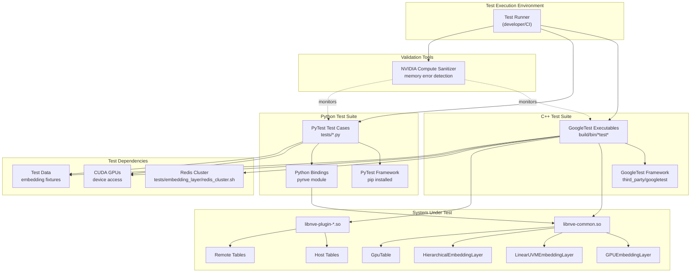
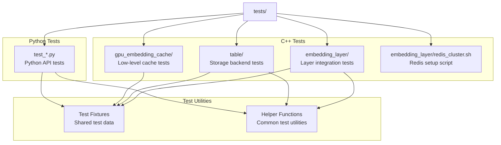
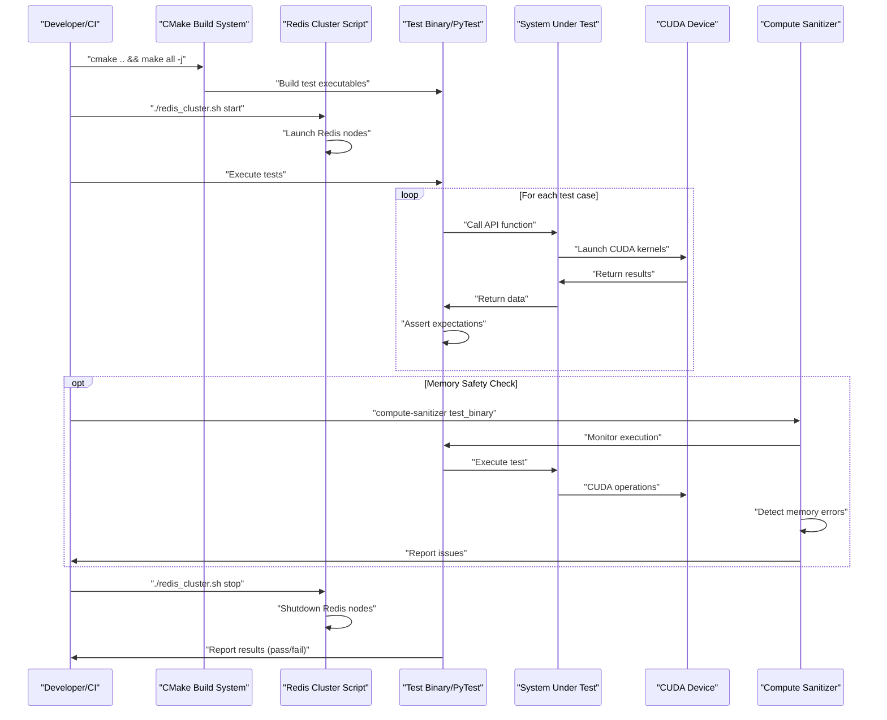
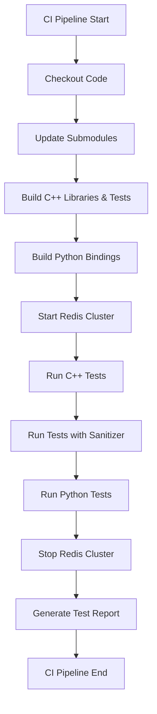

<!-- source: DeepWiki mcp.deepwiki.com · repo NVIDIA/nv-embedding-cache · page 11 Testing · fetched 2026-10-26 -->

# Testing

<details>
<summary>Relevant source files</summary>

The following files were used as context for generating this wiki page:

- [CONTRIBUTING.md](CONTRIBUTING.md)
- [README.md](README.md)
- [docs/advanced.md](docs/advanced.md)

</details>


This page provides an overview of the testing infrastructure for NV Embedding Cache, including test frameworks, organization, execution procedures, and guidelines for writing tests. The SDK employs a comprehensive testing strategy that combines unit tests, integration tests, and validation with NVIDIA Compute Sanitizer to ensure correctness and reliability.

For detailed information about unit test implementation and structure, see [Unit Tests](#11.1). For performance testing and benchmarking procedures, see [Benchmarking](#11.2).

## Testing Strategy

NV Embedding Cache uses a multi-layered testing approach to validate functionality across different components and integration levels:

**Test Coverage Levels:**
- **Component Tests**: Individual classes and functions tested in isolation
- **Integration Tests**: Multi-component interactions, including Redis cluster integration
- **API Tests**: Both C++ and Python API surfaces validated
- **Memory Safety Tests**: CUDA memory errors detected via Compute Sanitizer
- **Performance Tests**: Benchmarking scripts validate performance characteristics

**Sources:** [CONTRIBUTING.md:27-30](), [docs/advanced.md:34-35]()

## Testing Frameworks

The testing infrastructure is built on two primary frameworks, each targeting a different language surface:

| Framework | Language | Purpose | Test Location |
|-----------|----------|---------|---------------|
| GoogleTest | C++ | Unit tests for core library components | [tests/]() |
| PyTest | Python | Unit tests for Python bindings | [tests/]() |

Both frameworks are managed as third-party dependencies via git submodules and integrated into the CMake build system.

**Sources:** [docs/advanced.md:34-35](), [README.md:83-93]()

## Test Infrastructure Architecture



**Sources:** [docs/advanced.md:34-54](), [README.md:48-54]()

## Test Organization

Tests are organized by language and component type within the `tests/` directory:



**Sources:** [docs/advanced.md:34-35](), [docs/advanced.md:38-44]()

## Prerequisites for Testing

Before running tests, ensure the following dependencies are satisfied:

**System Requirements:**
- CUDA 12.8+ with appropriate GPU(s) available
- Redis 7.0.15+ (for integration tests requiring remote storage)
- Python 3.10+ with PyTorch installed
- CMake build completed successfully

**Installation Steps:**
```bash
# Build C++ tests
mkdir build_dir
cd build_dir
cmake ..
make all -j
cd -

# Install Python bindings for Python tests
pip install .

# Install additional Python test dependencies
PIP_CONSTRAINT="" pip install -r benchmarks/requirements.txt
```

**Sources:** [README.md:21-29](), [docs/advanced.md:50-54]()

## Running C++ Tests (GoogleTest)

C++ tests are compiled into separate executable binaries, each testing a specific component or subsystem.

### Basic Test Execution

```bash
# Start Redis cluster for integration tests
./tests/embedding_layer/redis_cluster.sh start
sleep 5

# Run all test binaries
for test in build_dir/bin/*test*; do
    ./$test
done

# Stop Redis cluster
./tests/embedding_layer/redis_cluster.sh stop
```

### Individual Test Execution

Each test binary can be run independently with GoogleTest options:

```bash
# Run a specific test binary
./build_dir/bin/gpu_embedding_cache_test

# Run specific test cases
./build_dir/bin/gpu_embedding_cache_test --gtest_filter="TestSuiteName.TestCaseName"

# List available tests
./build_dir/bin/gpu_embedding_cache_test --gtest_list_tests

# Verbose output
./build_dir/bin/gpu_embedding_cache_test --gtest_verbose
```

**Sources:** [docs/advanced.md:37-44]()

## Running Python Tests (PyTest)

Python tests validate the Python bindings and PyTorch integration.

### Basic PyTest Execution

```bash
# Run all Python tests
pytest tests

# Run with verbose output
pytest tests -v

# Run specific test file
pytest tests/test_specific_feature.py

# Run specific test function
pytest tests/test_specific_feature.py::test_function_name

# Show print statements
pytest tests -s
```

### Test Discovery

PyTest automatically discovers test files and functions following these conventions:
- Test files: `test_*.py` or `*_test.py`
- Test functions: `test_*`
- Test classes: `Test*`

**Sources:** [docs/advanced.md:46-49]()

## Test Execution Flow



**Sources:** [docs/advanced.md:37-54](), [CONTRIBUTING.md:29-30]()

## NVIDIA Compute Sanitizer

NVIDIA Compute Sanitizer is used to detect memory errors, race conditions, and other CUDA-related issues. All tests must pass Compute Sanitizer validation before pull requests are accepted.

### Running Tests with Compute Sanitizer

```bash
# Run with memory check
compute-sanitizer --tool memcheck ./build_dir/bin/gpu_embedding_cache_test

# Run with race detection
compute-sanitizer --tool racecheck ./build_dir/bin/gpu_embedding_cache_test

# Run with initialization check
compute-sanitizer --tool initcheck ./build_dir/bin/gpu_embedding_cache_test

# Run with synchronization check
compute-sanitizer --tool synccheck ./build_dir/bin/gpu_embedding_cache_test
```

### Common Issues Detected

| Tool | Detects |
|------|---------|
| `memcheck` | Out-of-bounds access, memory leaks, use-after-free |
| `racecheck` | Data races in concurrent kernel execution |
| `initcheck` | Uninitialized memory reads |
| `synccheck` | Synchronization errors, missing barriers |

**Sources:** [CONTRIBUTING.md:29-30]()

## Writing New Tests

When adding new features or fixing bugs, tests must be added or modified to cover the changes.

### C++ Test Structure

C++ tests follow GoogleTest conventions:

```
File: tests/component/test_feature.cpp

Structure:
- Include test framework headers
- Include system under test headers
- Define test fixtures (if needed)
- Implement test cases using TEST() or TEST_F() macros
- Use EXPECT_* and ASSERT_* macros for validation
```

**Common GoogleTest Macros:**
- `TEST(TestSuiteName, TestName)` - Basic test case
- `TEST_F(FixtureClass, TestName)` - Test with fixture
- `EXPECT_EQ(val1, val2)` - Non-fatal assertion
- `ASSERT_EQ(val1, val2)` - Fatal assertion
- `EXPECT_TRUE(condition)` - Boolean check
- `EXPECT_NEAR(val1, val2, tolerance)` - Floating point comparison

### Python Test Structure

Python tests follow PyTest conventions:

```
File: tests/test_feature.py

Structure:
- Import pytest and required modules
- Define test functions starting with test_
- Use assert statements for validation
- Use pytest fixtures for setup/teardown
- Use parametrize for data-driven tests
```

**Common PyTest Patterns:**
- `@pytest.fixture` - Setup/teardown resources
- `@pytest.mark.parametrize` - Run test with multiple inputs
- `@pytest.mark.skipif` - Conditional test skipping
- `pytest.raises(Exception)` - Assert exception is raised

### Test Coverage Guidelines

When writing tests, ensure coverage of:

1. **Happy Path**: Normal operation with valid inputs
2. **Edge Cases**: Boundary conditions, empty inputs, maximum sizes
3. **Error Handling**: Invalid inputs, out-of-memory conditions
4. **Concurrent Execution**: Multi-threaded/multi-stream scenarios
5. **Resource Cleanup**: Proper destruction and memory release
6. **API Contracts**: Return values, exceptions, state changes

**Sources:** [CONTRIBUTING.md:27-28]()

## Redis Cluster for Integration Tests

Some tests require a Redis cluster to validate the `RedisClusterTable` implementation and hierarchical caching.

### Redis Cluster Management

```bash
# Start Redis cluster (creates 6 nodes: 3 masters, 3 replicas)
./tests/embedding_layer/redis_cluster.sh start

# Check cluster status
./tests/embedding_layer/redis_cluster.sh status

# Stop Redis cluster
./tests/embedding_layer/redis_cluster.sh stop
```

The `redis_cluster.sh` script manages local Redis server instances configured as a cluster specifically for testing purposes. This cluster is separate from any production Redis deployment.

**Sources:** [docs/advanced.md:38-44]()

## Test Execution in CI/CD

For continuous integration, tests should be executed in the following order:



**Pull Request Requirements:**
- All tests must pass in both C++ and Python
- Compute Sanitizer checks must pass with no errors
- Test coverage must include new features or bug fixes
- Tests must be deterministic and reproducible

**Sources:** [CONTRIBUTING.md:23-34]()

## Test Data and Fixtures

Test cases use various fixtures to create reproducible test scenarios:

**Common Test Data:**
- Embedding dimensions: Powers of 2 (e.g., 64, 128, 256, 512)
- Embedding counts: Small (100s), Medium (10K), Large (100K+)
- Batch sizes: 1, 32, 256, 1024, 4096
- Cache capacities: Various percentages of total embeddings
- Key distributions: Uniform random, power-law (Zipf)

**Fixture Types:**
- In-memory embedding tables with known data
- Temporary GPU/host memory allocations
- Mock execution contexts
- Temporary Redis database instances
- Test-specific configuration parameters

## Debugging Test Failures

When tests fail, use these strategies for debugging:

### C++ Test Debugging

```bash
# Run test with debugger
gdb --args ./build_dir/bin/test_binary --gtest_filter="FailingTest"

# Enable verbose output
./build_dir/bin/test_binary --gtest_verbose

# Run single test case
./build_dir/bin/test_binary --gtest_filter="TestSuite.SpecificTest"
```

### Python Test Debugging

```bash
# Run with debugger on failure
pytest tests --pdb

# Show print statements
pytest tests -s

# Increase verbosity
pytest tests -vv

# Run specific failing test
pytest tests/test_file.py::test_function -vv -s
```

### CUDA Debugging

```bash
# Check for CUDA errors with cuda-gdb
cuda-gdb --args ./build_dir/bin/test_binary

# Use Compute Sanitizer for detailed error info
compute-sanitizer --log-file sanitizer.log ./build_dir/bin/test_binary

# Check device properties
nvidia-smi
```

**Sources:** [CONTRIBUTING.md:29-30]()

## Performance Testing

While functional correctness is validated through unit tests, performance characteristics are measured through dedicated benchmarking scripts. For detailed information on performance testing and benchmarking methodology, see [Benchmarking](#11.2).

---

**Related Pages:**
- For detailed unit test implementation, see [Unit Tests](#11.1)
- For performance benchmarking procedures, see [Benchmarking](#11.2)
- For contribution guidelines including test requirements, see [Contributing](#12)
- For build system details, see [Build System Details](#10)

---

