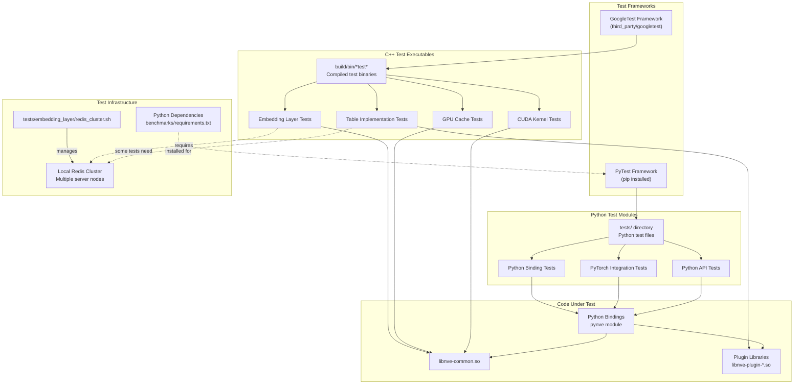
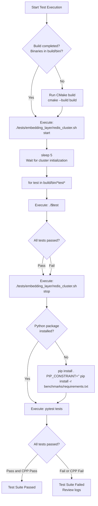
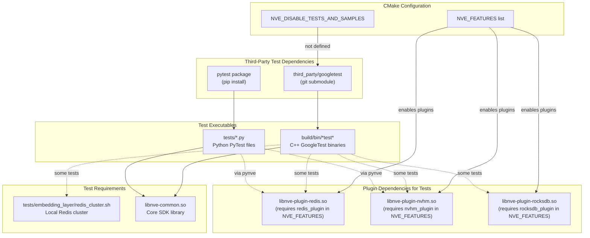

<!-- source: DeepWiki mcp.deepwiki.com · repo NVIDIA/nv-embedding-cache · page 11.1 Unit Tests · fetched 2026-10-26 -->

# Unit Tests

<details>
<summary>Relevant source files</summary>

The following files were used as context for generating this wiki page:

- [.gitmodules](.gitmodules)
- [docs/advanced.md](docs/advanced.md)
- [third_party/CMakeLists.txt](third_party/CMakeLists.txt)

</details>


This page documents the unit testing infrastructure for the NV Embedding Cache SDK, including both C++ GoogleTest-based tests and Python PyTest-based tests. It covers test organization, execution procedures, infrastructure requirements, and guidelines for writing new tests.

For information about performance benchmarking, see [Benchmarking](#11.2). For general contribution guidelines including testing requirements, see [Contributing](#12).

## Overview

The SDK uses two primary testing frameworks to ensure code quality and correctness across both C++ and Python interfaces:

| Framework | Language | Test Location | Purpose |
|-----------|----------|---------------|---------|
| GoogleTest | C++ | `tests/` | Core library functionality, CUDA kernels, table implementations |
| PyTest | Python | `tests/` | Python bindings, PyTorch integration, API correctness |

Tests are conditionally built based on the CMake configuration flag `NVE_DISABLE_TESTS_AND_SAMPLES`. When this flag is not set, the GoogleTest framework is automatically added as a third-party dependency.

Sources: [docs/advanced.md:34-54](), [third_party/CMakeLists.txt:20-22]()

## Test Framework Architecture

The following diagram illustrates the complete test infrastructure and its dependencies:



**Test Infrastructure Architecture**: This diagram shows the relationship between test frameworks, compiled test executables, test infrastructure components, and the code under test. GoogleTest produces C++ test binaries, while PyTest executes Python test modules. Some tests require a Redis cluster managed by a helper script.

Sources: [docs/advanced.md:34-54](), [third_party/CMakeLists.txt:20-22](), [.gitmodules:1-3]()

## Running C++ GoogleTest Tests

C++ unit tests are compiled into separate executable binaries during the build process. Each test executable is placed in the `build/bin/` directory with a name containing "test".

### Execution Procedure

The complete procedure for running all C++ tests includes starting the Redis cluster infrastructure, executing test binaries, and stopping the Redis cluster:

```bash
# Start local Redis cluster (required for some tests)
./tests/embedding_layer/redis_cluster.sh start
sleep 5

# Run all test executables
for test in build_dir/bin/*test*; do
  ./$test
done

# Stop Redis cluster
./tests/embedding_layer/redis_cluster.sh stop
```

### Redis Cluster Requirement

The `redis_cluster.sh` script manages local Redis server nodes required by tests that validate the Redis table plugin and hierarchical embedding layer functionality. The script supports the following operations:

| Command | Purpose |
|---------|---------|
| `start` | Launch Redis cluster nodes locally |
| `stop` | Terminate all Redis cluster nodes |

The 5-second sleep after starting the cluster allows nodes to initialize and establish cluster communication before tests begin.

Sources: [docs/advanced.md:37-44]()

## Running Python PyTest Tests

Python tests validate the Python bindings (`pynve` module) and PyTorch integration. These tests require proper installation of the Python package and its dependencies.

### Prerequisites

Before running Python tests, ensure the following packages are installed:

```bash
# Install the nve Python bindings
pip install .

# Install test and benchmark dependencies
PIP_CONSTRAINT="" pip install -r benchmarks/requirements.txt
```

The `PIP_CONSTRAINT=""` environment variable ensures that dependency resolution is not constrained by system-wide pip constraints.

### Execution Procedure

Once prerequisites are satisfied, execute all Python tests using:

```bash
pytest tests
```

PyTest automatically discovers and executes all test files in the `tests/` directory following the naming convention `test_*.py` or `*_test.py`.

Sources: [docs/advanced.md:46-54]()

## Test Execution Workflow

The following diagram illustrates the complete workflow for executing the test suite:



**Test Execution Workflow**: This flowchart details the sequential steps required to execute the complete test suite, including prerequisite checks, Redis cluster management, and both C++ and Python test execution phases.

Sources: [docs/advanced.md:34-54]()

## Test Organization and Structure

### Directory Structure

Tests are organized in the `tests/` directory with the following structure:

```
tests/
├── embedding_layer/
│   ├── redis_cluster.sh        # Redis cluster management script
│   └── [test files]            # Layer-specific tests
├── [C++ test sources]          # GoogleTest test files
└── [Python test files]         # PyTest test files
```

### Test Categories

The SDK includes tests for the following components:

| Test Category | Focus Area | Test Type |
|---------------|------------|-----------|
| **Embedding Layer Tests** | `GPUEmbeddingLayer`, `LinearUVMEmbeddingLayer`, `HierarchicalEmbeddingLayer` | GoogleTest (C++), PyTest (Python) |
| **Table Tests** | `GpuTable`, `NvhmMapTable`, `RedisClusterTable`, `RocksDBTable` | GoogleTest (C++) |
| **GPU Cache Tests** | `ec_set_associative`, eviction policies, insert heuristics | GoogleTest (C++) |
| **CUDA Kernel Tests** | Query, update, gather, accumulate kernels | GoogleTest (C++) |
| **Python Binding Tests** | `pynve` API correctness, type conversions | PyTest (Python) |
| **PyTorch Integration Tests** | `torch.nn.Embedding` compatibility, gradient flow | PyTest (Python) |

Sources: [docs/advanced.md:34-54]()

## Test Infrastructure Components

### GoogleTest Framework

GoogleTest is included as a git submodule and configured through CMake. The framework is automatically added to the build when tests are enabled:

[third_party/CMakeLists.txt:20-22]()

The `NVE_DISABLE_TESTS_AND_SAMPLES` CMake variable controls whether GoogleTest is included in the build. When undefined or set to false, the GoogleTest submodule at `third_party/googletest` is added to the project.

### Redis Cluster Management

Tests requiring distributed table functionality depend on a local Redis cluster. The management script provides lifecycle control:

**Script Location**: `tests/embedding_layer/redis_cluster.sh`

**Operations**:
- `start`: Initialize and configure multiple Redis server nodes to form a cluster
- `stop`: Gracefully shutdown all cluster nodes

The script enables testing of the `RedisClusterTable` plugin ([RedisClusterTable](#6.2)) without requiring an external Redis deployment.

### Python Test Dependencies

Python tests require additional packages beyond the core `pynve` module. These dependencies are specified in `benchmarks/requirements.txt` and include:

- PyTest framework and plugins
- PyTorch for integration testing
- NumPy for numerical validation
- Additional utilities for test fixtures

Sources: [docs/advanced.md:34-54](), [third_party/CMakeLists.txt:20-22]()

## Writing New Tests

### C++ GoogleTest Tests

New C++ tests should follow GoogleTest conventions:

1. **Include the GoogleTest header**: `#include <gtest/gtest.h>`
2. **Use `TEST()` or `TEST_F()` macros** to define test cases
3. **Add the test source to CMakeLists.txt** in the appropriate test directory
4. **Link against required libraries**: `libnve-common.so` and any needed plugins
5. **Use test fixtures** for setup/teardown of resources like execution contexts

**Example Test Structure**:
```cpp
#include <gtest/gtest.h>
#include "embedding_layer.hpp"

TEST(GpuTableTest, BasicInsertAndLookup) {
    // Test implementation
    EXPECT_EQ(result, expected);
}
```

### Python PyTest Tests

New Python tests should follow PyTest conventions:

1. **Create test files** named `test_*.py` or `*_test.py` in the `tests/` directory
2. **Use `assert` statements** for validation
3. **Use PyTest fixtures** for setup/teardown using `@pytest.fixture` decorator
4. **Import the `pynve` module** to access SDK functionality
5. **Test both Python API and PyTorch integration** where applicable

**Example Test Structure**:
```python
import pytest
from pynve import NVEmbedding

def test_embedding_lookup():
    # Test implementation
    assert result == expected
```

### Test Naming Conventions

| Convention | Purpose | Example |
|------------|---------|---------|
| `*_test.cpp` / `test_*.cpp` | C++ test source files | `gpu_table_test.cpp` |
| `test_*.py` / `*_test.py` | Python test files | `test_pytorch_integration.py` |
| `TEST(TestSuite, TestCase)` | GoogleTest macro format | `TEST(CacheTest, EvictionPolicy)` |
| `def test_*()` | PyTest function format | `def test_lookup_miss()` |

Sources: [docs/advanced.md:34-54]()

## Test Dependencies and Build Configuration

The following diagram maps test dependencies to CMake configuration and build outputs:



**Test Dependencies and Build Configuration**: This diagram shows how CMake configuration variables control test framework inclusion and how plugin features affect test availability. Some tests require specific plugins to be enabled during build configuration.

Sources: [third_party/CMakeLists.txt:20-22](), [third_party/CMakeLists.txt:114-145](), [.gitmodules:1-3]()

## Additional Validation Tools

Beyond unit tests, developers can use additional validation tools:

### NVIDIA Compute Sanitizer

NVIDIA Compute Sanitizer can be used to detect CUDA-related issues such as:
- Memory access violations
- Race conditions
- Synchronization errors
- API errors

**Usage**:
```bash
compute-sanitizer ./build/bin/test_executable
```

This tool is particularly valuable for validating CUDA kernel implementations and GPU memory operations.

### Manual Redis Cluster Testing

For interactive testing with Redis:

```bash
# Start the cluster
./tests/embedding_layer/redis_cluster.sh start

# Run your manual tests or interactive sessions
# ...

# Stop the cluster when done
./tests/embedding_layer/redis_cluster.sh stop
```

Sources: [docs/advanced.md:34-54]()

## Test Execution Best Practices

| Practice | Rationale |
|----------|-----------|
| **Always run Redis cluster setup before C++ tests** | Some tests depend on Redis infrastructure and will fail without it |
| **Allow cluster initialization time** | The 5-second sleep ensures cluster is ready before tests execute |
| **Install Python dependencies in clean environment** | Use virtual environments to avoid dependency conflicts |
| **Run full test suite before submitting changes** | Both C++ and Python tests must pass for code contributions |
| **Check test output logs carefully** | GoogleTest and PyTest provide detailed failure information |
| **Clean up Redis cluster after tests** | Prevents resource leakage and port conflicts |

For information about continuous integration and automated testing during pull requests, see [Pull Request Process](#12.2).

Sources: [docs/advanced.md:34-54]()

---

