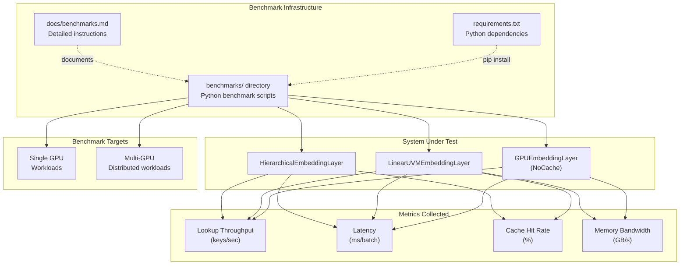
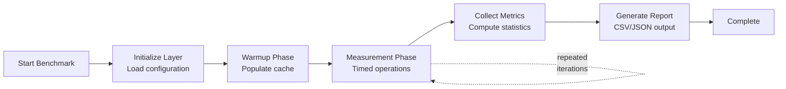
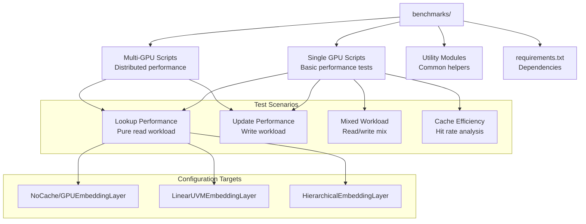
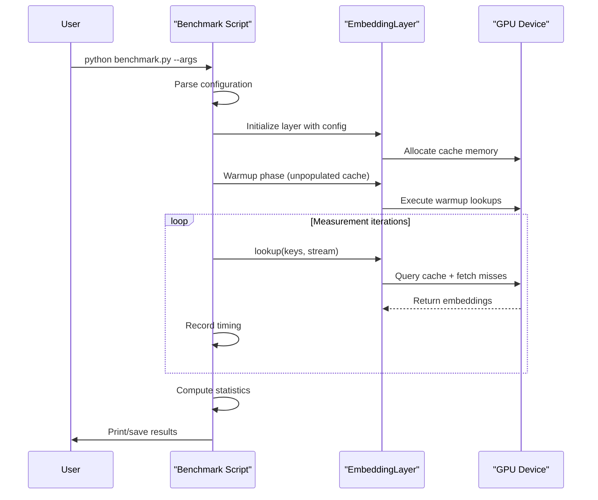
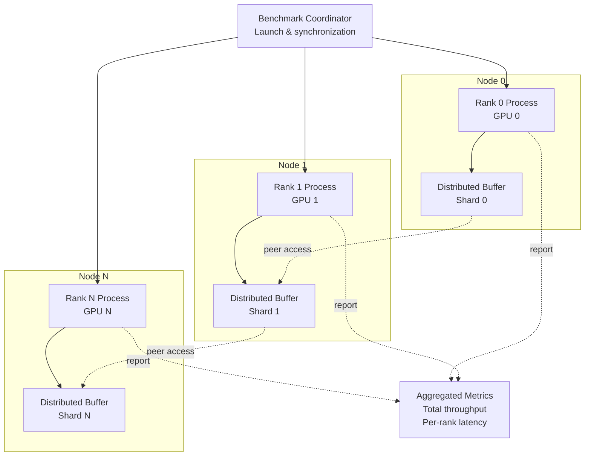
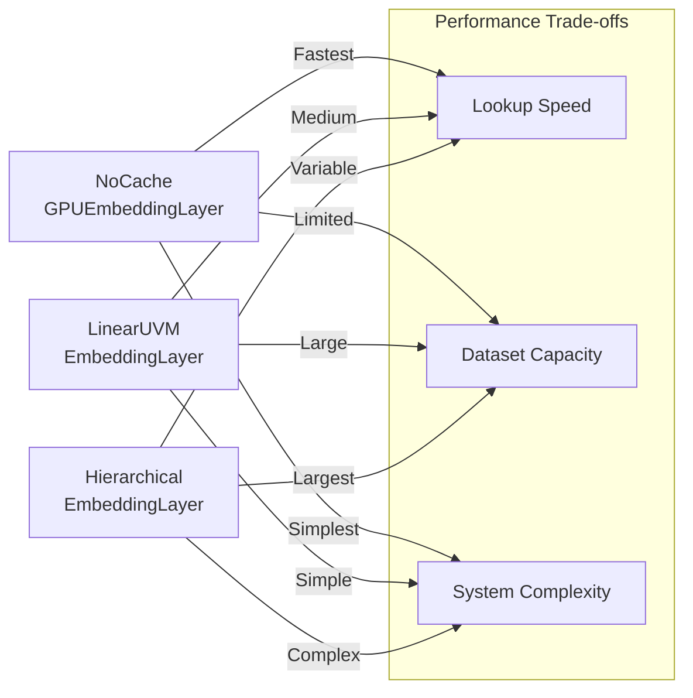
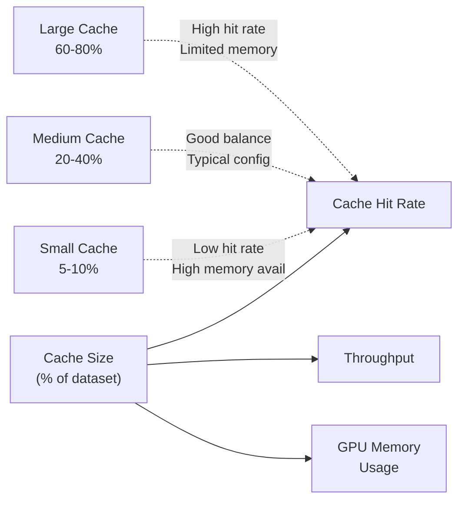
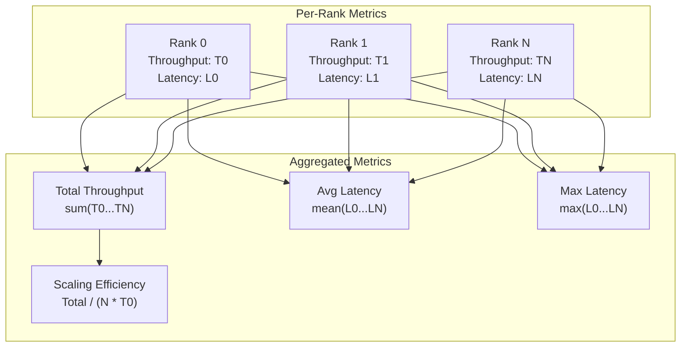
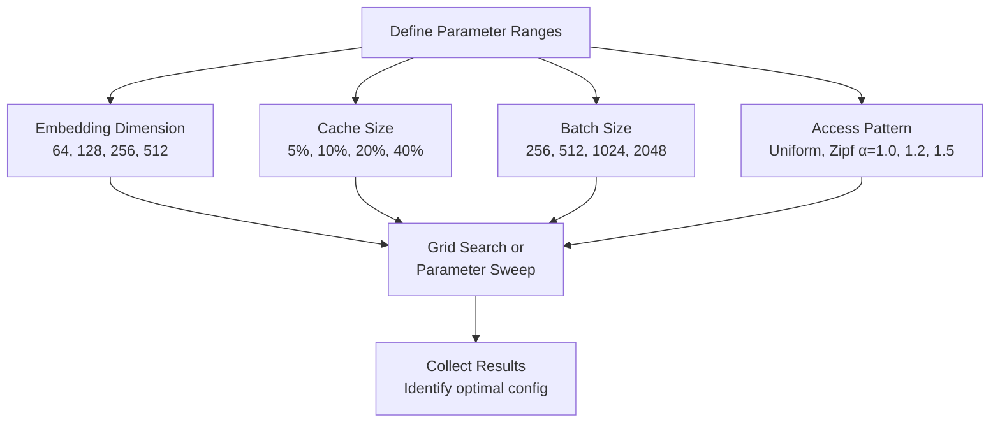

<!-- source: DeepWiki mcp.deepwiki.com · repo NVIDIA/nv-embedding-cache · page 11.2 Benchmarking · fetched 2026-10-26 -->

# Benchmarking

<details>
<summary>Relevant source files</summary>

The following files were used as context for generating this wiki page:

- [CHANGELOG.md](CHANGELOG.md)
- [README.md](README.md)
- [docs/advanced.md](docs/advanced.md)

</details>


## Purpose and Scope

This page documents the performance benchmarking infrastructure for NV Embedding Cache SDK. The benchmarking scripts measure lookup throughput, latency, and cache hit rates across different cache configurations and hardware setups. These tools help users evaluate performance characteristics and optimize cache parameters for their specific workloads.

For unit and integration testing, see [Unit Tests](#11.1). For performance optimization techniques and tuning parameters, see [Performance Tuning](#8.3).

**Sources:** [README.md:72](), [CHANGELOG.md:13]()

## Overview

The SDK provides benchmarking scripts in the `benchmarks/` directory that support both single-GPU and multi-GPU configurations. These scripts exercise the three main caching strategies (NoCache, LinearUVM, Hierarchical) and measure key performance metrics under various load patterns.



**Benchmark Execution Flow**



**Sources:** [README.md:72](), [CHANGELOG.md:13]()

## Prerequisites

Before running benchmarks, ensure the following dependencies are installed:

| Requirement | Purpose | Installation |
|------------|---------|--------------|
| Python 3.10+ | Benchmark script execution | System package manager |
| PyTorch | Tensor operations | `pip install torch` |
| NV Embedding Cache | SDK being tested | `pip install .` |
| Benchmark dependencies | Additional Python packages | `pip install -r benchmarks/requirements.txt` |
| CUDA 12.8+ | GPU operations | NVIDIA driver installation |

**Installation Command:**

```bash
# Install SDK
pip install .

# Install benchmark dependencies
PIP_CONSTRAINT="" pip install -r benchmarks/requirements.txt
```

The `PIP_CONSTRAINT=""` environment variable prevents conflicts with existing package constraints during installation.

**Sources:** [docs/advanced.md:50-54](), [README.md:21-27]()

## Benchmark Scripts Structure

The benchmarking infrastructure follows this organizational structure:



**Sources:** [README.md:72](), [CHANGELOG.md:13]()

## Running Single-GPU Benchmarks

Single-GPU benchmarks measure performance on a single device with various cache configurations.

### Basic Execution

The benchmark scripts are Python-based and execute through the command line:

```bash
cd benchmarks/
python <benchmark_script>.py [options]
```

### Common Configuration Parameters

Benchmark scripts typically accept parameters that control:

| Parameter Category | Examples | Purpose |
|-------------------|----------|---------|
| Dataset parameters | `--num_keys`, `--embedding_dim` | Define embedding table dimensions |
| Batch parameters | `--batch_size`, `--num_batches` | Control workload size |
| Cache parameters | `--cache_size`, `--cache_type` | Configure caching strategy |
| Access pattern | `--distribution`, `--hotspot_ratio` | Simulate realistic access patterns |
| Hardware | `--device`, `--num_threads` | Specify execution resources |
| Output | `--output_file`, `--format` | Control result reporting |

### Typical Benchmark Workflow



**Sources:** [README.md:72](), [docs/advanced.md:50-54]()

## Running Multi-GPU Benchmarks

Multi-GPU benchmarks test distributed embedding access across multiple devices or nodes, measuring scalability and coordination overhead.

### Multi-GPU Setup Requirements

Multi-GPU benchmarking requires additional setup:

1. **Multiple GPU devices** available on the system
2. **MPI environment** for distributed execution (optional but recommended)
3. **Distributed buffer allocation** spanning devices
4. **Network bandwidth** for cross-node communication (if applicable)

### Distributed Execution Model



The multi-GPU benchmarks leverage the distributed buffer capabilities described in [include/distributed.hpp]() and the `CUDADistributedBuffer` class for memory allocation spanning multiple devices.

**Sources:** [CHANGELOG.md:13](), [docs/advanced.md:26-28]()

## Metrics and Interpretation

### Primary Performance Metrics

Benchmark scripts collect and report the following metrics:

| Metric | Units | Interpretation | Relevant For |
|--------|-------|----------------|--------------|
| **Lookup Throughput** | keys/second or GB/s | Rate of embedding retrievals | All cache types |
| **Batch Latency** | milliseconds | Time per batch operation | Latency-sensitive applications |
| **Cache Hit Rate** | percentage (0-100%) | Fraction of lookups served from cache | LinearUVM, Hierarchical |
| **Memory Bandwidth** | GB/s | Data transfer rate | GPU-intensive workloads |
| **Insertion Rate** | keys/second | Rate of cache updates | Modify-heavy workloads |

### Performance Comparison Table

Results typically compare configurations:

| Configuration | Throughput | Latency (p50) | Latency (p99) | Hit Rate |
|--------------|------------|---------------|---------------|----------|
| NoCache (GPU only) | Highest | Lowest | Most consistent | N/A (100%) |
| LinearUVM | Medium-High | Low-Medium | Variable | 80-95% typical |
| Hierarchical (L1+L2) | Medium | Medium | More variable | 70-90% typical |
| Hierarchical (L1+L2+L3) | Lower | Higher | Most variable | 60-85% typical |

### Key Observations



- **NoCache/GPUEmbeddingLayer**: Consistent highest throughput, but limited by GPU memory capacity
- **LinearUVMEmbeddingLayer**: Good balance of throughput and capacity, automatic caching via UVM
- **HierarchicalEmbeddingLayer**: Maximum capacity with tiered performance based on cache levels

**Sources:** [README.md:11-15]()

## Benchmark Configuration Patterns

### Access Pattern Simulation

Realistic benchmarks simulate access patterns that match production workloads:

| Pattern Type | Description | Use Case |
|-------------|-------------|----------|
| **Uniform** | All keys equally likely | Baseline testing |
| **Zipf/Power-law** | Hot embeddings accessed frequently | Typical recommender systems |
| **Hotspot** | Small subset very hot | User activity bursts |
| **Sequential** | Linear key access | Batch inference |

Power-law distributions are particularly important as they match real-world recommender system workloads where a small percentage of embeddings account for most lookups.

### Cache Size Tuning

Benchmarks help determine optimal cache sizes:



The optimal cache size depends on:
- **Access pattern skew**: Higher skew (Zipf) benefits smaller caches
- **Working set size**: Larger working sets need bigger caches
- **GPU memory constraints**: Balance with model and other allocations

**Sources:** [README.md:11-17]()

## Integration with Performance Tuning

Benchmark results inform configuration decisions documented in [Performance Tuning](#8.3):

| Benchmark Observation | Tuning Action |
|----------------------|---------------|
| Low cache hit rate | Increase cache size, adjust eviction policy |
| High latency variance | Tune batch sizes, adjust execution contexts |
| Poor multi-GPU scaling | Check network bandwidth, adjust sharding |
| Memory bandwidth bottleneck | Reduce embedding dimensions, enable compression |

### Execution Context Impact

The number of execution contexts (see [Execution Contexts](#3.4)) affects benchmark results:

- **Fewer contexts**: Lower memory overhead, potential serialization
- **More contexts**: Higher parallelism, increased memory usage
- **Optimal count**: Typically 2-4 contexts per benchmark thread

Benchmark scripts should test with varying context counts to find the optimal configuration for the target workload.

**Sources:** [docs/advanced.md:3-10]()

## Benchmark Output Formats

### Common Output Structure

Benchmark scripts typically produce structured output:

**Terminal Output Example:**
```
=== Benchmark Configuration ===
Cache Type: LinearUVM
Embedding Dim: 128
Num Keys: 10000000
Cache Size: 1000000
Batch Size: 1024
Distribution: Zipf (alpha=1.2)

=== Warmup Phase ===
Iterations: 100
Duration: 2.3s

=== Measurement Phase ===
Iterations: 1000
Duration: 18.7s
Throughput: 54.7M keys/s (6.99 GB/s)
Latency p50: 18.7ms
Latency p99: 24.3ms
Cache Hit Rate: 87.3%
```

**File Output Formats:**
- **CSV**: Time-series data, per-iteration metrics
- **JSON**: Structured configuration and results
- **Log files**: Detailed execution traces

### Multi-GPU Aggregation

Multi-GPU benchmarks aggregate metrics across ranks:



**Scaling efficiency** measures how well the system utilizes additional GPUs. Ideal scaling = 1.0 (linear), practical values typically 0.7-0.9 depending on communication overhead.

**Sources:** [CHANGELOG.md:13]()

## Troubleshooting Benchmark Issues

### Common Issues and Solutions

| Issue | Symptom | Solution |
|-------|---------|----------|
| Import errors | `ModuleNotFoundError: nve` | Ensure `pip install .` completed successfully |
| CUDA out of memory | Benchmark crashes with OOM | Reduce cache size, batch size, or embedding dimensions |
| Inconsistent results | High variance between runs | Increase warmup iterations, check system load |
| Redis connection failures | Hierarchical benchmarks fail | Start Redis cluster (see [Unit Tests](#11.1)) |
| MPI errors | Multi-GPU benchmark won't start | Check MPI installation, process count |

### Validation Checks

Before benchmarking, verify the environment:

```bash
# Check Python installation
python --version

# Check NVE installation
python -c "import nve; print(nve.__version__)"

# Check GPU availability
nvidia-smi

# Check CUDA version
nvcc --version
```

**Sources:** [docs/advanced.md:50-54](), [README.md:21-27]()

## Best Practices

### Benchmarking Methodology

1. **Isolate the system**: Run benchmarks on dedicated hardware without other workloads
2. **Multiple runs**: Execute each configuration 3-5 times and report median/mean
3. **Warmup properly**: Allow cache to populate before measurement phase
4. **Representative access patterns**: Use Zipf/power-law distributions matching production
5. **Document configuration**: Save complete benchmark parameters with results
6. **Consistent baselines**: Compare against NoCache/GPU-only configuration

### Configuration Space Exploration

Systematically explore parameter space:



Focus exploration on parameters that match your deployment constraints (GPU memory, dataset size, latency requirements).

**Sources:** [README.md:72]()

---

## Related Documentation

- [Unit Tests](#11.1): Testing infrastructure and test execution
- [Performance Tuning](#8.3): Optimization techniques and configuration parameters
- [Multi-GPU Support](#8.1): Multi-device configuration and distributed setups
- [Cache Configuration Strategies](#1.2): Choosing appropriate cache types

**Sources:** [README.md:58-73](), [CHANGELOG.md:1-40](), [docs/advanced.md:1-55]()

---

