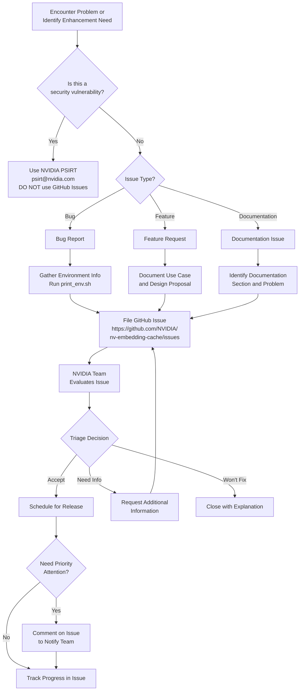
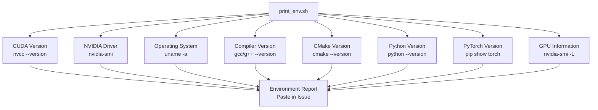
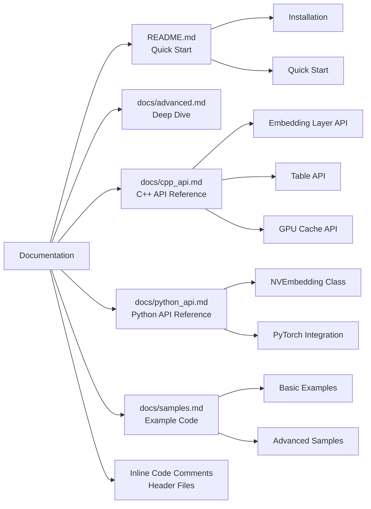
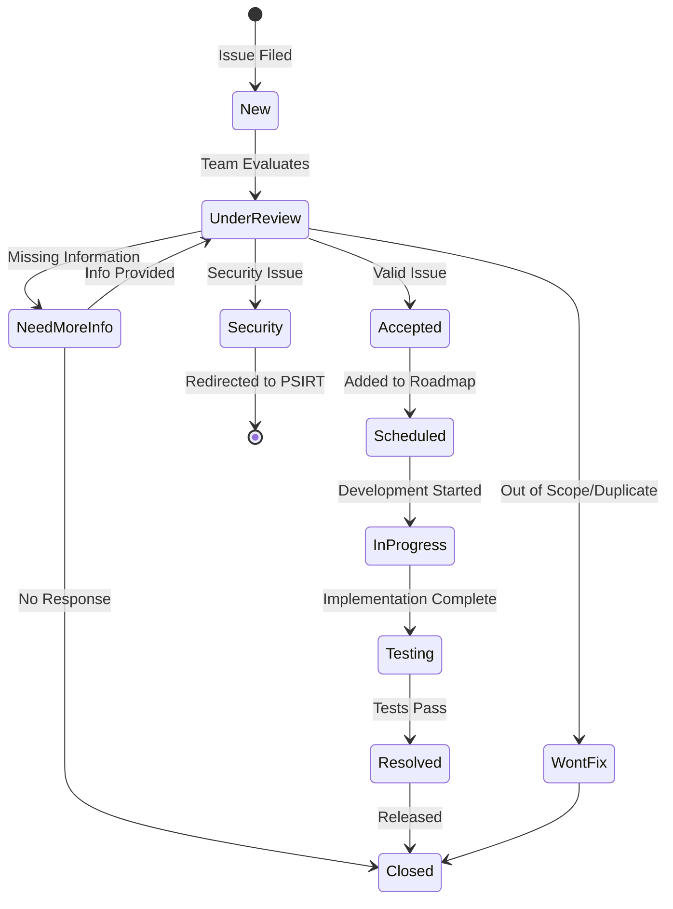

<!-- source: DeepWiki mcp.deepwiki.com · repo NVIDIA/nv-embedding-cache · page 12.1 Reporting Issues · fetched 2026-10-26 -->

# Reporting Issues

<details>
<summary>Relevant source files</summary>

The following files were used as context for generating this wiki page:

- [CONTRIBUTING.md](CONTRIBUTING.md)
- [SECURITY.md](SECURITY.md)

</details>


## Purpose and Scope

This page documents the process for reporting bugs, feature requests, and documentation issues in the NV Embedding Cache SDK. It covers what types of issues should be reported, how to gather necessary diagnostic information, and what to expect after filing an issue.

For information about contributing code through pull requests, see [Pull Request Process](#12.2). For security vulnerability reporting, see [Security](#14). For general contributing guidelines, see [Contributing](#12).

---

## Types of Issues

The NV Embedding Cache project tracks three primary types of issues through GitHub Issues:

| Issue Type | Description | Required Information |
|------------|-------------|---------------------|
| **Bug Report** | Unexpected behavior, crashes, incorrect results | Environment details from `print_env.sh`, reproduction steps, expected vs actual behavior |
| **Feature Request** | New functionality or enhancement proposals | Use case description, design considerations, impact analysis |
| **Documentation Issue** | Unclear, incorrect, or missing documentation | Affected documentation section, suggested improvements |

Sources: [CONTRIBUTING.md:1-12]()

---

## Issue Reporting Workflow



Sources: [CONTRIBUTING.md:5-12](), [SECURITY.md:5]()

---

## Filing a GitHub Issue

Issues are tracked using GitHub's issue tracking system. The process is straightforward:

### Step 1: Access the Issue Tracker

Navigate to the [GitHub Issues page](https://github.com/NVIDIA/nv-embedding-cache/issues) for the NV Embedding Cache repository.

### Step 2: Create a New Issue

Click the "New Issue" button and provide the required information based on the issue type.

### Step 3: Provide Complete Information

The quality of the issue report directly impacts how quickly it can be addressed. See the sections below for specific requirements.

Sources: [CONTRIBUTING.md:6]()

---

## Bug Report Requirements

When filing a bug report, include the following information:

### Environment Information

The `print_env.sh` script is a critical diagnostic tool that gathers relevant environment details. This script collects:



**To run the script:**

```bash
./print_env.sh
```

Paste the complete output into your bug report. This information helps the development team quickly identify environment-specific issues.

### Reproduction Steps

Provide clear, step-by-step instructions to reproduce the bug:

1. Initial conditions (dataset size, configuration parameters)
2. Exact commands or code executed
3. Expected behavior
4. Actual behavior observed

### Additional Context

Include any other relevant information:

- **Error messages**: Complete stack traces or error output
- **Logs**: Relevant log files if available
- **Configuration**: Embedding layer type, table configurations, cache parameters
- **Workarounds**: Any temporary solutions you've discovered

Sources: [CONTRIBUTING.md:8-9]()

---

## Feature Request Requirements

When proposing a new feature, provide:

### Use Case Description

Explain the problem or limitation you're trying to address:
- What task are you trying to accomplish?
- Why can't this be achieved with current functionality?
- What is the expected benefit or improvement?

### Design Proposal

If you have ideas about implementation:
- Proposed API changes or additions
- How it integrates with existing components (see [System Architecture](#1.3))
- Performance considerations
- Backwards compatibility concerns

### Discussion Process

The team will engage in design discussion before implementation:

1. **Initial Proposal**: File the feature request issue
2. **Design Discussion**: Team responds with questions and suggestions
3. **Agreement**: Once the design is approved, implementation can begin
4. **Implementation**: Follow the [Pull Request Process](#12.2)

Sources: [CONTRIBUTING.md:13-17]()

---

## Documentation Issue Requirements

For documentation problems, specify:

| Information | Description |
|-------------|-------------|
| **Location** | Which file, section, or API is affected (e.g., `README.md`, specific class documentation) |
| **Problem Type** | Unclear explanation, incorrect information, missing content, broken links |
| **Suggested Fix** | Proposed corrections or clarifications |
| **Context** | Why this documentation is important for your use case |

Common documentation locations to reference:



Sources: [CONTRIBUTING.md:31]()

---

## Issue Lifecycle

After filing an issue, the following process occurs:

### 1. Team Evaluation

The NVIDIA development team reviews all new issues. This typically happens within a few business days.

### 2. Triage

The team categorizes and prioritizes the issue:



### 3. Scheduling

Accepted issues are scheduled for a future release. The release timeline depends on:
- **Severity**: Critical bugs receive higher priority
- **Complexity**: Simple fixes may be included sooner
- **Roadmap fit**: Features aligned with planned work
- **Community impact**: Issues affecting many users

### 4. Priority Escalation

If you believe an issue requires urgent attention:

1. Add a comment to the issue explaining the urgency
2. Provide context on the impact (e.g., blocking production deployment)
3. The team will re-evaluate the priority

Sources: [CONTRIBUTING.md:10-12]()

---

## What NOT to Report as Issues

### Security Vulnerabilities

**Never report security vulnerabilities through GitHub Issues.** Security issues must be reported through NVIDIA's Product Security Incident Response Team (PSIRT):

- **Email**: psirt@nvidia.com
- **Web Form**: [NVIDIA Security Vulnerability Submission Form](https://www.nvidia.com/object/submit-security-vulnerability.html)
- **PGP Key**: Available for secure communication at [NVIDIA PGP Key](https://www.nvidia.com/en-us/security/pgp-key)

See [Security](#14) for complete details on security reporting.

### Questions and Usage Help

GitHub Issues are for actionable bug reports and feature requests. For questions about how to use the SDK:

- Review existing documentation in `README.md` and `docs/` directory
- Check the [FAQ](#16) and [Troubleshooting](#15) pages
- Examine the [Examples and Samples](#9)

If documentation is unclear, that IS a valid documentation issue.

Sources: [CONTRIBUTING.md:5-6](), [SECURITY.md:5]()

---

## Issue Tracking and Updates

Once an issue is filed, you can:

### Monitor Progress

- **Watch the issue**: GitHub will notify you of updates
- **Check milestones**: Issues may be assigned to specific release milestones
- **Review commits**: Linked commits show implementation progress

### Participate in Discussion

- Answer clarifying questions from the team
- Test proposed fixes or workarounds
- Provide additional context as requested
- Help other users experiencing similar issues

### Verify Resolution

When an issue is marked as resolved:
1. Test the fix in your environment
2. Confirm the issue is fully addressed
3. Close the issue if satisfied, or request further work if not

Sources: [CONTRIBUTING.md:10-12]()

---

## Best Practices for Effective Issue Reports

### Be Specific

❌ **Bad**: "Cache doesn't work"

✅ **Good**: "HierarchicalEmbeddingLayer lookup returns incorrect embeddings when using RedisClusterTable with multi-GPU configuration (4x A100)"

### Provide Complete Context

Always include:
- Output from `print_env.sh`
- Configuration parameters from your code
- Complete error messages and stack traces
- Minimal reproduction case

### Search Before Filing

Before creating a new issue:
1. Search existing open issues for duplicates
2. Search closed issues for previously resolved problems
3. Check recent release notes for known issues

### One Issue Per Report

File separate issues for separate problems. This allows:
- Independent tracking and resolution
- Clear scope for each fix
- Better organization of the issue tracker

Sources: [CONTRIBUTING.md:1-22]()

---

## Code References

The issue reporting process is documented in:
- [CONTRIBUTING.md:1-22]() - Complete contributing guidelines
- [SECURITY.md:1-25]() - Security vulnerability reporting process

The `print_env.sh` script should be located in the repository root and executed before filing bug reports.

Sources: [CONTRIBUTING.md:8-9]()

---

