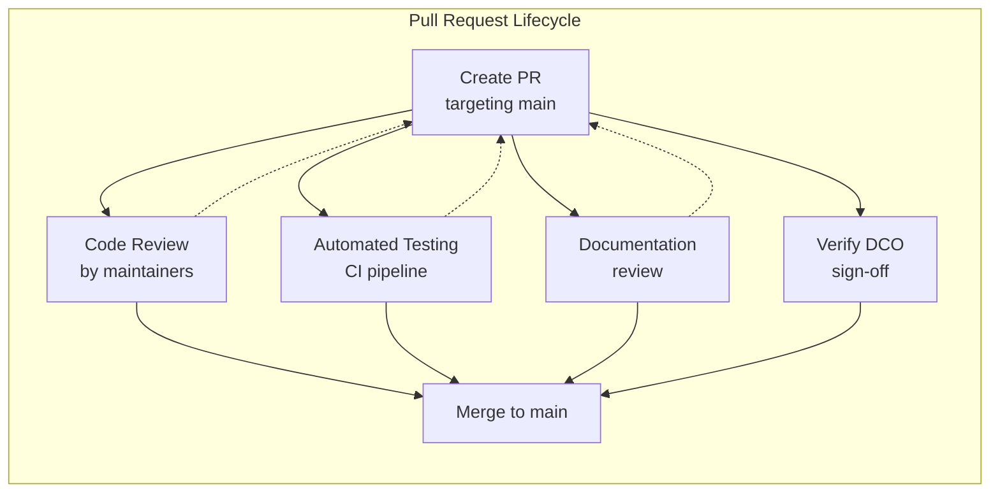
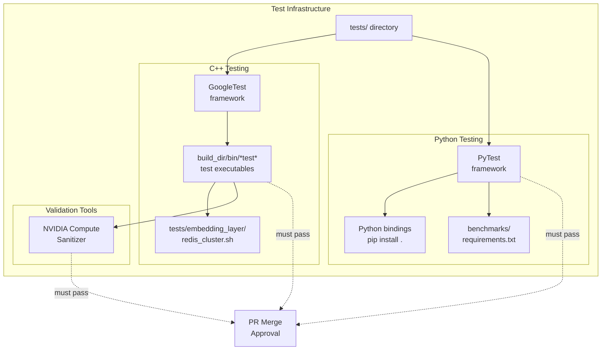
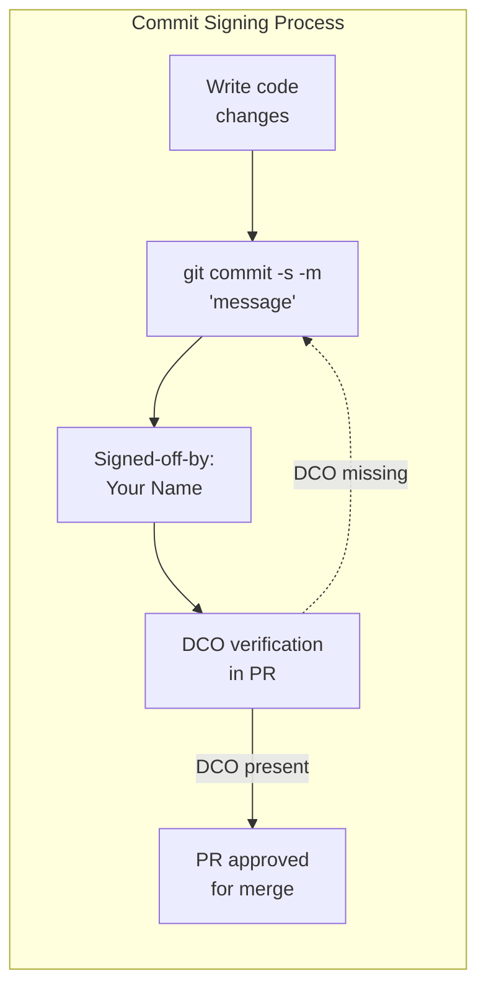
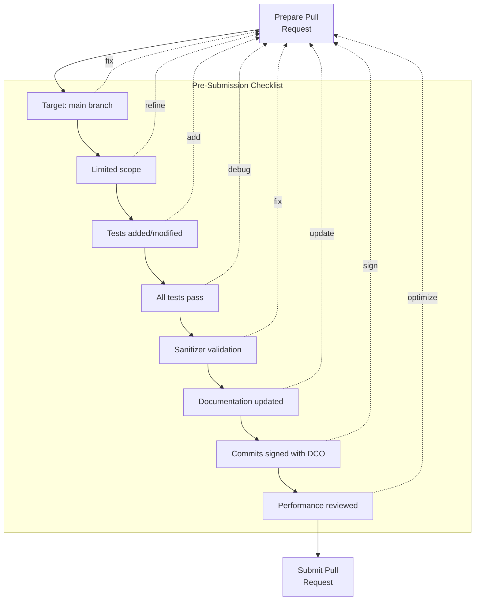

<!-- source: DeepWiki mcp.deepwiki.com · repo NVIDIA/nv-embedding-cache · page 12.2 Pull Request Process · fetched 2026-10-26 -->

# Pull Request Process

<details>
<summary>Relevant source files</summary>

The following files were used as context for generating this wiki page:

- [CONTRIBUTING.md](CONTRIBUTING.md)
- [docs/advanced.md](docs/advanced.md)

</details>


This document describes the requirements and process for submitting pull requests to the NV Embedding Cache repository. It covers submission guidelines, testing requirements, documentation expectations, and commit signing procedures.

For general contribution guidelines and reporting issues, see [Reporting Issues](#12.1). For code review expectations and quality standards, see [Code Review Guidelines](#12.3).

---

## Overview

Pull requests to the NV Embedding Cache repository must meet specific quality standards before being accepted. All contributions require proper testing, documentation, code signing, and should maintain backward compatibility where possible.

Sources: [CONTRIBUTING.md:23-34]()

---

## Pull Request Scope and Structure

### Target Branch and Scope

Pull requests should:
- **Target the `main` branch** for all contributions
- **Be limited in scope** - Each PR should address a single feature, bug fix, or improvement
- **Use concise, clear commit messages** to facilitate code review
- **Keep changes focused** to make review more efficient

Large features should be broken down into multiple smaller pull requests when possible, each representing a logical unit of work.

Sources: [CONTRIBUTING.md:24-25]()

### Commit Message Standards

Commit messages should clearly describe what changes are being made and why. This helps reviewers understand the context and intent of the changes.



**Diagram: Pull Request Review Process**

Sources: [CONTRIBUTING.md:23-34]()

---

## Testing Requirements

### Unit Test Coverage

All pull requests must include appropriate test coverage:

- **Add new tests** for new features or functionality
- **Modify existing tests** when changing behavior
- **Ensure all tests pass** - PRs with failing tests will not be accepted

The test suite is located in the `tests/` directory and uses two testing frameworks:
- **GoogleTest** for C++ unit tests
- **PyTest** for Python binding tests

Sources: [CONTRIBUTING.md:27-28](), [docs/advanced.md:34-35]()

### Running C++ Tests (GoogleTest)

C++ tests require a Redis cluster for some integration tests. The complete test execution process:

```bash
# Start Redis cluster for integration tests
./tests/embedding_layer/redis_cluster.sh start
sleep 5

# Run all C++ tests
for test in build_dir/bin/*test*; do
    ./$test
done

# Stop Redis cluster
./tests/embedding_layer/redis_cluster.sh stop
```

**Test Executables Location**: `build_dir/bin/*test*`

**Redis Cluster Script**: `tests/embedding_layer/redis_cluster.sh`

Sources: [docs/advanced.md:37-44]()

### Running Python Tests (PyTest)

Python tests require the Python bindings to be installed along with dependencies:

```bash
# Install Python bindings (one-time setup)
pip install .

# Install test dependencies
PIP_CONSTRAINT="" pip install -r benchmarks/requirements.txt

# Run Python tests
pytest tests
```

Sources: [docs/advanced.md:46-54]()

### NVIDIA Compute Sanitizer Validation

All tests must also pass with **NVIDIA Compute Sanitizer**, which detects memory access errors, race conditions, and other CUDA-related issues:

- Compute Sanitizer is included with the CUDA Toolkit
- Tests should be run under sanitizer validation before submitting
- Memory leaks, race conditions, or other errors will block PR acceptance

For more information, see the [NVIDIA Compute Sanitizer documentation](https://docs.nvidia.com/cuda/compute-sanitizer/index.html).

Sources: [CONTRIBUTING.md:29-30]()



**Diagram: Testing Infrastructure and Requirements**

Sources: [docs/advanced.md:34-54](), [CONTRIBUTING.md:27-30]()

---

## Documentation Requirements

All code changes must include appropriate documentation updates:

### Inline Documentation

- **Code comments**: Add clear comments explaining complex logic or non-obvious behavior
- **API documentation**: Document all public classes, functions, and methods

### Project Documentation

Update relevant documentation files when changes impact:

| File Type | Location | Purpose |
|-----------|----------|---------|
| README files | Various directories | High-level feature descriptions and usage |
| Advanced topics | `docs/advanced.md` | Complex features and usage patterns |
| API reference | `README.md`, API sections | Public API changes |
| Examples | `samples/` directory | New feature demonstrations |

**Key Principle**: Any new code or feature must be documented both inline and in the appropriate `README.md` or documentation file.

Sources: [CONTRIBUTING.md:31]()

---

## Commit Signing (Developer Certificate of Origin)

All commits must be signed to certify that you have the right to contribute the code under the project's open source license.

### How to Sign Commits

Use the `-s` or `--signoff` flag when committing:

```bash
git commit -s -m "Add feature X"
# or
git commit --signoff -m "Fix bug Y"
```

This adds a "Signed-off-by" line to your commit message, certifying that you agree to the Developer Certificate of Origin.

### Developer Certificate of Origin

By signing your commits, you certify that:

**(a)** The contribution was created in whole or in part by you and you have the right to submit it under the open source license indicated in the file; or

**(b)** The contribution is based upon previous work that is covered under an appropriate open source license and you have the right under that license to submit that work with modifications; or

**(c)** The contribution was provided directly to you by someone who certified (a), (b), or (c) and you have not modified it.

**(d)** You understand and agree that this project and the contribution are public and that a record of the contribution (including all personal information submitted with it, including your sign-off) is maintained indefinitely.

The complete text of the Developer Certificate of Origin version 1.1 can be found in [CONTRIBUTING.md:36-75]().

Sources: [CONTRIBUTING.md:33](), [CONTRIBUTING.md:36-75]()



**Diagram: Commit Signing Workflow**

Sources: [CONTRIBUTING.md:33](), [CONTRIBUTING.md:36-75]()

---

## Code Review Process

### Participating in Reviews

Contributors are encouraged to participate in code reviews to help improve the quality of the codebase. This includes:

- Reviewing other contributors' pull requests
- Providing constructive feedback
- Testing proposed changes when possible
- Asking clarifying questions

For detailed code review expectations and quality standards, see [Code Review Guidelines](#12.3).

Sources: [CONTRIBUTING.md:26]()

### Performance Considerations

If your change is likely to impact performance:

- **Bring this up during the code review** - Discuss potential performance implications
- **Consider benchmarking** - Provide performance measurements if possible
- **Document trade-offs** - Explain any performance/functionality trade-offs made

The repository includes benchmarking scripts in the `benchmarks/` directory that can be used to measure performance impact.

Sources: [CONTRIBUTING.md:32]()

---

## Summary Checklist

Before submitting a pull request, verify that your contribution meets all requirements:

| Requirement | Description | Reference |
|-------------|-------------|-----------|
| ✓ **Target branch** | PR targets `main` branch | [CONTRIBUTING.md:24]() |
| ✓ **Scope** | Changes are focused and concise | [CONTRIBUTING.md:25]() |
| ✓ **Tests added** | New tests or modifications to existing tests | [CONTRIBUTING.md:27-28]() |
| ✓ **Tests pass** | All GoogleTest and PyTest tests pass | [docs/advanced.md:37-49]() |
| ✓ **Sanitizer clean** | Tests pass under NVIDIA Compute Sanitizer | [CONTRIBUTING.md:29-30]() |
| ✓ **Documentation** | Code and project documentation updated | [CONTRIBUTING.md:31]() |
| ✓ **Commit signed** | All commits include DCO sign-off (`-s`) | [CONTRIBUTING.md:33]() |
| ✓ **Performance** | Performance impact discussed if applicable | [CONTRIBUTING.md:32]() |



**Diagram: Pull Request Submission Checklist Flow**

Sources: [CONTRIBUTING.md:23-34]()

---

## Getting Help

If you need more context on a particular issue or have questions about the pull request process:

- **Open an issue** on GitHub - The team will respond promptly
- **Ask in code review** - Request clarification on specific technical requirements
- **Review existing PRs** - See how others have structured their contributions

For reporting bugs or requesting features, see [Reporting Issues](#12.1).

Sources: [CONTRIBUTING.md:20-21](), [CONTRIBUTING.md:34]()

---

