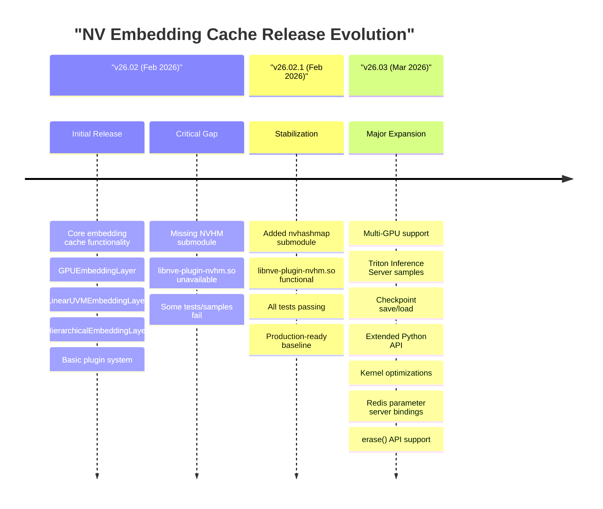
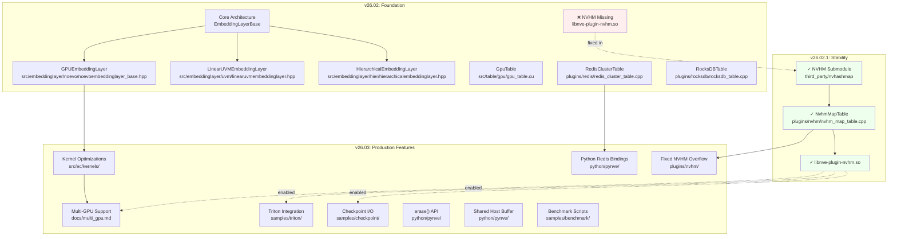
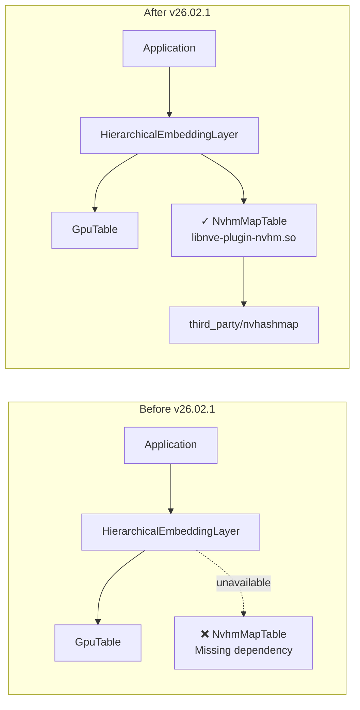
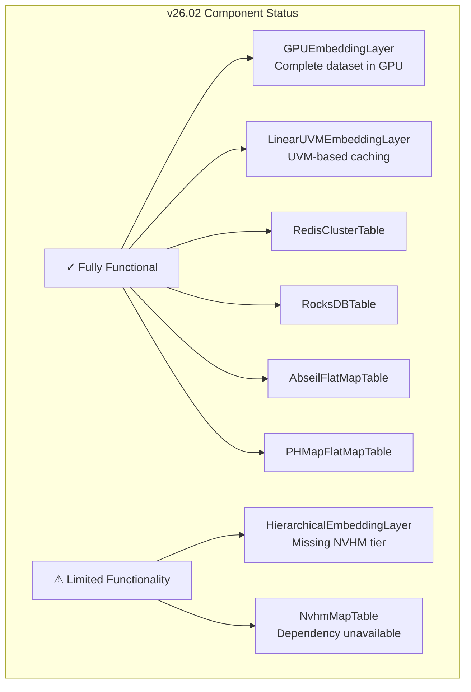

<!-- source: DeepWiki mcp.deepwiki.com · repo NVIDIA/nv-embedding-cache · page 13 Release History · fetched 2026-10-26 -->

# Release History

<details>
<summary>Relevant source files</summary>

The following files were used as context for generating this wiki page:

- [CHANGELOG.md](CHANGELOG.md)
- [version.txt](version.txt)

</details>


This page documents the complete version history of the NV Embedding Cache SDK, including new features, improvements, and bug fixes for each release. The SDK follows a time-based versioning scheme where releases are named in the format `vYY.MM[.P]` (e.g., `v26.03.0` for the March 2026 release, patch 0).

For detailed information about specific release features, see the child pages: [Version 26.03](#13.1), [Version 26.02.1](#13.2), and [Version 26.02](#13.3). For information about contributing to future releases, see [Contributing](#12). For build system details and feature flags, see [Build System Details](#10).

**Sources:** [CHANGELOG.md:1-41](), [version.txt:1]()

## Versioning Scheme

The NV Embedding Cache SDK uses a time-based versioning format:

| Component | Format | Example | Description |
|-----------|--------|---------|-------------|
| Major | `YY` | `26` | Two-digit year (2026) |
| Minor | `MM` | `03` | Two-digit month (March) |
| Patch | `P` (optional) | `0`, `1`, `2` | Patch number for hotfixes |

The complete version is: `vYY.MM.P` (e.g., `v26.03.0`)

**Current Version:** `26.03.0` as defined in [version.txt:1]()

**Sources:** [CHANGELOG.md:5-6](), [version.txt:1]()

## Release Timeline



**Sources:** [CHANGELOG.md:7-28]()

## Feature Evolution by Release



**Sources:** [CHANGELOG.md:7-28]()

## Release Details

### v26.03 (March 2026) - Current Release

The latest production release with comprehensive multi-GPU support, production deployment features, and extensive Python API improvements.

#### New Features

| Feature | Code Location | Description |
|---------|---------------|-------------|
| **Load/Save Checkpoint** | `samples/checkpoint/` | Checkpoint save/load samples for fault tolerance |
| **Triton Inference Server** | `samples/triton/` | Production inference deployment with NVIDIA Triton |
| **Multi-GPU Documentation** | `docs/multi_gpu.md` | Comprehensive multi-GPU configuration guide |
| **Benchmark Scripts** | `samples/benchmark/` | Single-GPU and multi-GPU performance benchmarking |

#### Improvements

| Area | Changes | Code Location |
|------|---------|---------------|
| **Kernel Optimizations** | Additional tile sizes supported | `src/ec/kernels/` |
| **Python Bindings** | Redis parameter server support | `python/pynve/` |
| **Python Bindings** | Shared host buffer access API | `python/pynve/` |
| **Python Bindings** | `erase()` API for removing embeddings | `python/pynve/` |

#### Bug Fixes

| Issue | Resolution | Code Location |
|-------|------------|---------------|
| **Excessive Overflow Handling** | Fixed NVHM table overflow handling | `plugins/nvhm/` |

For complete details, see [Version 26.03](#13.1).

**Sources:** [CHANGELOG.md:7-19]()

---

### v26.02.1 (February 2026) - Stabilization Release

Critical patch release that added the missing NVHM dependency, enabling full functionality of the system memory cache tier.

#### New Features

| Feature | Code Location | Description |
|---------|---------------|-------------|
| **NVHM Submodule** | `third_party/nvhashmap` | Added nvHashMap as git submodule |
| **NVHM Plugin** | `plugins/nvhm/nvhm_map_table.cpp` | Enabled `NvhmMapTable` implementation |
| **NVHM Library** | Build output: `libnve-plugin-nvhm.so` | Shared library for NVHM table backend |

#### Impact

Before v26.02.1, the following components were non-functional:
- `HierarchicalEmbeddingLayer` with NVHM system memory tier
- Tests and samples requiring `NvhmMapTable`
- Multi-tier caching scenarios

After v26.02.1, the system became fully functional with all three caching strategies operational.



For complete details, see [Version 26.02.1](#13.2).

**Sources:** [CHANGELOG.md:20-23]()

---

### v26.02 (February 2026) - Initial Release

The foundational release establishing the core architecture, three-tier caching strategies, and plugin system.

#### New Features

This release established the complete base architecture:

| Component Category | Features | Code Locations |
|-------------------|----------|----------------|
| **Embedding Layers** | GPUEmbeddingLayer, LinearUVMEmbeddingLayer, HierarchicalEmbeddingLayer | `src/embeddinglayer/noevo/`, `src/embeddinglayer/uvm/`, `src/embeddinglayer/hier/` |
| **GPU Tables** | GpuTable with set-associative cache | `src/table/gpu/gpu_table.cu` |
| **Host Tables** | AbseilFlatMapTable, PHMapFlatMapTable, LinearHostTable | `plugins/abseil/`, `plugins/phmap/`, `src/table/linear_host_table.cu` |
| **Remote Tables** | RedisClusterTable, RocksDBTable | `plugins/redis/`, `plugins/rocksdb/` |
| **Low-Level Cache** | Set-associative GPU cache kernels | `src/ec/ec_set_associative.cu` |
| **Python Bindings** | pynve module with PyTorch integration | `python/pynve/` |
| **C++ API** | Public headers for embedding layers and tables | `include/nve/` |
| **Build System** | CMake configuration with feature selection | `CMakeLists.txt` |
| **Samples** | Basic C++ and Python examples | `samples/` |

#### Known Limitations

As documented in [CHANGELOG.md:27-28]():

> **Note:** NVHM is not included in this release, so some tests/samples that rely on it will fail and complain about a missing `libnve-plugin-nvhm.so`.

This limitation was addressed in the immediate follow-up release v26.02.1.



For complete details, see [Version 26.02](#13.3).

**Sources:** [CHANGELOG.md:24-28]()

## Component Lifecycle Matrix

The following table shows when each major component became available:

| Component | v26.02 | v26.02.1 | v26.03 | Code Path |
|-----------|---------|----------|--------|-----------|
| **Core Layers** ||||
| `GPUEmbeddingLayer` | ✓ | ✓ | ✓ | `src/embeddinglayer/noevo/` |
| `LinearUVMEmbeddingLayer` | ✓ | ✓ | ✓ | `src/embeddinglayer/uvm/` |
| `HierarchicalEmbeddingLayer` | ⚠ | ✓ | ✓ | `src/embeddinglayer/hier/` |
| **GPU Components** ||||
| `GpuTable` | ✓ | ✓ | ✓ | `src/table/gpu/gpu_table.cu` |
| Set-associative cache | ✓ | ✓ | ✓ | `src/ec/ec_set_associative.cu` |
| Multi-GPU support | ✗ | ✗ | ✓ | `src/embeddinglayer/*/` |
| **System Memory Plugins** ||||
| `NvhmMapTable` | ✗ | ✓ | ✓ | `plugins/nvhm/nvhm_map_table.cpp` |
| `AbseilFlatMapTable` | ✓ | ✓ | ✓ | `plugins/abseil/abseil_flat_map_table.cpp` |
| `PHMapFlatMapTable` | ✓ | ✓ | ✓ | `plugins/phmap/phmap_flat_map_table.cpp` |
| `LinearHostTable` | ✓ | ✓ | ✓ | `src/table/linear_host_table.cu` |
| **Remote Storage Plugins** ||||
| `RedisClusterTable` | ✓ | ✓ | ✓ | `plugins/redis/redis_cluster_table.cpp` |
| `RocksDBTable` | ✓ | ✓ | ✓ | `plugins/rocksdb/rocksdb_table.cpp` |
| **Python API** ||||
| Basic `NVEmbedding` | ✓ | ✓ | ✓ | `python/pynve/nve.py` |
| Redis parameter server | ✗ | ✗ | ✓ | `python/pynve/` |
| `erase()` API | ✗ | ✗ | ✓ | `python/pynve/` |
| Shared host buffer | ✗ | ✗ | ✓ | `python/pynve/` |
| **Samples & Docs** ||||
| Basic samples | ✓ | ✓ | ✓ | `samples/basic/` |
| Checkpoint samples | ✗ | ✗ | ✓ | `samples/checkpoint/` |
| Triton samples | ✗ | ✗ | ✓ | `samples/triton/` |
| Benchmark scripts | ✗ | ✗ | ✓ | `samples/benchmark/` |
| Multi-GPU docs | ✗ | ✗ | ✓ | `docs/multi_gpu.md` |

**Legend:**
- ✓ = Fully functional
- ⚠ = Limited functionality (NVHM tier missing)
- ✗ = Not available

**Sources:** [CHANGELOG.md:7-28]()

## Breaking Changes and Migration Notes

### From v26.02 to v26.02.1

**No breaking changes.** This was a pure addition release that added the missing NVHM dependency. Existing code continues to work without modification.

**Migration Required:** None

### From v26.02.1 to v26.03

**No breaking changes.** All improvements and new features are additive. The API remains backward compatible.

**New Optional Features:**
- Multi-GPU configurations require explicit setup (see [Multi-GPU Support](#8.1))
- Extended Python API methods are available but not required
- Checkpoint save/load is opt-in functionality

**Migration Required:** None for existing code. New features can be adopted incrementally.

**Sources:** [CHANGELOG.md:7-28]()

## Version Format for Future Releases

Future releases will follow the same format as documented in [CHANGELOG.md:31-40]():

```markdown
## NV Embedding Cache YY.MM(.PP)
### New Features
- ...
### Improvements
- ...
### Bug Fixes
- ...
```

Releases are published at approximately monthly intervals, with patch releases (`.P`) issued as needed for critical bug fixes.

**Sources:** [CHANGELOG.md:31-40]()

---

For more information about specific release features and detailed migration guides, see the child pages:
- [Version 26.03](#13.1) - Current release details
- [Version 26.02.1](#13.2) - NVHM stabilization
- [Version 26.02](#13.3) - Initial release features

For information about contributing to future releases, see [Contributing](#12).

---

