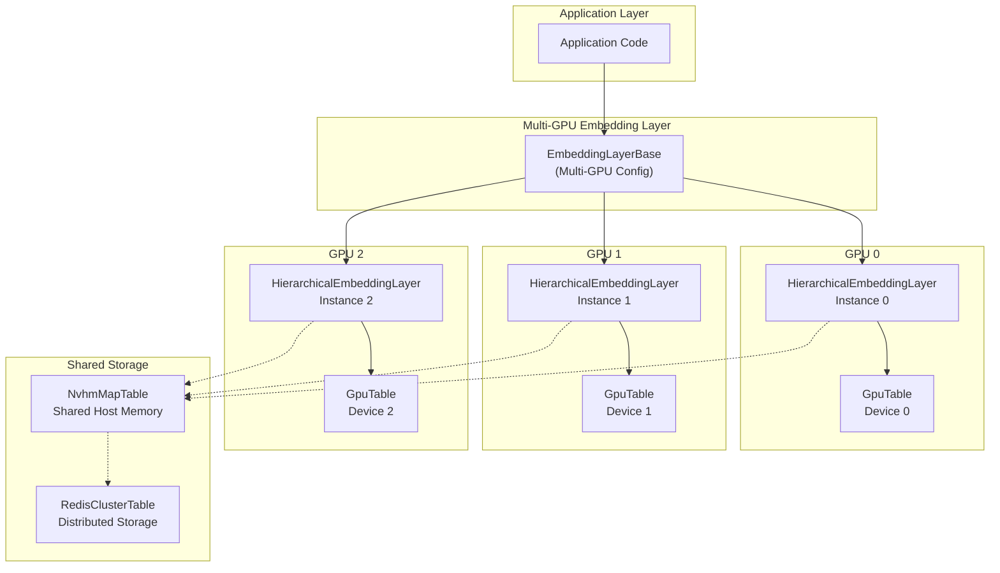
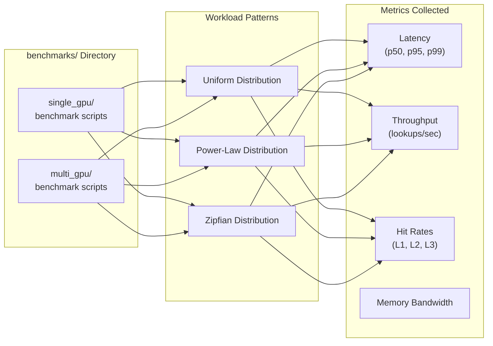
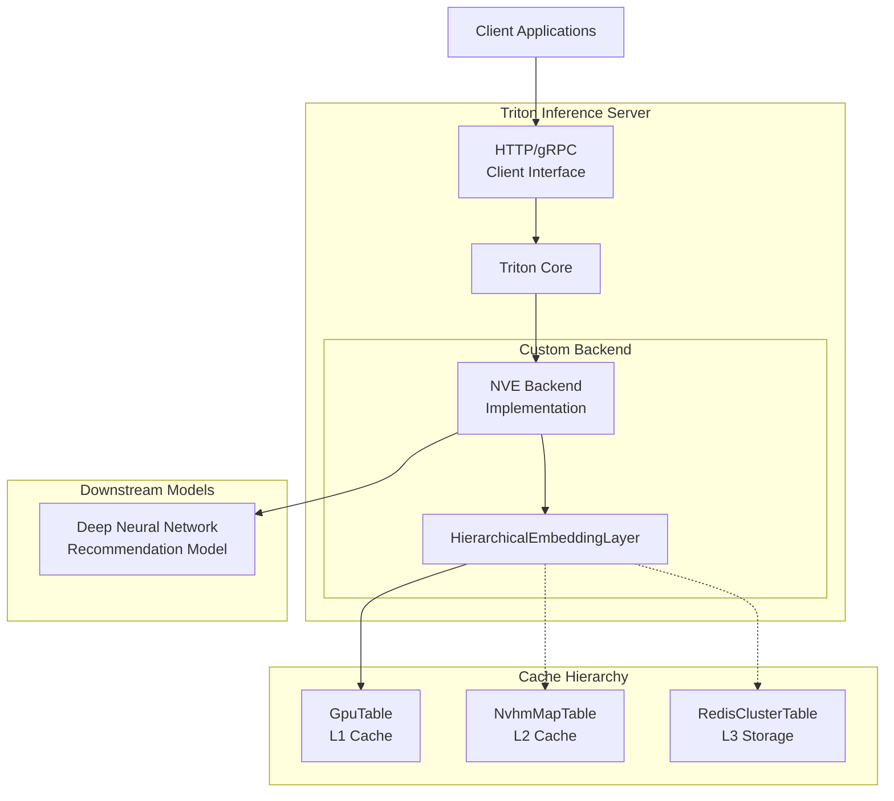
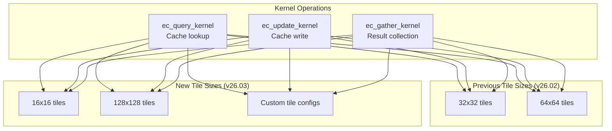
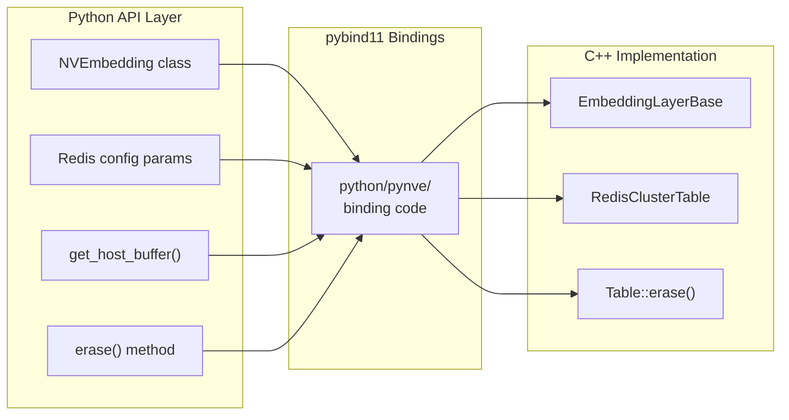

<!-- source: DeepWiki mcp.deepwiki.com · repo NVIDIA/nv-embedding-cache · page 13.1 Version 26.03 · fetched 2026-10-26 -->

# Version 26.03

Relevant source files

The following files were used as context for generating this wiki page:

- [CHANGELOG.md](CHANGELOG.md)
- [README.md](README.md)

This document describes the features, improvements, and bug fixes introduced in NV Embedding Cache version 26.03. This release represents a significant maturation of the SDK with production-ready features including multi-GPU support, Triton Inference Server integration, enhanced Python API coverage, and kernel optimizations. For the previous release, see [Version 26.02.1](#13.2). For the initial release, see [Version 26.02](#13.3).

**Sources:** [CHANGELOG.md:7-19](), [README.md:5]()

---

## Release Overview

Version 26.03 focuses on production deployment capabilities and scale-out features. The major additions are:

- **Multi-GPU Support**: Embedding caches can now be distributed across multiple GPUs and nodes
- **Triton Integration**: Sample implementation for deploying embeddings in NVIDIA Triton Inference Server
- **Checkpoint Management**: APIs for saving and loading cache state
- **Extended Python API**: New bindings for Redis parameter servers, shared host buffers, and erase operations
- **Kernel Optimizations**: Additional tile size configurations for improved performance

This release maintains backward compatibility with 26.02.1 while adding new optional functionality.

**Sources:** [CHANGELOG.md:7-19]()

---

## New Features

### Multi-GPU Support

Version 26.03 introduces comprehensive multi-GPU capabilities, allowing embedding tables to be distributed across multiple GPU devices within a single node or across multiple nodes. This enables handling of embedding tables that exceed the capacity of any single GPU.

**Configuration**: Multi-GPU deployments use device-specific configurations passed to the embedding layer constructors. Each GPU maintains its own L1 cache (`GpuTable`), while L2 (`NvhmMapTable`) and L3 (`RedisClusterTable` or `RocksDBTable`) are shared across devices.

**Documentation**: Comprehensive multi-GPU setup instructions have been added to the documentation suite.

**Sources:** [CHANGELOG.md:9-13]()

---

### Benchmark Scripts

Version 26.03 includes new benchmarking infrastructure for measuring embedding cache performance in both single-GPU and multi-GPU configurations.

**Location**: Benchmark scripts are located in the `benchmarks/` directory with separate subdirectories for single and multi-GPU scenarios.

**Usage**: Scripts support configurable workload patterns, cache sizes, and embedding dimensions to simulate production scenarios. See [Benchmarking](#11.2) for detailed usage.

**Sources:** [CHANGELOG.md:13](), [README.md:72]()

---

### Checkpoint Management

New APIs for saving and loading embedding cache state enable fault tolerance and warm-start capabilities in production deployments.

#### Save Checkpoint

The checkpoint save functionality serializes the current state of the embedding cache, including:
- Cached embedding vectors
- Metadata (access frequencies, timestamps)
- Cache configuration parameters

#### Load Checkpoint

The load functionality restores a previously saved cache state, enabling:
- Fast recovery after system restarts
- Migration of cache state between systems
- Warm-start for inference workloads

**Sample Code**: A complete checkpoint management example has been added demonstrating save/load workflows.

**API Coverage**: Checkpoint APIs are available in both C++ (`EmbeddingLayerBase` methods) and Python (`NVEmbedding` methods).

**Sources:** [CHANGELOG.md:10]()

---

### Triton Inference Server Integration

A new sample demonstrates deploying NV Embedding Cache in NVIDIA Triton Inference Server for production inference serving.

**Implementation Details**:
- Custom Triton backend implementing the embedding lookup interface
- Integration with Triton's model configuration system
- Support for batched inference requests
- Metrics integration with Triton's monitoring infrastructure

**Sample Location**: The Triton integration sample provides a complete reference implementation including backend code, model configuration, and deployment instructions.

**Sources:** [CHANGELOG.md:11]()

---

## Improvements

### Kernel Optimizations

Version 26.03 extends the GPU kernel implementations to support additional tile size configurations, improving performance across a wider range of embedding dimensions and batch sizes.

**Performance Impact**: 
- Small embeddings (dim < 64) benefit from 16x16 tiles
- Large embeddings (dim > 256) benefit from 128x128 tiles
- Custom configurations allow fine-tuning for specific workloads

**Auto-selection**: The system automatically selects optimal tile sizes based on embedding dimensions and batch size when using default configurations.

**Sources:** [CHANGELOG.md:15]()

---

### Extended Python Bindings

The Python API has been significantly expanded to expose additional functionality previously only available in C++.

#### New Python APIs in Version 26.03

| Feature | Python API | C++ Equivalent |
|---------|-----------|----------------|
| Redis Parameter Server | `NVEmbedding` with Redis config | `RedisClusterTable` |
| Shared Host Buffer Access | `get_host_buffer()` method | Direct table access |
| Erase Operation | `erase(keys)` method | `EmbeddingLayerBase::erase()` |

**Redis Parameter Server**: Python applications can now configure and use Redis as a distributed parameter server directly through the `NVEmbedding` interface, enabling distributed deployments without C++ code.

**Shared Host Buffer**: The `get_host_buffer()` method provides zero-copy access to host memory buffers, enabling efficient integration with NumPy and other Python data processing libraries.

**Erase API**: The `erase()` method allows removing specific embedding keys from the cache, supporting use cases like user data deletion and cache invalidation.

**Sources:** [CHANGELOG.md:16]()

---

## Bug Fixes

### NVHM Overflow Handling

**Issue**: In version 26.02.1, the `NvhmMapTable` implementation had excessive overflow handling that could trigger unnecessary hash table reorganizations, impacting performance under high insertion rates.

**Resolution**: Version 26.03 refines the overflow detection and handling logic to:
- Reduce false-positive overflow detections
- Optimize hash table expansion thresholds
- Improve performance stability under sustained insert workloads

**Impact**: Applications using `HierarchicalEmbeddingLayer` with `NvhmMapTable` as the L2 cache will see improved insertion throughput and reduced latency variance.

**Related Components**: 
- `NvhmMapTable` class implementation
- `libnve-plugin-nvhm.so` plugin

**Sources:** [CHANGELOG.md:18]()

---

## Version Comparison

The following table summarizes the evolution from version 26.02 to 26.03:

| Feature | v26.02 | v26.02.1 | v26.03 |
|---------|--------|----------|--------|
| Core Cache System | ✓ | ✓ | ✓ |
| NVHM Plugin | ✗ (missing) | ✓ | ✓ |
| Single GPU | ✓ | ✓ | ✓ |
| Multi-GPU | ✗ | ✗ | ✓ |
| Triton Integration | ✗ | ✗ | ✓ |
| Checkpointing | ✗ | ✗ | ✓ |
| Benchmark Scripts | ✗ | ✗ | ✓ |
| Python Redis API | ✗ | ✗ | ✓ |
| Python Erase API | ✗ | ✗ | ✓ |
| Extended Kernel Tiles | ✗ | ✗ | ✓ |

**Sources:** [CHANGELOG.md:1-28]()

---

## Upgrade Considerations

### API Compatibility

Version 26.03 maintains full backward compatibility with 26.02.1. Existing applications will continue to function without modification. New features are additive and accessed through:
- Optional configuration parameters
- New API methods (with default behavior matching previous versions)
- Additional plugin libraries (optional dependencies)

### Performance

Applications may see performance improvements from kernel optimizations without code changes. Multi-GPU configurations require explicit setup through the new configuration APIs.

### Dependencies

No new mandatory dependencies. Optional features require:
- Triton Server (for Triton integration sample)
- Additional Python packages (for extended Python API features)

**Sources:** [CHANGELOG.md:7-19]()

---

## Migration Path

For applications upgrading from previous versions:

1. **From 26.02 to 26.03**: First upgrade to 26.02.1 to ensure NVHM plugin is available, then upgrade to 26.03
2. **From 26.02.1 to 26.03**: Direct upgrade with no breaking changes
3. **Configuration**: Review new configuration options for multi-GPU and checkpoint management
4. **Testing**: Verify performance with new benchmark scripts
5. **Optional**: Adopt new Python APIs if previously using C++ for Redis or buffer access

**Sources:** [CHANGELOG.md:1-28]()

---

