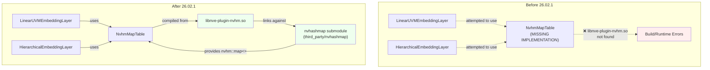
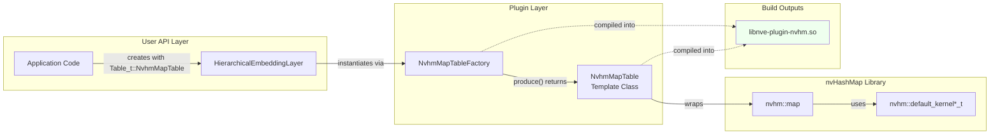
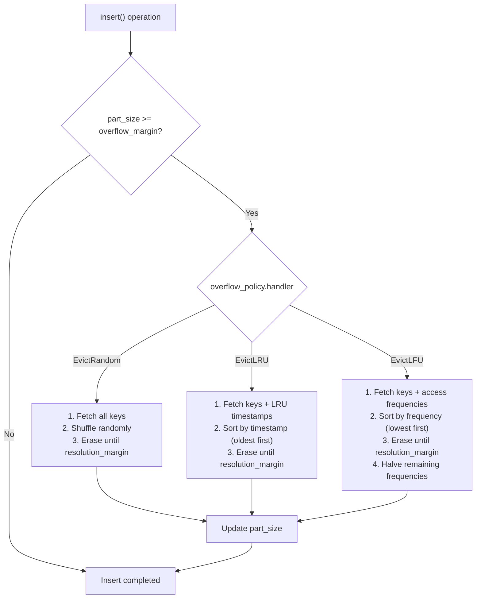
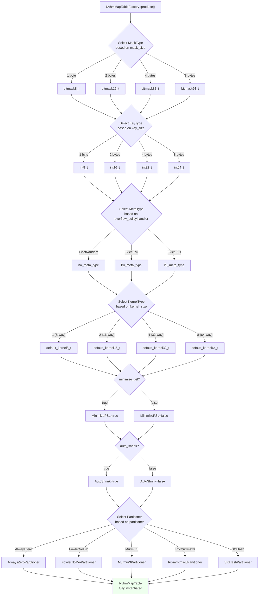

<!-- source: DeepWiki mcp.deepwiki.com · repo NVIDIA/nv-embedding-cache · page 13.2 Version 26.02.1 · fetched 2026-10-26 -->

# Version 26.02.1

<details>
<summary>Relevant source files</summary>

The following files were used as context for generating this wiki page:

- [CHANGELOG.md](CHANGELOG.md)
- [plugins/nvhm/src/nvhm_map_table.cpp](plugins/nvhm/src/nvhm_map_table.cpp)

</details>


This page documents release version 26.02.1 of the NV Embedding Cache SDK, a critical stabilization release that resolved missing dependency issues from the initial 26.02 release. For information about the initial release, see [Version 26.02](#13.3). For the subsequent major feature expansion, see [Version 26.03](#13.1).

## Release Overview

Version 26.02.1 was released as an immediate follow-up to version 26.02 to address a critical issue: the NVHM (nvHashMap) submodule was not included in the initial release, causing test failures and runtime errors when attempting to use the `NvhmMapTable` storage backend.

**Release Date**: February 2026 (Patch 1)

**Release Type**: Stabilization/Bug Fix

### Key Changes

| Category | Description | Impact |
|----------|-------------|--------|
| **New Features** | Added NVHM git submodule | Critical - Enables `HierarchicalEmbeddingLayer` and system memory caching |
| **Bug Fixes** | Resolved missing `libnve-plugin-nvhm.so` errors | High - Unblocks tests and samples |
| **Dependencies** | Integrated `nvhashmap` third-party library | High - Required for production deployments |

Sources: [CHANGELOG.md:20-23]()

## The NVHM Submodule Integration

The primary change in this release was the addition of the NVHM (nvHashMap) submodule to the third-party dependencies. This submodule provides the underlying hash table implementation for the `NvhmMapTable` storage backend.

### What is NVHM?

NVHM refers to **nvHashMap**, NVIDIA's high-performance CPU hash table implementation optimized for:
- Parallel access across multiple threads
- Cache-friendly memory layouts
- Low-latency lookups with prefetching
- Support for variable-length values (embeddings)
- Configurable eviction policies (LRU, LFU, Random)

### Integration Architecture



**Diagram: NVHM Integration Before and After 26.02.1**

Sources: [CHANGELOG.md:20-27](), [plugins/nvhm/src/nvhm_map_table.cpp:1-98]()

### Component Mapping to Code Entities



**Diagram: Code Entity Mapping for NVHM Plugin**

Sources: [plugins/nvhm/src/nvhm_map_table.cpp:654-821]()

## Impact on System Components

The addition of NVHM enabled several critical system components that were non-functional in version 26.02:

### Enabled Embedding Layers

| Layer Type | Class Name | Impact |
|------------|------------|--------|
| **Hierarchical** | `HierarchicalEmbeddingLayer` | Now functional with system memory tier |
| **Linear UVM** | `LinearUVMEmbeddingLayer` | Enhanced with optional NVHM backing |

### Enabled Storage Backends

The following table configurations became available:

```cpp
// Now possible in 26.02.1
TableConfig table_config;
table_config.type = Table_t::NvhmMapTable;
table_config.config = NvhmMapTableConfig{
  .num_partitions = 16,
  .initial_capacity = 1000000,
  .overflow_policy = {
    .handler = OverflowHandler_t::EvictLRU,
    .overflow_margin = 1100000,
    .resolution_margin = 0.9
  }
};
```

### NvhmMapTable Configuration Parameters

The `NvhmMapTableConfig` structure provides extensive configuration options:

| Parameter | Type | Default | Description |
|-----------|------|---------|-------------|
| `num_partitions` | `int64_t` | 1 | Number of hash table partitions (must be power of 2) |
| `partitioner` | `Partitioner_t` | `FowlerNollVo` | Hash partitioner for distributing keys |
| `workgroups` | `vector<int>` | - | CPU thread groups for parallel operations |
| `max_find_task_size` | `int64_t` | - | Maximum batch size for find operations |
| `kernel_size` | `int64_t` | 1 | SIMD kernel width (1=8-way, 2=16-way, etc.) |
| `initial_capacity` | `int64_t` | 0 | Initial hash table capacity per partition |
| `value_alignment` | `int64_t` | 64 | Memory alignment for embedding vectors |
| `key_fetch_queue_length` | `int64_t` | 0 | Prefetch queue depth (0, 1, 2, 4, or 8) |
| `prefetch_values` | `bool` | `false` | Enable value prefetching during lookups |
| `minimize_psl` | `bool` | `false` | Minimize probe sequence length |
| `auto_shrink` | `bool` | `false` | Automatically shrink table when sparse |
| `overflow_policy` | `OverflowPolicy` | - | Eviction strategy when capacity exceeded |

Sources: [plugins/nvhm/src/nvhm_map_table.cpp:29-42](), [plugins/nvhm/src/nvhm_map_table.cpp:44-86]()

### Overflow Handling Mechanisms

The NVHM plugin implements sophisticated overflow handling with three eviction strategies:



**Diagram: NVHM Overflow Resolution Flow**

Sources: [plugins/nvhm/src/nvhm_map_table.cpp:260-303]()

## Implementation Details

### Template Instantiation

The `NvhmMapTable` is a heavily templated class that supports multiple configurations:



**Diagram: NvhmMapTable Template Instantiation Decision Tree**

The factory uses a series of nested template selection functions to instantiate the correct type:

1. `make_nvhm_map_table_1` - Selects `MaskType` based on `mask_size`
2. `make_nvhm_map_table_2` - Selects `KeyType` based on `key_size`
3. `make_nvhm_map_table_3` - Selects `MetaType` based on `overflow_policy.handler`
4. `make_nvhm_map_table_4` - Selects `KernelType` based on `kernel_size`
5. `make_nvhm_map_table_5` - Selects `MinimizePSL` template parameter
6. `make_nvhm_map_table_6` - Selects `AutoShrink` and `Partitioner` templates

Sources: [plugins/nvhm/src/nvhm_map_table.cpp:656-821]()

### Core Operations

The `NvhmMapTable` implements the `Table` interface with the following operations:

| Operation | Method | Parallelization | Lock Type |
|-----------|--------|-----------------|-----------|
| **Find** | `find()` | Multi-threaded across partitions | `shared_lock` (read) |
| **Insert** | `insert()` | Multi-threaded across partitions | `lock_guard` (write) |
| **Update** | `update()` | Multi-threaded across partitions | `lock_guard` (write) |
| **Update Accumulate** | `update_accumulate()` | Multi-threaded across partitions | `lock_guard` (write) |
| **Erase** | `erase()` | Multi-threaded across partitions | `lock_guard` (write) |
| **Clear** | `clear()` | Multi-threaded across partitions | `lock_guard` (write) |
| **Size** | `size()` | Multi-threaded across partitions | `shared_lock` (read) |

Each operation uses the configured `workgroups` and `ThreadPool` to parallelize work across table partitions.

Sources: [plugins/nvhm/src/nvhm_map_table.cpp:101-640]()

### Find Operation with Prefetching

The `find()` operation has specialized implementations based on configuration:

```cpp
// Template parameters control optimization strategies
template <size_t KeyFetchQueueLength, bool PrefetchValues, 
          bool WithValues, bool WithValueSizes>
int64_t find_(...) const;
```

**Prefetch Queue Mechanism**:
- `KeyFetchQueueLength = 0`: No prefetching
- `KeyFetchQueueLength = 1, 2, 4, 8`: Ring buffer prefetch queue depth

The prefetching implementation uses `nvhm::experimental::ring_prefetch_queue` to overlap hash table lookups with memory fetches, improving throughput on cache-miss-heavy workloads.

Sources: [plugins/nvhm/src/nvhm_map_table.cpp:145-200](), [plugins/nvhm/src/nvhm_map_table.cpp:402-640]()

## Migration from Version 26.02

### For Existing Users

If you were using version 26.02 and encountered errors like:

```
error while loading shared libraries: libnve-plugin-nvhm.so: 
cannot open shared object file: No such file or directory
```

**Migration Steps**:

1. Update to version 26.02.1:
   ```bash
   git checkout v26.02.1
   git submodule update --init --recursive
   ```

2. Rebuild the project:
   ```bash
   rm -rf build
   mkdir build && cd build
   cmake -DNVE_FEATURES="nvhm" ..
   make -j$(nproc)
   ```

3. Verify NVHM plugin is built:
   ```bash
   ls -l build/lib/libnve-plugin-nvhm.so
   ```

### Affected Test Cases

The following tests were non-functional in 26.02 and now pass in 26.02.1:

- `test_nvhm_map_table` - Basic NVHM table operations
- `test_hierarchical_embedding_layer` - Multi-tier caching with NVHM
- `layer_sample` - Advanced layer sample using hierarchical configuration

Sources: [CHANGELOG.md:24-27]()

## Build System Changes

### CMake Feature Flag

The NVHM plugin is controlled by the CMake feature flag:

```cmake
# Enable NVHM plugin
set(NVE_FEATURES "nvhm" CACHE STRING "...")
```

When enabled:
1. Git submodule `third_party/nvhashmap` is required
2. Plugin source `plugins/nvhm/src/nvhm_map_table.cpp` is compiled
3. Shared library `libnve-plugin-nvhm.so` is built
4. Plugin is loaded at runtime via `Table_t::NvhmMapTable` enum value

### Submodule Location

```
third_party/
└── nvhashmap/          # Added in 26.02.1
    ├── include/
    │   └── nvhm/
    │       ├── map.hpp
    │       └── ...
    └── ...
```

Sources: [CHANGELOG.md:20-23]()

## Known Limitations in This Release

While version 26.02.1 resolved the critical NVHM dependency issue, some limitations remain:

1. **Variable-Length Values**: Not yet supported (fixed size only)
   - See [plugins/nvhm/src/nvhm_map_table.cpp:213]() comment
   
2. **Overflow Handling Frequency**: May trigger too frequently under high load
   - Improved in version 26.03 with better margin calculations
   - See [CHANGELOG.md:18]()

3. **No Multi-GPU Support**: NVHM plugin is CPU-only
   - Multi-GPU support added in version 26.03
   - See [Version 26.03](#13.1)

## Summary

Version 26.02.1 was a critical stabilization release that:

✅ **Added NVHM submodule** - Integrated `nvhashmap` third-party dependency

✅ **Enabled `NvhmMapTable`** - System memory storage backend now functional

✅ **Unblocked `HierarchicalEmbeddingLayer`** - Multi-tier caching fully operational

✅ **Fixed test failures** - All tests now pass with proper dependencies

This release made the SDK production-ready for workloads requiring system memory caching, paving the way for the feature expansion in version 26.03.

---

**Related Pages**:
- [Version 26.02](#13.3) - Initial release details
- [Version 26.03](#13.1) - Subsequent feature expansion
- [NVHM Plugin](#6.1) - Detailed NVHM configuration guide
- [HierarchicalEmbeddingLayer](#3.1.3) - Multi-tier caching architecture

Sources: [CHANGELOG.md:1-41](), [plugins/nvhm/src/nvhm_map_table.cpp:1-825]()

---

