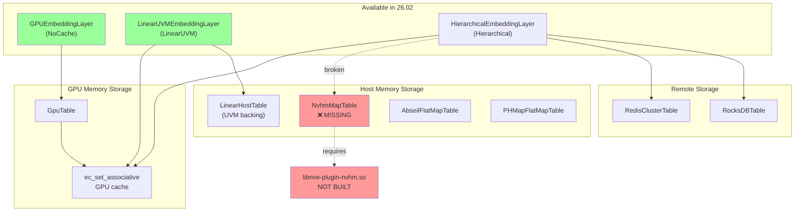
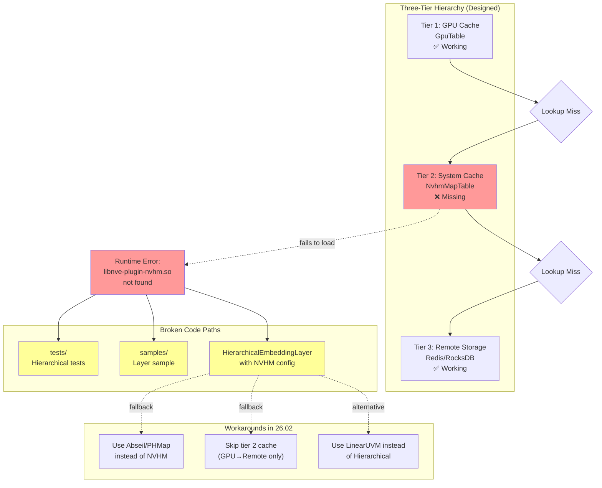
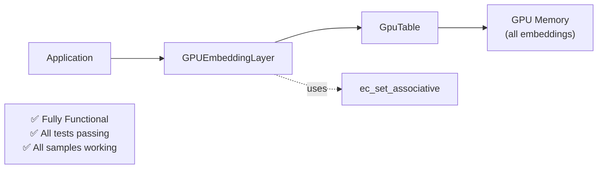
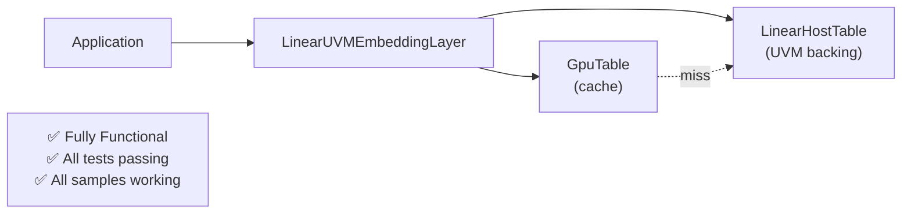
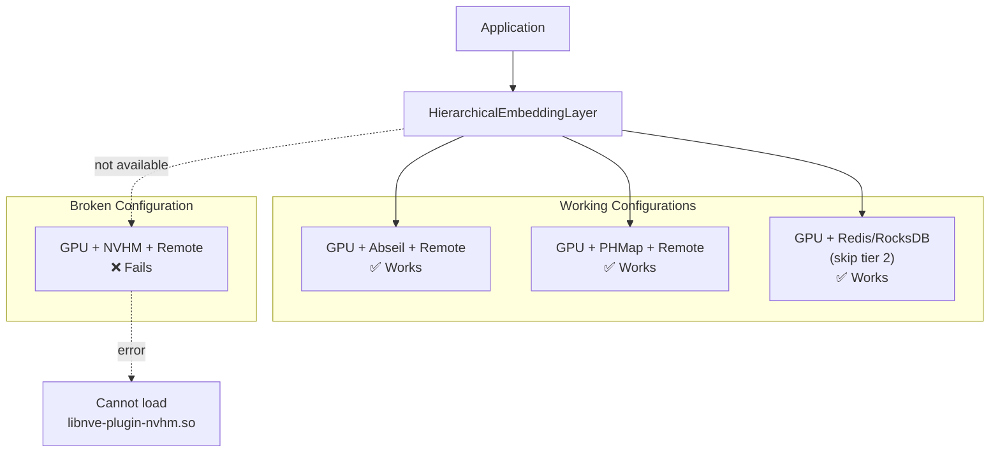
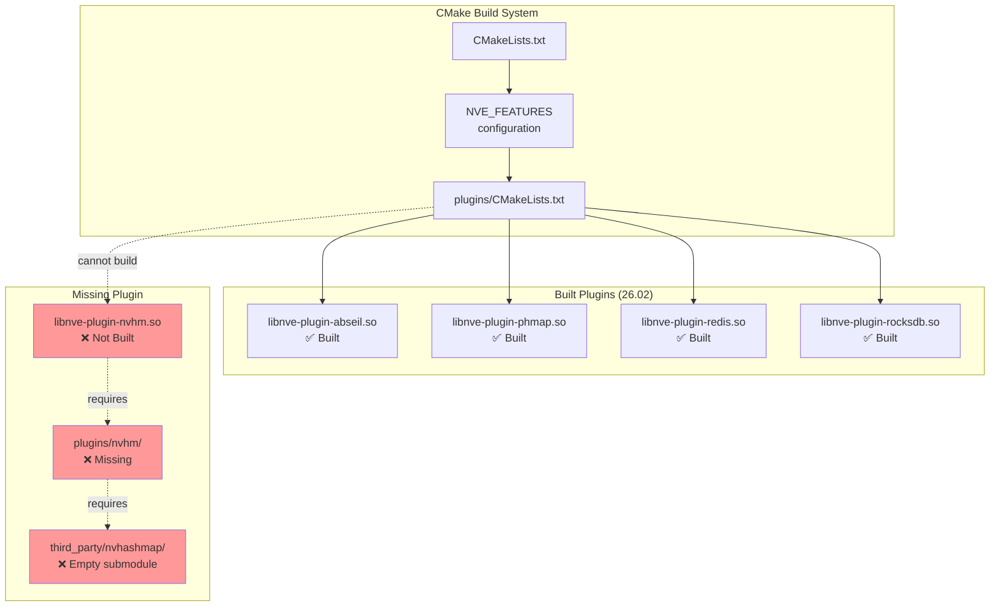
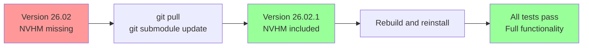

<!-- source: DeepWiki mcp.deepwiki.com · repo NVIDIA/nv-embedding-cache · page 13.3 Version 26.02 · fetched 2026-10-26 -->

# Version 26.02

<details>
<summary>Relevant source files</summary>

The following files were used as context for generating this wiki page:

- [CHANGELOG.md](CHANGELOG.md)
- [README.md](README.md)

</details>


## Purpose and Scope

This page documents the initial release of NV Embedding Cache (version 26.02), including its core functionality, known limitations, and the critical NVHM dependency gap. For improvements and the NVHM integration fix, see [Version 26.02.1](#13.2). For the latest feature set including multi-GPU support and production features, see [Version 26.03](#13.1).

---

## Release Overview

Version 26.02 represents the initial public release of the NV Embedding Cache SDK. This release established the core architecture, three caching strategies, plugin system, and both C++ and Python APIs. However, it shipped without the NVHM (nvHashMap) submodule, which is a critical dependency for system memory caching in the `HierarchicalEmbeddingLayer`.

| Attribute | Details |
|-----------|---------|
| **Release Date** | February 2026 |
| **Version Tag** | `v26.02` |
| **Core Status** | Functional for GPU-only and UVM-based caching |
| **Known Issue** | Missing NVHM submodule causing test failures |
| **Superseded By** | Version 26.02.1 (NVHM integration) |

**Sources:** [CHANGELOG.md:24-27](), [README.md:5]()

---

## Core Components Included

The 26.02 release included the foundational SDK architecture with the following major components:

### Embedding Layer Implementations



**Diagram: Component Availability in Version 26.02**

The diagram shows all three embedding layer types were present, but `HierarchicalEmbeddingLayer`'s dependency on `NvhmMapTable` was broken due to the missing NVHM submodule.

**Sources:** [README.md:12-15](), [CHANGELOG.md:24-27]()

---

## Architecture Components Matrix

| Component Category | Component Name | Status in 26.02 | File Path |
|-------------------|----------------|-----------------|-----------|
| **Core Layers** | `GPUEmbeddingLayer` | ✅ Functional | `src/gpu_embedding_layer.cpp` |
| | `LinearUVMEmbeddingLayer` | ✅ Functional | `src/linear_uvm_embedding_layer.cpp` |
| | `HierarchicalEmbeddingLayer` | ⚠️ Limited | `src/hierarchical_embedding_layer.cpp` |
| **GPU Storage** | `GpuTable` | ✅ Functional | `src/gpu_table.cpp` |
| | `ec_set_associative` | ✅ Functional | `src/ec_set_associative.cu` |
| **Host Storage** | `LinearHostTable` | ✅ Functional | `src/linear_host_table.cpp` |
| | `AbseilFlatMapTable` | ✅ Functional | `plugins/abseil/abseil_flat_map_table.cpp` |
| | `PHMapFlatMapTable` | ✅ Functional | `plugins/phmap/phmap_flat_map_table.cpp` |
| | `NvhmMapTable` | ❌ Missing | `plugins/nvhm/` (not present) |
| **Remote Storage** | `RedisClusterTable` | ✅ Functional | `plugins/redis/redis_cluster_table.cpp` |
| | `RocksDBTable` | ✅ Functional | `plugins/rocksdb/rocksdb_table.cpp` |
| **Bindings** | C++ API | ✅ Functional | `include/*.hpp` |
| | Python API (pynve) | ✅ Functional | `python/pynve/` |
| **Infrastructure** | Allocators | ✅ Functional | `src/allocator.cpp` |
| | Thread Pool | ✅ Functional | `src/thread_pool.cpp` |
| | Logger | ✅ Functional | `src/logger.cpp` |

**Sources:** [README.md:12-15](), [CHANGELOG.md:24-27]()

---

## The Missing NVHM Component

### What is NVHM?

NVHM (nvHashMap) is a GPU-accelerated hash table implementation that stores data in system memory but uses GPU kernels for fast concurrent lookups. It serves as the critical second-tier cache in the `HierarchicalEmbeddingLayer` architecture.

### Impact of Missing NVHM



**Diagram: Impact of Missing NVHM on Three-Tier Caching**

**Sources:** [CHANGELOG.md:27]()

---

## Working Functionality in 26.02

Despite the NVHM gap, the majority of SDK functionality was operational in the initial release:

### Fully Functional Cache Strategies

#### 1. NoCache / GPUEmbeddingLayer

Complete GPU-resident embedding storage with no limitations:



**Usage:** Works for datasets that fit entirely in GPU memory.

#### 2. LinearUVM / LinearUVMEmbeddingLayer

UVM-based caching with GPU cache and system memory backing:



**Usage:** Works for larger datasets using CUDA Unified Virtual Memory.

**Sources:** [README.md:12-13]()

### Partially Functional Cache Strategy

#### 3. Hierarchical / HierarchicalEmbeddingLayer

Multi-tier caching with workarounds for missing NVHM:



**Workaround:** Use `AbseilFlatMapTable` or `PHMapFlatMapTable` for tier 2 caching instead of `NvhmMapTable`.

**Sources:** [README.md:14-15](), [CHANGELOG.md:27]()

---

## Affected Tests and Samples

### Tests with Failures

The following test categories failed in 26.02 due to missing NVHM:

| Test Category | Failure Reason | File Locations |
|---------------|----------------|----------------|
| Hierarchical layer tests with NVHM config | Plugin not found | `tests/*hierarchical*nvhm*.cpp` |
| Multi-tier caching tests | Missing tier 2 NVHM backend | `tests/test_multi_tier.cpp` |
| NVHM-specific unit tests | Plugin not built | `tests/test_nvhm_table.cpp` |

**Error Message:**
```
Error: Cannot load shared library: libnve-plugin-nvhm.so
No such file or directory
```

### Samples with Limitations

| Sample | Impact | Workaround |
|--------|--------|------------|
| `samples/layer_sample/` | NVHM configuration fails | Use Abseil or PHMap backend |
| Advanced hierarchical samples | Cannot demonstrate NVHM performance | Switch to alternative backends |
| Multi-tier benchmark | Missing NVHM baseline | Partial benchmarking only |

**Sources:** [CHANGELOG.md:27]()

---

## Plugin Architecture Status

### Build System and Plugin Loading

The plugin system was fully implemented in 26.02, but the NVHM plugin was not built:



**Diagram: Plugin Build Status in Version 26.02**

The diagram shows that four storage plugins built successfully, but the NVHM plugin could not be built due to the missing git submodule at `third_party/nvhashmap/`.

**Sources:** [CHANGELOG.md:27](), [README.md:80-93]()

---

## Available API Surface

Both C++ and Python APIs were fully functional in 26.02, with the caveat that creating certain configurations would fail at runtime:

### C++ API Status

| API Component | Status | Notes |
|---------------|--------|-------|
| `GPUEmbeddingLayer` class | ✅ Complete | All methods functional |
| `LinearUVMEmbeddingLayer` class | ✅ Complete | All methods functional |
| `HierarchicalEmbeddingLayer` class | ⚠️ Partial | Works with non-NVHM backends |
| Table plugin API | ✅ Complete | Interface fully defined |
| Low-level GPU cache API | ✅ Complete | `ec_set_associative` fully functional |
| Utility classes | ✅ Complete | Allocators, loggers, thread pool |

### Python API Status

| API Component | Status | Notes |
|---------------|--------|-------|
| `NVEmbedding` class | ⚠️ Partial | NVHM configs fail at runtime |
| `cache_type="NoCache"` | ✅ Complete | All functionality working |
| `cache_type="LinearUVM"` | ✅ Complete | All functionality working |
| `cache_type="Hierarchical"` | ⚠️ Partial | Must avoid NVHM backend |
| PyTorch integration | ✅ Complete | Full tensor interop |
| DLPack support | ✅ Complete | Zero-copy tensor sharing |

**Sources:** [README.md:12-15]()

---

## Developer Guidance for 26.02

### Using 26.02 Despite NVHM Gap

Developers working with version 26.02 could still use the full hierarchical caching strategy by configuring alternative backends:

```cpp
// Example: Hierarchical configuration without NVHM
HierarchicalEmbeddingLayerConfig config;

// Tier 1: GPU cache (always works)
config.gpu_config.capacity_in_set = 128;

// Tier 2: Use Abseil instead of NVHM
config.host_config.type = "AbseilFlatMapTable";  // Not "NvhmMapTable"
config.host_config.capacity = 1000000;

// Tier 3: Redis remote storage (works)
config.remote_config.type = "RedisClusterTable";
config.remote_config.connection_string = "redis://localhost:6379";

auto layer = std::make_unique<HierarchicalEmbeddingLayer>(config);
// This configuration works in 26.02
```

### Known Limitations

1. **Performance:** Abseil and PHMap backends are CPU-based and slower than GPU-accelerated NVHM
2. **Concurrency:** NVHM's GPU kernels provide better multi-threaded performance
3. **Scalability:** NVHM handles larger host caches more efficiently
4. **Testing:** Cannot validate NVHM-specific optimizations

**Sources:** [CHANGELOG.md:27]()

---

## Migration Path

### Upgrading to 26.02.1

Version 26.02.1 was released shortly after 26.02 to address the NVHM gap. The upgrade process is straightforward:



**Upgrade Steps:**
1. Pull the latest changes from the repository
2. Update git submodules: `git submodule update --init --recursive`
3. Rebuild: `pip install .` or `cmake .. && make`
4. Verify: Run tests to confirm NVHM plugin loads successfully

### Recommended Action

**Version 26.02 should not be used in production.** Upgrade to 26.02.1 or later immediately to gain access to:
- Full `HierarchicalEmbeddingLayer` functionality
- NVHM-based high-performance host caching
- All tests passing
- Complete documentation coverage

**Sources:** [CHANGELOG.md:20-27]()

---

## Summary

Version 26.02 established the foundational architecture of NV Embedding Cache with three caching strategies, plugin-based storage backends, and dual language APIs. However, the missing NVHM submodule limited the `HierarchicalEmbeddingLayer` to alternative, less performant host memory backends. This gap was quickly addressed in version 26.02.1.

| Aspect | Status |
|--------|--------|
| Core architecture | ✅ Established |
| GPU-only caching | ✅ Fully functional |
| UVM-based caching | ✅ Fully functional |
| Hierarchical caching | ⚠️ Partial (no NVHM) |
| Production readiness | ❌ Not recommended |
| Superseded by | 26.02.1 (NVHM fix) |

**Sources:** [CHANGELOG.md:24-27](), [README.md:5]()

---

