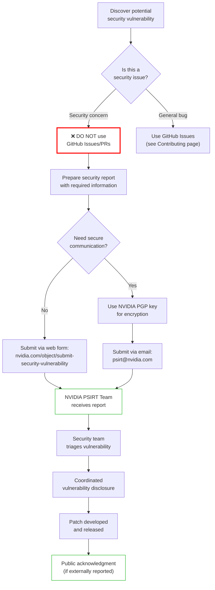
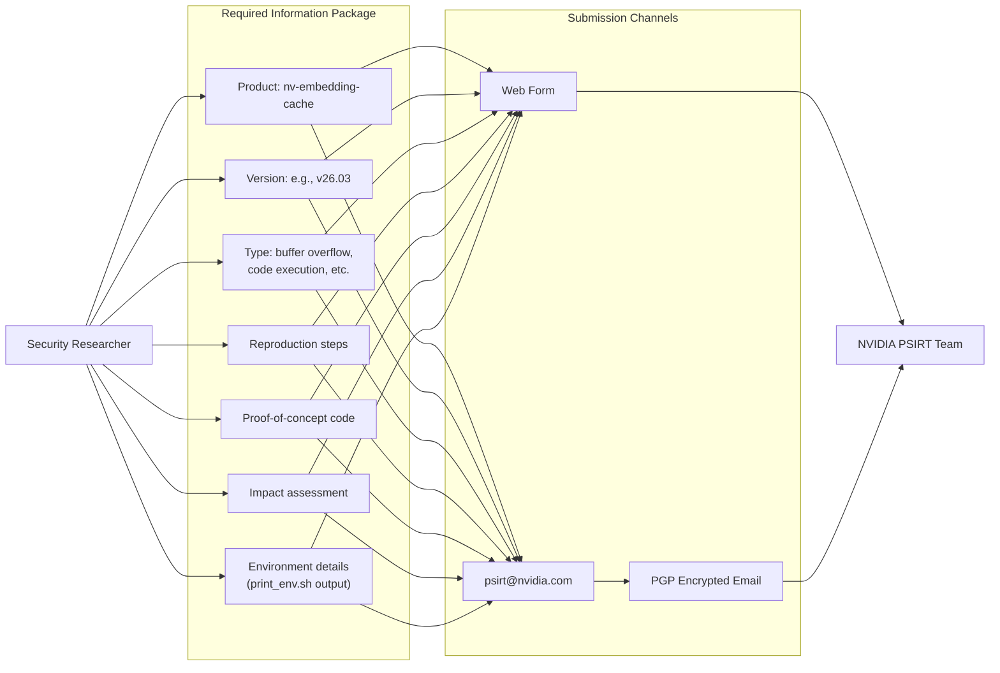
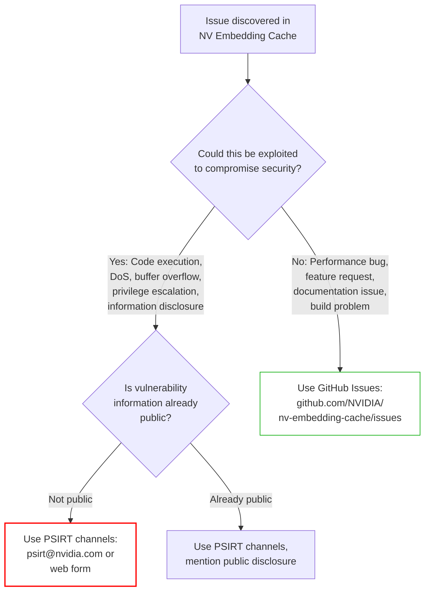

<!-- source: DeepWiki mcp.deepwiki.com · repo NVIDIA/nv-embedding-cache · page 14 Security · fetched 2026-10-26 -->

# Security

<details>
<summary>Relevant source files</summary>

The following files were used as context for generating this wiki page:

- [CONTRIBUTING.md](CONTRIBUTING.md)
- [SECURITY.md](SECURITY.md)

</details>


This page documents the security vulnerability reporting process for NV Embedding Cache SDK and NVIDIA's security policies. This covers how to report potential security issues, required information for reports, and the coordinated vulnerability disclosure process.

For general bug reports and feature requests, see [Contributing](#12). For production deployment considerations, see [Triton Inference Server Integration](#8.6).

---

## Security Vulnerability Reporting

NVIDIA is dedicated to the security and trust of software products managed through this repository. If you discover a potential security vulnerability in NV Embedding Cache, it must be reported through NVIDIA's official security channels.

### Critical Rule: Do Not Use GitHub

**Security vulnerabilities must NOT be reported through GitHub Issues or Pull Requests.** Public disclosure of security issues can put users at risk before patches are available. If a security issue is inadvertently reported publicly, NVIDIA maintainers will limit discussion and redirect to private channels.

Sources: [SECURITY.md:5]()

---

## Reporting Process

### Official Reporting Channels

NVIDIA provides two methods for reporting security vulnerabilities:

| Channel | Details |
|---------|---------|
| **Web Form** | [Security Vulnerability Submission Form](https://www.nvidia.com/object/submit-security-vulnerability.html) |
| **Email** | psirt@nvidia.com (NVIDIA Product Security Incident Response Team) |
| **Secure Email** | Use [NVIDIA's PGP public key](https://www.nvidia.com/en-us/security/pgp-key) for encrypted communication |

Sources: [SECURITY.md:9-12]()

### Security Reporting Workflow



Sources: [SECURITY.md:5-20](), [CONTRIBUTING.md:1-34]()

---

## Required Information for Security Reports

When submitting a security vulnerability report, include the following information to help NVIDIA's security team assess and address the issue efficiently:

### Essential Report Contents

| Field | Description | Example for NV Embedding Cache |
|-------|-------------|-------------------------------|
| **Product Name** | Full product name and component | "NVIDIA NV Embedding Cache SDK" |
| **Version/Branch** | Specific version or git branch/commit | "v26.03" or "commit abc1234 on main branch" |
| **Vulnerability Type** | Classification of the issue | Code execution, denial of service, buffer overflow, information disclosure, privilege escalation |
| **Reproduction Steps** | Clear instructions to reproduce | Step-by-step setup and trigger sequence |
| **Proof-of-Concept** | Demonstration code or exploit | Sample code that triggers the vulnerability |
| **Impact Assessment** | Potential consequences and exploitation method | What an attacker could achieve, prerequisites for exploitation |
| **Environment Details** | System configuration | Output from `print_env.sh` (see below) |

Sources: [SECURITY.md:13-18](), [CONTRIBUTING.md:8-9]()

### Environment Information

For all security reports (and general bug reports), run the `print_env.sh` script to gather relevant environment details:

```bash
./print_env.sh
```

This script collects information about:
- CUDA version and GPU configuration
- Operating system and kernel version
- Compiler versions
- Library versions
- Python environment (if applicable)

Include this output in your security report to help the team reproduce the issue.

Sources: [CONTRIBUTING.md:8-9]()

---

## Security Report Information Flow



Sources: [SECURITY.md:13-18]()

---

## NVIDIA Security Policies

### Product Security Incident Response Team (PSIRT)

NVIDIA's PSIRT team manages the coordinated vulnerability disclosure process. Key policies:

- **Coordinated Disclosure**: NVIDIA works with security researchers to address vulnerabilities before public disclosure
- **Acknowledgment**: Externally reported security issues that are addressed receive public acknowledgment (though no monetary bug bounty program exists)
- **Transparency**: Security advisories are published for significant vulnerabilities

For comprehensive information about NVIDIA's security policies, visit the [PSIRT Policies Page](https://www.nvidia.com/en-us/security/psirt-policies/).

Sources: [SECURITY.md:20]()

### General Security Resources

The [NVIDIA Product Security Portal](https://www.nvidia.com/en-us/security) provides:
- Security bulletins and advisories
- Product-specific security information
- Security best practices
- Contact information for security concerns

Sources: [SECURITY.md:24]()

---

## Security vs. General Issues

Understanding when to use security reporting channels versus general issue tracking:



Sources: [SECURITY.md:5](), [CONTRIBUTING.md:5-6]()

---

## Security Considerations for Developers

While developing with or contributing to NV Embedding Cache, consider these security aspects:

### Input Validation

When using the SDK, validate embedding IDs and vector dimensions:
- Ensure embedding IDs are within expected ranges
- Validate batch sizes before operations
- Check vector dimensions match configured embedding size

### Memory Safety

The SDK uses CUDA and C++ extensively. Contributors should:
- Follow memory management patterns in existing code (see [Utility Classes](#4.4))
- Run tests with NVIDIA Compute Sanitizer to detect memory errors
- Ensure proper synchronization for concurrent operations (see [Execution Contexts](#3.4))

Sources: [CONTRIBUTING.md:29-30]()

### Remote Storage Authentication

When using remote storage backends:
- **Redis**: Configure authentication credentials securely (see [Redis Plugin](#6.2))
- **RocksDB**: Ensure file permissions are appropriate for persistent storage (see [RocksDB Plugin](#6.3))
- Avoid hardcoding credentials in application code

### Testing Security-Related Changes

Pull requests that could impact security should:
1. Include comprehensive tests in the `tests/` directory
2. Pass validation with NVIDIA Compute Sanitizer
3. Document potential security implications in the PR description
4. Undergo thorough code review

Sources: [CONTRIBUTING.md:27-30]()

---

## Developer Certificate of Origin

All contributions to NV Embedding Cache must be signed with the Developer Certificate of Origin (DCO) using `git commit -s` or `git commit --signoff`. This certifies that:

- You have the right to submit the contribution under the project's open source license
- The contribution doesn't introduce code with security vulnerabilities from untrusted sources
- You understand the contribution and its provenance

The full DCO text is available in [CONTRIBUTING.md:36-75]().

Sources: [CONTRIBUTING.md:33-75]()

---

## Summary

| Action | Channel | Use Case |
|--------|---------|----------|
| **Report Security Vulnerability** | psirt@nvidia.com or [web form](https://www.nvidia.com/object/submit-security-vulnerability.html) | Code execution, DoS, buffer overflow, information disclosure, privilege escalation |
| **Report General Bug** | [GitHub Issues](https://github.com/NVIDIA/nv-embedding-cache/issues) | Performance issues, build problems, feature requests |
| **Contribute Code Fix** | [GitHub Pull Request](https://github.com/NVIDIA/nv-embedding-cache/pulls) (with DCO sign-off) | Bug fixes, features, documentation (after issue discussion) |
| **Ask Security Questions** | [NVIDIA Security Portal](https://www.nvidia.com/en-us/security) | General security inquiries, policy questions |

**Key Principle**: Security vulnerabilities require private disclosure through NVIDIA's PSIRT channels to protect users. All other issues use the standard GitHub workflow described in [Contributing](#12).

Sources: [SECURITY.md:1-25](), [CONTRIBUTING.md:1-79]()

---

